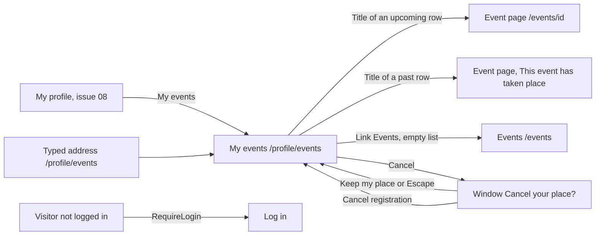

# My events

- Component: web/src/pages/MyEvents.tsx, with MyEvents.module.css and MyEvents.test.tsx. The part Past events is its own component web/src/components/myEvents/PastEvents.tsx, with PastEvents.module.css and PastEvents.test.tsx.
- Address in the browser: /profile/events (registered in web/src/App.tsx inside RequireLogin)

## What the page is for

A young person who registered for events on Connect wants to see in one place where they are going. This page lists the upcoming events they registered for, soonest first, each with its title, date, time and place. Next to each upcoming event is a button Cancel, so the young person can give their place back when they cannot come. Below that, a second part Past events shows the events they went to, so they remember where they have been. Only the young person sees their own list. It never shows who else is going.

## Who can open it

- Member (young person): sees their own upcoming and past registrations. The address has no number of a person in it, so there is no way to open the list of someone else.
- Organisation: can open the page when logged in, but an organisation cannot register for events, so both lists are empty.
- Admin: the same as any logged in account. The page only shows the own registrations of the account.
- Visitor who is not logged in: RequireLogin of issue 04 sends them to the page Log in, with no event anywhere. The server answers 401 with "Log in to see this page".

## How you get there and where you go next

You arrive from the page My profile (issue 08), which gets a link My events (task 69.3). You can also type /profile/events.

From here you go to the page of an event by pressing its title, both in the upcoming list and in Past events. With no upcoming registrations the link Events leads to /events. The button Cancel opens a confirm window and keeps you on this page.

## Every element of the page, top to bottom

The page sits inside the shell of the site. Colours, fonts and spacing come only from the variables in web/src/styles/tokens.css.

1. Heading (h1 of the page): My events
   - Shown with the list. After a cancel the focus goes to this heading.
   - Built by task 69.3, issue 69 See my events, GitLab #130, sprint 3.
2. Message above the list: Your place is freed
   - Appears after a cancel worked, in an area with role status.
   - Built by task 70.3, issue 70 Cancel my event registration, GitLab #132, sprint 3.
3. The upcoming list
   - Data: getMyEvents(page, pageSize) in web/src/api/events.ts sends GET /api/accounts/current/events?page=<page>&pageSize=20 through the shared helper request() in web/src/api/client.ts. The page never calls fetch itself and never sees a status code.
   - The server (task 69.2, GetMyEventsService, MyEventsRequestValidator) reads the account only from the session with User.GetAccountId(). Any other value in the address, such as ?accountId=, is ignored. It returns only events that start later than now, soonest first, then by event id. The answer is {"data": [{"eventId", "title", "startsAt", "place"}], "meta": {"page", "pageSize", "total"}}. No name, email or account id is ever in it.
   - page is a whole number of 1 or more, default 1. pageSize is a whole number from 1 to 50, default 20. A wrong value (0, 51, abc) gives 400 with a message for that field: page "Ask for page 1 or higher", pageSize "Ask for 1 to 50 events".
   - The query (task 69.1) uses the new index ix_event_member_account_id.
   - Each row: the title as one link to /events/{id}, the date and time written out in Amsterdam time with Intl.DateTimeFormat and the time zone Europe/Amsterdam (2026-11-05T15:00:00Z shows as Thursday 5 November, 16:00), and the place. The name of the link that a screen reader says holds the title and the date.
   - An event drops off this list once it has started.
   - Built by tasks 69.1, 69.2 and 69.3, issue 69, GitLab #130, sprint 3.
4. Button on each upcoming row: Cancel
   - Stands next to the link of the title, never inside it.
   - Its name for a screen reader is Cancel plus visually hidden text "your place at <title>", for example "Cancel your place at Test event, next week".
   - Pressing it opens ConfirmDialog of issue 113 with the title "Cancel your place?", the title and date of the event as its content, and two buttons: Keep my place and Cancel registration. ConfirmDialog gets one new optional prop cancelLabel with the default "Cancel", so other pages that use it stay the same.
   - Keep my place and the Escape key close the window and send nothing. The focus goes back to the Cancel button of that row.
   - Cancel registration calls cancelRegistration(id) in web/src/api/events.ts, which sends DELETE /api/events/{id}/registrations/current. The server (task 70.2, CancelRegistrationService) reads the account from the session and removes only the own row (a hard delete, task 70.1).
   - While waiting both buttons are disabled and Cancel registration says "Cancelling...". Two clicks send one request.
   - Done (204): the window closes, the row is removed and "Your place is freed" appears above the list. A 404 means the place was already gone, and the page does the same.
   - Started (409): "This event has already started, you can no longer cancel" in the window, and the row stays.
   - Not reachable (503 or no answer): "Connect is not reachable right now, try again later" in the window, and the row stays.
   - The row is removed only after the server said it is done.
   - Built by tasks 70.1, 70.2 and 70.3, issue 70, GitLab #132, sprint 3.
5. Mark on a cancelled event: Cancelled
   - When the organisation cancelled the event (issue 163), the row stays in the list with the word Cancelled next to the date. The word is part of the name of the link for a screen reader. The row has no button Cancel.
   - Data: every item of GET /api/accounts/current/events and GET /api/accounts/current/events/past gets "isCancelled" (task 163.3).
   - Built by tasks 163.1, 163.3 and 163.4, issue 163 Cancel my event, GitLab #224, sprint 5. This issue is blocked until the client answers question 75 of issue 10.
6. Link when the upcoming list is empty: You have not registered for anything yet, with a link Events to /events
   - Built by task 69.3, issue 69, GitLab #130, sprint 3.
7. Button under the upcoming list: Load more
   - Only shown when total in meta is more than the rows shown. It fetches the next page and adds its rows below. While it waits it says "Loading..." and is disabled.
   - Built by task 69.3, issue 69, GitLab #130, sprint 3.
8. Heading (h2): Past events
   - A separate part below the upcoming list. It loads on its own, so a slow or failing past list never holds up the upcoming list.
   - Data: getMyPastEvents(page) in web/src/api/events.ts sends GET /api/accounts/current/events/past?page=<page>&pageSize=20. The server (task 160.2, GetMyPastEventsService) uses the same validator MyEventsRequestValidator, with the same messages "Ask for page 1 or higher" and "Ask for 1 to 50 events", and the same answer shape as the upcoming list, and reads the account only from the session.
   - The query (task 160.1, GetPastForAccountAsync) returns events whose start time is now or earlier, the most recent first, then by event id. An event is always in exactly one of the two lists.
   - Each row: the title as one link to /events/{id}, the date in Europe/Amsterdam time (for example Saturday 26 September, 19:00) and the place. The name of the link holds the title and the date. A past row has no button Cancel. The event page says "This event has taken place".
   - Empty: "You have no past events yet".
   - Load more: shown when total is more than the rows shown. While it loads it says "Loading...". When it fails, the rows already there stay and the message appears below them.
   - Built by tasks 160.1, 160.2 and 160.3, issue 160 See the past events I registered for, GitLab #131, sprint 3.

## States

- Loading, upcoming list: three grey placeholder rows, with aria-busy on the list. The list appears within two seconds on a phone over mobile data.
- Loading, Past events: two grey placeholder rows, with aria-busy on the list.
- Empty, upcoming: "You have not registered for anything yet" and the link Events.
- Empty, Past events: "You have no past events yet".
- Filled: the rows as described above, with Load more when there are more than twenty.
- Not reachable, upcoming list: "Connect is not reachable right now, try again later" in place of the list, in an area with role alert. On Load more the rows stay and the sentence stands below them. A tester checks this by switching the phone to airplane mode and pulling the page down to reload it.
- Not reachable, Past events: "Your past events cannot be loaded right now, try again later" in place of the past list, in an area with role status. The upcoming part above it keeps what it shows.
- Not reachable, in the cancel window: "Connect is not reachable right now, try again later", and the row stays.
- Not logged in (401): RequireLogin sends the person to Log in.
- Phone (360 pixels wide): nothing scrolls sideways. The team check is done on a phone of 360 pixels wide or close.
- Laptop: the same content. The team check is also done on a laptop.
- Design: the Figma frame of My events on the Figma board of Connect, page Design directions. The upcoming list (task 69.3), the button Cancel (task 70.3) and Past events (task 160.3) all follow that one frame. Colours, fonts and spacing come only from web/src/styles/tokens.css.

## Accessibility and privacy

- The title of each row is one link, never a clickable div. The name a screen reader says holds the title and the date, and the word Cancelled for a cancelled event.
- Each Cancel button names its event for a screen reader, so a list of buttons never sounds like Cancel, Cancel, Cancel.
- The confirm window is the dialog element of the browser. It keeps the keyboard inside it and closes with Escape. A screen reader hears its title when it opens. After Keep my place the focus goes back to the row, after a cancel to the heading My events.
- A screen reader hears the heading Past events and the title and date of each past row.
- axe reports 0 issues.
- Only the young person sees their own list. The address holds no id of a person, and the server ignores ?accountId=. No row ever shows the name or email address of anyone else who is going.
- A cancelled registration leaves nothing behind: the row is really removed from the database.

## Built by

| Board | Title | GitLab | Sprint | Prio |
|---|---|---|---|---|
| 69 | See my events | #130 | 3 | should |
| 160 | See the past events I registered for | #131 | 3 | should |
| 70 | Cancel my event registration | #132 | 3 | should |
| 163 | Cancel my event | #224 | 5 | could |

Issue 69 needs issue 68 Register for an event first. Issue 160 needs 69. Issue 70 needs 69 and 68b A full event refuses a place fairly, and reuses ConfirmDialog of issue 113. Issue 163 needs 68, 10, 113, 140, 160, 67, 69 and 70.

## Open points

- Issue 163 is built only when the client says yes to question 75 of issue 10 (may an organisation cancel a published event). Until then the label blocked stays on it and the mark Cancelled does not exist. An email to the young people who registered is also question 75. Undoing a cancel is question 105, removing cancelled events after a while is question 106.
- A deadline for cancelling before the event, or a message to the organisation when someone cancels, waits for question 73 of issue 10.

## AI use declaration

AI was used as a writing support tool while working on this document. We used AI to draft
the formulation of sentences, the structure of wording, readability, and clarity from
content that we had provided, and to generate the diagrams. The content itself, including
our experiences, reflections, learning goals, decisions, self-assessments, and
conclusions, is our own. We reviewed the drafts and decided as a team which text to
include.
