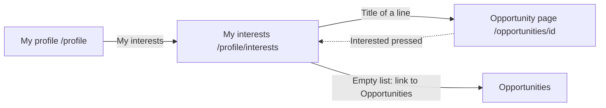

# My interests

- Component: frontend/src/pages/MyInterests.tsx, with MyInterests.module.css and MyInterests.test.tsx
- Address in the browser: /profile/interests

## What the page is for

A young person can press Interested on an opportunity, such as an internship or a summer job. This page is the one place where they find all those opportunities back, the most recent on top. They can open an opportunity from here, and take one off the list when they changed their mind.

## Who can open it

- Member (young person with a profile): sees only their own list, and nothing about other young people who pressed the same opportunities.
- Visitor who is not logged in: the route is inside RequireLogin of issue 04, so the visitor goes to Log in first and comes back here after it.
- Organisation: has no list My interests. Opening the address shows "This list is for young people with a profile" in place of the list.
- An opportunity of an organisation that the foundation switched off is not shown, even when the young person pressed Interested on it.

## How you get there and where you go next

## Every element of the page, top to bottom

1. Heading: My interests
   - Built by task 58.4, issue 58 See the opportunities I am interested in, GitLab #116, sprint 3.
2. Status line above the list, in role status
   - "Removed from your list" right after a line was taken back. A screen reader reads it without moving to it.
   - Built by task 58b.3, issue 58b Take back my interest from my list, GitLab #117, sprint 3.
3. The list
   - Data: getMyInterests(page) in frontend/src/api/opportunities.ts sends GET /api/member-profiles/current/interests?page=1&pageSize=20 through request(). It returns the lines with the total, notAllowed, or notReachable. The page never sees a status code. It asks the server on every visit and keeps nothing in local storage.
   - The server finds the member profile of the account in the cookie connect_session, reads one page of its marks from opportunity_member, opportunity and organisation_profile in one query, newest first, through the index ix_opportunity_member_member_profile_id_created_at. It adds per line whether the opportunity is still open with OpportunityOpenRule of issue 54. Nothing is written. Tasks 58.1 and 58.3.
   - Each line shows:
     - the title, as a link to /opportunities/{id} (the page of issue 55b)
     - the name of the organisation
     - the kind in plain words
     - "Closes on" with the closing date in words, for example 1 November 2026
     - the word "Closed" next to the date when the closing date has passed. It is a word, not only a colour, and the line stays in the list
     - "Interested since" with the day of the press
   - The date comes from the server. The page never compares the closing date with the clock of the phone.
   - Built by task 58.4.
4. Button Take back, on every line
   - Visible label "Take back", accessible name "Take back my interest in <title of the line>".
   - Calls unmarkInterest(opportunityId) in frontend/src/api/opportunities.ts (issue 57b), which sends DELETE /api/opportunities/{id}/interest. The server removes the one row of this young person and this opportunity from opportunity_member, also when the opportunity is closed. A mark that is already gone is still done.
   - While it waits the button says "Taking back..." and is disabled.
   - Only after the server said done, the line leaves the list and the status line says "Removed from your list". The focus moves to the next line, or to the heading when it was the last line.
   - When more than one page is loaded, the page asks getMyInterests again for page 1 up to the last page it had loaded and replaces the lines, so no line shows twice or goes missing.
   - On the page of that opportunity the button Interested is unpressed again. There is no window that asks "Are you sure?".
   - Not reachable: the line stays, and "Taking back did not work, try again later" appears next to that line in role alert. The button is enabled again.
   - Not logged in any more: the listener onUnauthorized of task 4.6 sends the young person to Log in and back here.
   - Built by task 58b.3, with the server check of task 58b.2.
5. Button Load more
   - Shown when the lines on the page are fewer than total. The list shows twenty at a time.
   - Pressing it asks the next page, says "Loading..." while waiting, and adds the new lines below the old ones. The focus moves to the first new line.
   - When it fails, the lines stay and "Connect is not reachable right now" with Try again appears below the list.
   - Built by task 58.4.

The page My profile of issue 08 gets a link My interests to this page (MyProfile.tsx, task 58.4). It is called My interests and not Interested, so it is never mixed up with the button Interested of issue 57.

## States

- Loading: "Loading your list...". The list appears within two seconds.
- Empty: "You have not pressed Interested on anything yet" in place of the list, with a link to Opportunities. The same sentence shows after the last line was taken back.
- Filled: the lines, newest first, with Take back on each and Load more when there are more than twenty.
- Not a young person: "This list is for young people with a profile" in place of the list.
- Not reachable: "Connect is not reachable right now" in place of the list, with a button "Try again" that asks page 1 again and shows the list once Connect is back.
- Error on Take back: "Taking back did not work, try again later" next to the line.
- Phone (360 pixels wide) and laptop (1280 pixels wide): screenshots at both widths in the merge requests.
- Design: the Figma frames of My profile and the frame of My interests on the Figma board of Connect, page Design directions. Colours, fonts and spacing only through frontend/src/styles/tokens.css.

## Accessibility and privacy

- The title is a link and Load more and Take back are buttons, so the keyboard and the screen reader work without extra code.
- A screen reader hears the word Closed on a line that is over.
- Every Take back button has the title of its line in its accessible name.
- After Load more the focus moves to the first new line. After a take back it moves to the next line or the heading.
- "Removed from your list" sits in role status, the take back failure in role alert.
- axe reports zero problems.
- The list is only about the young person who is logged in. It shows nothing about other young people. A take back never touches the list of another young person.
- The list is never kept in the browser between visits, so a shared school computer never shows one pupil's list to the next.

## Built by

| Board | Title | GitLab | Sprint | Prio |
|---|---|---|---|---|
| 58 | See the opportunities I am interested in | #116 | 3 | could |
| 58b | Take back my interest from my list | #117 | 3 | could |

Issue 58 needs issue 57 first. Issue 58b needs issues 58 and 57b.

## Open points

- None on the cards of issues 58 and 58b. An opportunity that its organisation removes also leaves this list with issue 154.
- The not reachable sentence on this page is "Connect is not reachable right now" without "try again later", as the cards of issue 58 give it, next to a button Try again.

## AI use declaration

AI was used as a writing support tool while working on this document. We used AI to draft
the formulation of sentences, the structure of wording, readability, and clarity from
content that we had provided, and to generate the diagrams. The content itself, including
our experiences, reflections, learning goals, decisions, self-assessments, and
conclusions, is our own. We reviewed the drafts and decided as a team which text to
include.
