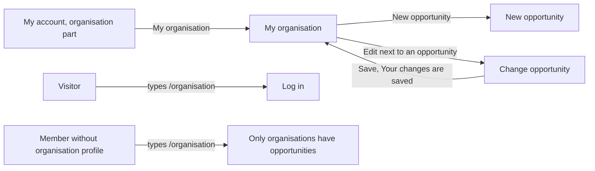

# My organisation

- Component: frontend/src/pages/MyOrganisation.tsx, with MyOrganisation.module.css and MyOrganisation.test.tsx
- Parts used on this page only: frontend/src/components/myOrganisation/OwnOpportunities.tsx (Your opportunities) and frontend/src/components/myOrganisation/ClosedOpportunities.tsx (Closed)
- Address in the browser: /organisation

## What the page is for

This is the home of an organisation on Connect. It shows the name of the organisation, a link to post a new opportunity, every open opportunity it posted and, below that, the opportunities whose closing date has passed. Here the organisation sees that publishing worked, keeps the history of what it offered, opens an opportunity to change it or to open it again, and removes an open opportunity for good.

## Who can open it

- Visitor (not logged in): the route sits inside RequireLogin of issue 04, so a visitor is sent to Log in first.
- Member (young person) without an organisation profile: sees no link My organisation on My account. When they type /organisation they read "Only organisations have opportunities" and see no list, and never a part Closed.
- Organisation: sees its own page, and only its own opportunities, never those of another organisation.
- Admin: the cards give no separate rule for an admin. An account without an organisation profile gets the same refusal as a member.

## How you get there and where you go next

- From My account: in the organisation part, next to "You are logged in for <name>" and the link New opportunity, the link My organisation (task 54b.3). Only an account with an organisation profile sees it.
- From Change opportunity: after a good save the page Change opportunity sends the organisation back here with "Your changes are saved" (task 153.5).
- Away: the link New opportunity to /opportunities/new, and the link Edit next to each opportunity to /opportunities/<id>/edit (the page Change opportunity).

## Every element of the page, top to bottom

The page sits inside AppShell of issue 06, so the five tabs stay around it.

1. Loading text: "Loading..."
   - Shows while the page asks for the organisation profile.
   - Data: getCurrentOrganisationProfile() of task 34.4, which asks GET /api/organisation-profiles/current (issue 34 Create an organisation profile).
   - Built by task 54b.3, issue 54b See the opportunities my organisation posted, GitLab #107, sprint 3.
2. Refusal: "Only organisations have opportunities"
   - Shows when the account has no organisation profile (answer 404), and nothing else shows. The parts are never rendered, so the lists are never asked for a member.
   - Built by task 54b.3, issue 54b, GitLab #107, sprint 3.
3. Not reachable on load: "Connect is not reachable right now" with a button Try again
   - Try again asks again.
   - Built by task 54b.3, issue 54b, GitLab #107, sprint 3.
4. Heading (h1): the name of the organisation, as it was typed in its organisation profile.
   - Built by task 54b.3, issue 54b, GitLab #107, sprint 3.
5. Saved message: "Your changes are saved"
   - Shows above the parts, in an area with role status, only when the page opens with the router state saved after a change on Change opportunity. Without that state it does not show.
   - Built by task 153.5, issue 153 Change my opportunity after publishing, GitLab #212, sprint 5.
6. Link New opportunity
   - Goes to /opportunities/new.
   - Built by task 54b.3, issue 54b, GitLab #107, sprint 3.
7. Part Your opportunities (heading h2)
   - Shows every open opportunity of this organisation, the newest at the top, in the order the server sends. The browser never sorts again.
   - Data: getOwnOpportunities(page) in frontend/src/api/opportunities.ts asks GET /api/organisation-profiles/current/opportunities?page=<page>&pageSize=20 through request() of client.ts. The word current means the organisation of the session, so no organisation can ask for the list of another one. Open means a closing date of today or later, judged by OpportunityOpenRule on the server in Dutch time.
   - Each line (a list item in a ul): the title, the kind from KIND_LABELS (Internship, Job, Project or Other) and the closing date written out in words, for example "Closes on 31 January 2030", made with Intl.DateTimeFormat with timeZone "UTC".
   - Link Edit on every line, to /opportunities/<id>/edit, with the accessible name "Edit <title of the line>" (task 153.5).
   - Button Remove on every line, with the visible label Remove and the accessible name "Remove <title of the line>" (task 154.3). It is not on the part Closed.
     - A press opens ConfirmDialog of task 113.3 with the title "Remove <title>?", the text "Young people will no longer see it, and the list of who is interested is removed too. This cannot be undone." and the buttons Remove and Keep. Nothing is sent yet. The focus goes into the window. Keep and Escape close it, nothing changes, and the focus goes back to the button that opened it.
     - Remove in the window calls removeOpportunity(id) in frontend/src/api/opportunities.ts, which sends DELETE /api/opportunities/{id} of task 154.2 through request() of client.ts. While waiting the button in the window says "Removing..." and both buttons are disabled.
     - Code 204: the window closes, the line is removed, and a status line above the list (role status) says "Your opportunity is removed". The part asks its pages again, from page 1 up to the last page it had loaded, so no line is skipped by Load more. The focus moves to the next line, or to the heading Your opportunities when it was the last line. When it was the only line, "You have no open opportunities yet" with the link New opportunity shows.
     - Code 404: the opportunity was already removed, for example on another device. The window closes, the line is removed as above, and the status line says "This opportunity was already removed".
     - Code 403: cannot happen here, because only an organisation sees this part. The part then shows "Only organisations can remove opportunities" next to the line.
     - Not reachable (every 5xx answer and every network failure): the window closes, the line stays, and "Removing did not work, try again later" appears next to that line in an area with role alert.
     - Rules: a line is removed only after the server said done or already removed. Removing is for good. A young person then no longer finds the opportunity in Opportunities or in My interests, and its old address says "This opportunity does not exist". An organisation can never remove an opportunity of another organisation.
   - Button Load more below the list while the number shown is less than the total. It asks the next page of twenty, adds the items below the others and moves the focus to the first new item. While waiting it says "Loading..." and is disabled. On the last page it is gone.
   - Empty: "You have no open opportunities yet" with the link New opportunity.
   - Not reachable while loading the part or more: "Connect is not reachable right now" with a button Try again, only inside the part. The heading and the link New opportunity of the page stay.
   - The part asks again every time the page opens, so after a publish or a change the newest data is shown.
   - Built by task 54b.3 (issue 54b, GitLab #107, sprint 3), with the link Edit from task 153.5 (issue 153, GitLab #212, sprint 5) and the button Remove from task 154.3 (issue 154 Remove my opportunity, GitLab #213, sprint 5).
8. Part Closed (heading h2), below Your opportunities
   - Shows every opportunity of this organisation whose closing date has passed, the one that closed last at the top, in the order of the answer.
   - Data: getOwnOpportunities(page, "closed") asks GET /api/organisation-profiles/current/opportunities?state=closed&page=<page>&pageSize=20. Without state the answer stays the open list. Nothing changes in the database when an opportunity closes. Closed is worked out each time.
   - Each line: the title, the kind from KIND_LABELS and "Closed on 31 March 2026" (Intl.DateTimeFormat with timeZone "UTC").
   - Link Edit on every line, with the title in its accessible name (task 153.5). On Change opportunity a closed opportunity can get a new closing date of today or later and then moves back to Your opportunities.
   - Button Load more while the number of items is smaller than the total, with the focus on the first new item after each load.
   - Empty: "Nothing closed yet". Loading: "Loading...".
   - Not reachable: "Connect is not reachable right now" with Try again, inside the part only, in an area with role alert. Your opportunities keeps working.
   - Built by task 56b.4 (issue 56b See the closed opportunities of my organisation, GitLab #113, sprint 3), with the link Edit from task 153.5 (issue 153, GitLab #212, sprint 5).

## States

- Loading: "Loading..." for the page, and "Loading..." inside each part.
- Not an organisation: "Only organisations have opportunities" and nothing else.
- Empty: "You have no open opportunities yet" with the link New opportunity under Your opportunities, and "Nothing closed yet" under Closed.
- Filled: the lines with title, kind and written date, and Load more when there are more than twenty.
- After a change: "Your changes are saved" above the parts.
- Remove: the window with "Remove <title>?", then "Removing..." on its button, then "Your opportunity is removed" or "This opportunity was already removed" above the list. When Connect cannot be reached, "Removing did not work, try again later" next to the line, and the line stays.
- Error inside one part: "Connect is not reachable right now" with Try again, only in that part. The rest of the page stays.
- Not reachable on load: "Connect is not reachable right now" with Try again. A tester checks it by switching the phone to airplane mode, pressing My organisation, switching airplane mode off and pressing Try again.
- Phone (360 pixels wide): the list shows within two seconds after pressing My organisation (issue 54b AC8).
- Laptop (1280 pixels wide): the same content inside the shell.
- Design: the Figma frame My organisation on the Figma board of Connect, page Design directions. Colours, fonts and spacing come only from the variables in frontend/src/styles/tokens.css. The screenshots at 360 and 1280 pixels are checked against that frame.

## Accessibility and privacy

- Your opportunities and Closed are h2 headings, so a screen reader user can jump to each part and hear each item with its title and date.
- After Load more the focus moves to the first new item, so a keyboard or screen reader user goes on where the new items start.
- Every link Edit and every button Remove has an accessible name with the title of its line. The window of Remove takes the focus when it opens, closes with Escape and gives the focus back to the button Remove that opened it. "Your opportunity is removed" is read aloud (role status), and "Removing did not work, try again later" has role alert.
- "Your changes are saved" is read aloud without moving to it (role status). The not reachable sentence of Closed has role alert.
- Dates are written out in words, never as 2030-01-31, so 31-01 and 01-31 cannot be misread, and timeZone "UTC" keeps a phone in another time zone from showing the day before.
- The page shows only the title, the kind and the closing date of the own opportunities. It never shows anything about young people: no name, age, email address or number of interested people.
- An organisation only ever sees its own opportunities. A member never sees the part Closed on any page.

## Built by

| Board | Title | GitLab | Sprint | Prio |
|---|---|---|---|---|
| 54b | See the opportunities my organisation posted | #107 | 3 | should |
| 56b | See the closed opportunities of my organisation | #113 | 3 | should |
| 153 | Change my opportunity after publishing | #212 | 5 | could |
| 154 | Remove my opportunity | #213 | 5 | could |

## Open points

- Issue 10, question 68: may an organisation change its opportunity after publishing, also its tags, and reopen a closed one? The links Edit and the sentence "Your changes are saved" come with issue 153, which is only built when the client says yes.
- Issue 10, question 118: may an organisation close its opportunity before the closing date, so young people no longer see it but it stays under Closed?
- Issue 10, question 130: should the young people who pressed Interested be told, for example by email, when an organisation changes its opportunity?
- How long Connect keeps closed postings is decided in issue 19 GDPR notes on minors' data.
- Issue 10, question 69: may an organisation remove its own opportunity for good, which also removes the list of young people who pressed Interested, and should that also be possible after the closing date? The button Remove comes with issue 154, and the answer also decides whether the part Closed gets the button too.
- Issue 10, question 133: should the young people who pressed Interested on an opportunity be told, for example by email, when its organisation removes it?

## AI use declaration

AI was used as a writing support tool while working on this document. We used AI to draft
the formulation of sentences, the structure of wording, readability, and clarity from
content that we had provided, and to generate the diagrams. The content itself, including
our experiences, reflections, learning goals, decisions, self-assessments, and
conclusions, is our own. We reviewed the drafts and decided as a team which text to
include.
