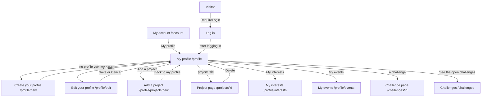

# My profile (MyProfile)

Component: `frontend/src/pages/MyProfile.tsx`, with `MyProfile.module.css`.
Address in the browser: `/profile`.
Title of the browser tab: "Connect, My profile", without the first name (task 8.3, issue 06 Move between the five tabs of Connect).

## What the page is for

My profile is the page where a young person sees what they told Connect about themselves: their first name, age band, region and short line, their skills and interests, their badges, their projects and the challenges they joined. From here they edit their profile, add and remove tags, add a project and open the lists My interests and My events. The page also tells them what they need to know about their own account: that their email address is not confirmed yet, that a parent still has to give permission, or that the foundation removed something of theirs and why. Only the young person sees this page. Other members see a different page (issue 14).

## Who can open it

| Who | What they see |
|---|---|
| Visitor (not logged in) | The page is inside `RequireLogin` of issue 04. A visitor is sent to the page Log in, and after logging in comes back to My profile. |
| Member with a young person profile | Their own profile, and only their own. The address has no id in it, so there is no address that opens someone else's My profile. |
| Member without a profile yet | The page sends them on to the form Create your profile at `/profile/new`, never an empty page. |
| Another member | Never sees this page of someone else. The parts My challenges, Removed by the foundation and the banners are never on the page of another member (issue 14). |

## How you get there and where you go next

Ways in:

- The link My profile on the page My account (`/account`), which the tab Profile opens (issue 08).
- The link See my profile below "Your profile is saved" on Create your profile (issue 08, issue 130).
- Save on Edit your profile, which lands here with "Your changes are saved" (issue 33).
- Delete in the window on My project, which lands here with "Your project is deleted" (issue 158).
- The link Back to my profile after saving a project on Add a project (issue 60).

Ways out:

- Edit goes to Edit your profile at `/profile/edit` (issue 33). The word Edit in the message about a removed short line goes there too (issue 142).
- Add a project goes to `/profile/projects/new` (issue 60).
- The title of a project goes to the project page at `/projects/<id>` (issue 64, task 64.4). Before issue 64 it went to My project at `/profile/projects/<id>` (issue 62), and that old address still leads to `/projects/<id>`.
- My interests goes to `/profile/interests` (issue 58).
- My events goes to `/profile/events` (issue 69).
- A challenge under My challenges goes to `/challenges/<id>`, and See the open challenges goes to `/challenges` (issue 78).

## Every element of the page, top to bottom

The cards give the place of each part relative to one or two others. Where two cards both claim the top, or both claim the place under the heading, that is listed under Open points.

### Status line at the top: saved, deleted, hidden

- Texts:
  - "Your changes are saved", after Save on Edit your profile (issue 33, task 33.4).
  - "Your project is deleted", after deleting a project on My project. It comes along as the notice projectDeleted with `navigate('/profile', { replace: true, state: { notice: 'projectDeleted' } })`, so the back button never returns to the deleted project. The list of projects then asks its first page again (issue 158, task 158.3).
  - "Message hidden", after the last removal message is hidden. It is read from a status area of MyProfile.tsx that stays on the page (issue 145, task 145.3).
- Each is in an area with role status, above the profile.
- Built by: issue 33 Edit my own profile (GitLab #64, sprint 2), issue 158 Delete my project (GitLab #175, sprint 4), issue 145 Hide a removal message after I read it (GitLab #219, sprint 5).

### Banner: email address not confirmed

- Text: "Your email address is not confirmed yet, so other members cannot see your profile. Open the link in the email we sent you to confirm it."
- What it shows: the component `frontend/src/components/UnconfirmedEmailBanner.tsx`, at the top of My profile, above the heading with the first name, for every state of the page. The profile stays fully visible below it.
- Data: `useSession` keeps `emailConfirmed` from `GET /api/sessions/current` (task 29b.2). The banner shows when it is false, and shows nothing when it is true or not known yet.
- When the member confirms on the page Confirm your email address (issue 27), that page calls `refresh()` of `useSession`, so the banner is gone without logging in again.
- When Connect cannot be reached: no banner, and the page shows its own not reachable message.
- It sits in an area with role status, so a screen reader reads it when the page opens, without moving to it.
- Built by: issue 29b A banner reminds me to confirm my email address, task 29b.3 (GitLab #59, sprint 2).

### Banner: waiting for a parent, or the link for a parent has ended

- Shown only for a young person under 16 whose parent has not given permission. The component is `frontend/src/components/myProfile/ParentConsentBanner.tsx`, above the heading, in an area with role status. It uses the colour for information, not the colour for errors, because nothing is wrong.
- Data: `GET /api/member-profiles/current` gives `parentConsent`, which is `pending`, `ended`, or left out (tasks 130.4 and 130b.4).
- Text when pending: "Only you can see your profile for now. Other members see it once your parent gives permission through the email we sent." No button. The banner goes away by itself once the parent gives permission (issue 131).
- Text when ended: "The link for your parent has ended. Only you can see your profile. We removed the address you gave. Ask a parent again below."
- Below the ended banner: the form `frontend/src/components/myProfile/AskParentAgainForm.tsx`:
  - A field of type email with the label "Email address of a parent", autocomplete off, empty at the start. The old address is never filled in anywhere.
  - A button Ask again. While the answer is on its way it says Sending and cannot be pressed twice.
  - Pressing it calls `askParentAgain(parentEmail)` in `frontend/src/api/memberProfiles.ts`, which sends `POST /api/member-profiles/current/parent-consent` (task 130b.5).
  - 204: the page asks `getCurrentMemberProfile()` again and shows what the server says, normally the pending banner without the field.
  - 400: the message of the server below the field, linked with `aria-describedby`, and the focus moves to the field. The messages are "Fill in the email address of a parent", "Fill in a valid email address" and "Fill in the address of a parent, not your own".
  - 409: the text of the server above the field in an area with role alert, and the page asks for the profile again.
  - 503 or no answer: "Connect is not reachable right now, your text is kept" above the field, and the address stays in the field.
- The parent gets one new email with a new link, without the name, age band, region or short line of the young person. The old link stops working. A background worker removes the parent address by itself once the link has ended (task 130b.3).
- While loading, with a 404 or with a 503: the behaviour of task 8.3, and no banner.
- Built by: issue 130 A young person under 16 asks a parent for permission, task 130.6 (GitLab #40, sprint 2), and issue 130b Connect forgets a parent's address when the permission link has ended, task 130b.6 (GitLab #41, sprint 2).

### Part: Removed by the foundation

- What it shows: the component `frontend/src/components/myProfile/RemovalNotices.tsx` (task 49.3), at the top of My profile, above the profile details, and only on My profile. It is a section with `aria-labelledby` pointing to its heading, an h2 Removed by the foundation, and a list with one item per removed project:
  "The foundation removed your project <title> on <date>. Reason: <sentence>."
  The newest message comes first. The date is written with `Intl.DateTimeFormat` in English with the time zone Europe/Amsterdam, for example 12 October 2026. The title is shown as text, never as HTML. It never names the employee of the foundation who removed it.
- Data: `getRemovalNotices(page)` in `frontend/src/api/removalNotices.ts` asks `GET /api/accounts/current/removal-notices` with pageSize 20 (task 49.2). The part asks this on its own, next to the profile, so a failure of the messages never breaks the profile.
- Load more: shown under the list while the messages shown are fewer than `meta.total`. It asks the next page and adds the messages below.
- Empty list: the part renders nothing, no heading and no empty box.
- While waiting: Loading messages... in the same place. The profile itself shows as soon as its own answer is there.
- 503 or no answer: "Messages about removed projects are not available right now." The profile below keeps working.
- 401: the part shows nothing, `RequireLogin` handles the page.
- It looks like a notice, not like an error.
- The button Dismiss on every message (issue 145):
  - A real button with the visible text Dismiss and the accessible name "Dismiss the message about <title>" through `aria-label`.
  - Pressing it calls `dismissRemovalNotice(projectId)` in `frontend/src/api/removalNotices.ts`, which sends `POST /api/accounts/current/removal-notices/{projectId}/dismissal` (task 145.2). While waiting the button says Hiding... and is disabled.
  - 204, or 404 when the message is already gone: the item leaves the list, "Message hidden" appears in an area with role status at the top of the part, and the focus moves to the button Dismiss of the next message, or of the one before when it was the last in the list.
  - The last message: the whole part disappears, and the focus moves to the heading of My profile.
  - 503 or no answer: the item stays, the button can be pressed again, and "This message could not be hidden right now. Try again later." appears under the button, linked with `aria-describedby`.
  - A hidden message stays hidden after a reload and on another phone or laptop. Hiding it does not bring the project back to the list Projects.
- The button Ask to look again on every removal message (issue 146):
  - A real button with the text Ask to look again and the accessible name "Ask to look again at <title>", shown only when `reviewRequestedAt` is empty. It sits next to the button Dismiss.
  - Pressing it opens `ReviewRequestForm.tsx` right under the message, and the focus goes into the field. The field is a textarea with the visible label "Why should the foundation look again?", the hint "At most 500 characters" linked with `aria-describedby`, and a counter "<n> of 500" that a screen reader reads only when you stop typing. A button Send and a button Cancel.
  - Rules, checked on the screen and on the server: empty or only spaces gives "Write why the foundation should look again" under the field, more than 500 characters after trimming gives "Use at most 500 characters", and nothing is sent.
  - Send calls `askRemovalReview(projectId, text)` through the shared helper `client.ts`. While sending the button says Sending... and is disabled.
  - 201: the form closes, the message shows "You asked the foundation to look at this again on <date>." in a status area, and the focus goes to that line. The date is written with `Intl.DateTimeFormat` in English, for example 14 October 2026. The button is gone, because one question per removal is enough.
  - 400: the message of the server under the field. 409: the form closes, the message shows "You already asked the foundation to look at this again", and the list loads again. 404: the message is gone, for example because the project was brought back, and the list loads again.
  - 503 or no answer: "Connect is not reachable right now, your question is not sent. Try again later." under the field, and the text stays in the field.
  - Cancel: the form closes, the text is thrown away, and the focus goes back to Ask to look again.
  - The admin reads the question next to the removed project in Admin, Projects.
- Built by: issue 49 See what was removed from my content and why, task 49.3 (GitLab #122, sprint 3), issue 145, task 145.3 (GitLab #219, sprint 5), and issue 146 Ask the foundation to look at a removal again, task 146.4 (GitLab #220, sprint 5).

### Heading: the first name

- What it shows: the first name as the one heading of the page, exactly as saved.
- Data: `getCurrentMemberProfile()` in `frontend/src/api/memberProfiles.ts` asks `GET /api/member-profiles/current` (task 8.2). The answer holds the first name, the age band, the region and the short line, later also the tags, the badges, `parentConsent` and `bioRemoval`. It never holds the email address, the account id or dates of the account.
- Built by: issue 08 See my own profile page, task 8.3 (GitLab #27, sprint 1).

### Link: Edit

- Text: Edit.
- What it does: a link under the heading to Edit your profile at `/profile/edit`. It is a link, because it goes to another page.
- Built by: issue 33 Edit my own profile, task 33.4 (GitLab #64, sprint 2). Issue 08 had no Edit button yet.

### Badge row

- What it shows: the component `frontend/src/components/BadgeRow.tsx`, directly below the first name and above the part Projects. For each badge: the gold icon as an img with the badge name as its alt text, the name in bold and the line below it. For the first badge that is the icon, First project and "You added your first project".
- Data: the badges come with `GET /api/member-profiles/current` (task 80.3), so the row makes no call of its own. Each badge holds only its code, its name and its line, nothing about the project, the date, the age or the region.
- An empty list: the row renders nothing, no heading Badges and no empty space.
- An unknown code: a plain gold circle with role img and the badge name as its `aria-label`, never a broken picture.
- The row wraps to a new line on a narrow screen.
- The badge is given by the server when the first project is saved (task 80.2). No member and no admin can give or take a badge by hand.
- Built by: issue 80 Earn a badge for my first project, task 80.4 (GitLab #182, sprint 4).

### Profile details: Age band, Region, About you

- What it shows: the component `frontend/src/components/ProfileDetails.tsx`, a description list (dl, dt and dd), so a screen reader reads each label with its value, such as Region, Amstelveen.
  - Age band: in words, 15 to 17, 18 to 21 or 22 to 30, from `AGE_BAND_LABELS`. Never an exact age or a birth date.
  - Region.
  - About you: the short line. When it was left empty, the label is not shown at all and no placeholder appears.
- The message about a removed short line (issue 142): when `bioRemoval` in the answer is there, the component `frontend/src/components/myProfile/BioRemovalNotice.tsx` shows in place of the short line:
  "The foundation removed your short line on <date>. Reason: <reason sentence>. You can write a new one with Edit."
  The date is written with `Intl.DateTimeFormat` in English, and the word Edit is a link to `/profile/edit`. It is a paragraph inside the profile, not a role alert, so a screen reader reads it in order. It names nobody of the foundation. After the young person saves a new short line, the message is gone. Without `bioRemoval` nothing extra shows.
- Built by: issue 08, task 8.3, and issue 142 Remove a profile text that breaks the rules, task 142.5 (GitLab #217, sprint 5).

### Part: Skills and interests

- What it shows: a section with the heading Skills and interests, below ProfileDetails, with the component `frontend/src/components/TagInput.tsx`.
- Data on load: `getSuggestedTags()` in `frontend/src/api/tags.ts` asks `GET /api/tags/suggested` (page 1, pageSize 50) for the starter list of about twenty tags, and the chosen tags come from `GET /api/member-profiles/current`. While waiting: "Loading your tags...".
- Your tags: a list under the heading Your tags, or "You have no tags yet". Below Your tags the count, for example "3 of 10 tags", in normal text (issue 36d).
- Suggested tags: buttons. A chosen one shows as chosen with `aria-pressed="true"` and does nothing when pressed again.
- Add your own: a text field with that visible label, a button Add, and the hint "Skills and interests only. Nothing about your health, faith or other private matters."
- Adding: every tap or Add calls `addMemberProfileTag(name)` in `frontend/src/api/memberProfileTags.ts`, which sends `POST /api/member-profiles/current/tags` (task 36.2). While waiting that tag, or the button Add, shows a busy state and is disabled, so tapping twice adds once.
  - 201 or 200: the tag appears in Your tags, the field is emptied, and "Saved" appears in an area with role status.
  - 400: the message of the server below Add your own, linked with `aria-describedby`, and the typed text stays. The messages are "Fill in a tag", "A tag has at most 30 characters" and "Use only letters, numbers, spaces and -".
  - 409: "You have 10 tags, the most there is. Remove one to add another." below Add your own, also when the tap was on a suggested tag, and Your tags stays as it was.
  - 503 or no answer: "Connect is not reachable right now, your tags are kept" in an area with role alert above the part, and the chosen tags stay as they were.
  - A message goes away on the next add that works, or when the young person types in the field again.
- Rules: a tag is saved in small letters (Video Editing becomes video editing), at most 30 characters, only letters, numbers, spaces and the sign -, so café and hip-hop are fine. At most ten tags per profile (`MAX_TAGS = 10` in `frontend/src/api/tags.ts`, which follows `TagRules.MaxPerProfile` on the server). The browser never refuses the eleventh tag itself, the server decides.
- Removing: every chosen tag has a button with an x sign and the accessible name "Remove <tag>", for example "Remove football" (issue 36b). Pressing it calls `removeMemberProfileTag(tagId)`, which sends `DELETE /api/member-profiles/current/tags/{tagId}` (task 36b.2). While waiting the tag shows a busy state.
  - 204: the tag leaves the list, "Removed" appears in the status area, and the focus moves to the next chosen tag, or to Add your own when it was the last one.
  - 400 or 404: "This tag could not be removed, reload the page" in the area with role alert, and the tag stays.
  - 503 or no answer: "Connect is not reachable right now, your tags are kept", and the tag stays.
  - Removing a tag from your own profile does not remove it from anyone else's.
- Built by: issue 36 Add skills and interests as tags, task 36.3 (GitLab #69), issue 36b Remove a tag from my profile, task 36b.3 (GitLab #71), and issue 36d A clear message when a tag is not allowed, task 36d.3 (GitLab #73), all sprint 2.

### Part: Projects

- What it shows: a part with the heading Projects and Add a project to `/profile/projects/new` (issue 60). It is a link element drawn as a button, because it goes to another page (task 60.3). Below it the component `frontend/src/components/ProjectList.tsx` with one `ProjectCard` per project (issue 62).
- Data: `getOwnProjects(page)` in `frontend/src/api/projects.ts` asks `GET /api/member-profiles/current/projects?page=<page>&pageSize=20` (task 62.2). The profile comes from the session, never from the address.
- A card: the picture of the project with its width, height, `loading="lazy"` and the title as alt text, or an empty space of the same shape without a picture, hidden for a screen reader (task 61b.5). After the young person removes the picture on the project page, the card shows no picture (issue 159). Then the title as a heading (h3) and a real link to `/projects/<id>` (task 64.4, before issue 64 it was `/profile/projects/<id>`), the start of the description, and "Added on" with the date in the time zone of the browser. Newest on top, in the order of the server.
- While waiting: "Loading projects...".
- Empty: "You have no projects yet", next to Add a project.
- Load more: a button below the list while the number of cards is smaller than the total. It says "Loading..." while it waits, adds the next 20 at the bottom, and is gone when everything is shown.
- 503 or no answer on the first page: "Connect is not reachable right now" and a button Try again. On Load more: the same sentence below the list, and the cards already shown stay.
- A project that an admin took down is not in the list (issue 48). A deleted project is gone from the list (issue 158).
- Built by: issue 60 Add a project, task 60.3 (GitLab #119, sprint 3), issue 62 See my projects on my profile, task 62.3 (GitLab #174, sprint 4), issue 61b Add an image to my project, task 61b.5 (GitLab #180, sprint 4), issue 64 Open a project page, task 64.4 (GitLab #181, sprint 4), and issue 159 Remove the picture of my project (GitLab #234, sprint 5).

### Link: My interests

- Text: My interests. The name is not Interested, so it is never mixed up with the button Interested of issue 57.
- What it does: a link to the page My interests at `/profile/interests`, which lists the opportunities the young person pressed Interested on.
- Built by: issue 58 See the opportunities I am interested in, task 58.4 (GitLab #116, sprint 3).

### Link: My events

- Text: My events.
- What it does: a link to the page My events at `/profile/events`, which lists the upcoming events the young person registered for.
- Built by: issue 69 See my events, task 69.3 (GitLab #130, sprint 3).

### Part: My challenges

- What it shows: the component `frontend/src/components/myProfile/MyChallenges.tsx`, below the profile, with the heading (h2) My challenges. One item per joined challenge, with the `ChallengeCard` of issue 75: the title, the organisation, the deadline as a readable date such as 30 June 2027, and the word Closed on a closed one, as text and not only as a colour. Each item is one link to `/challenges/<id>`. The nearest deadline is on top, closed ones below the open ones, in the order of the server.
- Data: `getJoinedChallenges(page)` in `frontend/src/api/challengeParticipants.ts` asks `GET /api/member-profiles/current/challenges?page=1&pageSize=20` (task 78.2). The profile does not wait for this part.
- Load more: while fewer items are shown than `meta.total`. It adds the next page below.
- Empty: "You have not joined a challenge yet." with a link See the open challenges to `/challenges`.
- Loading: "Loading your challenges..." in an area with role status.
- 503 or no answer: "Your challenges cannot be loaded right now, try again later" in an area with role alert. The profile above it stays.
- A challenge that its organisation deleted (issue 168): the title as plain text, not a link, the organisation name, and the words "Removed by the organisation" in place of the deadline and the mark Closed. The words are text, so a screen reader reads them and a person who cannot see colours understands them. The item may look paler through a variable of tokens.css.
- It never shows the names of other young people who joined.
- Built by: issue 78 See my challenges, task 78.4 (GitLab #145, sprint 4), and issue 168 Delete my challenge, task 168.5 (GitLab #229, sprint 5).

## States

| State | What the person sees |
|---|---|
| Loading | "Loading your profile...". The parts that load on their own show "Loading messages...", "Loading your tags...", "Loading projects..." and "Loading your challenges...". |
| No profile yet | The page sends the member on to Create your profile at `/profile/new`. |
| Filled | The banners that apply, the part Removed by the foundation when there are messages, the first name, Edit, the badges, Age band, Region, About you, Skills and interests, Projects, the links My interests and My events, and My challenges. |
| Empty parts | An empty short line, no badges and no removal messages show nothing at all. No tags shows "You have no tags yet", no projects shows "You have no projects yet", no challenges shows "You have not joined a challenge yet." |
| Not reachable | "Connect is not reachable right now, try again later" in an area with role alert, never an empty page. No banner shows. After a full reload with the server down, `RequireLogin` shows its own plain not reachable message first. When only one part fails, that part shows its own sentence and the rest of the page keeps working. |
| Not logged in | The page Log in, and back here after logging in. |
| Phone and laptop | The page works on a phone (360 pixels wide) and a laptop (1280 pixels wide) without scrolling sideways. The badge row wraps on a narrow screen. Every value is checked on a phone and a laptop in the team checks of each issue. |

The part My challenges shows within two seconds after opening My profile (issue 78), and the list of projects within two seconds (issue 62).

## Accessibility and privacy

- The first name is the one heading. The values are a description list, so each label is read with its value.
- The banners and the status lines are role status areas, read without moving to them. Not reachable messages are role alert areas.
- The part Removed by the foundation is its own region with its heading. Each Dismiss button names its project. Focus moves to the next message, or to the heading when the part is gone.
- A suggested tag says whether it is chosen through `aria-pressed`. Each remove button names its tag. A field message is linked to its field with `aria-describedby`.
- Each project title is a heading, so a screen reader can jump from project to project.
- The badge icon has the badge name as its alt text. The gold `--color-badge-gold` in `tokens.css` must reach at least 3 to 1 against the background (WCAG 2.2, 1.4.11), measured and written next to the variable.
- The word Closed on a challenge is text, not only a colour.
- Titles of projects and names of tags are shown as text, never as HTML.
- Never on this page: the email address, a birth date or exact age, a school or a street address, the name of the employee of the foundation who removed something, the address of a parent, and the names of other young people.
- A young person only ever sees their own profile. Every address this page calls takes the account from the session and has no id of a person in it.
- Deleting the account also deletes the tags, the projects, the removal facts and the hidden dates (issues 36, 60, 62, 142, 145 with issue 113).

The design: colours, fonts and spacing come only from the variables in `frontend/src/styles/tokens.css`, following the Figma frames of My profile on the page Design directions of the Figma board (among them My profile state not confirmed, Skills and interests, Projects, Profile and My profile with My challenges).

## Built by

| Board | Title | GitLab | Sprint | Prio |
|---|---|---|---|---|
| 08 | See my own profile page | #27 | 1 | must |
| 130 | A young person under 16 asks a parent for permission | #40 | 2 | must |
| 130b | Connect forgets a parent's address when the permission link has ended | #41 | 2 | must |
| 29b | A banner reminds me to confirm my email address | #59 | 2 | must |
| 33 | Edit my own profile | #64 | 2 | must |
| 36 | Add skills and interests as tags | #69 | 2 | must |
| 36b | Remove a tag from my profile | #71 | 2 | must |
| 36d | A clear message when a tag is not allowed | #73 | 2 | must |
| 58 | See the opportunities I am interested in | #116 | 3 | could |
| 60 | Add a project | #119 | 3 | should |
| 49 | See what was removed from my content and why | #122 | 3 | should |
| 69 | See my events | #130 | 3 | should |
| 78 | See my challenges | #145 | 4 | could |
| 62 | See my projects on my profile | #174 | 4 | should |
| 158 | Delete my project | #175 | 4 | should |
| 61b | Add an image to my project | #180 | 4 | should |
| 64 | Open a project page | #181 | 4 | should |
| 80 | Earn a badge for my first project | #182 | 4 | could |
| 142 | Remove a profile text that breaks the rules | #217 | 5 | could |
| 145 | Hide a removal message after I read it | #219 | 5 | could |
| 146 | Ask the foundation to look at a removal again | #220 | 5 | could |
| 168 | Delete my challenge | #229 | 5 | could |
| 159 | Remove the picture of my project | #234 | 5 | could |

## Open points

- The order at the top of the page is not fixed by one card. Issue 29b puts its banner at the top above the heading, issue 130 puts its banner above the heading, and issue 49 puts the part Removed by the foundation at the top above the profile details. The team decides the order with the Figma frame of My profile.
- The place under the heading is claimed twice. Issue 33 puts the link Edit under the heading, and issue 80 puts the badge row directly below the first name. The team decides which comes first.
- Issue 78 places My challenges "below the profile and above nothing else", while the cards do not say where the links My interests and My events sit. The team places them with the Figma frame.
- Whether a young person may leave a challenge, so it leaves this list: issue 10, question 86 (issue 169).
- How many days Connect keeps the address of a parent who does not answer: issue 10, question 20. The 14 days of `PARENT_CONSENT_KEEP_DAYS` change when the client answers.
- Whether one email to the address the young person types is enough as the check that a parent gave permission: issue 10, question 62.
- Asking a parent again while the first link still works, and deleting a profile that waits for a parent for a long time: issue 10, question 61.
- Whether Connect sends a member an email when the foundation removes their short line: issue 10, question 95.
- Which badges come after First project: issue 10, question 102. Whether young people who had a project before the badge went live get it too: question 103. Whether the badge stays when the project is removed: question 104.
- Getting a deleted project back: issue 10, question 128. Deleting a project that the foundation took down: issue 10, question 129.
- Issue 168 Delete my challenge, with the words Removed by the organisation under My challenges, is built only when the client says yes: issue 10, question 85.
- An answer from the foundation inside Connect to a question Ask to look again, and an email to the foundation when a question comes in: issue 10, question 47 (issue 146).

## AI use declaration

AI was used as a writing support tool while working on this document. We used AI to draft
the formulation of sentences, the structure of wording, readability, and clarity from
content that we had provided, and to generate the diagrams. The content itself, including
our experiences, reflections, learning goals, decisions, self-assessments, and
conclusions, is our own. We reviewed the drafts and decided as a team which text to
include.
