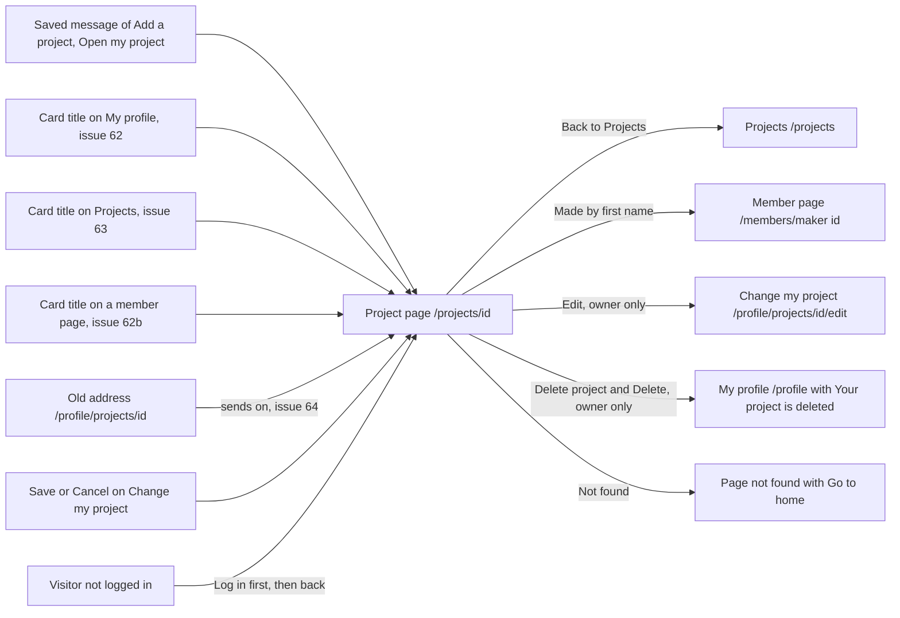

# The page of one project

- Component: frontend/src/pages/MyProject.tsx, with MyProject.module.css and MyProject.test.tsx. The picture buttons are frontend/src/components/ProjectImagePicker.tsx.
- Address in the browser: /profile/projects/:id (issue 61). From issue 64 on the address is /projects/:id, and /profile/projects/:id sends on to it, so old links keep working. The id is the long code of the project, for example 3f2a9c1e-0b7d-4e5f-8a6b-2c9d1e0f7a3b.
- Title of the browser tab: the title of the project (task 61.3).

## What the page is for

This is the page of one project that a young person added to Connect. It shows the picture, the title, the date and the whole description.

At first only the maker can open it, to read back what they saved and to change it. The maker adds or removes the picture here, opens the form to change the text, and deletes the project. Issue 64 then opens the same page to every logged in member, with the first name of the maker as a link to their page. There is only ever one page per project.

## Who can open it

- Visitor (not logged in): sees the page Log in instead of the project. After logging in, the visitor lands on that project (issue 64).
- Member who made the project (young person, the owner): sees the whole page with the buttons Add image or Replace image, Remove image, Edit and Delete project.
- Other member (young person or organisation):
  - Until issue 64: reads "This project does not exist" and sees nothing of the project (issue 61).
  - From issue 64: sees the project, with the first name of its maker, but none of the buttons that change it. The buttons are not on the page at all, not only hidden.
- Admin: the cards give no own rule for an admin on this page. A project an admin took down (issue 48) is never found here.
- Anyone who opens a project that does not exist or was taken down gets the not found answer. So does another member who opens a project whose maker was switched off or has not confirmed their email address. The maker still sees their own project. See States.

## How you get there and where you go next

You arrive from the link Open my project in the saved message of the page Add a project (issue 60, task 61.3). You also arrive from a title on a project card: in the part Projects on My profile (issue 62), on the tab Projects (issue 63) and on the page of another member (issue 62b). From issue 64 every card title links to /projects/<id>. After Save or Cancel on the form Change my project you come back here too.

From here you go back to Projects, to the page of the maker, to the form Change my project, or to My profile after a delete.

## Every element of the page, top to bottom

The page sits inside AppShell of issue 06, with the five tabs around it. It loads the project once when it opens.

### The data behind the page

- getProject(id) in frontend/src/api/projects.ts asks GET /api/projects/{id} through request() in client.ts. Issue 61 named it getOwnProject(id), and issue 64 renames it. It returns found, not found or not reachable. The page never sees a status code.
- GET /api/projects/{id}, issue 61 (tasks 61.1 and 61.2): only for the owner. The answer 200 is { "data": { "id", "title", "description", "createdAt" }, "meta": {} }. Another member, an unknown id, an id that is not an id (abc) and a taken down project all get the same 404 with "This project does not exist". A visitor gets 401 with "Log in to see this page". A stopped database gives 503 with "Connect is not reachable right now".
- Issue 61b (task 61b.4) adds the field image: { "url": "/api/projects/<id>/image?v=3f2a9c1e", "width", "height" }, or null without a picture. The file name itself never leaves the server.
- Issue 157 (task 157.2) adds the field updatedAt, empty when the project was never changed.
- Issue 64 (tasks 64.1 and 64.2): the same address now answers every logged in member. The answer adds "maker": { "id", "firstName" } and "isOwner": true or false. A taken down project, an unknown id, abc and a hidden maker all get the shared 404 NotFoundProblem of issue 53 with the title "This page does not exist". Never 403 and never 410. The query FindVisibleByIdAsync reads of the maker only the id, the first name and the account id, and the account id stays on the server.

### The elements

1. Link: Back to Projects
   - At the top of every project page. Goes to /projects.
   - Built by task 64.3, issue 64 Open a project page, GitLab #181, sprint 4.
2. Notice after a save: "Your changes are saved"
   - Shown in an area with role status when the form Change my project sends the member back after Save.
   - Built by task 157.3, issue 157 Change my project, GitLab #179, sprint 4.
3. The picture, or the space without a picture
   - With a picture: an image from the url in the field image, with its width and height from the answer, so the page does not jump while it loads. The alt text is the title of the project. The picture is never wider than the screen.
   - The picture file comes from GET /api/projects/{id}/image (task 61b.4). Every logged in member may ask it, a visitor gets 401. The answer has Content-Type image/jpeg or image/png, X-Content-Type-Options: nosniff and Cache-Control: private, max-age=86400. A missing picture gives 404 with "This picture does not exist".
   - Without a picture: the text No picture yet (tasks 61b.5, 159.3 and 64.3).
   - Built by task 61b.5, issue 61b Add an image to my project, GitLab #180, sprint 4, and task 64.3.
4. Picture buttons (owner only), in ProjectImagePicker below the picture
   - Add image, or Replace image when there is a picture: a label around a hidden file input with accept="image/jpeg,image/png". The input stays reachable with Tab and the label shows a visible focus ring. A phone opens its photos, a laptop the file window. No drag and drop and no cropping.
   - Rules: one picture per project. A new one replaces the old one. At most 5 MB (5 * 1024 * 1024 bytes), checked on the page before anything is sent. The server also refuses a file whose first bytes are not JPEG or PNG and a picture wider or higher than 10000 pixels. It turns the picture upright, makes it at most 1600 pixels wide and removes the photo details (Exif, IPTC and XMP).
   - Pressing it: uploadProjectImage(id, file) sends a FormData with the field file to POST /api/projects/{id}/image (task 61b.3). While sending, the button says "Uploading..." and is disabled.
   - Saved (200): the new picture replaces the old one without a reload, and "Your picture is saved" is read aloud through the area with role status.
   - Too big (413, with or without text from the server, or a file over 5 MB before sending): "This picture is too big. Choose a JPEG or PNG under 5 MB."
   - Wrong kind (415): "Choose a JPEG or PNG picture."
   - Not found (404): "This project does not exist".
   - Not reachable (503 or no answer): "Connect is not reachable right now, try again later".
   - All these error texts go in an area with role alert below the button, and the old picture stays.
   - Built by tasks 61b.3 and 61b.5, issue 61b, GitLab #180, sprint 4.
   - Remove image: a button next to Replace image, only when the project has a picture. It uses the style of a secondary button, never a warning colour.
     - Pressing it replaces the two buttons by the question "Remove this picture from your project?" with the buttons Yes, remove and Keep it, in the same place. The focus goes to Keep it.
     - Keep it closes the question, keeps the picture and puts the focus back on Remove image.
     - Yes, remove calls removeProjectImage(id), which sends DELETE /api/projects/{id}/image (task 159.2). While waiting it says "Removing..." and both buttons are disabled.
     - Removed (204): No picture yet shows at once without a reload, the button Add image is back and gets the focus, and "Your picture is removed" is read aloud through the area with role status. A project that has no picture any more also gets 204, so a double tap does no harm.
     - Changed at the same moment in another tab (409): "Your picture was just changed. Reload the page and try again." in the area with role alert, and the picture stays.
     - Not found (404): the page NotFound (issue 53).
     - Not reachable (503 or no answer): "Connect is not reachable right now, try again later" in the area with role alert below the buttons, and the picture stays.
     - On the server the three picture columns are emptied first, and only then is the file deleted. The old address of the picture then shows "This picture does not exist".
     - Built by tasks 159.1, 159.2 and 159.3, issue 159 Remove the picture of my project, GitLab #234, sprint 5.
5. Heading (h1): the title of the project
   - The only main heading of the page. At most 80 characters, the rule of issues 60 and 60b.
   - Built by task 61.3, issue 61 See my project on its own page, GitLab #173, sprint 4, and task 64.3.
6. The date
   - "Added on" with the date and time the project was added, in the time zone of the browser (Intl.DateTimeFormat). Task 64.3 calls it the date.
   - "Changed on" with the date of the last change, shown whenever updatedAt is filled.
   - Built by task 61.3 (Added on) and task 157.3 (Changed on).
7. The description
   - The whole description exactly as it was typed, at most 1000 characters. The line breaks stay (white-space: pre-wrap, task 61.3 and task 64.3).
   - Always plain text. A sign like < or a web address stays a sign and never becomes bold text or a link. dangerouslySetInnerHTML is never used.
   - Built by task 61.3 and task 64.3.
8. Made by and the first name of the maker
   - "Made by" with the first name of the maker as a link to /members/<maker id>, the page of that young person (issue 14). From there a member can send a connection request (issue 39).
   - Only the first name, never an age, a region, a school or an email address.
   - Built by tasks 64.1, 64.2 and 64.3, issue 64, GitLab #181, sprint 4.
9. Button Edit (owner only)
   - A link to /profile/projects/<id>/edit, the page EditProject.tsx with the heading Change my project and the title and description already filled in.
   - Built by task 157.3, issue 157, GitLab #179, sprint 4.
10. Button Delete project (owner only), below the description
    - Shown only when the project has loaded. It uses the colour for a dangerous action from tokens.css.
    - Pressing it opens the shared window ConfirmDialog of task 113.3 with the question "Delete this project?", the sentence "You cannot undo this. The project is gone for everyone." and the buttons Delete and Cancel. The window has no field. The focus goes to Cancel. Cancel and Escape close the window, change nothing and put the focus back on Delete project.
    - Delete calls deleteOwnProject(id), which sends DELETE /api/projects/{id} (task 158.2). While waiting, Delete says "Deleting..." and both buttons are disabled, so a double press sends one request.
    - Deleted (204): go to /profile with replace, so the back button never returns to the deleted project. My profile shows "Your project is deleted" at the top in an area with role status, and the project is no longer in the list.
    - Not found (404): the window closes and the page shows NotFound (issue 53).
    - Not reachable (503 or no answer): "Connect is not reachable right now, your project is not deleted. Try again later." in the window, in an area with role alert. The window stays open with Delete available again.
    - Not logged in (401): the member is sent to Log in, as on every page.
    - On the server the project row is deleted for good, not only hidden, and its picture file is deleted after the row (task 61b.3). A project the foundation took down is never deleted here. A badge earned for a first project stays (issue 80).
    - Built by tasks 158.1, 158.2 and 158.3, issue 158 Delete my project, GitLab #175, sprint 4.

## States

- Loading: "Loading..." while the page waits for GET /api/projects/{id}.
- Filled: Back to Projects, the picture or the space without a picture, the title as heading, the date, the description and Made by. The owner also sees the picture buttons, Edit and Delete project.
- Empty: the page shows one project, so there is no empty list. A project without a picture shows the grey area with No picture yet (task 61b.5).
- Not found:
  - Issue 61: "This project does not exist" with a link to My profile (/profile).
  - Issue 64: the page NotFound of issue 53 with "This page does not exist or is no longer available" and the button Go to home, inside the shell.
  - The same answer for an unknown id, an id with a typing error, a taken down project, a project of a hidden maker, and until issue 64 a project of someone else. Nobody can learn which projects exist.
- Not reachable: "Connect is not reachable right now" in an area with role alert, with a button Try again that asks once more. When Try again works, the project appears.
- Errors of a button: each button keeps its own message in place, as written with the element. The picture and the project stay on every error.
- Checked by a tester: switch the phone to airplane mode after opening the page, press the button or reload, read the message, and switch airplane mode off. Nobody stops the test server or the database.
- Phone (360 pixels wide): the page matches the Figma frame at this width, shown with screenshots in the merge request. The picture is never wider than the screen. Add image opens the photos of the phone. A normal phone photo is on the page within five seconds.
- Laptop (1280 pixels wide): the page matches the Figma frame at this width. Add image opens the file window.
- Design: the Figma frame My project (issues 61, 61b, 158 and 159) and the Figma frame Project page on the page Design directions (issue 64), on the Figma board of Connect. Colours, fonts and spacing come only from the variables in frontend/src/styles/tokens.css.

## Accessibility and privacy

- The picture has the title of the project as its alt text, so a screen reader reads the title.
- The file input is reachable with Tab and Enter and has a visible focus ring on its label.
- Messages that tell a result ("Your picture is saved", "Your picture is removed", "Your changes are saved") sit in areas with role status. Error messages sit in areas with role alert.
- In the delete window the focus starts on Cancel, and in the remove question on Keep it, so pressing Enter by accident deletes nothing. A screen reader hears "Delete this project?" when the window opens and "Your project is deleted" after the delete.
- After a remove the focus moves to Add image.
- One h1 per page, and axe reports 0 issues.
- About the maker only the first name is shown, because many makers are under 18. The answer holds no email address, age band, region, account id or file name (task 64.2).
- A picture can only be seen by a logged in member, through GET /api/projects/{id}/image. The storage folder is outside the website. A visitor who opens the address of a picture reads "Log in to see this page".
- The place where a photo was taken and the phone model are removed before anyone else can see the picture.
- A deleted project and a removed picture are really gone from Connect, not only hidden. Deleting the project or the account also deletes the picture file.
- The server log never holds the title, the description, the original file name or the photo details.

## Built by

| Board | Title | GitLab | Sprint | Prio |
|---|---|---|---|---|
| 61 | See my project on its own page | #173 | 4 | should |
| 158 | Delete my project | #175 | 4 | should |
| 157 | Change my project | #179 | 4 | should |
| 61b | Add an image to my project | #180 | 4 | should |
| 64 | Open a project page | #181 | 4 | should |
| 159 | Remove the picture of my project | #234 | 5 | could |

Issue 61 needs issue 60 and makes the page. After its team check, issues 61b and 157 can start. Issue 61b also needs issues 104, 71b and 95. Issue 157 needs issues 29, 48, 60b and 62b. Issue 158 needs issues 62, 113, 29 and 48. Issue 64 needs issue 61b and issues 63, 14, 46, 48, 53 and 04b. Issue 159 starts after issue 61b and also needs issues 29, 48, 62 and 62b.

## Open points

- Not found text for the button Add image or Replace image: task 61b.3 still says "This project does not exist" for a 404 of its own address. No card brings it in line with the page NotFound.
- Where the notice "Your changes are saved" and Changed on sit on the page is not on the cards. The Figma frames My project and Project page are the reference.
- Issue 10, question 66: should the foundation keep the old texts of a changed project.
- Issue 10, question 128: can a deleted project be brought back.
- Issue 10, question 129: may a young person delete a project that the foundation took down. Until then the owner cannot open such a project, so it cannot be deleted here.

Settled: the address is /projects/<id> with the old /profile/projects/<id> as a redirect, No picture yet is the one text without a picture, the button reads Delete project, the description keeps white-space: pre-wrap, GET /api/projects/{id} already carries updatedAt before issue 64, and the 404 after Delete, after Remove image and on the edit form all show the page NotFound.

## AI use declaration

AI was used as a writing support tool while working on this document. We used AI to draft
the formulation of sentences, the structure of wording, readability, and clarity from
content that we had provided, and to generate the diagrams. The content itself, including
our experiences, reflections, learning goals, decisions, self-assessments, and
conclusions, is our own. We reviewed the drafts and decided as a team which text to
include.
