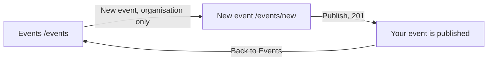

# New event

- Component: frontend/src/pages/NewEvent.tsx, with NewEvent.module.css and NewEvent.test.tsx. The five fields sit in the shared component frontend/src/components/EventForm.tsx (issue 162).
- Address in the browser: /events/new

## What the page is for

An organisation on Connect, such as a school, a sports club, a company or a community group, publishes an event here: a title, a short description, the date and time, the place and how many people can come. Young people then find it on Connect. An event never shows a contact person, a phone number or an email address, only the name of the organisation, because young people under 18 read every event and may only reach an organisation through Connect. The foundation first checks an organisation before it can publish.

## Who can open it

- Organisation that the foundation checked: fills in the form and publishes.
- Organisation that the foundation has not checked yet: can fill in every field while it waits, but reads "The foundation checks your organisation first. You can publish after that." where the button Publish was (issue 140).
- Young person: never sees the button New event. A young person who types the address reads "Only organisations can publish events" in place of the form.
- Visitor who is not logged in: the route is inside RequireLogin of issue 04, so the visitor sees the page Log in, and after logging in as an organisation lands on the form (issue 04b).

## How you get there and where you go next

The page Events gets a link New event, styled as a button, above its heading area. It is only rendered when useSession() says isOrganisation is true (task 65.3). For a young person it is not in the page at all, not hidden with CSS.

## Every element of the page, top to bottom

1. Message area above the form, in role alert
   - "Connect is not reachable right now, your text is kept" on 503 or no answer. Every field keeps its value.
2. Field: Title
   - A text field, at most 120 characters, label above it.
   - Required. An empty title shows a plain message directly below the field. The server removes spaces at the start and the end before it checks (CreateEventRequestValidator, task 65.2).
3. Field: Description
   - A textarea, optional, with a counter such as "1850 characters left". At most 2000 characters.
4. Field: Date and time
   - One field of type datetime-local, the browser's own field, no date picker library.
   - Required, and later than now. A date and time in the past shows the message of the server "Choose a date and time in the future" below the field.
   - createEvent turns the date and time into a moment with its time zone before sending, for example 15 October 2026 19:30 becomes "2026-10-15T19:30:00+02:00" in summer and 15 December 2026 19:30 gets "+01:00" in winter.
5. Field: Place
   - A text field with the hint "Everyone on Connect sees this. Use the address of a public place, never a home address."
   - Required, at most 200 characters.
6. Field: Number of places
   - A field of type number, a whole number from 1 to 10000. Zero places shows "Fill in at least 1 place" below the field, and the database itself refuses zero places (the check ck_event_capacity_positive of task 65.1).
7. Button: Publish, or the notice of issue 140 in its place
   - isCheckedOrganisation from useSession() (task 140.3) decides. When it is false, the button Publish is not rendered, and NotCheckedNotice (frontend/src/components/NotCheckedNotice.tsx) stands where it was: a paragraph with role status and the sentence "The foundation checks your organisation first. You can publish after that." The fields stay visible. While the session loads the page shows "Loading...", never a flash of the button. Task 140.4, issue 140 Only a checked organisation can publish, GitLab #139, sprint 3.
   - Pressing Publish calls createEvent(...) in frontend/src/api/events.ts, which sends POST /api/events through request() in frontend/src/api/client.ts. The browser adds the cookie connect_session by itself. It returns published (with the id), wrong fields, not an organisation, not reachable or not logged in. The page never calls fetch.
   - While waiting the button says "Publishing..." and is disabled.
   - 201: the form is replaced by "Your event is published" with the title that was typed, in role status, and a link Back to Events.
   - 400: each message of the server directly below its own field, linked with aria-describedby, the focus on the first wrong field. What was typed stays.
   - 403 not an organisation: the form is not shown, and the page says "Only organisations can publish events". The page shows the same when useSession() says isOrganisation is false before anything is sent.
   - 403 not checked (isNotCheckedProblem in client.ts compares the title of the ProblemDetails with the sentence): the notice replaces the button, and every field keeps its value. This happens when the check was taken back while the page was open.
   - On the server, the guard of issue 04 checks the session and the validator checks every field. The server finds the organisation profile of the logged in account, refuses when there is none, refuses an organisation whose checked_at is empty (rule OrganisationProfile.IsChecked, task 140.2), and writes one row in the table event, owned by that profile. Nothing is written when publishing is refused.
   - Built by tasks 65.1 (table event), 65.2 (POST /api/events), 65.3 (isOrganisation in the session) and 65.4 (the page), issue 65 Publish an event, GitLab #123, sprint 3.

Since issue 162, the five fields Title, Description, Date and time, Place and Number of places, with their labels, hints and messages, live once in EventForm. The layout moves from NewEvent.module.css to EventForm. NewEvent uses it with the button Publish, the page Edit event with Save changes. What a person sees on New event does not change, and NewEvent.test.tsx stays green without a change (task 162.4, issue 162 Change my event after publishing, GitLab #223, sprint 5).

## States

- Loading: "Loading..." while the session loads, and no button yet.
- Empty: the form with five empty fields.
- Filled: the typed values and the button Publish, or the notice for an unchecked organisation.
- Publishing: the button says "Publishing..." and is disabled.
- Published: "Your event is published" with the title and the link Back to Events.
- Error: a plain message below each wrong field.
- Not allowed: "Only organisations can publish events" and no form.
- Not reachable: "Connect is not reachable right now, your text is kept" above the form, every value stays.
- Phone (360 pixels wide) and laptop (1280 pixels wide): the team checks the page on both on the test site.
- Design: the Figma frame New event on the Figma board of Connect, page Design directions. Colours, fonts and spacing only through frontend/src/styles/tokens.css.

## Accessibility and privacy

- Every field has its label above it. A screen reader hears the message of a wrong field together with the name of that field.
- The date and time use the browser's own field, which works on every phone and with a screen reader.
- The notice about the check is read where the button would be, so an organisation that uses a screen reader knows why it cannot publish.
- The form never asks for a contact name, a phone number or an email address. The hint below Place warns not to type a home address.
- A young person only finds events of organisations that the foundation checked.

## Built by

| Board | Title | GitLab | Sprint | Prio |
|---|---|---|---|---|
| 65 | Publish an event | #123 | 3 | should |
| 140 | Only a checked organisation can publish | #139 | 3 | should |
| 162 | Change my event after publishing (the shared form EventForm) | #223 | 5 | could |

Issue 65 needs issues 34, 06 and 04b first. Issue 140 needs 139, 54, 65 and 74. Issue 162 needs 66b, 10, 140, 29 and 68.

## Open points

- Issue 162 is built only when the client says yes: issue 10 The client's priorities for the epics, question 74. Until then NewEvent keeps its own fields.
- Taking back a check, and what happens then with what the organisation already published: issue 10, question 54. The same question decides on an email to the organisation when it is checked.

## AI use declaration

AI was used as a writing support tool while working on this document. We used AI to draft
the formulation of sentences, the structure of wording, readability, and clarity from
content that we had provided, and to generate the diagrams. The content itself, including
our experiences, reflections, learning goals, decisions, self-assessments, and
conclusions, is our own. We reviewed the drafts and decided as a team which text to
include.
