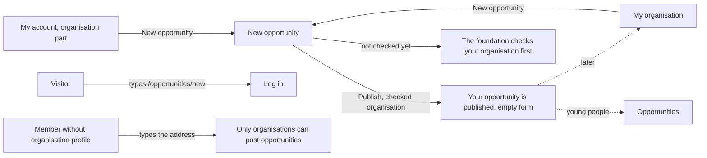

# New opportunity

- Component: web/src/pages/NewOpportunity.tsx, with NewOpportunity.module.css and NewOpportunity.test.tsx
- Address in the browser: /opportunities/new. In web/src/App.tsx the route /opportunities/:id of issue 55b comes after this one, so /opportunities/new always opens the form (task 55b.3).
- Shared parts it uses: OpportunityFields.tsx (issue 153), TagInput.tsx (issue 36), NotCheckedNotice.tsx (issue 140)

## What the page is for

An organisation on Connect, such as a company, a fund, a club or a school, uses this page to offer young people a chance: an internship, a job, a project or something else. It fills in a title, a description, the kind, a closing date and a few tags, and presses Publish. Young people then find the opportunity in the list of open opportunities. Only an organisation that the foundation has checked can publish, so young people can trust that every offer comes from a real organisation.

## Who can open it

- Visitor (not logged in): the route sits inside RequireLogin of issue 04, so a visitor is sent to Log in first.
- Member (young person) without an organisation profile: never sees a link New opportunity. When they type the address, they read "Only organisations can post opportunities" and see no form, also not for a moment.
- Organisation that the foundation has not checked yet: sees the whole form and can fill in every field, but in place of the button Publish it reads "The foundation checks your organisation first. You can publish after that." (issue 140).
- Checked organisation: sees the form with the button Publish and can publish.
- Admin: the cards give no separate rule for an admin on this page. An admin account without an organisation profile gets the same refusal as a member.

## How you get there and where you go next

- From My account: in the organisation part, next to "You are logged in for <name>", the link New opportunity (task 54.3). Only an account with an organisation profile sees it.
- From My organisation (/organisation): the link New opportunity below the heading, and the link New opportunity after the sentence "You have no open opportunities yet" (issue 54b).
- After a publish the page stays open with an empty form, so the organisation can post another one. The new opportunity shows under Your opportunities on My organisation, and young people find it on Opportunities (issue 55).

## Every element of the page, top to bottom

The page sits inside AppShell of issue 06, so the five tabs stay around it.

1. Loading text: "Loading..."
   - Shows while the page asks whether the account has an organisation profile and while the session loads. No field and no button show in the meantime, never a flash of the button Publish.
   - Data: getCurrentOrganisationProfile() of task 34.4, which asks GET /api/organisation-profiles/current. The session comes from useSession() of issue 04, which asks GET /api/sessions/current. Since task 140.3 that answer holds isCheckedOrganisation.
   - Built by task 54.3 (issue 54 Post an opportunity, GitLab #106, sprint 3) and task 140.4 (issue 140 Only a checked organisation can publish, GitLab #139, sprint 3).
2. Refusal for an account without an organisation profile: "Only organisations can post opportunities"
   - Shows in place of the form when the profile question answers 404, and also when Publish answers 403 for not an organisation.
   - Built by task 54.3, issue 54, GitLab #106, sprint 3.
3. Not reachable on load: "Connect is not reachable right now, try again later"
   - Shows with no form when the profile question gets no answer or a 5xx answer.
   - Built by task 54.3, issue 54, GitLab #106, sprint 3.
4. Message area above the form
   - Not reachable on publish: "Connect is not reachable right now, your text is kept", in an area with role alert. Every field, and every chosen tag, keeps its value. client.ts of task 3.6 turns every 5xx answer and every network failure into this result.
   - Published: "Your opportunity is published", in an area with role status. All fields and the chosen tags are empty again.
   - Built by task 54.3 (issue 54) and task 54c.3 (issue 54c Add tags to my opportunity, GitLab #110, sprint 3).
5. The form
   - The form has noValidate, so the messages come from the page and the server and not from the bubble of the browser.
   - Before sending, the page checks the same simple rules in the browser (required fields, no day before today). The server still decides.
   - Since issue 153 the four fields below live in the shared component OpportunityFields (web/src/components/OpportunityFields.tsx), which the page Change opportunity also uses. It gets the values, the messages and onChange and never calls the server. Every label and message stays the same (task 153.5, issue 153 Change my opportunity after publishing, GitLab #212, sprint 5).
6. Field Title
   - Label above it: Title. A text field of at most 120 characters. Required.
   - Messages next to the field: "Fill in a title" and "A title has at most 120 characters" (CreateOpportunityRequestValidator, task 54.2).
   - Built by task 54.3, issue 54, GitLab #106, sprint 3.
7. Field Description
   - Label above it: Description. A textarea with a counter, such as "3800 characters left". Required, at most 4000 characters.
   - Messages next to the field: "Fill in a description" and "A description has at most 4000 characters" (task 54.2).
   - Built by task 54.3, issue 54, GitLab #106, sprint 3.
8. Field Kind
   - Label above it: Kind. A select with Internship, Job, Project and Other, and no option chosen at the start. Required.
   - Message next to the field when no kind or a wrong kind is sent: "Choose a kind" (task 54.2).
   - The labels live once, in KIND_LABELS in web/src/api/opportunities.ts, so every list of opportunities shows the same words.
   - Built by task 54.3, issue 54, GitLab #106, sprint 3.
9. Field Tags
   - Label above it: Tags. Placed below Kind. It uses TagInput of issue 36, the one tag component of the whole site.
   - Suggested tags to tap, from getSuggestedTags() in web/src/api/tags.ts (issue 36). When only that call fails, a short line says the suggestions could not be loaded, and the field still works with Add your own.
   - The field Add your own with a button Add. Enter in this field adds the tag and never sends the form.
   - Each chosen tag shows with a Remove button (issue 36b). A counter such as "3 of 10 tags" comes from maxTags with the constant MAX_TAGS.
   - Hint below the field: "Skills and interests only. Never the name of a person."
   - Rules: at most 10 tags. An eleventh gets "An opportunity has at most 10 tags" below the field and is not added. A name of more than 30 characters gets "A tag has at most 30 characters". A tag with a sign that is not allowed gets a plain message from the server (issue 36d). Each name is made small, with one space between words, by normalizeTag in web/src/api/tags.ts, and a double is ignored.
   - The tags follow the one tag model of the board: the shared table tag with the link table opportunity_tag.
   - The field Tags stays on New opportunity only. It is not on Change opportunity.
   - Built by task 54c.3, issue 54c Add tags to my opportunity, GitLab #110, sprint 3.
10. Field Closing date
    - Label above it: Closing date. The date field of the browser (input type date) with today as the earliest day. Required.
    - Rule: an empty date gets "Fill in a closing date". Today is accepted, a day before today gets "The closing date cannot be in the past". Today follows Dutch time on the server (OpportunityOpenRule, task 54.2).
    - Built by task 54.3, issue 54, GitLab #106, sprint 3.
11. Button Publish, or the notice about the check
    - Checked organisation (isCheckedOrganisation true): the button Publish. Pressing it calls createOpportunity(form) in web/src/api/opportunities.ts, which sends POST /api/opportunities through request() of client.ts, with the chosen tags in the field tags. While waiting the button says "Publishing..." and is disabled, so the opportunity is published once.
    - Answer 201: the published message and an empty form. Answer 400: each message directly next to its own field, linked with aria-describedby, and the focus on the first wrong field. What was typed stays. Answer 403 for not an organisation: "Only organisations can post opportunities" in place of the form.
    - Unchecked organisation (isCheckedOrganisation false): the button is not rendered at all. In its place NotCheckedNotice (web/src/components/NotCheckedNotice.tsx), a paragraph with role status: "The foundation checks your organisation first. You can publish after that."
    - Answer 403 not checked, for example when the check was taken back while the page was open: the same notice replaces the button and every field keeps its value. The page recognises this answer with isNotCheckedProblem in web/src/api/client.ts. The server refuses on POST /api/opportunities and saves nothing (task 140.2).
    - Built by task 54.3 (issue 54, GitLab #106, sprint 3) and task 140.4 (issue 140, GitLab #139, sprint 3).

## States

- Loading: "Loading..." and no field and no button.
- Empty form: the four fields and Tags, with no kind chosen and no tags chosen.
- Filled and publishing: the button says "Publishing..." and is disabled.
- Published: "Your opportunity is published" and an empty form. The organisation sees the sentence within two seconds after pressing Publish on a phone (issue 54 AC9).
- Wrong input: a message next to each wrong field, the focus on the first one, the typed text stays.
- Not an organisation: "Only organisations can post opportunities" and no form.
- Not checked yet: the form with "The foundation checks your organisation first. You can publish after that." where Publish would be.
- Not reachable on load: "Connect is not reachable right now, try again later" and no form.
- Not reachable on publish: "Connect is not reachable right now, your text is kept" above the form, every field and tag kept. A tester checks it by switching the phone to airplane mode and pressing Publish.
- Phone (360 pixels wide): one column. The date field of the browser must work with a thumb (task 54.5).
- Laptop (1280 pixels wide): the whole form works with only a keyboard (task 54.5).
- Design: the Figma frame New opportunity on the Figma board of Connect, page Design directions. Colours, fonts and spacing come only from the variables in web/src/styles/tokens.css. The screenshots at 360 and 1280 pixels are checked against that frame.

## Accessibility and privacy

- Every field has a visible label above it. Every message sits next to its field and is linked with aria-describedby. After a wrong answer the focus moves to the first wrong field.
- The published sentence and the notice about the check are in an area with role status, the not reachable sentence in an area with role alert. A screen reader user hears the sentence about the check where the button would be (issue 140 AC7).
- The button Publish is never only hidden with CSS for an unchecked organisation, because a hidden button can still be reached with a keyboard or a screen reader.
- The page uses the date field of the browser, which works with a keyboard, a screen reader and the date format of the phone.
- No field asks about a young person. The organisation is the only name on the form. The tag hint says tags are never the name of a person.
- The page stores nothing in the browser between visits, so a shared computer at a school or a library never shows the next person the text of the organisation.
- The opportunity holds nothing about any young person. When an organisation deletes its account, its opportunities are deleted with it (issue 54 AC10, through issue 113 Delete my account and all my data).
- A member or a visitor never sees the form, also not for a moment.

## Built by

| Board | Title | GitLab | Sprint | Prio |
|---|---|---|---|---|
| 54 | Post an opportunity | #106 | 3 | should |
| 54c | Add tags to my opportunity | #110 | 3 | should |
| 140 | Only a checked organisation can publish | #139 | 3 | should |
| 153 | Change my opportunity after publishing | #212 | 5 | could |

## Open points

- Issue 10, question 54: when the foundation takes back the check of an organisation, must the opportunities it already published disappear for young people? The same answer decides whether an email to the organisation after a check is needed.
- Issue 10, question 68: may an organisation change its opportunity after publishing, also its tags, and reopen a closed one? Issue 153, which moves the fields into OpportunityFields, is only built when the client says yes.
- Issue 155 Filter the opportunities by kind and issue 156 Find opportunities by tag decide with the client whether the list and the block on Discover also show the tags.

## AI use declaration

AI was used as a writing support tool while working on this document. We used AI to draft
the formulation of sentences, the structure of wording, readability, and clarity from
content that we had provided, and to generate the diagrams. The content itself, including
our experiences, reflections, learning goals, decisions, self-assessments, and
conclusions, is our own. We reviewed the drafts and decided as a team which text to
include.
