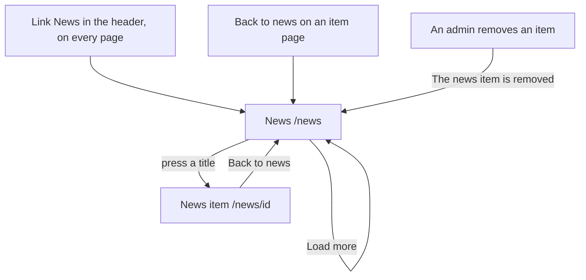

# The page News

Component: `web/src/pages/News.tsx`, with `web/src/components/NewsPicture.tsx`.
Address in the browser: `/news`.

## What the page is for

The page News shows the news of the WailSalutem Foundation around Connect, with the newest item at the top. Anyone can read it, also without an account, so a young person, a parent or an organisation knows what is happening without searching for it. Each item shows its picture when it has one, its title and its date. Pressing a title opens the whole item on its own page.

## Who can open it

- Visitor, member (young person or organisation) and admin: everyone sees the same list in the same order. The route sits outside `RequireLogin`.
- Nobody sees who at the foundation wrote an item, no name and no email address.

## How you get there and where you go next

- The link News in the header of the frame (AppShell), next to the name Connect, on every page, on a phone and on a laptop. It is not a sixth tab. On `/news` it is marked with `aria-current="page"`.
- The link Back to news on the page of one item (`/news/<id>`).
- After an admin removes an item, Connect brings the admin here with "The news item is removed" above the list.
- From here a title opens the page of that item at `/news/<id>`.

## Every element of the page, top to bottom

### Removed sentence

- Text: "The news item is removed"
- When: only right after an admin removed an item, passed through the state of the navigation. It sits in an area with role status above the list.
- Built by: issue 165 Remove a news item, task 165.3 (GitLab #225, sprint 5).

### Heading

- Text: News. It is the one h1 of the page. The title of the browser tab is "Connect, News".
- Built by: issue 72 See the news list, task 72.4 (GitLab #135, sprint 3).

### The list of news items

- What it shows: twenty items, newest first.
- Data: `getNewsItems(page)` in `web/src/api/newsItems.ts` asks `GET /api/news-items?page=<page>&pageSize=20` through the shared helper in `client.ts` and returns the items with the total, or not reachable. The page never sees a status code. Anyone may call the address without logging in. The answer holds per item only the id, the title, the date and the picture, with page, page size and total in `meta`. It never holds the text or anything about the author (task 72.3). A wrong page or page size gets a wrong input answer with a message for that field.
- Built by: issue 72, tasks 72.3 and 72.4.

### One item in the list

- The picture: above the title, only when the item has one. `NewsPicture` renders one image in a box with a fixed shape of 16 to 9, filled with `object-fit: cover`, with `loading="lazy"` so pictures further down load only when you scroll to them. The alt text is the description the admin wrote in issue 71b, never the file name and never the title again. The browser loads the picture from `GET /api/news-items/<id>/image`, which anyone may call (task 72b.2). An item without a picture shows no image, no empty box and no alt text. A picture that cannot be loaded hides itself, and the title stays. Because each picture gets its space first, the titles do not move while the pictures arrive. Built by issue 72b See the picture of a news item, task 72b.3 (GitLab #137, sprint 3).
- The title: a heading of level 2, and a React Router link to `/news/<id>`. Built by issue 73 Open a news item, task 73.3 (GitLab #136, sprint 3).
- The date: in a readable form such as 3 October 2026, from `publishedAt` in the time zone of the browser. Built by issue 72, task 72.4.
- Nothing about who wrote it.

### Button Load more

- Label: Load more.
- What it does: shown below the list while the number of items shown is lower than the total. It asks the next page and adds its items below the ones already shown. While it waits it says Loading... and is disabled, so a second press asks nothing extra. An item that is already shown is never added twice, compared by id. It is gone when everything is shown.
- Built by: issue 72, task 72.4.

### Could not load the news, with Try again

- Text: "Could not load the news", with a button Try again.
- When: Connect cannot be reached. On the first page it shows in the place of the list, in an area with role alert, and Try again asks page 1 again. On Load more the items stay, and the sentence with Try again shows below them. Try again asks the same page again.
- Built by: issue 72, task 72.4.

## States

| State | What the person sees |
|---|---|
| Loading | Three grey blocks in the shape of an item and "Loading..." in an area with role status. |
| Empty | "No news yet" in the place of the list. |
| Filled | Twenty items, newest first, with picture, title and date, and Load more while there are more. |
| Loading more | Load more says Loading... and is disabled. |
| Not reachable | "Could not load the news" with a button Try again, in the place of the list or below the items already shown. |
| Just removed (admin) | "The news item is removed" above the list. |
| Phone | The first items within two seconds after pressing News on a mobile connection. |
| Laptop | The same list. |

## Accessibility and privacy

- Each picture has the description of the admin as its alt text, so a screen reader hears what the picture shows and not a file name.
- The title of each item is a heading of level 2 below the one h1 News.
- Loading is a role status area, the error a role alert area.
- Saving a picture on a phone shows no place where the photo was taken (issue 72b, with the upload of issue 71b).
- The page never shows the name or the email address of the person at the foundation who wrote an item.

The design: colours, fonts and spacing come only from `web/src/styles/tokens.css`, following the Figma frame News on the page Design directions of the Figma board. When there is no frame yet, the builder follows the page Projects of issue 06 and writes that in the merge request.

## Built by

| Board | Title | GitLab | Sprint | Prio |
|---|---|---|---|---|
| 72 | See the news list | #135 | 3 | could |
| 73 | Open a news item (the titles become links) | #136 | 3 | could |
| 72b | See the picture of a news item | #137 | 3 | could |
| 165 | Remove a news item (the sentence after a removal) | #225 | 5 | could |

## Open points

- News on the home page: issue 166, built only after the client answers issue 10, question 81.
- Removing an item: issue 165 is built only when the client says yes to issue 10, question 80, may an admin remove a news item after it is published.
- Changing an item: issue 164, built only after the client answers issue 10, question 79.
- Searching or filtering the news, or news per organisation, is not planned. A wish for it goes to the client through issue 10.

## AI use declaration

AI was used as a writing support tool while working on this document. We used AI to draft
the formulation of sentences, the structure of wording, readability, and clarity from
content that we had provided, and to generate the diagrams. The content itself, including
our experiences, reflections, learning goals, decisions, self-assessments, and
conclusions, is our own. We reviewed the drafts and decided as a team which text to
include.
