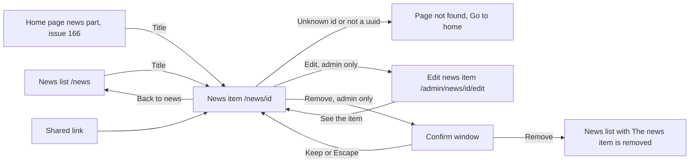

# News item

- Component: frontend/src/pages/NewsItem.tsx, with NewsItem.module.css and NewsItem.test.tsx. The picture is the shared component frontend/src/components/NewsPicture.tsx.
- Address in the browser: /news/:id, for example /news/00000000-0000-4000-8000-000000000725 (registered in frontend/src/App.tsx inside the layout route of issue 06 and outside RequireLogin)
- Title of the browser tab: Connect, <title of the item>

## What the page is for

The foundation publishes news on Connect. This page shows one news item in full: its title, its date, the line that the WailSalutem Foundation published it, a picture when there is one, and the whole text with its paragraphs. Anyone can open it, also without an account, so a young person can send the link to a friend. It never shows which person at the foundation wrote it. An admin of the foundation also finds buttons here to change or remove the item.

## Who can open it

- Visitor who is not logged in: sees the whole item. The server address is on the open list, so no log in is needed.
- Member (young person) and organisation: see the same item. They never see the buttons Edit or Remove. When a member types the address of the edit form, they read "You are not allowed to see this page".
- Admin of the foundation: sees the same item, plus the button Edit (issue 164) and the button Remove (issue 165). The buttons show only when the role in useSession is Admin.
- Anyone with an address that does not point to an item, or with an id that is not a uuid, sees the friendly not found page of issue 53 in the place of the item.

## How you get there and where you go next

You arrive by pressing a title in the news list at /news (issue 72, the titles become links in task 73.3), by pressing a title in the news part of the home page (issue 166 News on the home page), or by opening a link someone shared. The link News sits in the header of the site.

From here the link Back to news goes to /news. An admin can press Edit to go to the edit form at /admin/news/<id>/edit, or Remove to open a confirm window. After a removal the admin lands on /news with the sentence "The news item is removed".

## Every element of the page, top to bottom

The page sits inside the shell of the site. Colours, fonts and spacing come only from the variables in frontend/src/styles/tokens.css.

Data for the whole page: getNewsItem(id) in frontend/src/api/newsItems.ts asks GET /api/news-items/{id} through the shared helper and returns the item, not found or not reachable. The page never sees a status code. The server (task 73.2, NewsItemReadService, NewsItemIdValidator) is open to everyone (AllowAnonymous). The id is bound as text and checked as a uuid, never with {id:guid} in the route. The answer is {"data": {"id", "title", "body", "publishedAt", "changedAt", "image"}, "meta": {}}. It never holds the author, and the query (task 73.1) does not even read the author. An unknown uuid and a text that is not a uuid give the same NotFoundProblem, so nobody learns which ids exist. A database that is down gives 503 with "Connect is not reachable right now", never 404.

1. Link: Back to news
   - Goes to /news.
   - Built by task 73.3, issue 73 Open a news item, GitLab #136, sprint 3.
2. Heading (h1): the title of the item
   - The only main heading of the page.
   - Built by task 73.3, issue 73, GitLab #136, sprint 3.
3. Date line: the date in a readable form, such as 3 October 2026, with the words "Published by the WailSalutem Foundation"
   - No name and no email address of the admin who wrote it.
   - Built by task 73.3, issue 73, GitLab #136, sprint 3.
4. Line: Changed on, for example "Changed on 5 October 2026"
   - Below the date line, only when changedAt is filled, for every visitor. It never says who changed the item.
   - Data: the field changedAt of GET /api/news-items/{id}, null for an item that was never changed (task 164.2), from the column changed_at of the table news_item (task 164.1).
   - Built by tasks 164.1, 164.2 and 164.3, issue 164 Change a news item, GitLab #227, sprint 5. Only built when the client says yes to question 79 of issue 10.
5. Button: Edit (admin only)
   - Below the date line. It is a link to /admin/news/<id>/edit, styled as a button. Only rendered when useSession says the role is Admin (the field role of GET /api/sessions/current, task 45.2).
   - The edit form sends PUT /api/admin/news-items/{id}, in the group /api/admin with the rule AdminOnly. A member gets 403 with "You are not allowed to see this page", a visitor 401.
   - Built by task 164.3, issue 164, GitLab #227, sprint 5.
6. Button: Remove (admin only)
   - Next to Edit when that exists. A real button element, only rendered when the role in useSession is Admin.
   - Pressing it opens ConfirmDialog of task 113.3 with the question "Remove this news item? Everyone loses it and it cannot be undone.", confirmLabel Remove and cancelLabel Keep (the optional prop cancelLabel of task 70.3), and the focus on Keep when it opens, through the optional prop focusCancel with the default false that task 165.3 adds to ConfirmDialog. Issues 113 and 70 do not pass focusCancel, so their windows stay as they are.
   - Keep or Escape: the window closes, the focus goes back to Remove, nothing is sent.
   - Remove in the window calls removeNewsItem(id) in frontend/src/api/newsItems.ts, which sends DELETE /api/admin/news-items/{id}. The server (task 165.2, RemoveNewsItemService) removes the row first (task 165.1) and then the picture file. Only an admin may call it. A member gets 403, a visitor 401.
   - While waiting: Remove in the window says "Removing..." and is disabled, so a second press sends nothing.
   - Removed (204): the admin goes to /news, and the list shows "The news item is removed" in an area with role status.
   - Not found (404, for example when another admin removed it first): NotFound of task 53.3 in the place of the item.
   - Not reachable: "Could not remove, try again" in the window, in an area with role alert. The item stays.
   - Built by tasks 165.1, 165.2 and 165.3, issue 165 Remove a news item, GitLab #225, sprint 5. Only built when the client says yes to question 80 of issue 10.
7. Picture (only when the item has one)
   - Between the date line and the text, with loading eager and the full width of the text column, in a box with a fixed shape of 16 to 9 with the picture filling it (object-fit cover).
   - Data: the field image of the answer, {"url": "/api/news-items/<id>/image", "altText": "..."} or null. The browser loads the picture from GET /api/news-items/{id}/image (task 72b.2), which is open to everyone and sends Content-Type image/jpeg or image/png, X-Content-Type-Options nosniff and Cache-Control public, max-age=86400.
   - The alt text is the description the admin wrote in issue 71b, never the file name and never the title again.
   - No picture: no img, no empty box, no alt.
   - A picture that cannot be loaded hides itself, and the title and the text stay.
   - A saved copy of the picture holds no place where the photo was taken, because issue 71b removes the photo details.
   - Built by tasks 72b.1, 72b.2 and 72b.3, issue 72b See the picture of a news item, GitLab #137, sprint 3.
8. The text of the item
   - Shown exactly as the admin typed it, as plain text in a paragraph with white-space: pre-line, so the line breaks stay. Never through dangerouslySetInnerHTML. Signs like < and > show as signs, so <b>Check 73</b> is not bold.
   - Built by tasks 73.1, 73.2 and 73.3, issue 73, GitLab #136, sprint 3.

## States

- Loading: a grey block in the shape of the item and "Loading..." in an area with role status.
- Filled: Back to news, the title, the date line, Changed on when the item was changed, the picture when there is one, and the text. The buttons Edit and Remove only for an admin.
- Empty: not used. The page shows one item.
- Not found: NotFound of task 53.3 in the place of the item, with "This page does not exist or is no longer available" and the link Go to home. No own text. This also shows for the link of a removed item.
- Not reachable or no answer: "Could not load this item" in an area with role alert, and a button Try again that asks again. Try again shows the item once Connect is back. A tester checks this by switching the phone to airplane mode.
- Not reachable in the remove window: "Could not remove, try again".
- Phone (360 pixels wide or close): the text shows within two seconds after pressing a title, over a mobile connection.
- Laptop: the same content. The team checks are done on a phone and a laptop.
- Design: the Figma frame News item on the page Design directions of the Figma board of Connect. When there is no frame yet, the page follows the page News of task 72.4 (task 73.3). The picture follows the Figma frames News and News item (task 72b.3). The remove window follows the confirm window of issue 113.

## Accessibility and privacy

- A screen reader hears the title of the item as the one main heading of the page.
- A screen reader hears the description the admin wrote for the picture, not a file name.
- The remove window is ConfirmDialog of issue 113. The focus lands on Keep when it opens, so pressing Enter by habit keeps the item. Keep and Escape put the focus back on Remove.
- The message of a failed load or remove sits in an area with role alert, a removal in an area with role status.
- The page never shows which person at the foundation wrote or changed an item: no name and no email address. The server answer holds no author.
- The text is shown as plain text, so nothing an admin typed can run as a script on the page.
- After a removal the item and its picture are gone for everyone, also through the old picture address. A phone that showed the picture before may keep its copy for up to one day.

## Built by

| Board | Title | GitLab | Sprint | Prio |
|---|---|---|---|---|
| 73 | Open a news item | #136 | 3 | could |
| 72b | See the picture of a news item | #137 | 3 | could |
| 165 | Remove a news item | #225 | 5 | could |
| 164 | Change a news item | #227 | 5 | could |

Issue 73 needs issues 72 See the news list and 53 A friendly page for a link that does not exist first. Issue 72b needs 72, 73 and 71b Add a picture to a news item. Issue 164 needs 73, 10 and 29. Issue 165 needs 72, 10, 113, 29, 71b, 72b, 73 and 70.

## Open points

- Issue 164 (Edit and Changed on) is only built when the client says yes to question 79 of issue 10: may an admin change an item after it is published, and should it show that it was changed. Whether the picture may be changed too is question 132.
- Issue 165 (Remove) is only built when the client says yes to question 80 of issue 10. The client is told that a phone may keep a copy of the picture for up to a day.
- Task 73.3 says to follow the page News of task 72.4 when there is no Figma frame News item yet. Whether that frame exists is not on the cards.

## AI use declaration

AI was used as a writing support tool while working on this document. We used AI to draft
the formulation of sentences, the structure of wording, readability, and clarity from
content that we had provided, and to generate the diagrams. The content itself, including
our experiences, reflections, learning goals, decisions, self-assessments, and
conclusions, is our own. We reviewed the drafts and decided as a team which text to
include.
