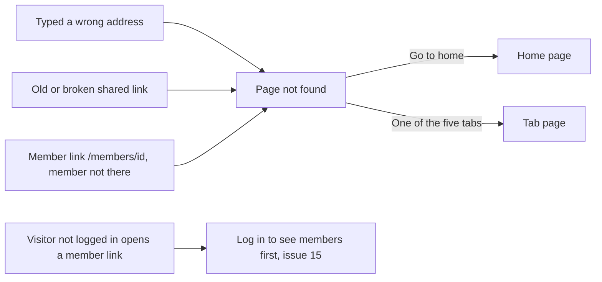

# Page not found

- Component: web/src/pages/NotFound.tsx, with NotFound.module.css and NotFound.test.tsx
- Address in the browser: any address the site does not know (the catch all route `*`), for example /this-does-not-exist. The member page /members/:id also shows this page when the member is not there.
- Title of the browser tab: Connect, Page not found

## What the page is for

Links to Connect get shared, and sooner or later one of them points to something that is not there. This page makes sure such a link never ends in a technical error or an empty screen. The person reads one friendly sentence and gets a link back to the home page, with the five tabs of Connect still around it.

## Who can open it

- Visitor: sees this page for every address that does not exist. The page looks the same whether the visitor is logged in or not.
- Member (young person), organisation and admin: see the same page for a made up address, and for a link to a member who does not exist.
- A visitor who is not logged in and opens a member link (/members/<id>) does not see this page. The login guard of issue 15 shows Log in to see members first.

## How you get there and where you go next

You arrive here by typing a wrong address, by opening an old or broken link, or by opening a member link for a member who does not exist or has an id with a typing error. Later detail pages show this same page when the thing they ask for is not there: the projects and the badges on the page of another member (issues 62b and 80b), the project page and its edit form (issue 64, and issue 159 for the picture of a project), the event page (issue 66b), a news item (issue 73, and issues 164 and 165 when an admin changes or removes it) and the challenge page (issues 75b and 76b). Issue 68 Register for an event gives the same not found answer on the server.

The only way on is the link Go to home, or one of the five tabs.

## Every element of the page, top to bottom

The page sits inside AppShell of issue 06, so the tabs and the footer stay in place around it.

1. Heading (h1): This page does not exist or is no longer available
   - Shows only this sentence. No error number, no code, no id and no server address.
   - Data: none for an unknown address. The catch all route shows the page at once, without asking the server.
   - For a member link, the page MemberProfile asks GET /api/member-profiles/{id} through getMemberProfile in web/src/api/memberProfiles.ts. When the answer is 404, request() in web/src/api/client.ts gives the shared result not found, and MemberProfile shows NotFound in place of the profile. The page never reads a status code itself.
   - On the server, an id that is not a uuid, an unknown member, an unknown site page and an unknown address under /api all give the same NotFoundProblem answer (task 53.2). A visitor gets not logged in first.
   - Built by task 53.3 (screen), 53.2 (server) and 53.1 (database check), issue 53 A friendly page for a link that does not exist, GitLab #105, sprint 3.
2. Link: Go to home
   - Styled as a button, but it is a link (React Router Link) to /.
   - Pressing it swaps the page inside the shell. The site does not load again and the tabs stay.
   - It can be opened in a new tab, and a screen reader reads it as a link.
   - Built by task 53.3, issue 53, GitLab #105, sprint 3.

## States

- Loading: for an unknown address there is no loading, the page shows at once. For a member link, MemberProfile keeps its own loading state from issue 14 until the answer comes.
- Filled: the heading This page does not exist or is no longer available and the link Go to home.
- Empty: not used. The page has no list.
- Error and not reachable: this page is never shown when Connect cannot be reached. The member page then shows Connect is not reachable right now, try again later. A tester checks this by switching the phone to airplane mode.
- Phone (360 pixels wide): the sentence and the link fit on the screen without scrolling, above the tabs. The page shows within two seconds after opening a wrong link.
- Laptop (1280 pixels wide): the same content inside the shell, no scrolling sideways.
- Design: the Figma frame of the not found page on the Figma board of Connect, page Design directions. Colours, fonts and spacing come only from the variables in web/src/styles/tokens.css.

## Accessibility and privacy

- A screen reader hears the sentence as the heading of the page and hears Go to home as a link it can follow.
- axe reports 0 issues at 360 and 1280 pixels.
- Nothing technical is shown: no error number, no English error text from the server, no id and no server address.
- A made up member link, a member link with a typing error and a made up address all look exactly the same. Nobody can learn from the page whether a member left or never existed.
- A member who was switched off (issue 46) or has not confirmed their email address (issue 29) gets a not found answer from the server, so this page shows for them too.

## Built by

| Board | Title | GitLab | Sprint | Prio |
|---|---|---|---|---|
| 53 | A friendly page for a link that does not exist | #105 | 3 | should |

Issue 53 needs issues 14 View another member's profile, 06 Move between the five tabs of Connect and 51 Read the privacy statement from every page first. Task 53.3 also changes MemberProfile.tsx, memberProfiles.ts and the tests of issue 14 that expected the old sentence This member does not exist.

## Open points

- None on the card of issue 53. The Figma frame of the not found page is the reference for how it looks.

## AI use declaration

AI was used as a writing support tool while working on this document. We used AI to draft
the formulation of sentences, the structure of wording, readability, and clarity from
content that we had provided, and to generate the diagrams. The content itself, including
our experiences, reflections, learning goals, decisions, self-assessments, and
conclusions, is our own. We reviewed the drafts and decided as a team which text to
include.
