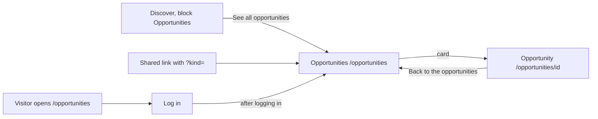

# Opportunities, the list of all open opportunities

- Component: frontend/src/pages/Opportunities.tsx, with Opportunities.module.css and Opportunities.test.tsx
- Address in the browser: /opportunities, and /opportunities?kind=Internship (or Job, Project, Other) with a filter
- Server address: GET /api/opportunities?page=1&pageSize=20, with &kind=<kind> when a filter is chosen

## What the page is for

Organisations on Connect post opportunities for young people: an internship, a job, a project or another offer. This page shows the open opportunities of every organisation in one list, the newest at the top. A young person finds a chance that fits them, and an organisation sees what else is on offer. With issue 155 the young person can show only one kind, for example only internships.

## Who can open it

- Member (young person): sees the list.
- Organisation: sees exactly the same list as a young person (AC5 of issue 55). The server lets any logged in account in, member or organisation.
- Admin: the cards name no separate view. The page sits inside RequireLogin, so a logged in admin sees the same list.
- Visitor who is not logged in: sees the page Log in and no opportunity, also with a link that holds a kind (AC9 of issue 155).
- What nobody ever sees here: an opportunity of an organisation that has not confirmed its email address or that the foundation switched off, a closed opportunity, and anything about other members, not even how many people are interested.

## How you get there and where you go next

You get here from Discover. At first the plain link See all opportunities sits below the matches (task 55.4). Since issue 55c that link moves inside the block Opportunities on Discover (task 55c.3). A link that someone shares, for example /opportunities?kind=Internship, opens the list with that kind chosen.

From here a young person taps a card to open the page of that opportunity at /opportunities/<id> (issue 55b). That page is described in Opportunity.md. Its link Back to the opportunities leads back here.

## Every element of the page, top to bottom

The page sits inside AppShell of issue 06, so the five tabs stay around it.

1. Heading: Opportunities
   - The h1 of the page.
   - Built by task 55.4, issue 55 See the open opportunities, GitLab #108, sprint 3.

2. Filter buttons: All, Internship, Job, Project, Other
   - Five real buttons in a group with the label "Show" (role group with aria-label), above the list. The component is KindFilter in frontend/src/components/opportunities/KindFilter.tsx, used on this page only. The labels of the four kinds come from KIND_LABELS of task 54.3, and the list of buttons is KIND_FILTERS in frontend/src/api/opportunities.ts.
   - All is chosen when the page opens. The chosen button has aria-pressed="true" and a mark that is not only a colour: a border and bold text.
   - The choice lives in the address. The page reads kind with useSearchParams. Pressing a button makes the address /opportunities?kind=<name>, or /opportunities for All. A reload, a copied link and the Back button of the browser keep the choice.
   - A missing kind or any other word, for example /opportunities?kind=Party, chooses All, and the page then asks without kind. A wrong link never shows an error.
   - A change of kind starts the list again at page 1 and shows the loading text.
   - The server checks kind with its validator. An unknown kind, for example kind=Party or kind=internship, gets code 400 with "Choose Internship, Job, Project or Other as kind" for the field kind, and nothing is read (task 155.2). The page never sends such a kind, because it asks without kind for any word it does not know. The block on Discover of issue 55c is not changed and always shows every kind.
   - On a phone the row wraps to a second line when it does not fit.
   - Built by tasks 155.1 (query), 155.2 (server parameter) and 155.3 (screen), issue 155 Filter the opportunities by kind, GitLab #214, sprint 5. Only built when the client says yes to question 70 of issue 10.

3. The list of opportunity cards
   - The cards are in a list (ul with li), in the order of the answer, newest first.
   - Each card is OpportunityCard (frontend/src/components/OpportunityCard.tsx): the title as a heading, the name of the organisation, the kind from KIND_LABELS and the closing date written out, for example "Closes on 31 December 2030".
   - The closing date is a date without a time, so it is formatted with Intl.DateTimeFormat and timeZone "UTC". A phone in a time zone west of London then still shows the right day.
   - Since task 55b.4 the whole card is one React Router Link to /opportunities/<id>. The readable name of the link is the title. The organisation, the kind and the date are plain text inside it. There is no button or second link inside a card, and the card has a clear focus line from tokens.css.
   - Data: listOpportunities(page, kind) in frontend/src/api/opportunities.ts asks GET /api/opportunities?page=<n>&pageSize=20 through request() of frontend/src/api/client.ts, and adds kind only for Internship, Job, Project or Other. The page never calls fetch.
   - The server checks the session with the guard of issue 04, reads page and pageSize as text with a validator, takes today in Dutch time from OpportunityOpenRule and asks for one page and the total. It sends back only the fields the screen shows: the items in data, and page, pageSize and total in meta. A wrong page or pageSize gives a plain message per field.
   - In the database the query uses the filter OpenOn of OpportunityOpenRule, so a closed opportunity never gets in, and the rule AccountVisibility of issues 29 and 46, so an unconfirmed or switched off organisation is never listed and not counted. The index ix_opportunity_created_at_id keeps it fast.
   - The seed organisation Seed Organisation has 25 open test opportunities and two hidden ones, listed in docs/testing/testData.md.
   - Built by tasks 55.1 (query and index), 55.2 (seed data), 55.3 (server address) and 55.4 (screen), issue 55, GitLab #108, sprint 3. The cards became links in task 55b.4, issue 55b Open an opportunity page, GitLab #109, sprint 3.

4. Button: Load more
   - Below the list while the number of cards is smaller than meta.total. It asks the next page, of the same kind when a filter is chosen, and adds the items below.
   - While the next page loads the button says "Loading..." and is disabled.
   - After each load the focus moves to the link of the first new card, also when the button disappears on the last page.
   - Built by task 55.4, issue 55, GitLab #108, sprint 3. Keeping the kind on Load more is task 155.3.

## States

- Loading the first page: "Loading...".
- Empty, nothing open: "There are no open opportunities right now" in place of the list.
- Empty for one kind: "There are no open opportunities of this kind right now" in place of the list, with a button Show all that chooses All (AC5 of issue 155). The seed data never has an open opportunity of the kind Other.
- Filled: up to twenty cards, newest first, with Load more when there are more.
- Not reachable on the first load: "Connect is not reachable right now" with a button Try again in place of the list (task 55.4).
- Not reachable on Load more: the same sentence and Try again below the list, in an area with role alert. The cards already shown stay.
- Not reachable after pressing a filter button: "Connect is not reachable right now" in place of the list, with Try again that asks the same kind again. The buttons stay (task 155.3).
- Phone and laptop: on a phone the first twenty items show within two seconds (AC7 of issue 55). The screenshots at 360 and 1280 pixels match the Figma frames Opportunities, and axe reports 0 issues.
- Design: the Figma frames Opportunities on the page Design directions of the Figma board. Colours, fonts and spacing come only from frontend/src/styles/tokens.css.

## Accessibility and privacy

- Each card is one link named by its title, so a screen reader reads each item once and a keyboard needs one Tab per item (AC6 of issue 55b).
- After Load more the focus goes to the first new card, so a keyboard user carries on where the new items start.
- Load more is a button, not endless scrolling, so it works with a keyboard and a screen reader and the footer stays reachable.
- The chosen filter button has aria-pressed and a border and bold text, so it can be told apart without colour and with a screen reader (AC8 of issue 155).
- The list never shows who is interested, how many people are, or any member name or email address (AC6 of issue 55).

## Built by

| Board | Title | GitLab | Sprint | Prio |
|---|---|---|---|---|
| 55 | See the open opportunities | #108 | 3 | should |
| 55b | Open an opportunity page | #109 | 3 | should |
| 155 | Filter the opportunities by kind | #214 | 5 | could |

## Open points

- The filter buttons are only built when the client says yes to question 70 of issue 10 The client's priorities for the epics (GitLab #11).
- Finding opportunities by tag is a later issue, 156 Find opportunities by tag. What a closed opportunity shows is issue 56 Closed opportunities disappear.

## AI use declaration

AI was used as a writing support tool while working on this document. We used AI to draft
the formulation of sentences, the structure of wording, readability, and clarity from
content that we had provided, and to generate the diagrams. The content itself, including
our experiences, reflections, learning goals, decisions, self-assessments, and
conclusions, is our own. We reviewed the drafts and decided as a team which text to
include.
