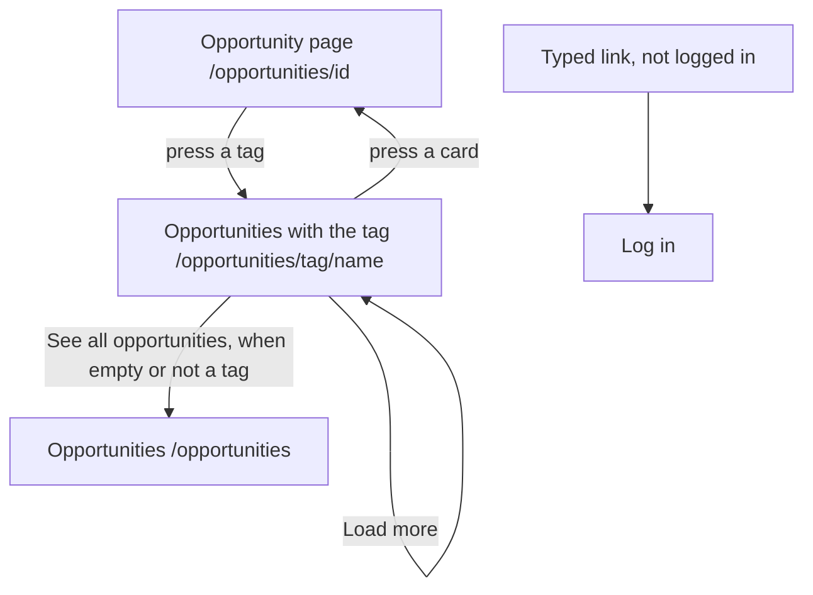

# The page Opportunities with the tag

Component: `frontend/src/pages/OpportunitiesWithTag.tsx`.
Address in the browser: `/opportunities/tag/<name>`, for example `/opportunities/tag/seed%20tag`.

## What the page is for

Opportunities on Connect carry tags about skills and interests, such as video editing or football. A young person who reads an opportunity and sees a tag can press it and get every open opportunity with that same tag, the newest first. That way they find more chances about the skill or interest that caught their eye. Tags are about skills and interests, never about a person, so the list shows offers and never people.

## Who can open it

- Young person and any other logged in member: yes.
- Visitor who is not logged in: sees the page Log in and no opportunity (`RequireLogin` of issue 04).
- Closed opportunities are never in the list. Opportunities of an organisation that the foundation switched off are never in the list either.

## How you get there and where you go next

- Every tag on the page of one opportunity (`frontend/src/pages/Opportunity.tsx`, issue 54c) is a link here. The tags sit in a list under the small heading Tags, below the kind and the closing date. A closed opportunity keeps its tags as links, because this page shows only the open ones.
- From here each card opens the page of its opportunity. The link See all opportunities goes to `/opportunities`.

## Every element of the page, top to bottom

### The tag links on the page of an opportunity (the way in)

- Each tag becomes a React Router link to `/opportunities/tag/<name>`. The name goes through `encodeURIComponent` in `tagListPath(name)` of `frontend/src/api/opportunities.ts`, so drone video becomes drone%20video and a tag of two words or with a - works.
- The text of the link is the name of the tag, with no extra words and no icon, so a screen reader says "link" and the name.
- Each link is at least as big as the touch area the Definition of Done asks for, with the focus style of `tokens.css`.
- Without tags nothing changes: no heading and no list.
- This part asks nothing from the server itself.
- Built by: issue 156 Find opportunities by tag, task 156.4 (GitLab #215, sprint 5).

### Heading

- Text: "Opportunities with the tag" followed by the name, for example Opportunities with the tag seed tag. It is the h1, and the title of the browser tab is the same, so a tab and a screen reader say which list is open.
- The name is read from the address with `useParams`, which already decodes it.
- When the name cannot be a tag, the heading says "Opportunities with a tag", without the name, so nothing strange is shown large on the page.
- Built by: issue 156, task 156.5.

### The list of opportunities

- What it shows: every open opportunity with the tag, the newest first, twenty at a time, as OpportunityCard of tasks 55.4 and 55b.4 in a list (`ul` with `li`). Each card is a link to its opportunity.
- Data: `listOpportunitiesWithTag(name, page)` in `frontend/src/api/opportunities.ts` asks `GET /api/tags/<encoded name>/opportunities?page=<page>&pageSize=20` through `request()` of `client.ts`. It returns the items with page, pageSize and total, not a tag, or not reachable. The page never sees a status code.
- The server normalises the name with `TagRules.Normalize` of issue 36 and checks it with the same length and character rules that a tag must follow. It takes today from `OpportunityOpenRule`. When no open opportunity has the tag, or the tag does not exist, the list is empty with total 0. A visitor is turned away by the guard (task 156.3).
- Built by: issue 156, tasks 156.3 and 156.5.

### Button Load more

- Label: Load more.
- What it does: shown below the list while the number of cards is smaller than `meta.total`. It asks the next page and adds the items below, none twice. After each load the focus moves to the first new card. While waiting it says "Loading..." and is disabled.
- Built by: issue 156, task 156.5.

### Empty, not a tag and not reachable

- Nothing open with this tag (total 0): "There are no open opportunities with this tag right now" in place of the list, with a link See all opportunities to `/opportunities`.
- A name that cannot be a tag (code 400), for example `/opportunities/tag/@@@`: "This is not a tag Connect can look for" in place of the list, with the same link.
- Not reachable (every 5xx answer and every network failure): on the first load "Connect is not reachable right now, try again later" with a button Try again in place of the list. On Load more the same sentence and Try again below the list in an area with role alert, and the cards already shown stay.
- Built by: issue 156, task 156.5.

## States

| State | What the person sees |
|---|---|
| Loading | "Loading..." |
| Empty | "There are no open opportunities with this tag right now" with See all opportunities. |
| Filled | The heading with the tag, the cards newest first, and Load more while there are more. |
| Not a tag | The heading "Opportunities with a tag" and "This is not a tag Connect can look for" with See all opportunities. |
| Not reachable | "Connect is not reachable right now, try again later" with Try again, in place of the list or below it. |
| Not logged in | The page Log in, no opportunity. |

The team check of task 156.7 runs on a phone and on a laptop.

## Accessibility and privacy

- A screen reader hears each tag on an opportunity page as a link with its name, and on this page hears the heading with the name of the tag first.
- After Load more the focus moves to the first new card.
- The list shows opportunities only, never people.

The design: colours, fonts and spacing come only from `frontend/src/styles/tokens.css`, following the Figma frames Opportunity and Opportunities on the page Design directions of the Figma board.

## Built by

| Board | Title | GitLab | Sprint | Prio |
|---|---|---|---|---|
| 156 | Find opportunities by tag | #215 | 5 | could |

## Open points

- Issue 156 is only built when the client says yes to issue 10, question 71.
- Typing a tag in a search field, or pressing more than one tag at once: also issue 10, question 71.

## AI use declaration

AI was used as a writing support tool while working on this document. We used AI to draft
the formulation of sentences, the structure of wording, readability, and clarity from
content that we had provided, and to generate the diagrams. The content itself, including
our experiences, reflections, learning goals, decisions, self-assessments, and
conclusions, is our own. We reviewed the drafts and decided as a team which text to
include.
