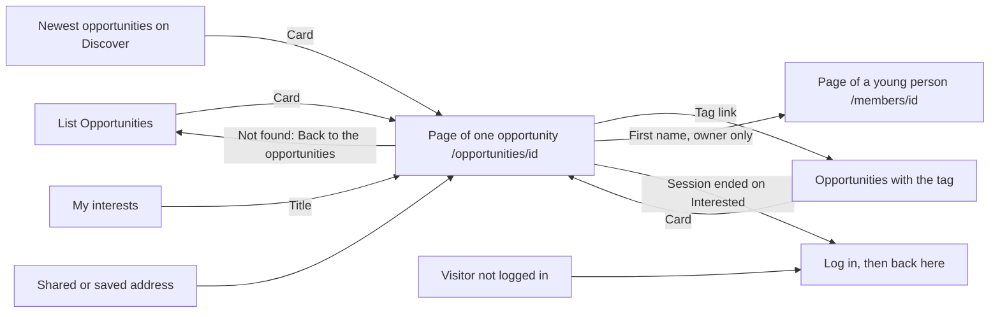

# The page of one opportunity

- Component: frontend/src/pages/Opportunity.tsx, with Opportunity.module.css and Opportunity.test.tsx. Two parts of the page have their own component: InterestButton (the button Interested) and InterestedMembers (the part Interested members).
- Address in the browser: /opportunities/:id, for example /opportunities/00000000-0000-4000-8000-000000055001.
- Title of the browser tab: the title of the opportunity.

## What the page is for

Organisations post opportunities on Connect, such as an internship, a job or a project. This page shows one opportunity in full: the title, the organisation, the kind, the closing date, the tags and the whole description as the organisation wrote it. A young person reads the whole offer here before deciding, and presses Interested with one press, or takes that back. The organisation that posted the opportunity sees on the same page which young people are interested. The page has its own address, so a young person can send it to a friend or open it again later. An old link to a closed opportunity still opens the page, with the sentence that it is closed.

## Who can open it

- Member (young person): sees the opportunity, its tags as links, and the button Interested when the opportunity is open. Sees nothing about other members, not even how many are interested.
- Organisation: sees the opportunity and the tags, but never the button Interested, also not on its own opportunity.
- Organisation that posted the opportunity (the owner): also sees the part Interested members, with the first names of the young people who pressed Interested. It stays after the closing date.
- Any other logged in account, such as another organisation: can open the page (every logged in account may call GET /api/opportunities/{id}), but never sees the part Interested members, not even that it exists.
- Visitor who is not logged in: the route sits inside RequireLogin of issue 04, so the visitor sees the page Log in first. The server answers 401 without a session.
- Opportunity of an organisation that has not confirmed its email address, or was switched off by the foundation: everyone else reads "This opportunity does not exist", the same as for an address that points to nothing. The organisation itself still sees its own opportunity.

## How you get there and where you go next

You arrive here from:
- The list Opportunities (/opportunities, issue 55). Every card there is one link to its page (task 55b.4).
- The block of the newest opportunities on Discover (issue 55c), which reuses the same card.
- The list of one tag, Opportunities with the tag (/opportunities/tag/:name, issue 156), whose cards are the same links.
- My interests (/profile/interests, issue 58 See the opportunities I am interested in), where the title of each line links to this page.
- A shared or saved address.

You go on from here with:
- A tag link, to the list of every open opportunity with that tag, /opportunities/tag/<name>.
- A first name in the part Interested members (owner only), to the page of that young person, /members/{id}.
- The link Back to the opportunities, to /opportunities, when the opportunity does not exist.
- The page Log in, with this page as next, when the session ended while pressing Interested.

## Every element of the page, top to bottom

The page calls getOpportunity(id) of frontend/src/api/opportunities.ts, which asks GET /api/opportunities/{id} through request() of frontend/src/api/client.ts. The answer holds id, title, organisationName, kind, closingDate, description, isOpen and tags, inside {"data": ..., "meta": {}}. It never holds an account id, an email address, the organisation_profile_id or anything about who is interested. The id is read as text and checked on the server, so text that is not a uuid gets the same not found as an unknown id. Built by task 55b.1 (database), task 55b.2 (server), task 56.2 (isOpen) and task 54c.2 (tags).

1. Sentence: This opportunity is closed
   - Only when isOpen is false, in an area with role status, above the title, in the colour for notices from tokens.css.
   - The server decides open or closed with OpportunityOpenRule and the date in Dutch time. The page never compares dates itself, so setting the clock of a phone back never brings a closed opportunity back.
   - A closed opportunity still answers OK, so an old link ends on this page and never on an error.
   - Built by task 56.3, issue 56 Closed opportunities disappear, GitLab #112, sprint 3.
2. Title (h1)
   - The title of the opportunity. The document title becomes the same, so a tab and a screen reader say which offer is open.
   - Built by task 55b.3, issue 55b Open an opportunity page, GitLab #109, sprint 3.
3. Name of the organisation
   - From organisation_profile, read in the same query as the opportunity. Task 55b.3.
4. Kind
   - In words from KIND_LABELS. Task 55b.3.
5. Closing date
   - "Closes on 31 December 2030", written out with Intl.DateTimeFormat in time zone UTC, as on the card of the list (task 55b.3).
   - On a closed opportunity it reads "Closed on 31 January 2026" in place of "Closes on" (task 56.3).
6. Tags
   - A small heading Tags (h2) and a list (ul with li), one item per tag, in the order of the answer, which is sorted by name (task 54c.4, issue 54c Add tags to my opportunity, GitLab #110, sprint 3).
   - Without tags there is nothing at all: no heading and no sentence.
   - A tag is shown as plain text, so a tag with <b> in it shows the characters.
   - Each tag is a link of React Router to /opportunities/tag/<name>, with the name encoded through tagListPath(name) and encodeURIComponent, so drone video becomes drone%20video. The text of the link is only the name of the tag, with no extra words and no icon. Each link is at least as big as the touch area of the Definition of Done and has the focus style of tokens.css. A closed opportunity keeps its tag links. Built by task 156.4, issue 156 Find opportunities by tag, GitLab #215, sprint 5.
7. Description
   - Shown as plain text, exactly as the organisation typed it, with its line breaks kept (CSS white-space: pre-line). Never shown as HTML, so <b>Hello</b> shows the characters and not a bold word. Task 55b.3.
8. Button Interested (component InterestButton)
   - Placed below the description, in the place task 55b.3 left empty for it. File frontend/src/components/opportunity/InterestButton.tsx.
   - On start it calls getInterest(id), which asks GET /api/opportunities/{id}/interest. The answer is {"canMark": true or false, "isInterested": true or false}. canMark is true only for an account with a member profile on an open opportunity. While that loads, nothing shows, so the button never jumps.
   - canMark false: nothing shows, also when isInterested is true, for example a young person who pressed Interested before the closing date. The place of the button stays empty on a closed opportunity (task 56.3), the same as for an organisation. Taking the interest back after the closing date goes through My interests instead (issue 58b Take back my interest from my list), whose server call still works (task 57b.2).
   - Not pressed: a button "Interested" with aria-pressed false. A press calls markInterest(id), which sends POST /api/opportunities/{id}/interest. There is no body, the young person comes from the session.
   - Pressed: the button "Interested, undo" with aria-pressed true (issue 57b), shown only while the opportunity is open. A press calls unmarkInterest(id), which sends DELETE /api/opportunities/{id}/interest.
   - While waiting the label is "Saving..." and the button is disabled, so it cannot be pressed twice. Pressing twice quickly still counts once, because the database refuses a second mark.
   - The label changes only after the server said done (code 204). A line with role status next to the button then says "You are interested", or "You are no longer interested" after taking back.
   - Code 409 (the opportunity closed while the page was open): "This opportunity is closed" in place of the button.
   - Code 401 (the session ended): the young person goes to Log in, with this page as next.
   - Every 5xx answer and no answer: "Saving did not work, try again later" below the button in an area with role alert. The label stays as it was.
   - Server messages: "Only young people with a profile can press Interested" (403), "This opportunity does not exist" (404), "This opportunity is closed" (409), "Connect is not reachable right now" (503).
   - Built by task 57.1 (table opportunity_member), 57.2 (POST), 57.3 (GET), 57.4 (the button) of issue 57 Press Interested on an opportunity, GitLab #114, sprint 3, and by task 57b.1 (remove), 57b.2 (DELETE), 57b.3 (undo) of issue 57b Take back my interest in an opportunity, GitLab #115, sprint 3.
9. Part Interested members (component InterestedMembers, owner only)
   - Placed below the description. File frontend/src/components/opportunity/InterestedMembers.tsx. It stays on a closed opportunity, so the organisation can still get in touch.
   - On start it calls getInterestedMembers(id, 1), which asks GET /api/opportunities/{id}/interested-members?page=1&pageSize=20. While waiting it shows "Loading who is interested...".
   - Filled: a heading (h2) "Interested members (22)" with the total, and one line per young person, the most recent on top: the first name as a link to /members/{memberProfileId} and "Interested since" with the day in words. Only the first name is shown, even if the server one day sends more.
   - Nobody yet: the heading "Interested members (0)" and the sentence "Nobody is interested yet".
   - Load more: shown while the names in the part are fewer than the total. It asks the next page, shows "Loading..." on the button, and adds the names below. The focus moves to the first new name.
   - Not allowed (anyone but the owner) and not found: the part shows nothing at all, no heading and no message. The server decides who the owner is, never the screen.
   - Not reachable: "Connect is not reachable right now" inside the part, with a button "Try again" that asks the same page again. Names already shown stay, and the rest of the page is not touched.
   - Server side: only the organisation that posted the opportunity gets the list (OpportunityOwnerRule, task 59.3). Everyone else gets 403 with "Only the organisation that posted this opportunity can see who is interested". page must be a whole number of 1 or more and pageSize a whole number from 1 to 50. Each line holds only memberProfileId, firstName and markedAt. Young people who never confirmed their email address, or who are under 16 and still wait for a parent, are not in the list and not in the total (task 59.1).
   - Built by tasks 59.1 to 59.4 of issue 59 See who is interested in my opportunity, GitLab #118, sprint 3.

## States

- Loading: "Loading..." before the answer of the opportunity comes.
- Filled, open: the title, organisation, kind, "Closes on ...", the tags when there are any, the description, and for a young person the button Interested.
- Filled, closed: "This opportunity is closed" above the title, "Closed on ..." and the description. No button Interested. The part Interested members stays for the owner.
- Not found: "This opportunity does not exist" with a link Back to the opportunities to /opportunities. The same for an unknown id, letters in place of the id, an opportunity of an unconfirmed or switched off organisation, and an opportunity the organisation removed (issue 154 Remove my opportunity, AC5).
- Not reachable: "Connect is not reachable right now" with a button Try again that asks again. A tester checks this by switching the phone to airplane mode before opening an item from the list.
- Button Interested: hidden, not pressed, "Saving...", pressed, and "Saving did not work, try again later" below the button when saving fails.
- Part Interested members: "Loading who is interested...", filled, "Nobody is interested yet", Load more, and "Connect is not reachable right now" with Try again inside the part.
- Empty: an opportunity without tags shows no heading Tags and no list.
- Phone (360 pixels wide or close) and laptop (1280 pixels wide): the screenshots at 360 and 1280 pixels match the Figma frame Opportunity (task 55b.3), and the team checks of issues 55b, 56, 54c, 57, 57b, 59 and 156 go through every criterion on both.
- Design: the Figma frame Opportunity on the Figma board of Connect, page Design directions. The part Interested members follows the frame of the page of an opportunity for its organisation, on the same page Design directions. Colours, fonts and spacing come only from the variables in frontend/src/styles/tokens.css.

## Accessibility and privacy

- The title is the h1 and the document title, so a screen reader says which offer is open.
- A screen reader hears "This opportunity is closed" before the title on a closed opportunity.
- Each tag is a link whose name is the name of the tag, for example "link, seed tag".
- The button Interested is one button element with aria-pressed, and the new state is read from an element with role status. Failure messages are in an area with role alert.
- The heading Interested members is an h2 with the number, and every first name can be reached with the keyboard.
- axe reports 0 issues on the page, the button and the part.
- The description and the tags are always plain text, never HTML or something that runs.
- A young person never sees who else pressed Interested, how many did, or anything else about another member.
- The owner sees only a first name, a link and the day of the press per young person. Never an email address, an age, a region or an account id. Many of these young people are under 18.
- Hidden young people (unconfirmed, or waiting for a parent) are never in the list. An opportunity of a hidden organisation is not found for anyone else.
- Deleting an account (issue 113) also deletes every mark of Interested of that young person, so no organisation sees their name afterwards.

## Built by

| Board | Title | GitLab | Sprint | Prio |
|---|---|---|---|---|
| 55b | Open an opportunity page | #109 | 3 | should |
| 54c | Add tags to my opportunity | #110 | 3 | should |
| 56 | Closed opportunities disappear | #112 | 3 | should |
| 57 | Press Interested on an opportunity | #114 | 3 | should |
| 57b | Take back my interest in an opportunity | #115 | 3 | should |
| 59 | See who is interested in my opportunity | #118 | 3 | should |
| 154 | Remove my opportunity | #213 | 5 | could |
| 156 | Find opportunities by tag | #215 | 5 | could |

Dependencies: 55b needs 55 See the open opportunities (#108). 56 needs 55, 55b, 55c See the newest opportunities on Discover (#111) and 04b (#16). 54c needs 54 Post an opportunity (#106), 36d (#73), 55b and 36b (#71). 57 needs 56, 55b and 113 Delete my account and all my data (#33). 57b needs 57. 59 needs 57 and 56. 154 removes an opportunity from My organisation, after which this page says it does not exist. 156 needs 55, 54c and 10 The client's priorities for the epics (#11).

## Open points

- Issue 156 (tags as links) is only built when the client says yes to question 71 of issue 10. Until then the tags stay plain text, as task 54c.4 made them. Typing a tag in a search field, or pressing more than one tag at once, is also question 71.
- Both the button Interested (task 57.4) and the part Interested members (task 59.4) are placed "below the description". The cards do not say which comes first.
- Changing an opportunity (issue 153) and removing it (issue 154) start from My organisation, not from this page. No card puts a link Edit or Remove on this page.
- A link from this page to the page of the organisation is named as later work in issue 35. No card builds it yet.

## AI use declaration

AI was used as a writing support tool while working on this document. We used AI to draft
the formulation of sentences, the structure of wording, readability, and clarity from
content that we had provided, and to generate the diagrams. The content itself, including
our experiences, reflections, learning goals, decisions, self-assessments, and
conclusions, is our own. We reviewed the drafts and decided as a team which text to
include.
