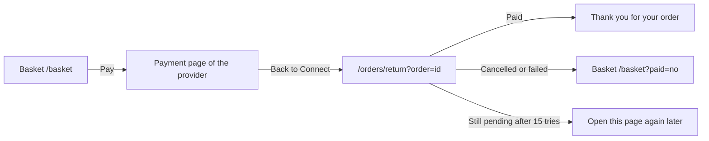

# Thank you for your order

- Component: web/src/pages/OrderReturn.tsx, with OrderReturn.module.css and OrderReturn.test.tsx
- Address in the browser: /orders/return?order=<order id>

## What the page is for

After paying on the page of the payment provider, the member comes back to Connect on this page. Connect checks with the provider whether the payment really went through, and then shows a thank you page with the order number, the items and the total. It also says that a confirmation email was sent. When the member cancelled or the payment failed, the page sends them back to the basket, where the items are still there.

## Who can open it

- Member (young person): sees only their own orders. The route is inside the app shell and wrapped in RequireLogin with the way back of issue 04b.
- Visitor who is not logged in: goes to Log in and comes back after logging in.
- A member who opens the address of someone else's order, or a made up order id, reads "We cannot find this order."
- After a member deleted their account, their old orders cannot be reached any more, and nothing on Connect links them to the email address.

## How you get there and where you go next

## Every element of the page, top to bottom

1. Waiting text: "We are checking your payment..."
   - In role status. The page asks GET /api/orders/{id} through getOrder(id) in web/src/api/orders.ts every 2 seconds, at most 15 times. The two numbers are named constants.
   - The page never trusts the return address alone. Anyone can type /orders/return without paying. Only the server, after asking the provider, knows the status.
   - On the server, the provider also sends a callback to POST /api/payments/callback. That address is open, and the server hands it on without trusting it. An order only becomes paid after the provider itself confirms the right amount. A repeated or simultaneous message changes nothing, and the basket is emptied once (task 83.3).
   - Built by task 83.5, issue 83 Pay for my basket, GitLab #194, sprint 5.
2. Heading: "Thank you for your order" (when the order is paid)
   - Below it the order number, the lines and the total, all amounts with formatPrice.
   - The page calls refresh() of useBasket, so the number next to Basket at the top is gone. The basket is empty.
   - The tables shop_order and shop_order_item keep each order with a copy of the names and prices and a unique order number (task 83.1).
   - Built by task 83.5, issue 83.
3. Sentence about the email, under the total, in role status
   - Paid and the email sent: "We sent a confirmation to your email address." The page stops asking.
   - Paid and the email not out yet: "Your confirmation email is on its way." The page keeps asking every 2 seconds within the same 15 tries.
   - Paid, and still not sent after the last try: "Your confirmation email is on its way. No email within an hour? Contact the foundation." The page stops asking.
   - Data: the field confirmationSent of OrderView, from GET /api/orders/{id}. The server sends the email exactly once, fills the column confirmation_sent_at of shop_order, and tries again on each status check when the email did not go out.
   - The email goes to the address of the account, in Dutch and then in English, with the order number, every item with its number and price, the total with the line about VAT, how to get the items and how to reach the foundation. It never holds a card detail, a password or a link that logs someone in. It arrives within one minute. Opening the page again never sends a second email. A cancel sends no email.
   - Built by tasks 83b.1, 83b.2 and 83b.3, issue 83b A confirmation email after I paid, GitLab #195, sprint 5.
4. Other outcomes
   - Cancelled or failed: the page goes to /basket?paid=no, where the page Basket shows "Nothing was paid. Your items are still in your basket."
   - Still pending after the last try: "Your payment is still being checked. You get an email as soon as it is done.", the sentence of task 83b.3, which replaces the sentence of issue 83.
   - Not found (404, also for a made up id): "We cannot find this order."
   - Not reachable (503 or no answer): "Connect is not reachable right now, try again later" in role alert, with a button Try again that asks getOrder once more.
   - Built by task 83.5 and task 83b.3.

## States

- Loading: "We are checking your payment..." in role status.
- Filled: the thank you content with the sentence about the email.
- Empty: not used.
- Error: "We cannot find this order." Or back to the basket with its message after a cancel or a failure.
- Still pending: the sentence to wait for the email, after 15 tries.
- Not reachable: "Connect is not reachable right now, try again later" with Try again.
- Phone (360 pixels wide) and laptop (1280 pixels wide): the page matches the Figma frame Thank you at both widths, shown with screenshots in the merge request.
- Design: the Figma frame Thank you on the Figma board of Connect, page Design directions. Colours and sizes only from web/src/styles/tokens.css.

## Accessibility and privacy

- The waiting text and the sentences about the email sit in role status. Not reachable sits in role alert.
- axe finds no problems.
- No payment detail is ever shown or kept in the browser. The order id is the only thing in the address.
- The email address of the member is never shown on the page.
- A member only ever sees their own orders.
- On the test site the provider runs in its test mode, so the payment is pretend and no real money moves.
- The provider must send the member back with a normal link. The cookie connect_session is SameSite=Lax (issue 04), so it comes along on a normal link but not on a form that another site posts. Issue 171 checks this for the chosen provider.

## Built by

| Board | Title | GitLab | Sprint | Prio |
|---|---|---|---|---|
| 83 | Pay for my basket | #194 | 5 | could |
| 83b | A confirmation email after I paid | #195 | 5 | could |

Issue 83 needs issues 21, 171 and 82b first. Issue 83b needs issues 83 and 29.

## Open points

- The whole webshop waits for the client: issue 10 The client's priorities for the epics, question 2. Issue 83 is blocked on this answer.
- The payment provider, and whether it sends the member back with a normal link: issue 171.
- How a member gets the items, which the email repeats: the answer of the client in issue 171. Whether a delivery address is built: issue 10, question 27.
- Whether members under 18 may pay, and an email to a parent: issue 171 and issue 10, question 123.
- Refunds, a page with earlier orders and invoices: issue 10, question 123.

## AI use declaration

AI was used as a writing support tool while working on this document. We used AI to draft
the formulation of sentences, the structure of wording, readability, and clarity from
content that we had provided, and to generate the diagrams. The content itself, including
our experiences, reflections, learning goals, decisions, self-assessments, and
conclusions, is our own. We reviewed the drafts and decided as a team which text to
include.
