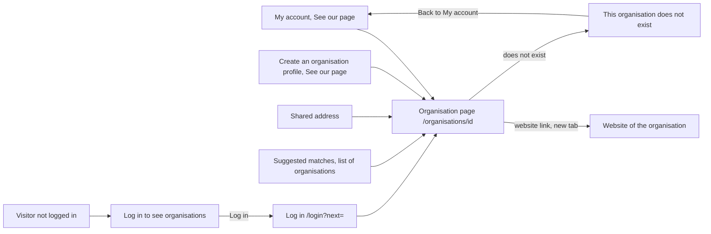

# The page of an organisation

- Component: frontend/src/pages/OrganisationPage.tsx, with OrganisationPage.module.css and OrganisationPage.test.tsx
- Parts used on this page only: frontend/src/components/organisationPage/OrganisationTagList.tsx (issue 129) and frontend/src/components/organisationPage/OrganisationLogo.tsx (issue 133)
- Address in the browser: /organisations/:id, for example /organisations/<id of Seed Club Atlas>
- Server addresses: GET /api/organisation-profiles/{id} and GET /api/organisation-profiles/{id}/logo

## What the page is for

Companies, schools, municipalities, clubs and funds in Amstelland have a profile on Connect. This page shows a young person who an organisation is and what it offers young people: its name, its kind, its text, its website, its tags and its logo. When the foundation has checked who is behind the organisation, the page says so. The organisation itself uses the same page to see how young people see it, and can share its address.

## Who can open it

- Member (young person): sees the page of every organisation whose account has confirmed its email address.
- Organisation: sees its own page, the same way young people see it, through the link See our page. Nobody can change anything on this page, also not the organisation itself.
- Admin: is a logged in member and sees the same page.
- Visitor who is not logged in: sees the heading "Log in to see organisations", the sentence "Organisation pages on Connect are only for people who are logged in, to keep the young people on Connect safe." and a button Log in. Nothing of the organisation is shown and no request for the organisation is made. After logging in the visitor lands on that organisation page. This follows the role table of issue 13 The role table per module.
- Anyone who opens an organisation that does not exist, an id that is not a real id, or an organisation that has not confirmed its email address yet: reads "This organisation does not exist" with a link Back to My account.

## How you get there and where you go next

Ways in:
- The organisation presses See our page on My account (/account), next to the line "You are logged in for <name>".
- The organisation presses See our page below "Your organisation profile is saved" right after it saved its profile on Create an organisation profile (/organisation/new, issue 34).
- Someone opens a shared address of the page.
- A card of an organisation under suggested matches links here with its name (issue 37 See suggested matches with the reason, GitLab #74).
- The name of each organisation on the list of all organisations links here (issue 134 See a list of all organisations, GitLab #203).

Ways out:
- The website link opens the website of the organisation in a new tab, so Connect stays open.
- The link Back to My account when the organisation does not exist.
- The button Log in for a visitor, which goes to /login?next=<this address>.
- The tabs of the app shell.

## Every element of the page, top to bottom

All data comes from one call: getOrganisationProfile(id) in frontend/src/api/organisationProfiles.ts asks GET /api/organisation-profiles/{id} through request() of frontend/src/api/client.ts and reads data from the answer. The page never calls fetch itself. On the server the guard of issue 04 checks the session, a validator checks that the id is a real id, and PublicOrganisationProfileService asks FindVisibleByIdAsync for the profile with the account of the session as the viewer. The answer holds only the public fields: id, name, kind, description, website, tags, logo and checkedAt. The account behind the organisation never leaves the database. The profile is read from the table organisation_profile, with a look at account.email_confirmed_at.

1. Logo, or a circle with the first letter
   - Without a logo: a round placeholder with the first letter of the name. It is aria-hidden, because the heading already says the name.
   - With a logo: an img with src logo.url, alt "Logo of <name>", width and height from the answer, shown at the size of the circle (for example 96 by 96 pixels with object-fit contain), in place of the circle.
   - When the picture fails to load, the circle comes back, so the page never shows a broken picture.
   - The logo file comes from GET /api/organisation-profiles/{id}/logo, only for a logged in member. A visitor who opens the address of the logo sees no picture. The organisation adds its logo on My account, in the part Logo of your organisation.
   - Built by task 35.4, issue 35 See an organisation's page, GitLab #68, sprint 2 (circle), and tasks 133.4 and 133.6, issue 133 Add a logo to my organisation profile, GitLab #233, sprint 5 (logo).

2. Heading (h1): the name of the organisation
   - The one heading of the page, also when there is a logo.
   - Built by task 35.4, issue 35, GitLab #68, sprint 2.

3. Line: Checked by the foundation
   - A paragraph right under the heading, with a small check icon from Phosphor Icons that is aria-hidden, because the text already says it.
   - Shows only when checkedAt has a value. When it is null, nothing is shown in its place, no "not checked" text.
   - No date and no name of the employee who checked.
   - Uses the colour of success text in tokens.css, with a contrast of at least 4.5 to 1.
   - An admin sets the mark with the button Mark as checked on the page Members (/admin/members).
   - Built by tasks 139.3 (checkedAt in the answer) and 139.5 (the line), issue 139 Mark an organisation as checked by the foundation, GitLab #94, sprint 3.

4. The kind of the organisation
   - The kind in words, from ORGANISATION_KIND_LABELS of task 34.4, for example Club or Company.
   - Built by task 35.4, issue 35, GitLab #68, sprint 2.

5. What the organisation offers (the description)
   - Shown as plain text, never as HTML. A description with code in it shows as text.
   - Built by task 35.4, issue 35, GitLab #68, sprint 2.

6. Website link
   - A link with the web address itself as its text, target="_blank" and rel="noopener noreferrer", and a hidden text "(opens in a new tab)" for screen readers.
   - When the organisation gave no website, nothing is shown in its place: no label Website and no empty link.
   - Built by task 35.4, issue 35, GitLab #68, sprint 2.

7. Tags
   - Below the description: a heading h2 Tags and a list (ul) with one item per tag, labelled with aria-labelledby to the heading. Sorted by name.
   - When the organisation has no tags, the heading and the list are not shown at all.
   - Read only: no button, no link and no field on the tags. The organisation adds tags on My account, in the part Tags of your organisation.
   - Only the names and ids of the tags go out, never who added them or when. They come from the table organisation_profile_tag, which points to the same table tag that young people use.
   - Built by tasks 129.3 (tags in the answer) and 129.5 (the list), issue 129 An organisation adds tags to its profile, GitLab #70, sprint 2.

There is no Edit button on this page, and no list of opportunities, events or challenges yet.

## States

- Loading: "Loading...".
- Filled: the circle or the logo, the name, the line Checked by the foundation when it applies, the kind, the description, the website and the tags.
- Empty parts: no website shows no label and no link. No tags shows no heading Tags. No logo shows the circle. Not checked shows nothing.
- Does not exist: "This organisation does not exist" with a link Back to My account, in place of the page. The same for an unknown id, an id that is not a real id (for example /organisations/abc), and an organisation that has not confirmed its email address.
- Not reachable: "Connect is not reachable right now, try again later" in an area with role alert, in place of the page, never an empty page. A tester checks it by switching the phone to airplane mode and pressing See our page.
- Visitor: "Log in to see organisations" with its sentence and the button Log in.
- Phone (360 pixels wide) and laptop (1280 pixels wide): the page matches the Figma frame Organisation page at both widths. Colours, fonts and spacing come only from frontend/src/styles/tokens.css. The frame is on the page Design directions of the Figma board of Connect.
- Test data: docs/testing/testData.md lists Seed Club Atlas (with website https://example.org, kind Club), Seed Bakery De Korenaar (no website), Seed Hidden Fund (not confirmed) and an id that no organisation has.

## Accessibility and privacy

- The name is the only h1. A screen reader hears the name as the only heading.
- The circle and the check icon are aria-hidden. The logo has the alt text "Logo of <name>".
- A screen reader hears the website link with its address and that it opens a new tab.
- A screen reader hears the tags as a list with the label Tags and the number of items.
- The page never shows the name or the email address of the person behind the organisation.
- The line Checked by the foundation never shows which employee checked, and no date.
- An organisation is only seen by others once its email address is confirmed.
- The logo is cleaned on upload: the place where a photo was taken and the name of the phone are removed. A visitor who is not logged in cannot open the logo.
- Deleting the organisation account also deletes its tags and its logo (issue 113 Delete my account and all my data).
- axe reports 0 issues.

## Built by

| Board | Title | GitLab | Sprint | Prio |
|---|---|---|---|---|
| 35 | See an organisation's page | #68 | 2 | must |
| 129 | An organisation adds tags to its profile | #70 | 2 | must |
| 139 | Mark an organisation as checked by the foundation | #94 | 3 | should |
| 133 | Add a logo to my organisation profile | #233 | 5 | could |

## Open points

- Whether organisations get a logo at all: issue 10 The client's priorities for the epics, question 10. Issue 133 is only built when the client says yes.
- Removing a tag from an organisation: issue 10, question 41. Until then there is no remove button.
- What the foundation checks before an admin marks an organisation as checked, for example the Chamber of Commerce number or a phone call: issue 10, question 45.
- Taking the mark Checked by the foundation away again and telling the organisation why: issue 10, question 46, and what happens with what it already published: question 54.
- Opening organisation pages to visitors who are not logged in: the role table of issue 13 keeps them closed for now.
- Opportunities, events and challenges on this page: card 35 names issues 55 See the open opportunities, 66 See the upcoming events and 75 See the open challenges for them, but none of those cards builds a part on this page yet. The team decides which issue adds them.

## AI use declaration

AI was used as a writing support tool while working on this document. We used AI to draft
the formulation of sentences, the structure of wording, readability, and clarity from
content that we had provided, and to generate the diagrams. The content itself, including
our experiences, reflections, learning goals, decisions, self-assessments, and
conclusions, is our own. We reviewed the drafts and decided as a team which text to
include.
