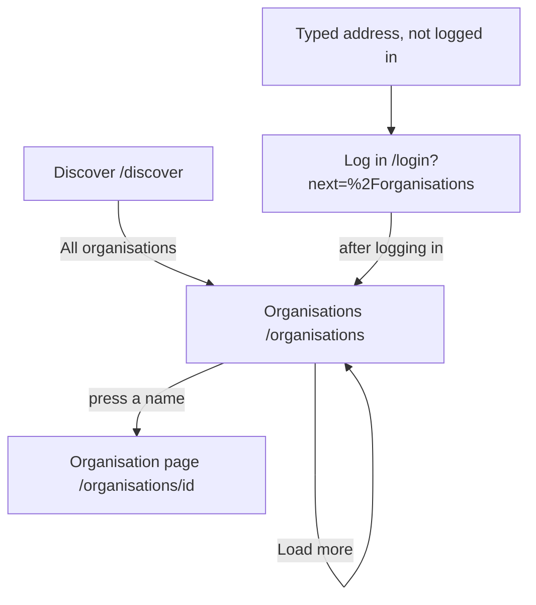

# The page Organisations

Component: `web/src/pages/Organisations.tsx`.
Address in the browser: `/organisations`.

## What the page is for

The page Organisations lists every organisation on Connect, sorted by name, with its kind: a company, a school, a municipality, a club or a fund. A young person, or any member, can look through all organisations instead of waiting for a suggestion or a link, and find organisations they have not met yet. Pressing a name opens the page of that organisation.

## Who can open it

- Young person and any other logged in member: yes.
- Visitor who is not logged in: goes to `/login?next=%2Forganisations` and comes back to the list after logging in (`RequireLogin` of issue 04).
- An organisation that never confirmed its email address, or that the foundation switched off, is not in the list.

## How you get there and where you go next

- The link All organisations on the page Discover, near the top. Task 134.3 adds it to web/src/pages/Discover.tsx.
- From here each name opens the page of that organisation at `/organisations/<id>` (issue 35).

## Every element of the page, top to bottom

### Heading

- Text: Organisations, the h1.
- Built by: issue 134 See a list of all organisations, task 134.3 (GitLab #203, sprint 5).

### The list of organisations

- What it shows: a `ul` with one `li` per organisation, twenty at first, in the order of the server (by name). Each shows the name as a link to `/organisations/<id>`, and below it the kind from `ORGANISATION_KIND_LABELS` of issue 34.
- Data: `getOrganisations(page)` in `web/src/api/organisationProfiles.ts` asks `GET /api/organisation-profiles?page=1&pageSize=20` through `request()`, with the results ok (items, total) and notReachable. The server checks that the person is logged in, reads page and page size as text and gives a plain message when they are wrong, and leaves out organisations that are not confirmed or are switched off. The answer holds the id, the name and the kind of each organisation, with page, page size and total. A page after the last one gives an empty list, never an error (task 134.2).
- Built by: issue 134, tasks 134.2 and 134.3.

### Button Load more

- Label: Load more.
- What it does: shown below the list while the number shown is less than `meta.total`. A press asks the next page and adds it below. While waiting it says "Loading..." and is disabled. After it, the focus moves to the link of the first new organisation. It is gone when every organisation is shown.
- When it fails: "Connect is not reachable right now, try again later" below the list, what is shown stays, and the button can be pressed again.
- Built by: issue 134, task 134.3.

## States

| State | What the person sees |
|---|---|
| Loading | "Loading organisations..." |
| Empty | "There are no organisations on Connect yet" in place of the list. |
| Filled | The heading, twenty organisations with name and kind, and Load more while there are more. |
| Loading more | Load more says "Loading..." and is disabled. |
| Not reachable | "Connect is not reachable right now, try again later" in an area with role alert, on load in place of the list and on Load more below it. The same sentence shows for a wrong input answer (code 400). |
| Not logged in | The page Log in, and after logging in the list. |

The team check of task 134.5 runs on a phone and on a laptop.

## Accessibility and privacy

- After Load more the focus moves to the link of the first new organisation, so a screen reader hears its name.
- The error sits in a role alert area.
- The list shows only organisations that confirmed their email address and are not switched off. It shows no logo (issue 133 shows the logo on the page of the organisation only).

The design: colours, fonts and spacing come only from `web/src/styles/tokens.css`, following the Figma frame Organisations on the page Design directions of the Figma board.

## Built by

| Board | Title | GitLab | Sprint | Prio |
|---|---|---|---|---|
| 134 | See a list of all organisations | #203 | 5 | could |

## Open points

- Whether Connect gets this list at all: issue 134 is only built when the client says yes to issue 10, question 11, because no requirement asks for a list of all organisations yet.
- A mark that the foundation checked an organisation is issue 139, not this page.

## AI use declaration

AI was used as a writing support tool while working on this document. We used AI to draft
the formulation of sentences, the structure of wording, readability, and clarity from
content that we had provided, and to generate the diagrams. The content itself, including
our experiences, reflections, learning goals, decisions, self-assessments, and
conclusions, is our own. We reviewed the drafts and decided as a team which text to
include.
