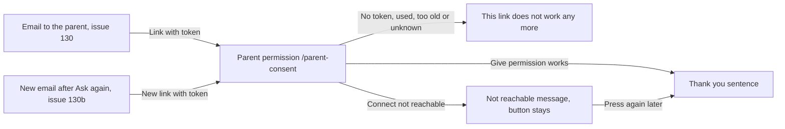

# Parent permission

- Component: web/src/pages/ParentConsent.tsx, with ParentConsent.module.css and ParentConsent.test.tsx.
- Address in the browser: /parent-consent?token=<token>, the link in the email to the parent. The page removes the token from the address bar at once, so afterwards the address reads /parent-consent.

## What the page is for

A young person under 18, so of the age band 15 to 17, who makes a profile on Connect gives the email address of a parent (issue 130, question 135 of docs/client/clientQuestions.md). The parent gets an email with a link. This page is where that link lands. The parent sees in plain words what Connect keeps about their child, and what Connect never asks for, and gives permission with one button. From that moment the profile of the child can be seen by other members, and the banner on the child's own profile page is gone. Connect keeps the date of the permission as proof and removes the email address of the parent.

This is the second half of the consent of a parent that the Dutch law on the GDPR (article 5 of the UAVG) asks for a member under 16, as issue 19 GDPR notes on minors' data names. The foundation asks it for every member under 18, which is stricter than the law and allowed (meeting with the client on 23 October 2026).

## Who can open it

- Parent with the link: sees the page and the button without an account and without logging in. The route is registered without RequireLogin, and both server addresses are open (AllowAnonymous).
- Anyone else with the same working link would see the same page, because the link itself is the key. Nobody can guess the code at the end of the link, and it works once.
- A link that was used before, is too old, or is unknown: the page shows "This link does not work any more". The answer is the same for all three, so a stranger learns nothing.

## How you get there and where you go next

You arrive only through the link in an email to the parent: the first email that issue 130 sends, or the new email with a new link after the young person pressed Ask again on My profile when the first link had ended (issue 130b Connect forgets a parent's address when the permission link has ended). The page has no links to other pages of Connect. After Give permission the parent reads the thank you sentence and is done.

## Every element of the page, top to bottom

All screen elements are built by task 131.4, issue 131 A parent gives permission for a young person under 16, GitLab #42, sprint 2, unless another task is named.

1. On load (not visible)
   - The page reads token from the address, keeps it in memory, and replaces the address with /parent-consent (history.replaceState), so the token is not left in the address bar or in the history of the browser.
   - No token in the address: "This link does not work any more" at once, without a request.
   - Then it calls lookupParentConsent(token) of web/src/api/parentConsents.ts, which sends POST /api/parent-consents/lookup through request(), with the token in the body and never in the address.
   - Server side, task 131.2: the token is required and at most 100 characters (ParentConsentTokenValidator). The server hashes the token with ResetToken.Hash of issue 21, finds the request and checks that it has not been used and has not ended. The answer holds firstName, ageBand, region, bio and alreadyGiven. It never holds the email address of the parent or the young person, the account id, the profile id or any date. The token is never written in a log line. Task 131.1 reads the request and the four values in one look up (FindSummaryByTokenHashAsync).
2. Heading: What Connect keeps about <first name>
3. Description list with a plain label per value
   - First name.
   - Age band, in words from AGE_BAND_LABELS of issue 08, for example 15 to 17.
   - Region.
   - About them, the short line the child wrote. Left out when it is empty.
4. Sentence: "Connect never asks for an exact age, a birth date, a school or an address."
5. Sentence: "Until you give permission, other members cannot see this profile."
6. Button Give permission
   - Calls confirmParentConsent(token), which sends POST /api/parent-consents/confirm with the token in the body. It is only sent when the button is pressed, never on load.
   - While waiting the button says "Saving..." and is disabled.
   - Works (code 200): "Thank you. <first name>'s profile can now be seen by other members of Connect." in an area with role status, in place of the button.
   - Server side, task 131.3: the answer is {"result": "given", "firstName": ...}. Task 131.1 fills given_at and empties the parent's email address in one step, only when given_at is still empty. Two presses at the same moment give permission once. After it, the banner of issue 130 on the child's profile is gone and another member finds the profile.
7. Refusal: "This link does not work any more"
   - Shown in place of the page when lookup or confirm answers 400, with one sentence: "Ask your child to send a new request from Connect."
8. Not reachable: "Connect is not reachable right now, try again later"
   - In an area with role alert, when the server answers 503 or gives no answer. On confirm the button stays, so the parent can press it again. The server changes nothing, so the same link still works later.

## States

- Loading: "Loading..." while the lookup waits.
- Filled: the heading with the first name, the four labelled values (About them left out when empty), the two sentences and the button Give permission.
- Saving: the button says "Saving..." and is disabled.
- Given: "Thank you. <first name>'s profile can now be seen by other members of Connect." in place of the button.
- Link does not work: "This link does not work any more" and "Ask your child to send a new request from Connect." in place of the page. Also when there is no token.
- Not reachable: "Connect is not reachable right now, try again later". A tester checks this by switching the phone to airplane mode before pressing Give permission, and presses again after switching it off.
- Empty: not used. The page has no list.
- Phone (360 pixels wide or close) and laptop: the team check of task 131.6 goes through every criterion on both.
- Design: the Figma frame Parent permission on the Figma board of Connect, page Design directions. Colours, fonts and spacing come only from the variables in web/src/styles/tokens.css.
- Clickable prototype (laptop, sprint 1 and 2), on the Figma page Prototype sprint 1 and 2 (desktop). The line above each screen names its GitLab issues.
  - [H03 Email to a parent](https://www.figma.com/design/SAVxDf3rlsWz22qlzTEYte/Young-Amstelland-Connect--team-workspace?node-id=1019-4119)
  - [H04 Parent permission](https://www.figma.com/design/SAVxDf3rlsWz22qlzTEYte/Young-Amstelland-Connect--team-workspace?node-id=1019-4154)
  - [H05 Permission given](https://www.figma.com/design/SAVxDf3rlsWz22qlzTEYte/Young-Amstelland-Connect--team-workspace?node-id=1019-4276)

## Accessibility and privacy

- A screen reader hears the name of the child in the heading, each value with its label, and the button Give permission. The team check uses VoiceOver or TalkBack.
- The thank you sentence is in an area with role status. The not reachable message is in an area with role alert.
- axe reports 0 issues.
- The token is removed from the address bar at once, travels only in the body of a POST, and never appears in a log. Connect stores only the hash of the token.
- The parent sees the region, because it is their own child. The page never shows an email address, an account id, a profile id or a date.
- The answer is the same for an unknown, a used and an ended link, so a stranger cannot learn that a child under 18 is on Connect.
- After the permission Connect keeps only the date (given_at) as proof, and the email address of the parent is emptied at that moment. When the young person deletes the account (issue 113), the profile and the proof of permission are deleted with it.

## Built by

| Board | Title | GitLab | Sprint | Prio |
|---|---|---|---|---|
| 131 | A parent gives permission for a young person under 16 | #42 | 2 | must |

Issue 131 needs issues 130 A young person under 16 asks a parent for permission (#40), 14 View another member's profile (#30) and 21 Ask for a password reset link by email (#39) first. The tasks run in this order: 131.1 (database: the two queries on parent_consent, no migration), 131.2 (POST /api/parent-consents/lookup), 131.3 (POST /api/parent-consents/confirm), 131.4 (this page), 131.5 (end to end test web/e2e/parentConsentGive.spec.ts) and 131.6 (team check on a phone and a laptop).

## Open points

- A parent who wants to withdraw the permission later: issue 10, question 82 in docs/client/clientQuestions.md.
- Forgetting the address of a parent who did not answer in time, and asking a parent again after that, belong to issue 130b, not to this page.

## AI use declaration

AI was used as a writing support tool while working on this document. We used AI to draft
the formulation of sentences, the structure of wording, readability, and clarity from
content that we had provided, and to generate the diagrams. The content itself, including
our experiences, reflections, learning goals, decisions, self-assessments, and
conclusions, is our own. We reviewed the drafts and decided as a team which text to
include.
