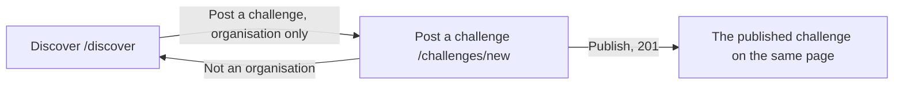

# Post a challenge

- Component: frontend/src/pages/PostChallenge.tsx, with PostChallenge.module.css and PostChallenge.test.tsx. The three fields sit in the shared component frontend/src/components/ChallengeForm.tsx (issue 167).
- Address in the browser: /challenges/new

## What the page is for

A challenge is a short assignment or competition that an organisation sets for young people, for example "Design a poster for our summer festival", with a last day to take part. On this page an organisation, such as a company, a school, a municipality, a club or a fund around Amstelland, posts a challenge with a title, a description and a deadline. After publishing it sees its challenge exactly as typed. The foundation first checks an organisation before it can publish.

## Who can open it

- Organisation that the foundation checked: fills in the form and publishes.
- Organisation that the foundation has not checked yet: can fill in every field, but reads "The foundation checks your organisation first. You can publish after that." where the button Publish was (issue 140).
- Young person, or anyone else who is not an organisation: never sees the button Post a challenge. When they type the address they read "Only organisations can post a challenge" with a link back to Discover, and no fields.
- Visitor who is not logged in: the route is inside RequireLogin of issue 04, so the visitor sees the page Log in, and after logging in as an organisation lands on the form (issue 04b).

## How you get there and where you go next

The page Discover of issue 37 gets a link Post a challenge to /challenges/new, shown only when useSession says isOrganisation (task 74.3). The route sits inside the shell of issue 06. The list of open challenges is issue 75 and the page of one challenge is issue 75b.

## Every element of the page, top to bottom

1. Field: Title
   - A text input, label above it.
   - Messages: "Fill in a title" when empty, "The title can be at most 120 characters" when longer. What was typed stays.
2. Field: Description
   - A textarea of at least six lines, label above it.
   - Messages: "Fill in a description" when empty, "The description can be at most 4000 characters" when longer (the server checks this limit, task 74.2). What was typed stays.
3. Field: Deadline
   - An input of type date, the date picker of the phone or browser, with the day of today as the earliest day to pick. No date picker library.
   - Messages: "Choose a deadline" when empty or when the date cannot be read, "The deadline must be today or later" for a date in the past. Which day is today is the day in Dutch time.
   - The form has noValidate, so the small bubbles of the browser do not replace the messages of Connect. The page checks the three fields itself before sending, with the same messages. The server stays the judge.
   - Every message sits directly next to its field. The field is marked with aria-invalid and linked to its message with aria-describedby, and the focus goes to the first wrong field.
4. Message area above the button, in role alert
   - "Connect is not reachable right now, try again later" on 503 or no answer (task 74.3). What was typed stays.
5. Button: Publish, or the notice of issue 140 in its place
   - isCheckedOrganisation from useSession() (task 140.3) decides. When it is false, the button Publish is not rendered, and NotCheckedNotice (frontend/src/components/NotCheckedNotice.tsx) stands where it was, a paragraph with role status and the sentence "The foundation checks your organisation first. You can publish after that." The fields stay visible. While the session loads the page shows "Loading...", never a flash of the button. Task 140.4, issue 140 Only a checked organisation can publish, GitLab #139, sprint 3.
   - Pressing Publish calls postChallenge(values) in frontend/src/api/challenges.ts, which sends POST /api/challenges through frontend/src/api/client.ts. It returns published (with the challenge), wrong fields, not an organisation, or not reachable. The page never calls fetch.
   - While waiting the button says "Publishing..." and is disabled.
   - 400: every message of the answer next to its field, as above. What was typed stays.
   - 403 not an organisation: "Only organisations can post a challenge". This happens when the profile was removed while the form was open.
   - 403 not checked (isNotCheckedProblem in client.ts): the notice replaces the button, and every field keeps its value.
   - On the server, the guard of issue 04 checks the session and the validator checks the three fields. The server finds the organisation profile of the logged in account, refuses when there is none, refuses an organisation that is not checked (task 140.2), and writes one row in the table challenge with the moment of now. Which day it is in Dutch time comes from OpportunityOpenRule of issue 54, and whether a deadline is still open from the rule ChallengeDeadline: a deadline of today or later is open. Nothing about any young person is stored.
   - Built by tasks 74.1 (table challenge), 74.2 (POST /api/challenges) and 74.3 (the page and the button on Discover), issue 74 Post a challenge, GitLab #138, sprint 3.
6. The published challenge, in place of the form (201)
   - The word Published above it, the title, the description, the deadline written as a date such as 12 October 2026, the organisation name and "Posted on" with the date of today.
   - Built by task 74.3.

Since issue 167, the three fields with their labels, messages and checks live once in ChallengeForm. PostChallenge uses it with the button Publish, the page Edit challenge (/challenges/:id/edit) with Save changes. What a person sees on Post a challenge does not change, and PostChallenge.test.tsx stays green without a change (task 167.4, issue 167 Change my challenge after posting, GitLab #228, sprint 5).

## States

- Loading: "Loading..." while the session loads, and no button yet.
- Empty: the form with three empty fields.
- Filled: the typed values and the button Publish, or the notice for an unchecked organisation.
- Publishing: the button says "Publishing..." and is disabled.
- Published: the challenge with the word Published.
- Error: the message next to each wrong field.
- Not allowed: "Only organisations can post a challenge" with a link back to Discover, no fields.
- Not reachable: "Connect is not reachable right now, try again later" above the button, what was typed stays.
- Phone (360 pixels wide) and laptop (1280 pixels wide): the page matches the Figma frame Post a challenge at both widths, shown with screenshots in the merge request.
- Design: the Figma frame Post a challenge on the Figma board of Connect, page Design directions. Colours, fonts and spacing only through frontend/src/styles/tokens.css.

## Accessibility and privacy

- Every field has its label above it. A screen reader hears the message next to a field as soon as it appears, together with the name of the field.
- The date picker of the phone itself works with a screen reader and does not offer a day in the past.
- The notice about the check is read where the button would be.
- axe reports 0 issues.
- The organisation is asked for nothing but a title, a description and a deadline: no contact person, no phone number, no email address and nothing about young people.
- When the organisation deletes its account (issue 113), its challenges are deleted with its profile.
- A young person only finds challenges of organisations that the foundation checked.

## Built by

| Board | Title | GitLab | Sprint | Prio |
|---|---|---|---|---|
| 74 | Post a challenge | #138 | 3 | could |
| 140 | Only a checked organisation can publish | #139 | 3 | should |
| 167 | Change my challenge after posting (the shared form ChallengeForm) | #228 | 5 | could |

Issue 74 needs issues 34, 65, 37, 04b and 54 first. Issue 140 needs 139, 54, 65 and 74. Issue 167 needs 75b, 10, 76b and 79.

## Open points

- Issue 167 is built only when the client says yes: issue 10 The client's priorities for the epics, question 84. It is marked blocked on that answer. When the answer adds a rule, for example that the deadline may only move later, the card of issue 167 changes before anyone builds it.
- Taking back a check, and an email to the organisation when it is checked: issue 10, question 54.
- Deleting a challenge (issue 168) and closing a challenge before its deadline (issue 10, question 93) are not part of this page.

## AI use declaration

AI was used as a writing support tool while working on this document. We used AI to draft
the formulation of sentences, the structure of wording, readability, and clarity from
content that we had provided, and to generate the diagrams. The content itself, including
our experiences, reflections, learning goals, decisions, self-assessments, and
conclusions, is our own. We reviewed the drafts and decided as a team which text to
include.
