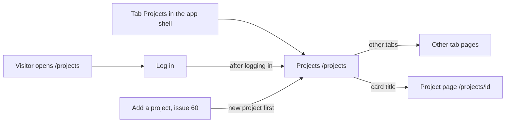

# Projects, the list of all projects

- Component: frontend/src/pages/Projects.tsx, with Projects.module.css and Projects.test.tsx
- Address in the browser: /projects, behind the tab Projects
- Server address: GET /api/projects?page=1&pageSize=20

## What the page is for

Young people in Amstelland put their projects on Connect. This page shows the projects of all members in one list, the newest on top. A member browses it to get inspired by what other young people made, or to find someone to work with. Each project shows its title, the start of its description, the date it was added and the first name of its maker.

## Who can open it

- Member (young person): sees the list. Every logged in member can open it.
- Organisation and admin: the page sits inside RequireLogin like every member page, so any logged in person gets the same list. The cards name no other role.
- Visitor who is not logged in: sees the page Log in first. After logging in they land on /projects (issue 04b, AC6 of issue 63).
- What nobody ever sees: a project that the foundation removed because it broke the house rules, and every project of a member whose account the foundation switched off or who has not confirmed their email address.

## How you get there and where you go next

You get here with the tab Projects in the app shell of issue 06 Move between the five tabs of Connect. Issue 06 put an empty page behind that tab, and issue 63 fills it. A visitor who opens /projects goes to Log in and comes back here.

From here you go on with the other tabs, or press the title of a card to open the page of that project at /projects/<id> (issue 64 Open a project page), with a link to its maker. Adding a project happens on the page Add a project of issue 60, and a new project then shows as the first card here.

## Every element of the page, top to bottom

The page sits inside AppShell of issue 06, so the five tabs stay around it.

1. Heading: Projects
   - Built by task 63.4, issue 63 Browse all showcases, GitLab #177, sprint 4.

2. The list of project cards
   - Each card is ProjectCard (frontend/src/components/ProjectCard.tsx) of issue 62 See my projects on my profile, reused and never copied. It shows the title, the start of the description, the date the project was added and, below the date, the first name of the maker (the optional prop makerFirstName). The profile pages of issue 62 do not pass that prop, so they look the same as before.
   - The title on every card is a Link of React Router to /projects/<id>, a real link and never a click handler on the card. ProjectCard makes the link for every list, the page itself builds no address. Built by task 64.4, issue 64 Open a project page, GitLab #181, sprint 4.
   - Each card carries its project id in the attribute data-project-id. It stays after issue 64, because the end to end tests of issues 63 and 63b use it.
   - A card shows nothing else about the maker: never an age, a region, a school or an email address.
   - The picture: the list answer gives the field image for each project (task 61b.4), and ProjectCard shows it with width, height, loading="lazy" and the title as alt text. A project without a picture keeps an empty space of the same shape, hidden for a screen reader. Built by task 61b.5, issue 61b Add an image to my project, GitLab #180, sprint 4.
   - Data: getProjectFeed(page) in frontend/src/api/projects.ts asks GET /api/projects?page=<page>&pageSize=20 through the shared helper frontend/src/api/client.ts. The page itself never calls fetch and never sees a status code. The answer is the team answer: the projects in data, and page, pageSize and total in meta.
   - The server checks the session through the guard of issue 04 and checks page and pageSize (whole numbers, page from 1, pageSize at most 50). It gives up to twenty projects, newest first, and the total. A page after the last one gives an empty list. A wrong page or pageSize gives a ProblemDetails answer with a message for that field.
   - In the database the projects come from the table project, with the maker from member_profile and account. Removed projects are left out through the query filter of issue 48 Remove content that breaks the rules, and makers who are switched off or not confirmed through the visibility rule of issues 29 and 46. Only the id and the first name of the maker leave the server. The index on the date and the id keeps the list fast with thousands of projects.
   - The list is one column on a phone and more columns on a laptop.
   - Built by tasks 63.1 (query and index), 63.2 (seed data), 63.3 (server address) and 63.4 (screen), issue 63, GitLab #177, sprint 4.

3. Button: Load more
   - Sits below the list. Pressing it asks for the next page and adds its projects to the end of the list. The first twenty stay.
   - While it runs the button says "Loading...", is disabled, and no second call starts.
   - After the press the focus moves to the link of the first new card, so a keyboard user goes on where they were and can open it with Enter (task 64.4).
   - A project whose id already shows is never added again. With page numbers a project added by someone else in between moves every row one place, so the first project of the next page can be the last one of the page before.
   - The button stays after issue 63b, for people who use only a keyboard or a screen reader, and does the same as scrolling.
   - Built by task 63.4, issue 63, GitLab #177, sprint 4.

4. Loading on scroll (no visible element)
   - An empty, invisible marker below the last card is watched with IntersectionObserver, with a rootMargin of 200 pixels. When it comes into view the page calls the same load function as Load more, so the next projects appear before the member reaches the bottom.
   - It loads only when no call runs, the end of the list is not reached and the last call did not fail.
   - Loading on scroll never moves the focus. Only a press on Load more does.
   - At the end of the list, and when the page closes, the observer stops watching.
   - No library for endless lists is used.
   - The server allows at most sixty pages of projects per minute per logged in member (a rate limit policy of its own in ASP.NET Core). A member who scrolls normally never notices it.
   - Built by tasks 63b.1 (forty more seed projects), 63b.2 (the limit) and 63b.3 (screen), issue 63b More projects appear when I scroll down, GitLab #178, sprint 4.

5. Spoken line (visually hidden)
   - An area with aria-live polite that a screen reader reads by itself. It says "20 more projects loaded" (with the real number) after every page, and "You have seen all projects" at the end.
   - Built by task 63b.3, issue 63b, GitLab #178, sprint 4.

6. End line: You have seen all projects
   - Shows below the last card when the number of projects on the screen reaches meta.total. The button Load more is then gone, and scrolling loads nothing more.
   - Built by task 63.4, issue 63, GitLab #177, sprint 4.

7. Messages below the list
   - Not reachable: "Connect is not reachable right now" with a button Try again. Try again asks for the same page again. See States.
   - Too fast: "You are loading projects very fast. Wait a moment and try again." with a button Try again, when the server says too many tries.
   - Built by task 63.4 (not reachable) and task 63b.3 (too fast).

## States

- Loading: while the first page loads, a loading text shows. While a next page loads, the button says "Loading...".
- Empty: when the first page has no projects, the line "No projects yet" shows in place of the list.
- Filled: the heading, twenty cards, and the button Load more, or the end line "You have seen all projects" when every project shows.
- Error, not reachable on the first page: "Connect is not reachable right now" with a button Try again in place of the list.
- Error, not reachable on a next page: the same message with Try again below the cards, and the cards stay on the screen. After this error the page stops loading on scroll until Try again was pressed and worked, so it never keeps trying by itself. A tester checks it by switching the phone to airplane mode and scrolling or pressing Load more.
- Too many tries: "You are loading projects very fast. Wait a moment and try again." with Try again below the cards, which stay.
- Phone (360 pixels wide): one column of cards. Scrolling with a thumb loads the next pages.
- Laptop (1280 pixels wide): more columns. No scrolling sideways on either screen.
- Design: the Figma frame Projects on the page Design directions of the Figma board of Connect. Colours, fonts and spacing come only from the variables in frontend/src/styles/tokens.css.
- Test data: docs/testing/testData.md lists sixty five test projects of the test member Robin (Seed project 01 to 25 and Scroll project 01 to 40), four pages. The removed project Seed project removed and the Project of Sam (a switched off test member) must never show.

## Accessibility and privacy

- The whole list can be reached with the keyboard through Load more. After Load more the focus lands on the first new project, not back at the top.
- Loading on scroll never moves the focus.
- The picture on a card has the title of the project as alt text, and the empty space of a card without a picture is hidden for a screen reader (task 61b.5).
- A screen reader hears how many projects were added, and hears the end line.
- A card shows only the first name of the maker, because many makers are under 18. Never an age, a region, a school or an email address.
- A removed project and the projects of a switched off or unconfirmed member never appear.
- Nobody sees the same project twice, also when someone adds a project while they browse or when they scroll very fast.
- axe reports 0 issues.

## Built by

| Board | Title | GitLab | Sprint | Prio |
|---|---|---|---|---|
| 63 | Browse all showcases | #177 | 4 | should |
| 63b | More projects appear when I scroll down | #178 | 4 | should |
| 61b | Add an image to my project | #180 | 4 | should |
| 64 | Open a project page | #181 | 4 | should |

## Open points

- Filters and search in the list of projects: issue 10 The client's priorities for the epics, question 65.
- Whether loading on scroll stays, or only the button Load more, for young people aged 15 to 23: the builder of task 63b.3 gives an advice to the client. No decision is on the cards.
- Page numbers against a bookmark after the last project, for a list of many thousands: measured in issue 108 Two ways of paging the showcases, measured.

## AI use declaration

AI was used as a writing support tool while working on this document. We used AI to draft
the formulation of sentences, the structure of wording, readability, and clarity from
content that we had provided, and to generate the diagrams. The content itself, including
our experiences, reflections, learning goals, decisions, self-assessments, and
conclusions, is our own. We reviewed the drafts and decided as a team which text to
include.
