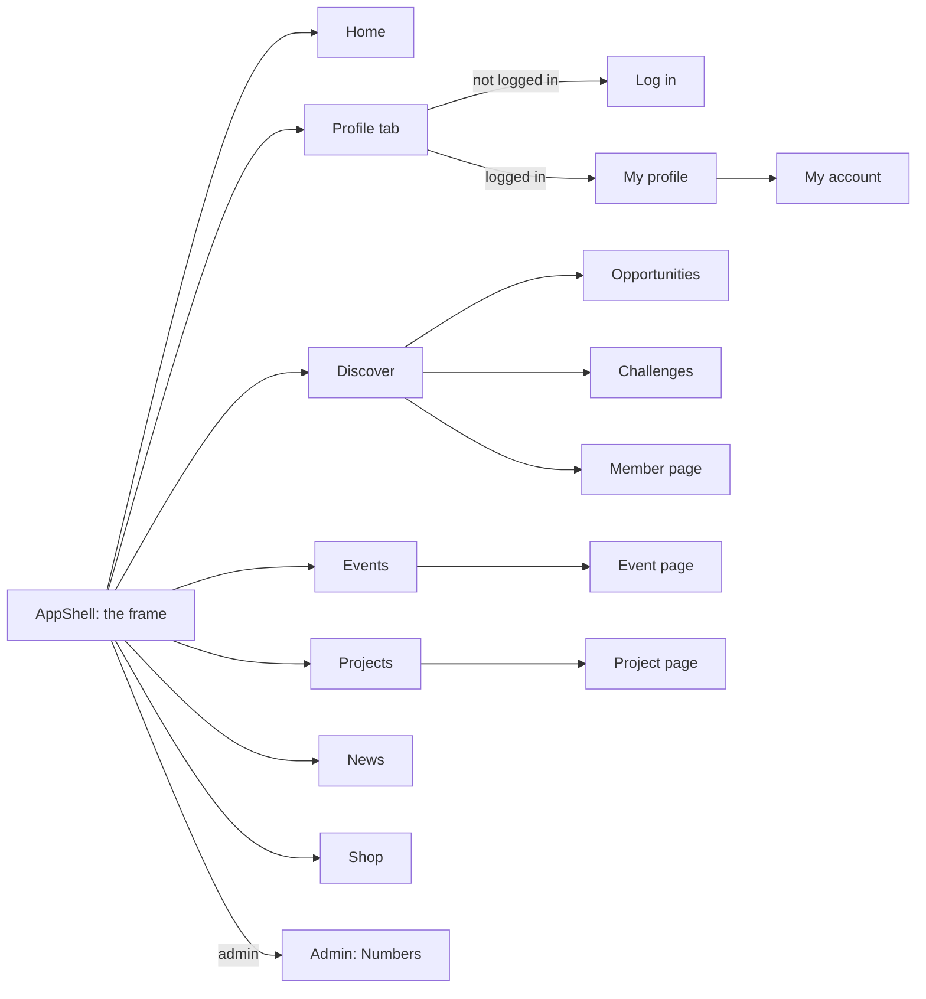

# The pages of Connect

Every page of the website Connect, grouped by the part of Connect it belongs to. Each link opens a standalone document with every element of that page: the texts, the fields and buttons, the data and server addresses behind them, the states, who can open it and the issues that build it.

The frame around every page (the name Connect, the five tabs, the links at the top and the footer) is described in [AppShell.md](AppShell.md).

## How the main pages connect

The five tabs of the frame lead to the main pages. The other pages open from those.

## Site shell

| Page | Address | What it is for |
|---|---|---|
| [The frame around every page (AppShell)](AppShell.md) | around every address | Every page of Connect sits inside one frame. |
| [Page not found](NotFound.md) | /this-does-not-exist, /members/:id | Links to Connect get shared, and sooner or later one of them points to something that is not there. |
| [Site page (privacy statement, house rules and other fixed pages)](SitePage.md) | /privacy, /privacy?language=nl, /house-rules | This page shows a site page: a page with a fixed text that the foundation writes, such as the privacy statement. |

## Account

| Page | Address | What it is for |
|---|---|---|
| [Make an account (CreateAccount)](CreateAccount.md) | /create-account | On this page a person who is new to Connect makes an account. |
| [Forgot password (ForgotPassword)](ForgotPassword.md) | /forgot-password | A member who forgot their password asks here for a link by email to set a new one. |
| [Home page](Home.md) | / | The home page is the first thing anyone sees when they open Connect. |
| [Link Google to my account](LinkGoogle.md) | /login/link-google | Some members made an account with an email address and a password, and later press Continue with Google with a Google account that has the same email address. |
| [Log in](LogIn.md) | /login, /login?next=, /login?reason=idle | On the page Log in a member of Connect logs in with their email address and password, or with Google or Facebook. |
| [Log in methods (LogInMethods)](LogInMethods.md) | /account/logins | On this page a member sees every outside account, Google or Facebook, that can open their Connect account. |
| [My account](MyAccount.md) | /account | My account is the home base of a logged in member. |
| [Choose a new password](ResetPassword.md) | /reset-password, /reset-password?token=&lt;code> | A member who forgot their password asks for a reset link on the page Forgot password (issue 21). |
| [Finishing a Google or Facebook log in](SocialLoginReturn.md) | /login/return, /login/return?provider=facebook, /login/return?error=not | A person can register or log in with Google or Facebook. |

## Account security

| Page | Address | What it is for |
|---|---|---|
| [Activity (admin)](AdminActivity.md) | /admin/activity | Connect is a platform where young people from Amstelland, many of them minors, meet organisations. |
| [Confirm your email address](ConfirmEmail.md) | /confirm-email?token=&lt;token>, /confirm-email | When a person makes an account on Connect, they get an email with a link. |
| [Send the confirmation email again](ConfirmEmailAgain.md) | /confirm-email/again | A person who made an account on Connect gets an email with a link to confirm the address. |
| [Log in tries](LogInTries.md) | /account/log-in-tries | A member sees every try to log in to their own account, newest first, with the date, the time and whether it worked. |

## Profiles

| Page | Address | What it is for |
|---|---|---|
| [Create an organisation profile](CreateOrganisationProfile.md) | /organisation/new | Connect brings young people from Amstelland together with the organisations around them. |
| [Create your profile](CreateProfile.md) | /profile/new | A young person who made an account and logged in tells Connect who they are: their first name, their age band, the town or area in Amstelland where they live, and, if they want, a short line about themselves. |
| [Edit our profile (edit an organisation profile)](EditOrganisationProfile.md) | /organisation/edit | An organisation that already made its profile with issue 34 Create an organisation profile uses this page to change it. |
| [Edit your profile (EditProfile)](EditProfile.md) | /profile/edit | A young person who made a profile changes it here, so what people see about them stays correct. |
| [Member page (another member's profile)](MemberProfile.md) | /members/:id, /members/00000000-0000-4000-8000-000000000141, /testing/test | This is the page of another young person on Connect. |
| [My profile (MyProfile)](MyProfile.md) | /profile | My profile is the page where a young person sees what they told Connect about themselves: their first name, age band, region and short line, their skills and interests, their badges, their projects and the challenges they joined. |
| [The page of an organisation](OrganisationPage.md) | /organisations/:id, /organisations/&lt;id | Companies, schools, municipalities, clubs and funds in Amstelland have a profile on Connect. |
| [The page Organisations](Organisations.md) | /organisations | The page Organisations lists every organisation on Connect, sorted by name, with its kind: a company, a school, a municipality, a club or a fund. |
| [Parent permission](ParentConsent.md) | /parent-consent?token=&lt;token>, /parent-consent | A young person younger than 16 who makes a profile on Connect gives the email address of a parent (issue 130). |

## Matching

| Page | Address | What it is for |
|---|---|---|
| [Connections (my connections)](Connections.md) | /connections | The page Connections shows a member everyone they are connected with on Connect. |
| [Discover, suggested matches and what is new on Connect](Discover.md) | /discover, /discover?kind=member, /discover?kind=organisation | Discover is the heart of why Connect exists between one gala and the next. |
| [The page Requests I received](ReceivedRequests.md) | /requests/received | A member can ask another member to connect with the button Connect on a member page. |
| [Saved](Saved.md) | /saved | A member can save people and organisations on Discover, and events on the page of an event. |
| [Requests I sent, the connection requests a member is waiting on](SentRequests.md) | /requests/sent | A member of Connect can press Connect on the page of another member to ask for a connection. |

## Opportunities

| Page | Address | What it is for |
|---|---|---|
| [Change opportunity](EditOpportunity.md) | /opportunities/:id/edit | An organisation that posted an opportunity can see a mistake, have news to add, or want to give young people more time, for example a sports club that finds a second trainer place after its closing date. |
| [My interests](MyInterests.md) | /profile/interests | A young person can press Interested on an opportunity, such as an internship or a summer job. |
| [My organisation](MyOrganisation.md) | /organisation | This is the home of an organisation on Connect. |
| [New opportunity](NewOpportunity.md) | /opportunities/new, /src/, /opportunities/:id | An organisation on Connect, such as a company, a fund, a club or a school, uses this page to offer young people a chance: an internship, a job, a project or something else. |
| [Opportunities, the list of all open opportunities](Opportunities.md) | /opportunities, /opportunities?kind= | Organisations on Connect post opportunities for young people: an internship, a job, a project or another offer. |
| [The page Opportunities with the tag](OpportunitiesWithTag.md) | /opportunities/tag/&lt;name>, /opportunities/tag/seed | Opportunities on Connect carry tags about skills and interests, such as video editing or football. |
| [The page of one opportunity](Opportunity.md) | /opportunities/:id, /opportunities/00000000-0000-4000-8000-000000055001 | Organisations post opportunities on Connect, such as an internship, a job or a project. |

## Showcases

| Page | Address | What it is for |
|---|---|---|
| [The page Add a project](AddProject.md) | /profile/projects/new | A young person made something they are proud of: a school project, a short film, a piece of code, an event they organised. |
| [Change my project](EditProject.md) | /profile/projects/:id/edit, /profile/projects/&lt;id, /edit | A young person who added a project to Connect may see a typo, want to tell more, or want to take something out of the text. |
| [The page of one project](MyProject.md) | /profile/projects/:id, /projects/:id | This is the page of one project that a young person added to Connect. |
| [Projects, the list of all projects](Projects.md) | /projects | Young people in Amstelland put their projects on Connect. |

## Events

| Page | Address | What it is for |
|---|---|---|
| [Change my event](EditEvent.md) | /events/:id/edit, /events/&lt;id, /edit | An organisation publishes an event on Connect and later has to change something: a typing mistake in the title, a new room, a later start, or more places because more volunteers can help. |
| [Event page](EventDetails.md) | /events/:id | A member opens the page of one event to learn everything about an activity before deciding to join: the title, the organisation that holds it, the date and time, the place, how many places are left and the full description. |
| [Events, the upcoming and past events of Connect](Events.md) | /events | Organisations around Amstelland hold events for young people, for example an open training day at a sports club. |
| [My events](MyEvents.md) | /profile/events, /src/ | A young person who registered for events on Connect wants to see in one place where they are going. |
| [New event](NewEvent.md) | /events/new | An organisation on Connect, such as a school, a sports club, a company or a community group, publishes an event here: a title, a short description, the date and time, the place and how many people can come. |

## News

| Page | Address | What it is for |
|---|---|---|
| [Admin news (publish a news item)](AdminNews.md) | /admin/news, /src/, /admin/members | The foundation wants young people and organisations to have a reason to come back to Connect between the awards. |
| [Edit news item](AdminNewsEdit.md) | /admin/news/:id/edit | An admin of the foundation published a news item and then sees a typing mistake, or learns that a date in it has changed, for example that the nominations stay open a week longer. |
| [The page News](News.md) | /news | The page News shows the news of the WailSalutem Foundation around Connect, with the newest item at the top. |
| [News item](NewsItem.md) | /news/:id, /news/00000000-0000-4000-8000-000000000725, /src/ | The foundation publishes news on Connect. |

## Challenges

| Page | Address | What it is for |
|---|---|---|
| [Challenge page](Challenge.md) | /challenges/:id, /challenges/00000000-0000-4000-8000-000000000999 | An organisation on Connect can post a challenge: a small assignment for young people, such as designing the shop window of a local bakery. |
| [The page Challenges](Challenges.md) | /challenges | Organisations on Connect post challenges: a small assignment for young people with a deadline, for example designing a poster for a summer festival. |
| [The page Edit challenge](EditChallenge.md) | /challenges/&lt;id>/edit | An organisation that posted a challenge can change its title, its description or its deadline while the challenge is still open. |
| [Post a challenge](PostChallenge.md) | /challenges/new | A challenge is a short assignment or competition that an organisation sets for young people, for example "Design a poster for our summer festival", with a last day to take part. |

## Webshop

| Page | Address | What it is for |
|---|---|---|
| [Basket](Basket.md) | /basket, /basket?paid=no | A member who put items from the Shop in the basket checks here what they will pay before they pay. |
| [Thank you for your order](OrderReturn.md) | /orders/return?order=&lt;order | After paying on the page of the payment provider, the member comes back to Connect on this page. |
| [The page Shop](Shop.md) | /shop | The page Shop shows the merchandise the WailSalutem Foundation sells, for example a T shirt, a cap or an agenda of the Young Amstelland Awards. |

## Admin

| Page | Address | What it is for |
|---|---|---|
| [Admin, Members](AdminMembers.md) | /admin/members, /admin/members?search=&lt;name> | This is the first page of the admin area of Connect. |
| [The page New page (admin)](AdminNewPage.md) | /admin/new-page | The WailSalutem Foundation wants to put information on Connect without waiting for the team, for example a page about the next gala or about how to become a volunteer. |
| [Numbers (admin usage numbers)](AdminNumbers.md) | /admin/numbers, /admin/numbers?month=2026-08 | The page Numbers tells the WailSalutem Foundation at a glance whether Connect is used. |
| [The editor of a site page (admin)](AdminPageEditor.md) | /admin/pages/&lt;slug>, /admin/pages/house-rules | Site pages are the texts every visitor of Connect can read, such as the privacy statement and the house rules. |
| [Admin, Pages](AdminPages.md) | /admin/pages | The foundation writes a few pages with a fixed text that every visitor can read, such as the privacy statement and the house rules. |
| [Add or change a shop item](AdminProductEdit.md) | /admin/shop/new, /admin/shop/:id | The foundation has a small shop (issue 81). |
| [Admin, Projects](AdminProjects.md) | /admin/projects | Many young people on Connect are minors. |
| [The page Reports (admin)](AdminReports.md) | /admin/reports | A member can report another member for breaking the house rules (issue 151). |
| [Admin shop (the items of the shop)](AdminShop.md) | /admin/shop, /src/ | Connect has a small shop where members buy merchandise of the foundation (issue 81). |

## Keeping this up to date

A new page gets its own document in this folder and a row in this table, in the same merge request as the issue that builds it.

## AI use declaration

AI was used as a writing support tool while working on this document. We used AI to draft
the formulation of sentences, the structure of wording, readability, and clarity from
content that we had provided, and to generate the diagrams. The content itself, including
our experiences, reflections, learning goals, decisions, self-assessments, and
conclusions, is our own. We reviewed the drafts and decided as a team which text to
include.
