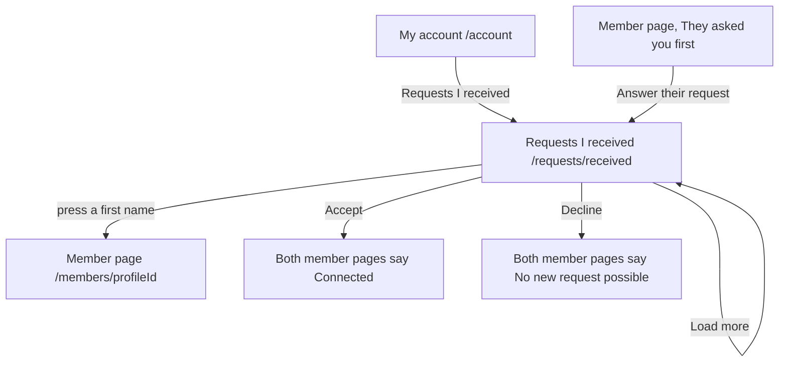

# The page Requests I received

Component: `web/src/pages/ReceivedRequests.tsx`.
Address in the browser: `/requests/received`.

## What the page is for

A member can ask another member to connect with the button Connect on a member page. The page Requests I received shows everyone who asked the logged in member and is still waiting for an answer, the newest at the top. On each row the member presses Accept or Decline. Nothing is shared between two members until both have said yes, which matters most for the youngest members. Saying no is as easy as saying yes: nobody asks for a reason, and the member who asked is not told why.

## Who can open it

- A logged in member: yes, and only their own requests. The server finds the member from the session, never from the address, so adding `?member=<id>` to the address still shows only the list of the logged in member.
- A visitor who is not logged in: sees the page Log in and no request (`RequireLogin` of issue 04).
- A member never sees a request they sent themselves on this page. Those are on Requests I sent (issue 40).
- Only the member who was asked can answer a request, and only once. The server holds that rule (issues 41b and 41c).

## How you get there and where you go next

- The link Requests I received on the page My account, below the link Requests I sent. The tab Profile opens My account.
- The link Answer their request on the page of a member who asked, below the line "They asked you first".
- From here the first name on a row opens the page of that member at `/members/<profileId>`.

## Every element of the page, top to bottom

### Heading

- Text: Requests I received. It shows at once, also while the first page loads.
- Built by: issue 41 See the connection requests I received, task 41.3 (GitLab #79, sprint 2).

### Live region

- What it says, read out by a screen reader through an area with `aria-live="polite"`:
  - "Request of <first name> accepted" after Accept.
  - "Request of <first name> declined" after Decline.
  - "This request was already answered" when the request was answered in another window (code 409).
  - "This request is no longer available" when the request is gone or belongs to someone else (code 403 or 404).
- Built by: issue 41b Accept a connection request, task 41b.4, and issue 41c Decline a connection request, task 41c.4.

### The list of requests

- What it shows: a list (`ul` with `li`) with one row per waiting request, newest first, twenty at a time.
- Each row shows four things and nothing else, no email address and no birth date:
  - The first name, as a link to `/members/<profileId>` (the page of issue 14).
  - The age band in words, through `AGE_BAND_LABELS` of issue 07.
  - The region.
  - The date of the request, in the member's own language through `Intl.DateTimeFormat`.
- A screen reader reads each row as the first name and the date.
- Data: `getReceivedRequests(page)` in `web/src/api/connectionRequests.ts` asks `GET /api/connection-requests/received` through the shared helper in `client.ts` and returns a list, not reachable or not logged in. The page never sees a status code. The server checks the session, lets `PageQueryValidator` of task 40.2 parse page and pageSize, and applies `ProfileVisibility` of issue 14. The answer holds up to pageSize requests in `data` and page, pageSize and total in `meta`. A member without a profile yet gets an empty list (task 41.2).
- Built by: issue 41, tasks 41.2 and 41.3.

### Alert area above a row

- Text: "Connect is not reachable right now, try again later"
- When: an answer could not be saved (code 503 or no answer). It shows in an area with role alert above the row, the row stays, and its buttons work again.

### Button Accept on each row

- Label: Accept. Accessible name: "Accept the request of <first name>".
- What it does: calls `acceptRequest(id)` in `web/src/api/connectionRequests.ts`, which sends `POST /api/connection-requests/{id}/accept` with the connectionRequestId of the row. Every button of that row is disabled until the answer comes, so a second press does nothing.
- Done (code 204): the row disappears at once, within one second, without the page reloading. The focus moves to the next row, or to the heading when the list is empty. From then on both member pages say Connected (task 41b.5).
- No confirm popup.
- Built by: issue 41b, tasks 41b.2 and 41b.4 (GitLab #80, sprint 2).

### Button Decline on each row

- Label: Decline. Accessible name: "Decline the request of <first name>". It sits next to Accept.
- What it does: calls `declineRequest(id)` in `web/src/api/connectionRequests.ts`, which sends `POST /api/connection-requests/{id}/decline`. Every button of that row is disabled until the answer comes.
- Done (code 204): the row disappears at once. The focus moves to the next row, or to the heading when the list is empty. After a decline neither of the two can send the other a new request, and both member pages say "No new request possible", without saying who said no or when (task 41c.5).
- No confirm popup and no box that asks for a reason. No reason is stored.
- Both buttons fit on one row at 360 pixels wide.
- Built by: issue 41c, tasks 41c.2 and 41c.4 (GitLab #81, sprint 2).

### Button Load more

- Label: Load more.
- What it does: shows while `meta.page` times `meta.pageSize` is less than `meta.total`. It fetches the next page and adds its rows below, says "Loading..." while it loads and cannot be pressed twice.
- When it fails: the rows already there stay, and the not reachable sentence shows below them.
- Built by: issue 41, task 41.3.

## States

| State | What the person sees |
|---|---|
| Loading | The heading Requests I received and "Loading your requests..." in an area with `aria-busy`. |
| Empty | "Nobody is waiting for an answer" in place of the list. The same sentence shows after the last row is answered. |
| Filled | The rows, newest first, each with Accept and Decline, and Load more while there are more. |
| Error on loading | "Connect is not reachable right now, try again later" with a button Try again that asks again. |
| Answer not saved | "Connect is not reachable right now, try again later" above the row, the row stays. |
| Not logged in | The page Log in. On a code 401 during the visit the page asks `useSession` to read the session again, so `RequireLogin` sends the member to Log in and back. |
| Phone | Accept and Decline fit on one row at 360 pixels wide. |

## Accessibility and privacy

- Each first name is a link, and a screen reader hears each row as the first name and the date.
- Accept and Decline can be reached with Tab and pressed with Enter. Their accessible names say whose request it is. The live region says what happened.
- After an answer the focus moves to the next row, or to the heading.
- No row shows an email address or a birth date, only the first name, the age band in words, the region and the date.
- Nobody but the logged in member can read or answer the requests that wait for them.
- A decline never shows who said no or when, on any page.

The design: colours, fonts and spacing come only from `web/src/styles/tokens.css`, following the Figma frame Requests on the page Design directions of the Figma board.

Clickable prototype (laptop, sprint 1 and 2), on the Figma page Prototype sprint 1 and 2 (desktop). The line above each screen names its GitLab issues.

- [J09 Requests I received](https://www.figma.com/design/SAVxDf3rlsWz22qlzTEYte/Young-Amstelland-Connect--team-workspace?node-id=1020-2272)
- [J10 Requests I received, after Accept](https://www.figma.com/design/SAVxDf3rlsWz22qlzTEYte/Young-Amstelland-Connect--team-workspace?node-id=1020-2398)
- [J11 Requests I received, nobody waiting](https://www.figma.com/design/SAVxDf3rlsWz22qlzTEYte/Young-Amstelland-Connect--team-workspace?node-id=1020-2513)

## Built by

| Board | Title | GitLab | Sprint | Prio |
|---|---|---|---|---|
| 41 | See the connection requests I received | #79 | 2 | must |
| 41b | Accept a connection request | #80 | 2 | must |
| 41c | Decline a connection request | #81 | 2 | must |

## Open points

- A warning on the list when an adult asks a member aged 15 to 17: issue 10, question 52.
- Telling the member who asked that the request was accepted, by email or otherwise: issue 10, question 52.
- Undoing a decline later, so the two members can connect after all: issue 10, question 51.
- Reporting a member who keeps asking: issue 151, when the client says yes to issue 10, question 39.

## AI use declaration

AI was used as a writing support tool while working on this document. We used AI to draft
the formulation of sentences, the structure of wording, readability, and clarity from
content that we had provided, and to generate the diagrams. The content itself, including
our experiences, reflections, learning goals, decisions, self-assessments, and
conclusions, is our own. We reviewed the drafts and decided as a team which text to
include.
