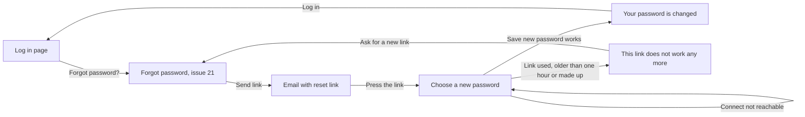

# Choose a new password

- Component: web/src/pages/ResetPassword.tsx, with ResetPassword.module.css and ResetPassword.test.tsx
- Address in the browser: /reset-password. The link in the email opens /reset-password?token=<code>, and the page removes the token from the address bar at once, so the address then ends in /reset-password with nothing after it.
- Title of the browser tab: not named on the cards.

## What the page is for

A member who forgot their password asks for a reset link on the page Forgot password (issue 21). The email holds a link to this page. Here the member types a new password twice and saves it. After that the old password no longer works, and every other phone, tablet or computer where the member was logged in is logged out. A link works once, and for one hour. A used, an old or a made up link all give the same plain sentence with a way to ask for a new link.

## Who can open it

- Anyone with a reset link. The page is open to everyone and is not wrapped in RequireLogin. The member is not logged in when they use it.
- Visitor, member (young person), organisation and admin: all see the same page, because the page only depends on the link. It shows nothing about the account, not the email address and not the name, and it never asks for the old password.
- Someone who opens /reset-password without a token, or with a token that does not work, sees the sentence This link does not work any more. A link works once, and for one hour. with the link Ask for a new link.
- A member who only logs in with Google or Facebook sets a password through issue 26, not through this page. A member who is logged in changes the password through issue 114.

## How you get there and where you go next

You arrive here only through the link in the reset email of issue 21 Ask for a password reset link by email. On the test site that email is read in the test mailbox Mailpit.

You leave the page through the button Log in after the change (to /login), or through the link Ask for a new link when the link does not work (to /forgot-password).

## Every element of the page, top to bottom

The page sits inside the frame AppShell, so the tabs stay in place around it. The tab Profile reads useSession and shows Log in or the display name of a logged in member.

1. Reading the token on opening
   - The page reads the token from ?token= in the address, keeps it in the state of the page, and replaces the address with /reset-password using navigate with replace: true. The browser history also shows only /reset-password.
   - Without a token the page shows the state This link does not work any more at once.
   - web/index.html has the meta tag referrer with the value no-referrer, so the address with the token is never sent to another site.
   - Built by task 22.3, issue 22 Set a new password through the link, GitLab #44, sprint 2.
2. Field New password
   - Label New password above the field. Type password, autocomplete new-password. Below it a place for its message, linked to the field with aria-describedby.
   - Rule: at least fifteen characters, the rule of issue 03b. A password that is known from data leaks is also refused (issue 116). The server checks this with NewPasswordRequestValidator and the shared rule chain MeetsPasswordRules().
   - Message: "Use at least fifteen characters for your password" next to this field. The old password still works.
   - Built by task 22.3 (screen) and task 22.2 (server check), issue 22, GitLab #44, sprint 2.
3. Field New password again
   - Label New password again above the field. Type password, autocomplete new-password, with its own message place linked with aria-describedby.
   - Rule: it must be the same as New password. This is checked on the screen only, the same rule and words as task 3b.3 on Make an account. The server gets the password once.
   - Message: "The two passwords are not the same" next to this field, and nothing is sent.
   - Built by task 22.3, issue 22, GitLab #44, sprint 2.
4. Button Save new password
   - The form has noValidate. Pressing the button first compares the two fields. When they are the same, the page calls setNewPassword(token, password) in web/src/api/passwordResets.ts, through the shared helper in web/src/api/client.ts. The page never calls fetch and never sees a status code.
   - Server address: POST /api/password-resets/new-password, open to everyone (AllowAnonymous) and on the open list in docs/architecture/api.md. The body is only { "token": "...", "password": "..." }. The token is in the body, never in the address.
   - While waiting the button says "Saving..." and is disabled, so a second press does nothing.
   - Answers of the server and what setNewPassword gives the page:
     - 204 ("done, nothing to send back"): changed.
     - 400 in the ValidationProblem format with a message per field: wrong input. "The link is not complete" for an empty token, "Use at least fifteen characters for your password" for the password.
     - 400 in the ProblemDetails format with the title "This link does not work any more": link does not work. The same status and title for an unknown, an ended, a used link and a link used a moment ago by another request.
     - 503 with the title "Connect is not reachable right now", any other server error such as 502, or no answer: not reachable.
   - On the server, one transaction marks the link used (only when it was not used yet), stores the new password hash made by PasswordHasher, and ends every active session of the account (task 22b.1). If anything fails, nothing changes, so the same link still works later.
   - Built by task 22.3 (screen), 22.2 (address), 22.1 (database), issue 22, GitLab #44, sprint 2, and task 22b.1 and 22b.2, issue 22b A new password logs me out on my other devices, GitLab #45, sprint 2.
5. Sentence after a change, with button Log in
   - Replaces the form, in an area with role status.
   - Issue 22 (task 22.3) shows: "Your password is changed. Log in with your new password."
   - Issue 22b (task 22b.3) changes it to: "Your password is changed. You are logged out on your other devices. Log in with your new password." It is one text in the page, not built from pieces.
   - With issue 22b the page also calls clear() of useSession once, so the tab Profile shows Log in at once when the member was logged in on this browser too. The page does not change the frame itself.
   - The button Log in goes to /login. The new password works, and the old one gives "Email or password is not right" on the page Log in.
   - Built by task 22.3, issue 22, GitLab #44, and task 22b.3, issue 22b, GitLab #45, both sprint 2.
6. Sentence when the link does not work, with link Ask for a new link
   - Replaces the form, in an area with role alert: "This link does not work any more. A link works once, and for one hour."
   - The link Ask for a new link goes to /forgot-password.
   - Shown for a used link, a link older than one hour, the first of two links after asking twice, a made up link and a missing token. All look exactly the same.
   - Built by task 22.3, issue 22, GitLab #44, sprint 2.
7. Sentence when Connect is not reachable
   - Below the form, in an area with role alert: "Connect is not reachable right now, try again later".
   - The token and both typed passwords stay, so pressing Save new password again works without opening the link again. clear() is not called, because no session ended.
   - Built by task 22.3, issue 22, and task 22b.3, issue 22b, both sprint 2.

## States

- Loading: there is no loading state on opening, the page reads the token from the address. While saving, the button says "Saving..." and is disabled.
- Empty: the form with the two empty fields and the button Save new password.
- Filled and saved: "Your password is changed. You are logged out on your other devices. Log in with your new password." with the button Log in (the shorter sentence of issue 22 until issue 22b is built).
- Wrong input: "Use at least fifteen characters for your password" next to New password, or "The two passwords are not the same" next to New password again.
- Link does not work: "This link does not work any more. A link works once, and for one hour." with Ask for a new link.
- Not reachable: "Connect is not reachable right now, try again later" below the form. Nobody is logged out anywhere and the password stays the old one. A tester checks this with airplane mode on the phone.
- Phone and laptop: the page matches the Figma frame Choose a new password at 360 and 1280 pixels wide, shown with screenshots in the merge request.
- Design: the Figma frame Choose a new password on the Figma board of Connect, page Design directions. Colours, fonts and spacing come only from the variables in web/src/styles/tokens.css.

## Accessibility and privacy

- Each field has its label above it, and each message is linked to its field with aria-describedby.
- The changed sentence is in an area with role status, the link sentence and the not reachable sentence in an area with role alert. A screen reader (VoiceOver or TalkBack) reads each message as soon as it appears, without moving to it.
- axe reports 0 issues.
- Nothing about the account is shown: no email address, no name, and no question for the old password.
- The token is removed from the address bar and the history, never shown on the page, and never sent to another site (referrer no-referrer).
- A stranger cannot tell a used, an old or a made up link apart. The server gives the same status and title, and the page shows the same sentence.
- The passwords are never kept after the page is left, not in local storage and not in the address.
- The server stores only the hash of the token and the hash of the password. No log line holds the token, the password or the email address. Issue 22b writes one log line "Password reset ended {SessionCount} sessions for {RequestId}" without the email address, the account id or the token.
- Other members stay logged in. Only the sessions of the account that changed its password end.

## Built by

| Board | Title | GitLab | Sprint | Prio |
|---|---|---|---|---|
| 22 | Set a new password through the link | #44 | 2 | should |
| 22b | A new password logs me out on my other devices | #45 | 2 | should |

Issue 22 needs issues 03b A clear message when my password is too weak, 05 Log out, 21 Ask for a password reset link by email, 04b A member page asks me to log in first and brings me back and 116 A password that is known from data leaks is refused first. Issue 22b needs issue 22. Tasks in build order: 22.1 database, 22.2 address, 22.3 page, 22.4 end to end test (web/e2e/resetPassword.spec.ts), 22.5 team check, then 22b.1 database, 22b.2 address, 22b.3 page, 22b.4 end to end test with two devices (web/e2e/resetPasswordOtherDevices.spec.ts), 22b.5 team check.

## Open points

- An email that tells the member the password was changed is not built. It waits on issue 10 The client's priorities for the epics, question 8 (named on the card of issue 22b).
- Whether the sentence after a change also says "If you did not ask for this, contact the foundation": the card of issue 22b asks the builder to weigh a worried young person against a member who simply forgot the password, and to advise the client.
- The title of the browser tab is not named on the cards of issues 22 and 22b.

## AI use declaration

AI was used as a writing support tool while working on this document. We used AI to draft
the formulation of sentences, the structure of wording, readability, and clarity from
content that we had provided, and to generate the diagrams. The content itself, including
our experiences, reflections, learning goals, decisions, self-assessments, and
conclusions, is our own. We reviewed the drafts and decided as a team which text to
include.
