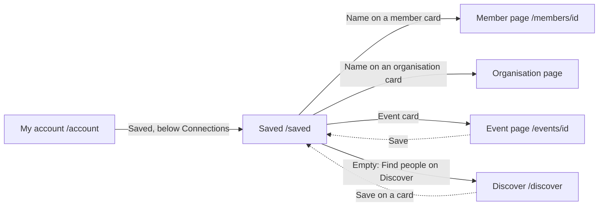

# Saved

- Component: frontend/src/pages/Saved.tsx, with Saved.module.css and Saved.test.tsx
- Address in the browser: /saved

## What the page is for

A member can save people and organisations on Discover, and events on the page of an event. This page shows everything they saved in one list, the most recent save first, so they find it back when they have time. People and organisations look exactly as they did on Discover. The member opens a page from here, or takes a card off the list.

## Who can open it

- Member (young person) and organisation: every logged in account sees only its own saves. The address holds nothing that could be changed to see someone else's.
- Visitor who is not logged in: the route is inside RequireLogin of issue 04, so the visitor is sent to Log in and sees no card.
- Nobody else ever sees what a member saved. The organisation of a saved event is not told.

## How you get there and where you go next

## Every element of the page, top to bottom

1. Heading: Saved
   - Built by task 44.4, issue 44 See my saved items, GitLab #86, sprint 2.
2. The list of saved cards
   - Data: getSavedItems(page) in frontend/src/api/savedItems.ts sends GET /api/saved-items?page=1&pageSize=20 through request() of frontend/src/api/client.ts. It returns a page (data and meta with page, pageSize and total) or not reachable.
   - The server checks the session with the guard of task 4.3 and the page numbers with PageQueryValidator of task 40.2. It reads the saves of this account from saved_item joined to the member profiles, organisation profiles and events they point to, in one query, newest first, through an index on (account_id, created_at). It hides the region where ProfileVisibility says so and skips a save whose profile no longer exists. Tasks 44.1, 44.3 and 161.3.
   - A real list (ul with li), so a screen reader says how many saved cards there are.
   - A member or organisation: SuggestionCard of issue 37, with SaveButton of issue 43 in its state Saved. The line "Matches you on:" is only shown when there are shared tags. The name on the card links to /members/<id> for a member and to the page of the organisation for an organisation, as on Discover. The card shows nothing that Discover does not show, and no email address or birth date.
   - An event: EventCard of issue 66, one link to /events/{id} with the title, the date written out in Europe/Amsterdam time and the place, and SaveButton with kind event next to it, outside the link. A past event shows like any other. Task 161.5, issue 161 Save an event, GitLab #222, sprint 5.
   - The card is chosen by the kind of the item, never by which fields are filled.
   - A member whom the admin switched off is not in the list. The row stays in the database. Task 46.4 adds this to the one visibility rule AccountVisibility that the query of issue 44 uses. Issue 46 Deactivate a member, GitLab #90, sprint 3.
   - Built by task 44.4 and task 161.5.
3. Button Saved on every card (taking a card off the list)
   - SaveButton sends DELETE /api/saved-items/<kind>/<id> of task 43b.2 through unsaveItem in frontend/src/api/savedItems.ts. The server deletes the one row in saved_item of this account only.
   - Only after a good answer, SaveButton calls onChange(false). The page takes the card out at once without a reload and lowers the total by one. The card stays away after a reload, and on Discover the same card says Save again. The card leaves within one second.
   - Filling the gap: when the total is still more than the cards shown, the page asks page = the cards now shown plus 1, with pageSize 1, and adds that one card at the end, unless it is already shown. When that question fails, the list stays and no message is shown. The next Load more asks from the place of the last card shown, so nothing is skipped.
   - Focus: after a card leaves, the focus moves to the button Saved of the next card, or to the heading Saved when it was the last one.
   - Failure: "Not removed, Connect is not reachable right now" next to the button, and the card stays with the word Saved.
   - Built by task 44b.3 (issue 44b Remove an item from my saved list, GitLab #87, sprint 3), with the server check of task 44b.2. For events the same works through task 161.5.
4. Button Load more
   - Shown below the list while fewer cards are shown than meta.total. It adds the next twenty under the cards. While it loads it says "Loading..." and is disabled. The button is gone when all cards are shown.
   - When it fails, the cards stay and "Connect is not reachable right now, try again later" appears below the list in role alert. Load more can be pressed again.
   - Built by task 44.4.

My account gets a link Saved below the link Connections of task 42.4 (MyAccount.tsx, task 44.4).

## States

- Loading: the heading Saved and "Loading your saved items..." in an area with aria-busy. The cards appear within two seconds on the test site.
- Empty: "Nothing saved yet" in place of the list, with a link Find people on Discover to /discover below it. The same shows after the last card was taken off.
- Filled: the cards, newest save first, with Load more when there are more than twenty.
- Not reachable on the first page: "Connect is not reachable right now, try again later" in role alert in place of the list, with a button Try again that shows the list once Connect is back.
- Not reachable on Load more: the same sentence below the list, the cards stay.
- Error on taking a card off: "Not removed, Connect is not reachable right now" next to the button.
- Phone (360 pixels wide) and laptop (1280 pixels wide): the page matches the Figma frame Saved at both widths, shown with screenshots in the merge request. axe reports 0 issues at both widths, also after a removal.
- Design: the Figma frame Saved on the Figma board of Connect, page Design directions. Colours, fonts and spacing only through frontend/src/styles/tokens.css.

## Accessibility and privacy

- A real list, so a screen reader says how many saved cards there are. Each button carries the name of its card.
- After a card leaves, the focus moves to the next card or the heading, so a keyboard user is not sent back to the top.
- An event card is one link, with the button outside it, so the button can be reached on its own.
- A member only ever sees and takes off their own saves. The save of the same card by another member stays.
- Nothing on a saved card that the same card on Discover does not show, and no email address or birth date.
- When a member deletes the account, the saved events are deleted with it.

## Built by

| Board | Title | GitLab | Sprint | Prio |
|---|---|---|---|---|
| 44 | See my saved items | #86 | 2 | should |
| 44b | Remove an item from my saved list | #87 | 3 | should |
| 46 | Deactivate a member | #90 | 3 | must |
| 161 | Save an event | #222 | 5 | could |

Issue 44 needs issues 43, 40, 42 and 04b first. Issue 44b needs issues 44 and 43b. Issue 46 needs issue 44 first. Issue 161 needs issues 43 and 66b.

## Open points

- A reminder by email before a saved event: issue 10 The client's priorities for the epics, question 101.

## AI use declaration

AI was used as a writing support tool while working on this document. We used AI to draft
the formulation of sentences, the structure of wording, readability, and clarity from
content that we had provided, and to generate the diagrams. The content itself, including
our experiences, reflections, learning goals, decisions, self-assessments, and
conclusions, is our own. We reviewed the drafts and decided as a team which text to
include.
