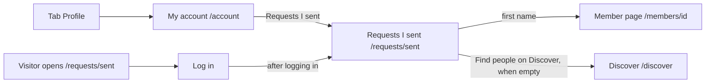

# Requests I sent, the connection requests a member is waiting on

- Component: frontend/src/pages/SentRequests.tsx, with SentRequests.module.css and SentRequests.test.tsx
- Address in the browser: /requests/sent
- Server addresses: GET /api/connection-requests/sent?page=1&pageSize=20, and DELETE /api/connection-requests/{id} for Take back

## What the page is for

A member of Connect can press Connect on the page of another member to ask for a connection. This page shows the requests that member sent and that are still waiting for an answer, newest first. The member sees at a glance who has not answered yet. With issue 136 the member can also take back a request, for example after pressing Connect on the wrong person.

## Who can open it

- Member (young person): sees their own waiting requests. A member without a profile gets an empty list (task 40.2).
- Organisation and admin: the cards name no other role for this page. The page sits inside RequireLogin, so any logged in person opens it, and the list only ever holds requests sent by that same person.
- Visitor who is not logged in: sees the page Log in and no list (AC9 of issue 40). RequireLogin sends them to Log in and back after logging in.
- Nobody else can ever see the requests a member sent. Adding ?member=<id> to the address changes nothing: the server takes the member from the session, never from the address (AC7 of issue 40).

## How you get there and where you go next

You get here from the page My account, which the tab Profile opens. My account has the link Requests I sent, below the link My profile (task 40.3).

From here you go to the page of a member by pressing their first name. When nothing is waiting, the link Find people on Discover leads to Discover.

## Every element of the page, top to bottom

The page sits inside AppShell of issue 06, so the five tabs stay around it.

1. Heading: Requests I sent
   - After a successful Take back the focus moves to this heading (task 136.3).
   - Built by task 40.3, issue 40 See the connection requests I sent, GitLab #78, sprint 2.

2. Message area above the list (only after Take back)
   - Shows "This request was already answered" in an area with role status, when the other member accepted or declined a moment before the member pressed Take back (AC7 of issue 136).
   - Built by task 136.3, issue 136 Take back a connection request I sent, GitLab #204, sprint 5.

3. The list of waiting requests
   - A real list (ul with one li per request), newest first, in the order the server sends.
   - Each row shows:
     - the first name of the member who was asked, as a real link to /members/<profileId>
     - the region of that member, only when the answer holds it. A member who hides their region on their own page shows no region here, and a row without region shows no empty label.
     - "Sent on" with the date written out, made with Intl.DateTimeFormat and the language of the browser, for example 5 October 2026.
   - A row never shows an email address, a birth date or an age band (AC8 of issue 40).
   - Data: getSentRequests(page) in frontend/src/api/connectionRequests.ts asks GET /api/connection-requests/sent?page=1&pageSize=20 through request() of frontend/src/api/client.ts. The page never calls fetch.
   - The server checks the session with the guard of issue 04, reads page and pageSize as text with the shared PageQueryValidator, finds the profile of the logged in member from the session, and applies ProfileVisibility of issue 14 to every row. The answer holds up to pageSize waiting requests in data, and page, pageSize and total in meta. A wrong value gives code 400 in the ValidationProblem format with "Use a page number of 1 or more" or "Use a page size from 1 to 50" (pageSize is 1 to 50). Any other parameter, such as member, is ignored.
   - In the database the rows come from the table connection_request with the status Requested, with the first name and region from member_profile. The index ix_connection_request_requester_id_status keeps the list fast (task 40.1).
   - A request leaves this list once it is accepted (issue 41b) or declined (issue 41c).
   - Built by tasks 40.1 (query and index), 40.2 (server address), 40.3 (screen) and 40.6 (seed data), issue 40, GitLab #78, sprint 2.

4. Button on each row: Take back
   - Sits on every row, after the date. It is a quiet secondary button.
   - Its aria-label is "Take back request to <first name>", so a screen reader tells the rows apart.
   - Pressing it opens the shared window ConfirmDialog of task 113.3 with the question "Take back your request to <first name>?" and the buttons Take back and Cancel.
   - Cancel and Escape close the window, change nothing and put the focus back on the button of that row.
   - Take back in the window calls takeBackRequest(connectionRequestId), which sends DELETE /api/connection-requests/<connectionRequestId> through request(). While it waits the button says "Taking back..." and is disabled.
   - The row only leaves the list after the answer came, never before.
   - Taken back (204): the window closes, the row leaves the list, the total goes down by one and the focus moves to the heading. When it was the last row, "Nothing is waiting" shows. The other member gets no message, no longer sees the request under Requests I received, and both members see the button Connect again on each other's page.
   - Already answered (409): the window closes, the row leaves the list and "This request was already answered" shows above the list.
   - Not found (404, "This request does not exist"): the window closes and the row leaves the list.
   - No answer or 503: the window stays open, "Not taken back, Connect is not reachable right now" shows in the window in an area with role alert, and the row stays.
   - Rules: only the member who sent a request can take it back. The member who was asked has no Take back button (AC9 of issue 136). The server removes the row only when this profile is the requester and the status is still Requested.
   - Until issue 136 is built, a row has no button and no field at all (AC6 of issue 40).
   - Built by tasks 136.1 (database), 136.2 (server address) and 136.3 (screen), issue 136, GitLab #204, sprint 5.

5. Button: Load more
   - Shows under the list while meta.page times meta.pageSize is less than meta.total, so when more than twenty requests are waiting.
   - Pressing it adds the next rows under the list. It says "Loading..." while it loads and cannot be pressed twice.
   - When it fails, the rows stay and the not reachable message shows under them.
   - Built by task 40.3, issue 40, GitLab #78, sprint 2.

## States

- Loading: "Loading your requests..." in an area with aria-busy.
- Empty: "Nothing is waiting" in place of the list, with the link Find people on Discover to /discover (AC3 of issue 40).
- Filled: the rows, newest first, with Load more when more than twenty are waiting. The seed member Sam of docs/testing/testData.md has twenty one waiting requests, so twenty rows show with Sent21 at the top, and Load more adds Sent01.
- Error, not reachable: "Connect is not reachable right now, try again later" in place of the list, in an area with role alert, with a button Try again that asks again (AC5 of issue 40).
- Not logged in while the page is open (401): the page asks useSession to read the session again, so RequireLogin sends the member to Log in and back.
- Take back not reachable: "Not taken back, Connect is not reachable right now" in the window (AC8 of issue 136).
- Take back too late: "This request was already answered" above the list (AC7 of issue 136).
- Phone and laptop: at 360 pixels wide nothing scrolls sideways, and axe finds 0 problems at 360 and 1280 pixels, also with the window open. The row leaves the list within one second after Take back (AC11 of issue 136).
- Design: the Figma frame Requests I sent on the page Design directions of the Figma board. Colours, fonts and spacing come only from frontend/src/styles/tokens.css.

## Accessibility and privacy

- Each first name is a real link, so a screen reader reads each row as the first name of the member (AC10 of issue 40).
- Each Take back button names the first name in its aria-label, and the question of the window is read when it opens (AC10 of issue 136).
- The window is the shared ConfirmDialog, so the keyboard and the screen reader work the same as everywhere else.
- The date is written with Intl.DateTimeFormat, so every member reads it the way they know.
- A row never shows an email address, a birth date or the region of a member who hides it.
- Only the member who sent the requests can see them. The address cannot be changed to show someone else's list.
- The other member is never told that a request was taken back.

## Built by

| Board | Title | GitLab | Sprint | Prio |
|---|---|---|---|---|
| 40 | See the connection requests I sent | #78 | 2 | should |
| 136 | Take back a connection request I sent | #204 | 5 | could |

## Open points

- Take back is only built when the client says yes to question 49 of issue 10 The client's priorities for the epics (GitLab #11): whether a member may take back a waiting request at all.
- Undoing a decline later is question 51 of issue 10.
- The builder of task 136.3 is asked to judge whether Requests I received should say "A request was taken back". The cards now say the other member gets no message.

## AI use declaration

AI was used as a writing support tool while working on this document. We used AI to draft
the formulation of sentences, the structure of wording, readability, and clarity from
content that we had provided, and to generate the diagrams. The content itself, including
our experiences, reflections, learning goals, decisions, self-assessments, and
conclusions, is our own. We reviewed the drafts and decided as a team which text to
include.
