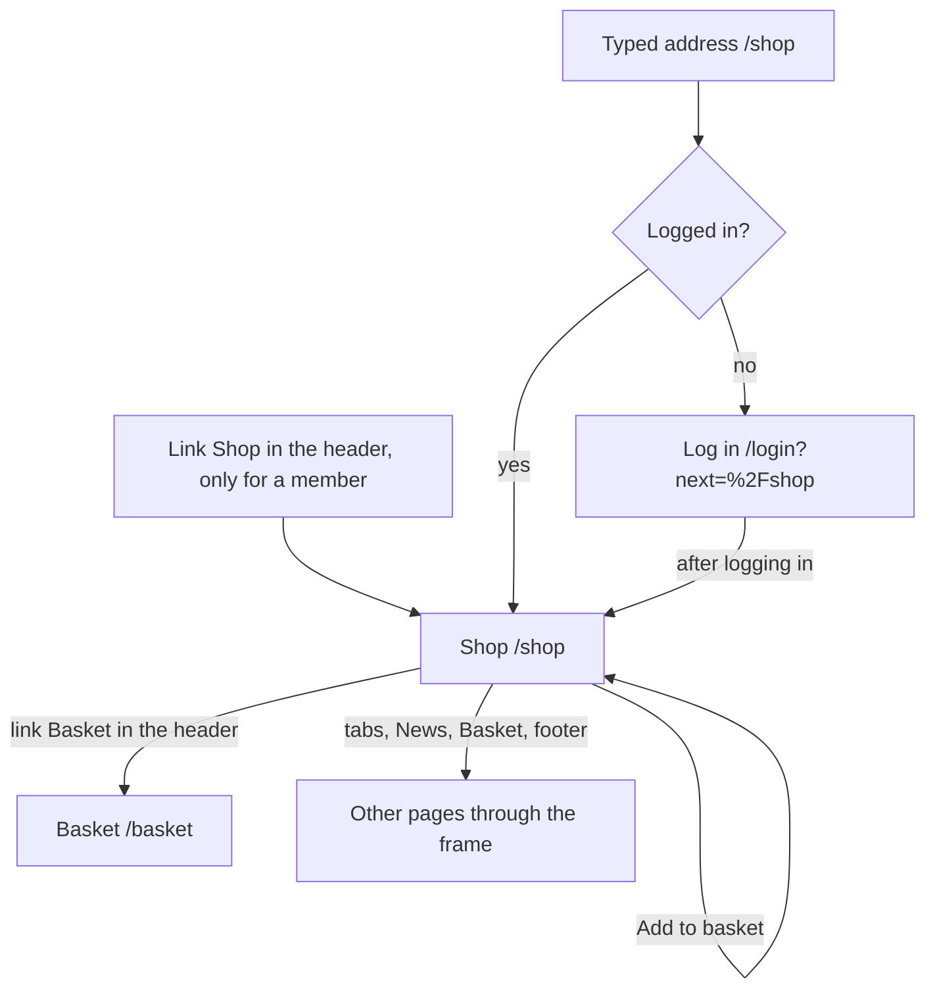

# The page Shop

Component: `frontend/src/pages/Shop.tsx`, with `frontend/src/components/ProductCard.tsx`.
Address in the browser: `/shop`.

## What the page is for

The page Shop shows the merchandise the WailSalutem Foundation sells, for example a T shirt, a cap or an agenda of the Young Amstelland Awards. Each item has a picture, a name, one or two sentences about it and a price in euros. Issue 81 shows the items. Issue 82 adds the button Add to basket on each item, issue 82b the link Basket with the number of items at the top, and issue 82c the limit of ten of one item. Paying comes with issue 83. An admin changes the items on the page Admin, Shop of issue 150, and members see the change here at once.

The shop waits for the client. The webshop (FR10 Webshop) is only in the foundation's drawing of Connect, not in its written brief. Issues 81 and 82 are not built before the client says yes in writing to issue 10, question 2. Issue 150 also waits for question 48. His answer also names the items and their prices, and the page shows exactly those items.

## Who can open it

- Member (young person, organisation or anyone else with an account): yes.
- Visitor who is not logged in: sees the page Log in and no item or price. After logging in, the visitor lands on the page Shop. `RequireLogin` sends them to `/login?next=%2Fshop` (issues 04 and 04b).
- A member whose log in ends in the middle of a visit: the next call answers code 401, the shared helper tells `useSession`, and `RequireLogin` sends the member to Log in with the way back to `/shop`.

## How you get there and where you go next

- The link Shop in the header of the frame (AppShell), next to the name Connect, only for a logged in member. It is not a sixth tab.
- A typed or shared address `/shop`.
- The link Basket sits next to the link Shop in the header, only for a logged in member, with the number of items when it is higher than 0, for example Basket 3. It goes to /basket (issue 82b, task 82b.3).
- From the page the member goes on through the frame: the five tabs, News, Basket and the footer.

## Every element of the page, top to bottom

### Loading text

- Text: "Loading the shop..."
- What it shows: while the first page of items loads, in an area with role status.
- Built by: issue 81 See the merchandise, task 81.3 (GitLab #147, sprint 4).

### The list of items

- What it shows: one card per item for sale, sorted by name from A to Z, twenty at a time.
- Data: `getProducts(page)` in `frontend/src/api/products.ts` asks `GET /api/products?page=<page>&pageSize=20` through the shared helper `client.ts`. The page never calls fetch itself. The answer holds the items with `meta` (page, page size and total). An empty list is a normal answer, not an error. The answer holds data about items only, never about members (task 81.2).
- Layout: one column below 768 pixels wide, a grid of cards from 768 pixels up, with one media query in `Shop.module.css`.
- Built by: issue 81, tasks 81.2 and 81.3.

### One item (ProductCard)

- The picture: with the name of the item as its alt text. It keeps its shape with `aspect-ratio` and loads with `loading="lazy"`. Its address is `imageUrl` from the answer: `/images/products/<image_file>` for an item of issue 81, and `/api/products/<id>/image?v=<8 characters>` for a picture an admin added with issue 150. That address is only for a logged in member and answers 404 "This picture was not found" for an item that is unknown or switched off (task 150.6, issue 150 Change the items of the shop through a screen, GitLab #232, sprint 5).
- The name: a heading.
- The description: one or two sentences.
- The price: plain text in euros with two decimals, like € 12,50, never 12.5. `formatPrice(cents)` in `frontend/src/utils/formatPrice.ts` uses `Intl.NumberFormat` with nl-NL and EUR. 1250 gives € 12,50 and 0 gives € 0,00. The price arrives in whole cents.
- The VAT line under the price: "VAT included" or "VAT not included".
- Rules: the card shows one Product and never calls fetch itself. Issues 82 and 83 reuse `formatPrice` for the basket and the total, never a copy.
- Built by: issue 81, task 81.3.

### Button Add to basket, on each item

- Label: Add to basket. For a screen reader its name is "Add <name> to your basket", so the buttons can be told apart.
- What it does: `addToBasket(productId)` in `frontend/src/api/basket.ts` sends the id of the item to `POST /api/baskets/current/items` through `client.ts`. The page never reloads.
- Busy: while its request runs the button says "Adding...", is disabled and cannot be pressed again, so a double tap adds one item.
- After it works: the line "Added to your basket. You have <quantity> of this in your basket." under the item, in an area with role status, with the number from the answer. It stays until the next press on that item. The card then passes `itemCount` of the answer to `setItemCount` of `useBasket`, so the number at the link Basket goes up at once (task 82b.3).
- Refused with 404: "This item is not for sale any more" under the item. Refused with 400: the message of the server under the item.
- Too many: "You can have at most 10 of one item in your basket" under the item, in an area with role alert, the title of the 409 answer of the server. The button stays usable (issue 82c, task 82c.3).
- Not reachable (code 503 or no answer): "Connect is not reachable right now, try again later" under the item, in an area with role alert. Nothing is added.
- Rules: the screen never works out a number itself, it shows the numbers of the server.
- Built by: issue 82 Put an item in my basket, task 82.3 (GitLab #148, sprint 4), issue 82b See my basket, task 82b.3 (GitLab #149, sprint 4), and issue 82c At most ten of one item in my basket, task 82c.3 (GitLab #150, sprint 4).

### Button Load more

- Label: Load more.
- What it does: a real button under the list, shown only while the number of items shown is lower than `meta.total`. It asks the next page, says "Loading more..." and cannot be pressed while it runs, and adds the items under the others.
- When that call fails: the items stay, and the not reachable sentence appears under the list.
- Built by: issue 81, task 81.3.

### Empty sentence

- Text: "There is nothing for sale right now."
- When: the server answers an empty list.

### Not reachable sentence

- Text: "Connect is not reachable right now, try again later"
- When: code 503 or no answer at all. It shows in an area with role alert, in place of the list.

## States

| State | What the person sees |
|---|---|
| Loading | "Loading the shop..." |
| Empty | "There is nothing for sale right now." |
| Filled | The items sorted by name, each with picture, name, description, price and VAT line, and Load more while there are more. |
| Loading more | The button says "Loading more..." and cannot be pressed. |
| Adding | The button Add to basket says "Adding..." and cannot be pressed. |
| Added | "Added to your basket. You have <quantity> of this in your basket." under the item, and the number at the link Basket goes up. |
| Add refused | "This item is not for sale any more", the message of the server, or "You can have at most 10 of one item in your basket" under the item. |
| Add not reachable | "Connect is not reachable right now, try again later" under the item. |
| Error or not reachable | "Connect is not reachable right now, try again later" in place of the list, or under the list when Load more fails. |
| Not logged in | The page Log in, no item and no price. |
| Phone | The items one under the other. |
| Laptop | The items in rows, several next to each other. |

The items are on the screen within two seconds after pressing Shop on a normal phone connection.

## Accessibility and privacy

- The picture has the name of the item as its alt text, so a screen reader hears the name at the picture. The price and the VAT line are text, so a screen reader reads them.
- The loading text is a role status area, the not reachable sentence a role alert area.
- Each button Add to basket has the name of its item for a screen reader. The line after a good add is a role status area, so it is read out without moving there. The limit of ten and not reachable under an item are role alert areas.
- A visually hidden area with role status says "Your basket has 3 items" each time the number at the link Basket changes (task 82b.3).
- The picture address of issue 150 only works for a logged in member, and a picture an admin added holds no place or phone name.
- The page shows data about items only. A visitor sees no item and no price.

The design: colours, fonts and spacing come only from the variables in `frontend/src/styles/tokens.css`, following the Figma frame of the page Shop on the page Design directions of the Figma board. When that frame does not exist yet, the builder asks the designer of the team first.

## Built by

| Board | Title | GitLab | Sprint | Prio |
|---|---|---|---|---|
| 81 | See the merchandise | #147 | 4 | could |
| 82 | Put an item in my basket | #148 | 4 | could |
| 82b | See my basket | #149 | 4 | could |
| 82c | At most ten of one item in my basket | #150 | 4 | could |
| 150 | Change the items of the shop through a screen | #232 | 5 | could |

## Open points

- Whether Connect has a shop at all, and which items it sells: issue 10, question 2. Issues 81 and 82 are not built before the client says yes in writing. The page Admin, Shop of issue 150 also waits for question 48. When he says no, every issue of the epic Webshop is closed with his reason and a link to his answer.
- Sizes and colours to choose inside one item: issue 10, question 122. Until the client answers, each size that must be sold is its own item.
- Paying for the basket is issue 83. It is not part of this page.

## AI use declaration

AI was used as a writing support tool while working on this document. We used AI to draft
the formulation of sentences, the structure of wording, readability, and clarity from
content that we had provided, and to generate the diagrams. The content itself, including
our experiences, reflections, learning goals, decisions, self-assessments, and
conclusions, is our own. We reviewed the drafts and decided as a team which text to
include.
