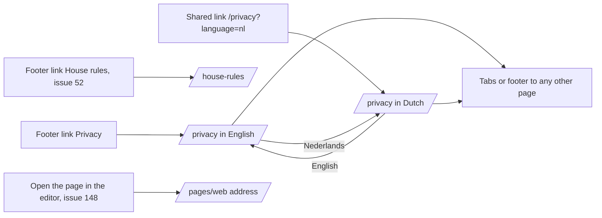

# Site page (privacy statement, house rules and other fixed pages)

- Component: web/src/pages/SitePage.tsx, with SitePage.module.css and SitePage.test.tsx
- Address in the browser: /privacy (English) and /privacy?language=nl (Dutch). The same component also serves /house-rules (issue 52) and /pages/<web address> for any site page (issue 148).
- Title of the browser tab: Connect and the title of the page, for example Connect, Privacy statement or Connect, Privacyverklaring.

## What the page is for

This page shows a site page: a page with a fixed text that the foundation writes, such as the privacy statement. The privacy statement tells a young person, and a parent who looks along, in plain words what Connect keeps about a member, why and on which legal basis, for how long, the rule for members under 16, what a member may ask the foundation, that they may complain to the Autoriteit Persoonsgegevens, and whom to contact. Everyone can read it, logged in or not, before they make an account. The text comes from the database, so when the foundation changes it in Admin, Pages the next reader sees the new text at once. A switch at the top shows the same text in Dutch.

## Who can open it

- Everyone: visitor, member (young person), organisation and admin. The page is open and needs no log in. A visitor who is not logged in reads exactly the same text as a logged in member.
- An address with a web address that does not exist, or that is not a valid web address, shows This page does not exist.

## How you get there and where you go next

You arrive through the link Privacy in the footer, the strip at the bottom of every page (SiteFooter.tsx, issue 51). Issue 52 adds a second link House rules next to it. A shared link such as /privacy?language=nl opens the Dutch text at once. With issue 148 an admin reaches a new page through the link Open the page in the editor, at /pages/<web address>.

From here you go on through the tabs of issue 06 around the page, the links in the footer, or the switch English and Nederlands at the top.

## Every element of the page, top to bottom

The page sits inside AppShell of issue 06, under the tabs and above the footer. On a phone the footer sits above the tabs, never behind them.

1. Language switch: English and Nederlands
   - Two React Router links at the top of the page. English goes to the address without language, Nederlands to ?language=nl. The current one has aria-current="true" and is bold.
   - Shown only when the answer has otherLanguage. A page without a Dutch version has no switch, so Nederlands never ends in not found. The switch is hidden while loading, on not found and on not reachable.
   - SitePage reads language from the address with useSearchParams. With ?language=nl it asks the slug with -nl, for example privacy-nl, without it the slug itself. A reload keeps the language.
   - Built by task 51b.4 (screen) and 51b.3 (server), issue 51b Read the privacy statement in Dutch, GitLab #103, sprint 3.
2. Title (h1)
   - The title from the answer, for example Privacy statement, Privacyverklaring, House rules or Huisregels.
   - Built by task 51.4, issue 51 Read the privacy statement from every page, GitLab #102, sprint 3.
3. Text of the page
   - The body, stored as markdown, turned into headings and lists by MarkdownView.tsx of task 50b.3, the one component for markdown on Connect. Raw HTML inside the markdown is not shown, and a script tag never reaches the page.
   - The text is wrapped in an element with lang set to the language of the answer, en or nl, so a screen reader reads Dutch with a Dutch voice.
   - The page holds no text of the statement in its code. All text comes from the server.
   - Data: getSitePage(slug) in web/src/api/sitePages.ts asks GET /api/pages/{slug} through request() of web/src/api/client.ts and returns the page, not found, or not reachable. The page never calls fetch.
   - The address is open to everyone and on the open list of the guard of task 4.3. The slug is bound as text and checked by GetSitePageRequestValidator: only lower case letters, digits and -, at most 50 characters.
   - Answer when it works: 200 with {"data": {"slug": "privacy", "title": "Privacy statement", "body": "# Privacy statement ...", "updatedAt": "...", "language": "en", "otherLanguage": {"language": "nl", "slug": "privacy-nl"}}, "meta": {}}. otherLanguage is null when the other version does not exist. The answer never holds who saved the page or the id, because it uses FindBySlugAsync of task 50.1. The second lookup for the other language never sends the body of that version.
   - Answer for an unknown or odd slug: 404 as a ProblemDetails with the title "This page does not exist". Both get the same status and title, so nobody can learn which slugs exist.
   - Answer when the database is down, also during the second lookup: 503 as a ProblemDetails with "Connect is not reachable right now".
   - The texts: the English privacy statement is written in docs/security/privacyStatement.md (task 51.1) and put in the row privacy by the migration AddPrivacyStatementText (task 51.2). The Dutch text is written in the part Nederlands of the same file (task 51b.1) and added as the row privacy-nl with the title Privacyverklaring by the migration AddDutchPrivacyStatement (task 51b.2).
   - Built by task 51.4 (screen), 51.3 (address), 51.2 (database) and 51.1 (text), issue 51, GitLab #102, sprint 3, and task 51b.4, 51b.3, 51b.2 and 51b.1, issue 51b, GitLab #103, sprint 3.
4. Footer with the link Privacy
   - SiteFooter.tsx: a footer element at the bottom of every page, inside AppShell, with a React Router link Privacy to /privacy. It is not hidden by the tabs.
   - Built by task 51.4, issue 51, GitLab #102, sprint 3. Issue 52 Read the house rules from every page (GitLab #104) adds the link House rules after it.

Other addresses that show this same component:

- /house-rules and /house-rules?language=nl: SitePage with the slug house-rules, and house-rules-nl for Dutch. Built by task 52.4, issue 52, GitLab #104, sprint 3.
- /pages/:slug: SitePage with the slug from the address, inside the layout of issue 06, so a page an admin adds can be read at once. Not found and not reachable stay as SitePage handles them. Built by task 148.4, issue 148 Add or delete a site page, GitLab #209, sprint 5.

## States

- Loading: Loading... in place of the text. No switch.
- Filled: the switch (when a second language exists), the title and the text, in the language of the address.
- Empty: not used. A site page always has a title and a text.
- Not found (code 404): This page does not exist. No switch. A page that an admin deleted with issue 148 also shows This page does not exist.
- Not reachable (fetch failed or an answer of 500 or higher): Connect is not reachable right now, try again later, in place of the text, with no codes or technical words. When the Dutch request fails, the page shows this sentence and never the English text in place of the Dutch one. A tester checks this with airplane mode on the phone.
- Phone: the statement is visible within two seconds after pressing Privacy, on mobile data. The page shows only the tabs, one title, the statement and the footer, with no pop up, advert or other block.
- Laptop: the same content inside the shell.
- Design: the Figma frame of the site page on the Figma board of Connect, page Design directions. Colours, fonts and spacing come only from the variables in web/src/styles/tokens.css.

## Accessibility and privacy

- The title is an h1, and a ## line of the markdown becomes a heading.
- The text has lang en or nl, so a screen reader picks the right voice. The current language link has aria-current.
- axe reports 0 issues on /privacy.
- The English and the Dutch statement use short sentences for a reader of 15, and explain every legal word in the same sentence. A teammate checks the English text and a young person from the target group checks the Dutch text, and each check is dated in docs/security/privacyStatement.md. The young reader is named by first name or role only.
- Kelvin, the security specialist of the team, checks the English text against issue 19 GDPR notes on minors' data, and checks that the Dutch text promises nothing more and nothing less.
- The answer never holds who saved the page, so the email address of an admin can never reach a visitor.
- Markdown is never shown as raw HTML, and the server never sends HTML.

## Built by

| Board | Title | GitLab | Sprint | Prio |
|---|---|---|---|---|
| 51 | Read the privacy statement from every page | #102 | 3 | must |
| 51b | Read the privacy statement in Dutch | #103 | 3 | must |
| 52 | Read the house rules from every page | #104 | 3 | must |
| 148 | Add or delete a site page | #209 | 5 | could |

Issue 51 needs issues 06 Move between the five tabs of Connect, 19 GDPR notes on minors' data, 50 Edit a site page without a deploy and 50b See a preview while I edit a site page first. Issue 51b needs issue 51. Issue 52 reuses the page and the switch and only adds the text, two rows, one link and the route /house-rules. Issue 148 adds the route /pages/:slug. Tasks of issues 51 and 51b in build order: 51.1 text, 51.2 database, 51.3 address, 51.4 page and footer, 51.5 end to end test (web/e2e/privacy.spec.ts), 51.6 team check, then 51b.1 Dutch text, 51b.2 database, 51b.3 address, 51b.4 switch, 51b.5 end to end test (web/e2e/privacyDutch.spec.ts), 51b.6 team check.

## Open points

- The contact address of the foundation in the statement: issue 10 The client's priorities for the epics, question 26. Until then the text says the address follows.
- Points that issue 19 GDPR notes on minors' data left open are written as open in the text, never guessed, for example how long data is kept.
- Whether visitors may read earlier versions of the statement: issue 10, question 25. The foundation sees them with issue 149.
- Whether the rest of Connect comes in Dutch: issue 10, question 42. The same question decides a Dutch version next to a new page of issue 148.
- A link in the footer or the menu to a page added with issue 148: issue 10, question 97.
- The house rules text waits on issue 10, questions 23 and 24 (what happens after breaking a rule, and how fast the foundation reads a report).

## AI use declaration

AI was used as a writing support tool while working on this document. We used AI to draft
the formulation of sentences, the structure of wording, readability, and clarity from
content that we had provided, and to generate the diagrams. The content itself, including
our experiences, reflections, learning goals, decisions, self-assessments, and
conclusions, is our own. We reviewed the drafts and decided as a team which text to
include.
