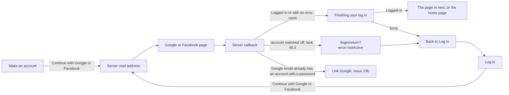

# Finishing a Google or Facebook log in

- Component: web/src/pages/SocialLoginReturn.tsx, with SocialLoginReturn.module.css and SocialLoginReturn.test.tsx (task 23.6). Issue 46 adds one sentence to the same file.
- Address in the browser: /login/return, with the values provider, next and error in the address (for example /login/return?provider=facebook&error=cancelled or /login/return?error=notActive)

## What the page is for

A person can register or log in with Google or Facebook. The browser leaves Connect for the Google or Facebook page and then comes back here. This page finishes the log in and opens the page the person wanted, or the home page. When something went wrong, it says in one plain sentence what happened and offers a link back to Log in. Nobody is logged in then. Issue 23 Register or log in with Google builds the page, issue 24 Register or log in with Facebook adds the Facebook sentences, and issue 46 Deactivate a member adds the sentence for a member who was switched off by an admin of the foundation.

## Who can open it

- Everyone may open the address: visitor, member (young person), organisation and admin. The route sits outside RequireLogin, because a person whose log in failed is not logged in and must still be able to read why.
- A member who was switched off (issue 46) is sent here by the server after Google confirmed who they are. They see the not active sentence and stay logged out.
- The page only shows fixed sentences. Text typed into the address never appears on the page.

## How you get there and where you go next

The person presses Continue with Google or Continue with Facebook on the page Make an account (/create-account) or Log in (/login). The button is a link (an a element with href, task 23.5, reused by task 24.3) to GET /api/auth/google/start or GET /api/auth/facebook/start, so the whole browser goes there. The server sends the browser to Google or Facebook (or to the stand in provider on a laptop and on the test site). After the person says yes or presses Cancel, the provider sends the browser back to /api/auth/google/callback or /api/auth/facebook/callback, and the server sends it on to this page. For a switched off account the Google callback sends it to /login/return?error=notActive (task 46.3).

When Google returns an email address that already has an account with a password, the server sends the browser to the page Link Google (/login/link-google, issue 23b) instead of this page.

## Every element of the page, top to bottom

1. Busy text: "Finishing your log in..."
   - Shown in an area with role status when the address has no error word.
   - The page calls refresh() of useSession (issue 04), which asks GET /api/sessions/current who is logged in, so the tab Profile shows the name of the member at once (issue 06b). The email address is never shown in the tabs.
   - When the answer is logged in, the page goes to next when it starts with a single / followed by something that is not / and not \. Otherwise it goes to the home page /. So next=/account/logins goes there, and next=//evil.example or next=/\evil.example goes to the home page.
   - When refresh() answers logged out although there was no error word, the page shows the failed sentence, because the cookie did not arrive.
   - When refresh() gets no answer, or an answer from 500 up, the page shows "Connect is not reachable right now, try again later".
   - Built by task 23.6, issue 23 Register or log in with Google, GitLab #46, sprint 2.
2. Message in place of the busy text, for an error word in the address
   - Shown in an area with role alert, so a screen reader reads it aloud. refresh() is not called.
   - The page keeps one list of provider names: google is Google, facebook is Facebook. Every sentence uses that name. The value provider is read from the address, and any value that is not google or facebook gives Google (task 23.6, followed by task 24.3).
   - The sentences, with the provider name filled in (tasks 23.6 and 24.3):
     - error=cancelled: "You cancelled the log in with Google. Nothing was changed." (Facebook: "You cancelled the log in with Facebook. Nothing was changed.")
     - error=failed: "The log in with Google did not work. Please try again." (Facebook: "The log in with Facebook did not work. Please try again.")
     - error=noEmail: "Google did not share an email address, so Connect cannot make an account."
     - error=emailInUse: "This email address already has an account. Log in with your password first."
     - error=emailNotVerified: "Google has not confirmed this email address, so Connect cannot make an account with it."
     - error=unreachable: "Connect is not reachable right now, try again later"
     - error=notActive: "Your account is not active, contact the foundation". It is the same sentence the page Log in shows after a password log in of a switched off account (task 46.6), and it never says why the account was switched off.
     - An unknown error word: the failed sentence.
   - Built by task 23.6 (issue 23, GitLab #46, sprint 2), task 24.3 (issue 24 Register or log in with Facebook, GitLab #49, sprint 2) and task 46.6 with the server side in task 46.3 (issue 46 Deactivate a member, GitLab #90, sprint 3).
3. Link: Back to Log in
   - Below every message. A link, because it goes to another page. Leads to the page Log in /login. Cards 23, 24 and 46 all call it the link Back to Log in.
   - Built by task 23.6.

What the server does before the page opens:
- Google (task 23.4): an account that already has this Google link is logged in. An email address that already has an account is refused with emailInUse and nothing is linked (issue 23b turns this into a pending link for an account with a password). A new verified email address gets a new account without a password, linked to Google, and logged in. An unverified email address is refused with emailNotVerified. A forged return with a wrong state logs nobody in. Every log in starts a session of 24 hours.
- Facebook (task 24.2): the same rule through SocialLoginService with the provider Facebook. A new Facebook account gets its email address marked as confirmed at once, so no confirmation email is sent.
- A switched off account (task 46.3): SocialLoginService checks IsActive after Google confirmed the person, gives the result not active, makes no session and sets no cookie, and the callback sends the browser to /login/return?error=notActive. The log gets only the account id and the request id, never the email address.
- Tables: account, external_login (issue 23, provider Google or Facebook only after task 24.1) and session. A refusal writes nothing.

## States

- Loading: "Finishing your log in..." in a role status area.
- Filled (success): the page the person wanted, or the home page, with the name of the member under the tab Profile.
- Error: one fixed sentence in a role alert area with the link Back to Log in. For notActive that is "Your account is not active, contact the foundation", and the person is not logged in.
- Not reachable: when the server runs but cannot finish, "Connect is not reachable right now, try again later" with the link Back to Log in. When the server cannot be reached at all, the browser shows its own page that the site cannot be reached, because Connect is not running to show anything.
- Empty: not used.
- Phone (360 pixels wide) and laptop (1280 pixels wide): the team does the whole log in on both on the test site (tasks 23.8 and 24.5), and checks the not active sentence of a switched off member on both (task 46.8).
- Design: the Figma board of Connect, page Design directions (the buttons follow the Figma frame Social buttons). Colours, fonts and spacing only through web/src/styles/tokens.css.
- Clickable prototype (laptop, sprint 1 and 2), on the Figma page Prototype sprint 1 and 2 (desktop). The line above each screen names its GitLab issues. The return page itself is not drawn. These two screens stand in for the pages of Google and Facebook.
  - [B01 Google page (stand-in)](https://www.figma.com/design/SAVxDf3rlsWz22qlzTEYte/Young-Amstelland-Connect--team-workspace?node-id=1017-1901)
  - [B03 Facebook page (stand-in)](https://www.figma.com/design/SAVxDf3rlsWz22qlzTEYte/Young-Amstelland-Connect--team-workspace?node-id=1017-2038)

## Accessibility and privacy

- Busy text in role status, every message in role alert.
- axe shows zero violations (tasks 23.6 and 46.6).
- Only fixed sentences are shown, never text from the address. Anyone can make a link to /login/return with any text in it.
- next is followed only when it starts with a single /, so a link through the real Connect log in can never end on a fake website.
- Connect asks Google only for openid and email, and Facebook only for email. It keeps only the email address. A fifteen year old sees exactly the same as an adult.
- No script from Google or Facebook is loaded in the page. The whole flow runs through the server.
- The not active sentence never names a reason (task 46.2 and issue 10, question 76).
- Deleting the account also deletes the link with Google or Facebook (issue 113).

## Built by

| Board | Title | GitLab | Sprint | Prio |
|---|---|---|---|---|
| 23 | Register or log in with Google | #46 | 2 | should |
| 24 | Register or log in with Facebook | #49 | 2 | could |
| 46 | Deactivate a member | #90 | 3 | must |

Issue 23 builds the page (task 23.6). Issue 23 needs issues 04, 10 and 20 first. Issue 24 needs issues 23, 10 and 27 first and reuses the page for Facebook (task 24.3). Issue 46 needs issue 23 first, and adds the error word notActive in task 46.3 (server) and task 46.6 (page). The team check of task 46.8 checks the Google log in of a switched off member by hand on the test site.

## Open points

- The real Google sign in project and the real Facebook app of the foundation wait on the client: issue 10 The client's priorities for the epics, question 7. Until then the team tests against the stand in provider. The check with a real Facebook account is issue 119.
- Linking Facebook to an existing account after typing its password: issue 10, question 12.
- Telling a switched off member by email why: issue 10, question 76. Until then the foundation contacts them in person.

## AI use declaration

AI was used as a writing support tool while working on this document. We used AI to draft
the formulation of sentences, the structure of wording, readability, and clarity from
content that we had provided, and to generate the diagrams. The content itself, including
our experiences, reflections, learning goals, decisions, self-assessments, and
conclusions, is our own. We reviewed the drafts and decided as a team which text to
include.
