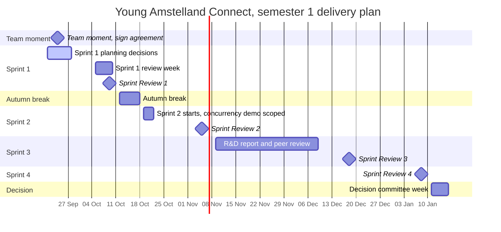

# Delivery plan, Young Amstelland Connect

This document serves the HvA level 3 criteria Management & Collaboration (MS), with entries
that also feed Analysis & Advice (AA) and Design & Realisation (OR) where a milestone's own
evidence does.

This is the team's calendar of deliverables from 24 September 2026 to the portfolio submission
at the end of the semester. Every date carries a source: the study manual's week table and the
DLO Assignments screenshots, `collaborationAgreement.md` section 5 (the Scrum Master and
Product Owner rotation), `workshopCoverage.md` (the team's own queued decisions and researched
proposals), and the team's own open TBDs with a date already attached. A date nobody has yet
stays a TBD, with an owner and the route to learn it, never invented.

## Milestone table

| Date | Milestone | Owner | Feeds |
| --- | --- | --- | --- |
| Thu 24 Sep 2026 | Team moment: confirm three open collaboration agreement notes, sign V1 | whole team | MS, collaborationAgreementV1.md |
| week of 21 Sep 2026 | Sprint 1 planning: architecture, testing strategy, hosting, prioritization, performance targets, success measures, stack conventions, DevOps additions, skills inventory | whole team | AA, OR |
| weeks of 21 and 28 Sep 2026 | Kelvin's Security requirements and risk framing datapoint: identify the security requirements, key assets and main risks for the team's project, feeding NFR1 now | Kelvin van Voorst | AA |
| by 5 Oct 2026 | Draft R&D research piece to the learning group teacher | Wesley | AA, Research & Design |
| week of 5 Oct 2026 | Sprint 1 review week: NFR1 authorization design, client questions 3/4/6 due | Kelvin van Voorst (NFR1), Nick Hoebe (client questions) | AA, OR, MS |
| Fri 9 Oct 2026 | Sprint Review 1 (DLO deadline, 11:59 PM) | whole team | AA, OR, Sprint Review datapoint |
| start of sprint 2 (19 Oct 2026) | Concurrency demonstration (event capacity race) confirmed and scoped to a Custom Datapoint | Wesley | AA/OR, Custom Datapoint |
| weeks of 19 and 26 Oct 2026 | Kelvin's Threat Model datapoint: DFD plus STRIDE for at least one Connect feature | Kelvin van Voorst | AA |
| Thu 5 Nov 2026 | Sprint Review 2 (DLO deadline, 11:59 PM) | whole team, SM Gurpreet Singh, PO Bayon Eerhart | AA, OR, Sprint Review datapoint |
| sprint 3, Nov 2026 | R&D report written and peer reviewed | Wesley (report), a fellow student (peer review) | AA, Review of R&D Report |
| Fri 18 Dec 2026 | Sprint Review 3 (DLO deadline, 11:59 PM) | whole team, SM Kelvin van Voorst, PO Wesley Oerlemans | AA, OR, Sprint Review datapoint |
| Fri 8 Jan 2027 | Sprint Review 4 (DLO deadline, 11:59 PM) | whole team, SM Bayon Eerhart, PO Kelvin van Voorst | AA, OR, Sprint Review datapoint |
| week of 26 Oct 2026, exact day TBD | Knowledge test 1 (week 9 per the study manual's anchored calendar) | individual, all students | counts toward progress evaluation 1 |
| week of 14 Dec 2026, exact day TBD | Knowledge test 2 (week 16 per the study manual's anchored calendar) | individual, all students | counts toward progress evaluation 2/3 |
| TBD, undated in DLO | Decision Committee, Portflow portfolio submission | whole team, route coach Karthik Srinivasan, ask by Thursday 24 September 2026 | all four learning outcomes |

## Thursday 24 September, the team moment

The collaboration agreement, version 1.10, carries three open notes the team confirms before
signing: the commit label order (`docs` and `test` were added 2026-09-22, the order is the
reverse of the Conventional Commits convention), the section 9.1 AI declaration wording moved
from "I" to "we" and needs the team's confirmation as a joint statement, and the section 9.3 AI
provider list (Anthropic and OpenAI) needs confirming. Source: `collaborationAgreement.md`
header, "Still open" list.

Once confirmed, `buildSigningVersion.py` regenerates the signing version and the five
signatures go into the signature table in section 11. This is the milestone that closes T015.

## Sprint 1 planning decisions, week of 21 September 2026

Every one of these is a queued decision in a team working document, owner the whole team unless
noted, due this week. Source: `workshopCoverage.md`'s "Open questions, gathered" section,
`requirements.md`, `techStack.md`, and `codeConventions.md`.

- **Architecture.** Confirm or redirect `architecture.md`'s proposed layered architecture with
  dependency inversion, the component diagram, the choice between the proposed Repository
  pattern and CQRS as an alternative, and the third design pattern (Dependency Injection,
  Strategy for the matching module, FR2).
- **Testing strategy.** Confirm or redirect `testingStrategy.md`'s remaining open items, React
  Testing Library and the module-by-module test plan. NUnit, FluentValidation, Vitest, and
  Playwright are already decided.
- **Hosting.** Confirm a hosting option from `infrastructure.md`'s four proposals (a single
  VPS, Azure for Students, a hybrid, or the Microsoft nonprofit Azure grant), weighed against
  the SQL Server licensing tension `stackResearch.md` names.
- **Prioritization with the client.** Confirm `requirements.md`'s proposed MoSCoW
  prioritization, owner the whole team together with the client.
- **Performance targets.** Numeric performance and availability targets (NFR4, NFR5), the same
  open question in `requirements.md` and `productVision.md`.
- **Success measures.** What counts as success for Connect, for the client and for the team,
  left open in `productVision.md`.
- **Stack conventions.** `codeConventions.md`'s stack-specific section for React, .NET, and
  Microsoft SQL Server, still entirely TBD.
- **DevOps additions.** `infrastructure.md`'s scan gate severity threshold and exact rollback
  procedure once a hosting option is picked.
- **Skills inventory cells.** The remaining TBD cells in `techStack.md`'s per-member skills
  table, owner each member for their own row.

## Sprint 1 review week, week of 5 October 2026

- **NFR1 authorization design.** Owner Kelvin van Voorst. Due at the latest this week, per
  `requirements.md` and `workshopCoverage.md`'s Security gap, fed by his separate Security
  requirements and risk framing datapoint due weeks of 21 and 28 September 2026. His Threat
  Model datapoint, DFD plus STRIDE, lands separately in sprint 2, weeks of 19 and 26 October
  2026, per the milestone table above.
- **Client questions 3, 4, and 6.** IP ownership, real versus test data (minors are in the user
  base), and portfolio visibility. Owner Nick Hoebe, sprint 1 Product Owner. Source:
  `collaborationAgreement.md` section 9.3 note and `productVision.md`.
- **Webshop scope question.** The client's concept diagram draws a webshop module the brief's
  text does not mention. Owner Nick Hoebe, due at the latest this week, per `infrastructure.md`
  and `requirements.md`.

## Sprint Review 1, Friday 9 October 2026

Source: DLO Assignments, due 11:59 PM.

**Proposal, the team confirms this split at sprint 1 planning.** Roughly 2.5 weeks separate the
Thursday 24 September team moment from this deadline, for a team with no repository yet and,
per `techStack.md`, four of five members with no experience in React, .NET, or SQL Server.
Listing everything queued above as equally due invites the same review week to try to close
architecture, testing, hosting, prioritization, the NFR1 design, a threat model, three client
answers, the R&D proposal, and a code slice all at once. Splitting what is minimum credible
from what is a stretch is this document's own attempt to be realistic about that, not a
lowered bar: the team can always deliver more than the minimum.

**Minimum credible set.**

- The collaboration agreement, signed (`collaborationAgreementV1.md`).
- The sprint 1 planning decisions above, confirmed rather than proposed.
- An existing GitLab repository, with the project skeleton and a small working slice of code
  in it, per the team's own sprint 1 planning note: "far enough along that the unsupervised
  week 5 does not stall it."
- The sprint board, showing the backlog split into sprint 1 work.
- Each member's own evidence collection toward their individual datapoints, gathered rather
  than finished. Work is tagged with the outcome, level, and direction labels from
  `issueMapping.md` at issue creation, and at datapoint time each member harvests their
  evidence by filtering GitLab on those labels.

**Stretch.**

- `requirements.md`, `productVision.md`, and `problemAnalysis.md` reflecting the confirmed
  prioritization and success measures.
- Wesley's Research & Design evidence: the reviewed R&D proposal, drafted to the learning group
  teacher by 5 October.
- Kelvin van Voorst's Security & Architecture evidence: the NFR1 authorization design and the
  threat model.
- Client questions 3, 4, and 6 answered and written in.

## The datapoint moments per the all-students sheet, as far as it is known

Source: the study manual's "Datapoints all students" screenshot, itself a partial capture that
stops before showing Sprint 3, Sprint 4, or a Knowledge Test row. What follows is only what
that sheet actually shows, not an assumption that later sprints repeat the same content.

| Sprint | Datapoint | Content | Feedback |
| --- | --- | --- | --- |
| 0 | Intake (Retro & PDP) | already delivered, T013 | Team coach to individual student |
| 1, 2 | Sprint Review | Project analysis, advice & design | Team coach to project team |
| 1, 2 | Retro & updated PDP | Self reflection on development skills, BoKSA, knowledge test knowledge, consultancy skills, learning attitude | Team coach to individual student |

**Truncation, honestly noted.** The sheet is cut off at "2-Nov", empty of content, before any
Sprint 3, Sprint 4, or Knowledge Test row. Their presence in the milestone table above is known
only from the kick-off's per-sprint count table (Sprint Review and Retro & PDP total 2 general
datapoints in every sprint 1 to 4), not from seeing sprint 3 and 4 content spelled out the way
sprints 1 and 2 are here. The follow-up is not recapturing the same cut-off page: it is asking
coach Karthik Srinivasan or checking Portflow, owner Wesley, natural moment the Thursday 24
September 2026 team moment.

## Wesley's individual line

- **R&D proposal to Portflow.** Date TBD. `research/inputsNeeded.md` question 4 remains open:
  the DLO Assignments page carries no research proposal, report, R&D, or peer review folder, so
  neither deadline is anywhere in the material this repository holds. Owner Wesley, route
  asking coach Karthik Srinivasan, ask by Thursday 24 September 2026.
- **Concurrency demonstration, start of sprint 2 (19 October 2026).** `research/advancedProgramming.md`'s
  plan for the event capacity check-then-act race (FR6) gets confirmed and assigned to a
  specific sprint's Custom Datapoint, per T009's rule that the elective's demonstration is
  decided at the start of the sprint it falls in.
- **R&D report and peer review, sprint 3, November 2026.** The finished report, reviewed by a
  fellow student and a teacher, is the evidence for the Review of R&D Report datapoint. Exact
  date TBD alongside the proposal date above, same route, same ask-by date.

## Sprint Reviews 2 through 4

Role rotation per `collaborationAgreement.md` section 5, version 1.2's rotation, everyone holds
each role exactly once across the five sprints:

| Sprint Review | Date | Scrum Master | Product Owner |
| --- | --- | --- | --- |
| 2 | Thu 5 Nov 2026 | Gurpreet Singh | Bayon Eerhart |
| 3 | Fri 18 Dec 2026 | Kelvin van Voorst | Wesley Oerlemans |
| 4 | Fri 8 Jan 2027 | Bayon Eerhart | Kelvin van Voorst |

Sprint Review 3's DLO deadline of 18 December 2026 falls later than sprint 3's own calendar
weeks (9, 16, and 23 November, per the study manual). Both dates are recorded here rather than
one silently overriding the other, the same rule the study manual and `collaborationAgreement.md`
already follow for their own contradictions.

## The knowledge test date

The exact day is TBD, the week is not. The study manual's anchored week table pins knowledge
test 1 to week 9, which starts 26 October 2026 (weeks 8, 9, and 10 of sprint 2 start 19
October, 26 October, and 2 November in turn), and knowledge test 2 to week 16, which starts 14
December 2026. Owner: individual, all students. Route: DLO Assignments or the study manual's
own detail. Wesley checks. Ask by Thursday 24 September 2026.

**Resolved 23 September 2026.** Per Wesley's ruling, where a school document and the team's
own record disagree, the school document wins. Knowledge test 2 is the week of 14 December,
matching the study manual's anchored week table and this document's table above.
`collaborationAgreement.md` is corrected to match, in version 1.11. The exact day stays TBD,
to be confirmed via coach Karthik Srinivasan, ask by Thursday 24 September 2026.

## Decision Committee, Portflow portfolio submission

Undated in DLO. The DLO Assignments page lists this folder with no due date
at all, alongside Workshop Domain IV and Progress Coaching. The study manual's week table places
the decision committee in week 18 (week of 11 January 2027) and a repair decision committee in
weeks 19 to 20 (18 and 25 January 2027), but that is the committee's own week, not a confirmed
submission deadline for the portfolio itself. Owner: whole team for the portfolio, Wesley for
his individual evidence. Route: coach Karthik Srinivasan. Ask by Thursday 24 September 2026.

## Semester overview

*Figure: the semester's dated milestones, the four Sprint Review deadlines from DLO, the
autumn break, and the study manual's decision committee week. Undated items, the knowledge
tests and the portfolio submission itself, are not on the chart since a gantt bar would invent
a date none of the sources hold.*

## References

Hogeschool van Amsterdam. (2026). *Studio studyguide 26-27 semester 1* [Course document].

## AI use declaration

AI was used as a writing support tool while working on this document. We used AI to draft
the formulation of sentences, the structure of wording, readability, and clarity from
content that we had provided, and to generate the diagrams. The content itself, including
our experiences, reflections, learning goals, decisions, self-assessments, and
conclusions, is our own. We reviewed the drafts and decided as a team which text to
include.
