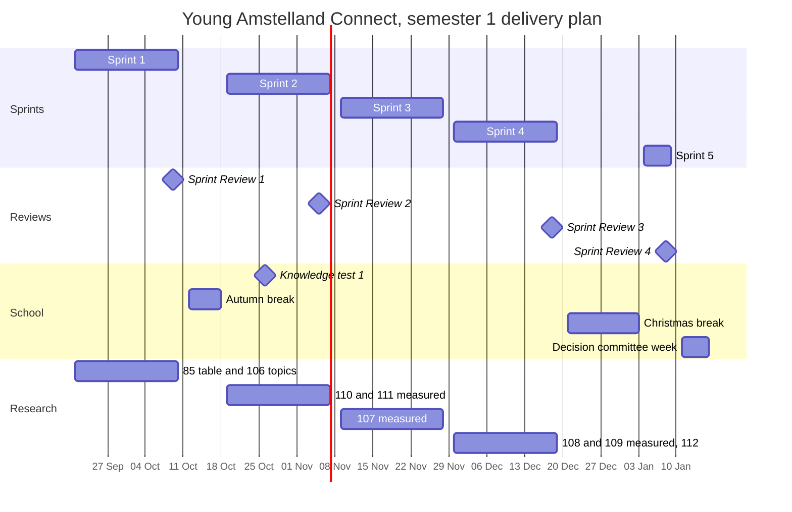

# Delivery plan, Young Amstelland Connect

This document serves the HvA level 3 criteria Management & Collaboration (MS), with entries
that also feed Analysis & Advice (AA) and Design & Realisation (OR) where a milestone's own
evidence does.

This is the team's calendar from sprint 1 to the portfolio submission at the end of the
semester. It follows the five sprints and milestones of `docs/team/gitlabSetup.md` and the
dates of the HvA schedule. Every date carries a source: the study manual's week table and the
DLO Assignments page, `docs/team/collaborationAgreement.md` section 4 (the semester calendar)
and section 5 (the role rotation), and the board in GitLab. A date nobody has yet stays open,
with the route to learn it, and is never invented. The GitLab number of every board number is
in `docs/team/boardNumbers.md`.

## The five sprints

Each sprint is a milestone in GitLab and has its own board with the lists Open, In progress,
Verify, Won't do and Closed (`docs/team/gitlabSetup.md`). A sprint ends in the week of its
sprint review and retrospective in the HvA schedule. Every issue carries the milestone and the
label of its sprint.

| Sprint | Start | End | Issues | Must | Should | Could |
|---|---|---|---|---|---|---|
| Sprint 1 | Mon 21 Sep 2026 | Fri 9 Oct 2026 | 25 | 23 | 2 | 0 |
| Sprint 2 | Mon 19 Oct 2026 | Fri 6 Nov 2026 | 30 | 25 | 5 | 0 |
| Sprint 3 | Mon 9 Nov 2026 | Fri 27 Nov 2026 | 36 | 29 | 7 | 0 |
| Sprint 4 | Mon 30 Nov 2026 | Fri 18 Dec 2026 | 36 | 15 | 19 | 2 |
| Sprint 5 | Mon 4 Jan 2027 | Fri 8 Jan 2027 | 20 | 20 | 0 | 0 |
| Without a sprint | | | 103 | 0 | 34 | 69 |

Together that is all 250 issues of the board, in 21 epics, as GitLab holds them after the team
planned sprints 2 to 5 again on 9 October 2026 in
[decision 004](../decisions/004-replanAfterSprint1.md). The rules of that plan: what is done or
waits in an open merge request stays, school goals come first and are spread over sprints 2
to 4, then every must, then should and
could, at about 60 weight per sprint of three weeks and 20 in sprint 5. A should or could issue
stands in a sprint only when a must or a school goal waits for it. The 103 should and could
issues that nothing waits for stay open without a sprint, as placeholders for a faster team or a
next team. The priorities are the proposal of the team until the client confirms the order of
the epics (`docs/client/clientQuestions.md`, question 1).

Every milestone description has the three headings the assessor looks for: Sprint goal, MVP
after this sprint and Client feedback. The team fills them at the start of the sprint.

History. The earlier version of this plan, of 24 September 2026, counted four sprint reviews
from DLO and no sprint board yet. The board now has five sprints. Sprint 4 starts on 30
November, as in the schedule export. The study manual puts sprint 4 in the weeks of 7 and 14
December, with the week of 30 November unsupervised (`docs/team/collaborationAgreement.md`,
section 4, where both are recorded).

## Milestone table

| Date | Milestone | Owner | Feeds |
| --- | --- | --- | --- |
| Thu 24 Sep 2026 | Team moment: confirm the open notes of the collaboration agreement. The agreement is still a draft, the team is working on the final version | whole team | MS |
| before Fri 9 Oct 2026 | The meeting with the client of issue 10 The client's priorities for the epics, questions 1 to 8 | sprint 1 Product Owner Nick Hoebe | AA, MS |
| week of 5 Oct 2026 | Progress evaluation 1 | individual, all students | PL, all outcomes |
| Fri 9 Oct 2026 | Sprint Review 1 (DLO deadline, 11:59 PM), end of sprint 1 | whole team | AA, OR, Sprint Review datapoint |
| 12 to 17 Oct 2026 | Autumn break | | |
| Mon 26 Oct 2026 | Knowledge test 1 (week 9 of the study manual) | individual, all students | progress evaluation |
| Thu 5 Nov 2026 | Sprint Review 2 (DLO deadline, 11:59 PM) | whole team, SM Gurpreet Singh, PO Bayon Eerhart | AA, OR, Sprint Review datapoint |
| Fri 6 Nov 2026 | End of sprint 2 | whole team | MS |
| 8 to 13 Nov 2026 | Bayon Eerhart is at the Stuttgart BIP | Bayon Eerhart | |
| week of 16 Nov 2026 | Progress evaluation 2 | individual, all students | PL, all outcomes |
| Fri 27 Nov 2026 | End of sprint 3 | whole team, SM Kelvin van Voorst, PO Wesley Oerlemans | AA, OR, MS |
| week of 14 Dec 2026, day open | Knowledge test 2 (week 16 of the study manual) | individual, all students | progress evaluation |
| Fri 18 Dec 2026 | Sprint Review 3 (DLO deadline, 11:59 PM), end of sprint 4 | whole team, SM Bayon Eerhart, PO Kelvin van Voorst | AA, OR, Sprint Review datapoint |
| 21 Dec 2026 to 2 Jan 2027 | Christmas break | | |
| Fri 8 Jan 2027 | Sprint Review 4 (DLO deadline, 11:59 PM), end of sprint 5, project completion and progress evaluation 3 | whole team, roles open | AA, OR, Sprint Review datapoint |
| week of 11 Jan 2027 | Decision committee (week 18 of the study manual), repair committee weeks of 18 and 25 January | whole team, route coach Karthik Srinivasan | all four learning outcomes |

## Sprint reviews and sprints

DLO shows four sprint review deadlines: 9 October, 5 November, 18 December and 8 January. The
board has five sprints. Sprints 1, 2, 4 and 5 end in the week of one of those deadlines. Sprint
3 ends on 27 November, in the last of its study manual weeks (9, 16 and 23 November), and no
DLO deadline in the material the team holds falls in that week. Whether sprint 3 has its own
sprint review datapoint is open. Route: coach Karthik Srinivasan or Portflow.

The names differ as a result. The DLO deadline "Sprint Review 3" of 18 December closes the
team's sprint 4, and "Sprint Review 4" of 8 January closes sprint 5. This plan uses the DLO
names for the deadlines and the GitLab names for the sprints.

## Roles per sprint

Scrum Master and Product Owner rotate every sprint, per `docs/team/collaborationAgreement.md`
section 5:

| Sprint | Scrum Master | Product Owner |
| --- | --- | --- |
| 1 | Wesley Oerlemans | Nick Hoebe |
| 2 | Gurpreet Singh | Bayon Eerhart |
| 3 | Kelvin van Voorst | Wesley Oerlemans |
| 4 | Bayon Eerhart | Kelvin van Voorst |
| 5 | open | open |

The agreement lists sprints 0 to 4, with sprint 0 before 21 September (Nick Hoebe and Gurpreet
Singh). The board has no sprint 0 and adds sprint 5 from 4 to 8 January 2027. Who holds the
roles in sprint 5 is open, to be settled in section 5 of the collaboration agreement. The
earlier version of this plan gave the 18 December review to Kelvin van Voorst and Wesley
Oerlemans and the 8 January review to Bayon Eerhart and Kelvin van Voorst. With five sprints,
18 December closes sprint 4, so it follows the sprint 4 row above.

Bayon Eerhart is abroad from 8 to 13 November, the first week of sprint 3, and holds no role in
that sprint.

## Sprint 1, 21 September to 9 October 2026

What sprint 1 holds on the board: the foundation of the repository, the first working piece of
Connect on the test site, and the answers of the client that the rest of the board waits for.
The team writes the sprint goal itself in the sprint 1 milestone.

- **Foundation and hosting.** Issue 01 The repository, the pipeline and the team rules, and
  issue 09 Every team member on the client's server. Issue 09 is blocked: the team waits for the
  first login and the DNS record of the test address from the client (task 9.1).
- **Decisions.** Issue 10 The client's priorities for the epics, and issue 11 The team agrees
  on the layered architecture (four backend projects and .NET 10).
- **The first slice.** Issues 03 Create an account, 04 Log in with email and password, 05 Log
  out, 06 Move between the five tabs of Connect, 07 Create a profile and 08 See my own profile
  page.
- **Security analysis.** Issue 12 Inventory of the personal data per module and issue 13 The
  role table per module, by Kelvin van Voorst.
- **School.** Issue 85 The coach sees per student which issue proves which workshop, and issue
  106 Each student's research topic approved, so every student starts the research with an
  approved topic.
- **Stretch.** Issues 84 The DevOps learning outcomes agreed with the teacher, 04b, 03b, 06b,
  16 A security scan in the pipeline, 17 A health check and structured logs, 19 GDPR notes on
  minors' data, 18 Data flow diagram of profile creation, 07b, 14 View another member's
  profile, 15 and 20 Dockerfiles for the server and the frontend.

**Issue 10 before the review.** The meeting with the client happens before 9 October 2026
(issue 10, acceptance criterion 15). It answers questions 1 to 8 of
`docs/client/clientQuestions.md`: the order of the epics, the webshop, real or invented data
on the test site, ownership and what the students may show, page speed and uptime, Connect
after January and the hosting grant, the Google and Facebook accounts for social log in, and
three account questions. The answers go under Client feedback in the sprint 1 milestone.

**What moved after sprint 1.** None of the 12 slices of sprint 1 was finished. The 18 issues that had not started and issue 03, which had started, moved to sprint 2 in decision 004. Issues 01, 09, 11, 178 and 179 stay in sprint 1 because their work waits in an open merge request, and issue 106 stays in Verify.

**Minimum credible set for Sprint Review 1.**

- The collaboration agreement. It is a draft now, not signed yet. The team finishes the final
  version and then signs it.
- The repository on gitlab.fdmci.hva.nl with dev and main protected, the templates, and the
  pipeline (issue 01).
- The sprint board, showing the sprint 1 issues and their tasks.
- The first slice on the test site, as far as issue 09 allows. When the server or the test
  address is not there yet, the team says so at the stand up and shows the slice locally.
- Each member's own evidence collection toward their individual datapoints, gathered rather
  than finished. The portfolio labels (outcome, level and direction) are on every task, and at
  datapoint time each member finds their evidence by filtering GitLab on those labels.

## Sprint 2, 19 October to 6 November 2026

The first slice of sprint 1 and what makes an account safe: issues 03 Create an account to 08
See my own profile page, 03b, 04b, 06b, 14, 15, issue 113 Delete my account and all my data,
the password reset of issues 21 and 22, the password change of issue 114, the check
against leaked passwords of issue 116, and issue 130 A young person under 16 asks a parent for
permission. Issue 20 starts Connect with one command, issue 17 adds the health check and issue
16 the security scan. The security analysis of Kelvin van Voorst (issues 12, 13, 18 and 19) and
the client meeting of issue 10 move here from sprint 1. School goals: issue 84 The DevOps
learning outcomes agreed, issue 85 the evidence table per student, issue 176 the Scrum Master
proof of sprint 2, issue 177 four ways of loading a profile, and issue 111 Two end to end test
tools compared on one flow.

## Sprint 3, 9 to 27 November 2026

Production and the first members who connect. The code quality and image checks of issues 88 to
90 and production of issues 91 to 97 come first, so every merge into `main` reaches the live
version from this sprint on. The numbers, the dashboard and the logs of issues 98, 99 and 101
watch it. Next to that: confirming the email address and logging in with Google, the waits
after wrong passwords (issues 30 and 30b), organisation profiles and pages, tags, matching from
the suggestions of issue 37 to the saved items of issue 44, and the admin list of members with
deactivate and reactivate.

## Sprint 4, 30 November to 18 December 2026

What young people find, and the rest of the school deliverables:

- **Events, opportunities, projects and news.** Issues 65 to 68b, 54 and 55, 60 to 64 with 61b and
  62b, 48, and 71 and 71b. They are here in the same sprint as the research and the threat
  model that measure them.
- **Site pages and admin.** Issues 50, 50b and 51, the friendly page of issue 53, and the
  activity log of issue 32.
- **Production extras.** Issues 173 and 174, and the alert email of issue 100.
- **DevOps evidence.** Issue 86 A recording of one change from commit to production and issue
  87 The live demo to the teacher.
- **Architecture and security.** Issues 102 The architecture drawn in layers, parts and places,
  103 The design patterns Connect uses, where and why, 104 A threat model of adding an image to
  a project, and 105.
- **Research.** Issues 107 Three ways to give out the last event place, 108 Two ways of paging
  the showcases, 109 Image formats for project pictures, and 110 The cost of password hashing,
  measured. Issue 112 Every research report reviewed by a fellow student closes the research in
  this sprint.

## Sprint 5, 4 to 8 January 2027

The last 20 musts of the project, all of them for the foundation: editing a profile and its tags
(issues 33, 36b, 36c and 36d), the rest of the parent permission (130b and 131), the lock and
the email after fifteen wrong passwords (31, 31b and 29b), the rest of Discover and the requests
(37b, 38 and 41c), searching members and the usage numbers (45b and 47), the privacy statement in
Dutch (51b), the house rules (52), the rule that an account is a young person or an organisation
(34b), member pages hidden from search engines (15b), the region message (07b) and issue 105b.
With 23 weight in one week this sprint is 3 above the pace of decision 004. The team checks at
the sprint 4 review whether that still holds.

A handover session with the client, if he wants one, gets a date before the last sprint review
as a GitLab milestone Handover (issue 10, task 10.7). What happens with the access to the server in
that session is in [serverHandover.md](../client/serverHandover.md).

## Without a sprint

34 should and 69 could issues that no must or school goal waits for, among them the webshop,
the challenges, the badges, most of the admin and the opportunities, and the rest of the news
and events. They stay open with their priority and the label of their epic. Many of them also
wait for a yes of the client in questions 9 and up of `docs/client/clientQuestions.md`.

## Individual lines

**Wesley Oerlemans, Research & Design.** The earlier plan had a draft R&D research piece to the
learning group teacher by 5 October 2026. The approval of every student's research topic is now
issue 106, in sprint 1. The event capacity race of the earlier plan is issue 107 Three ways to
give out the last event place, measured, in sprint 4, because it waits
for the events of sprint 3. The peer review of every report is issue
112, in sprint 4. The research schedule was moved forward on 27 September 2026 so that it sits
closer to the level 3 datapoint sheet (Research & Design in sprint 1, Review of R&D Report in
sprint 3). The exact Portflow deadlines for the proposal and the report are not in the
material the team holds. Route: coach Karthik Srinivasan.

**Kelvin van Voorst, Security.** His security requirements and risk framing datapoint is issue
12 Inventory of the personal data per module and issue 13 The role table per module, in sprint
2. The data flow diagram is issue 18, in sprint 2. The threat model of a second feature
is issue 104 A threat model of adding an image to a project, in sprint 4.

**Every student, DevOps.** Each student agrees three to five learning outcomes with the DevOps
teacher in issue 84, in sprint 2. The recording (issue 86) and the live demo (issue 87)
are in sprint 4.

## The datapoint moments per the all-students sheet, as far as it is known

Source: the study manual's "Datapoints all students" screenshot, itself a partial capture that
stops before showing Sprint 3, Sprint 4, or a Knowledge Test row. What follows is only what
that sheet actually shows, not an assumption that later sprints repeat the same content.

| Sprint | Datapoint | Content | Feedback |
| --- | --- | --- | --- |
| 0 | Intake (Retro & PDP) | already delivered | Team coach to individual student |
| 1, 2 | Sprint Review | Project analysis, advice & design | Team coach to project team |
| 1, 2 | Retro & updated PDP | Self reflection on development skills, BoKSA, knowledge test knowledge, consultancy skills, learning attitude | Team coach to individual student |

**Truncation, honestly noted.** The sheet is cut off at "2-Nov", empty of content, before any
Sprint 3, Sprint 4, or Knowledge Test row. Their presence in the milestone table above is known
only from the kick-off's per-sprint count table (Sprint Review and Retro & PDP total 2 general
datapoints in every sprint 1 to 4), not from seeing sprint 3 and 4 content spelled out the way
sprints 1 and 2 are here. The sheet counts four sprints and the board has five. How the school
counts the fifth is open. Route: coach Karthik Srinivasan or Portflow.

## The knowledge test dates

The weeks are fixed, the exact day of test 2 is not. The study manual's anchored week table
pins knowledge test 1 to week 9, Monday 26 October 2026, and knowledge test 2 to week 16, the
week of 14 December 2026. Where a school document and the team's own record disagree, the
school document wins (decided 23 September 2026). The exact day of test 2 is open. Route: DLO
Assignments or coach Karthik Srinivasan. The two tests are individual school duties and have no
issue on the board.

## Decision Committee, Portflow portfolio submission

Undated in DLO. The DLO Assignments page lists this folder with no due date at all, alongside
Workshop Domain IV and Progress Coaching. The study manual's week table places the decision
committee in week 18 (week of 11 January 2027) and a repair decision committee in weeks 19 to
20 (18 and 25 January 2027), but that is the committee's own week, not a confirmed submission
deadline for the portfolio itself. Owner: whole team for the portfolio, each student for their
individual evidence. Route: coach Karthik Srinivasan.

## Open points

1. The final version of the collaboration agreement. It is a draft, not signed yet, and the
   team is still working on the final version. The signature table in
   `docs/team/collaborationAgreement.md` section 11 stays empty until then. Owner: whole team.
2. Who holds Scrum Master and Product Owner in sprint 5. Owner: whole team, in section 5 of the
   collaboration agreement.
3. Whether sprint 3 has its own sprint review datapoint, and how the school counts five
   sprints. Route: coach Karthik Srinivasan.
4. The exact day of knowledge test 2. Route: DLO Assignments or coach Karthik Srinivasan.
5. The Portflow deadlines for the research proposal, the research report and the portfolio.
   Route: coach Karthik Srinivasan.
6. The client's answers to questions 1 to 8, before 9 October 2026. Issue 10.

## Semester overview

The chart shows the five sprints, the sprint review deadlines, the school dates and the sprint
of every research issue.

*Figure: the five sprints of the board, the four sprint review deadlines from DLO, the breaks,
knowledge test 1, the decision committee week and the sprint of each research issue. The meeting of issue 10, knowledge test 2
and the
portfolio submission are not on the chart, since a bar would invent a date none of the
sources hold.*

## References

Hogeschool van Amsterdam. (2026). *Studio studyguide 26-27 semester 1* [Course document].

## AI use declaration

AI was used as a writing support tool while working on this document. We used AI to draft
the formulation of sentences, the structure of wording, readability, and clarity from
content that we had provided, and to generate the diagrams. The content itself, including
our experiences, reflections, learning goals, decisions, self-assessments, and
conclusions, is our own. We reviewed the drafts and decided as a team which text to
include.
