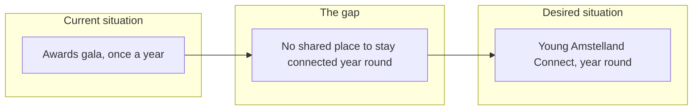
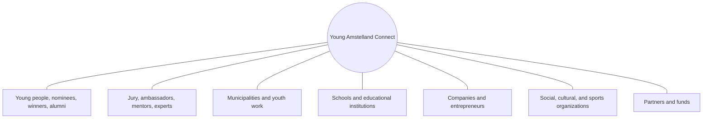

# Problem statement and analysis, Young Amstelland Connect

This document serves the HvA level 3 criterion Analysis & Advice (AA). It is grounded in
`docs/client/clientBrief.md` and `docs/project/productVision.md`, and stays open for the team to
edit and restructure as understanding develops. Every open question below names the issue or
the client question in `docs/client/clientQuestions.md` that decides it. The GitLab number of
every board number is in `docs/team/boardNumbers.md`.

## The problem statement

The Young Amstelland Awards give young people and young professionals aged 15 to 30 from
Amstelland a podium for their talent, social impact, entrepreneurship, and perseverance
(`docs/client/clientBrief.md`). That podium exists once a year, around the awards gala. For the rest of
the year, the people the awards recognize, and the people who could support them, have no
shared place to stay connected.

That is the societal gap the client is asking Young Amstelland Connect to close: young talent
in Amstelland gets a podium through the awards cycle, but no durable, year-round connection to
the people, organizations, and opportunities around it.

The client states the design question this project has to answer. It is quoted here exactly,
so its punctuation stays (`docs/client/clientBrief.md`):

> **"Hoe kunnen we een digitaal ecosysteem ontwikkelen waarin jong talent uit Amstelland niet
> alleen zichtbaar wordt, maar ook duurzaam wordt verbonden met mensen, organisaties, kansen
> en maatschappelijke uitdagingen?"**

Everything below works toward answering that question. It does not answer it on the team's
behalf.

## The current situation

The existing YAA website supports only the official award cycle: nominations, voting, the
jury process, and the gala (`docs/client/clientBrief.md`). Engagement with young talent is concentrated
around that one annual event. Once the gala ends, the website gives nominees, winners, jury
members, and the organizations around them no shared reason to come back.

## The desired situation

`docs/project/productVision.md` describes what the client wants instead: a digital ecosystem where young
talent stays connected, year-round, to young people, nominees, winners, and YAA alumni, to
jury members, ambassadors, mentors, and experts, to municipalities and youth work, to schools,
to companies, to social, cultural, and sports organizations, and to partners and funds that
offer opportunities. The client's own functionality list, profiles, showcases, challenges,
opportunities, events, badges, news, community interaction, matching, and an admin dashboard,
describes the shape that connection could take, with room left for the team to add its own
ideas on top of it. Each of these modules is now a requirement (FR1 to FR9) in
`docs/project/requirements.md` and an epic on the board.

The diagram shows the step from the current situation, through the gap, to the desired
situation.

*Figure: the current situation reaches young talent once a year, the desired situation
connects them year round, and the gap between the two is what Connect is built to close.*

## The gap

The gap is the difference between an audience reached once a year and a community reached all
year. The awards cycle proves that young talent in Amstelland exists and deserves visibility.
It does not give that talent, or the people who could mentor, employ, fund, or otherwise
support it, anywhere to act on that visibility between one gala and the next. Young Amstelland
Connect is the client's proposed way to close that gap, without touching the platform that
already runs the awards cycle.

## Stakeholder analysis

Built from the user groups the client's brief names (`docs/client/clientBrief.md`, "Doel"). What each
group needs from Connect, and what each group brings to it.

The diagram shows the seven groups around the platform, the table after it says what each
group needs and brings.

*Figure: the seven stakeholder groups named in the client's brief, each connected to the
platform at the center.*

| Stakeholder group | What they need from Connect | What they bring to Connect |
| --- | --- | --- |
| Young people, nominees, winners, and YAA alumni | A place to stay visible and keep finding opportunities after the gala, not only during it | Profiles, project showcases, and participation in challenges and events |
| Jury members, ambassadors, mentors, and experts | A way to stay connected to the talent they judge or advise, beyond the one evening they meet it | Mentorship, expertise, and credibility for the platform |
| Municipalities and youth work | A partner platform that reaches young people across Amstelland year-round | Local reach and referrals into youth work and municipal programs |
| Schools and educational institutions | A channel connecting students to real showcases and opportunities | Access to students and a route to publicize opportunities |
| Companies and entrepreneurs | A way to find and support the talent the awards surface | Opportunities, sponsorship, and challenges for young people |
| Social, cultural, and sports organizations | A community layer that reaches young members and volunteers | Events and community activities |
| Partners, funds, and other organizations offering opportunities | A platform to publish and match opportunities to the right young people | Funding, opportunities, and partnerships |

## Constraints

Two constraints shape any solution the team designs, both from the client's brief:

- **Standalone application.** Connect gets its own technical environment, its own hosting,
  and its own database. It is not a feature added to the existing YAA website. The foundation
  rents a server and lends it to the team: the test site runs there on docker compose (issue 09
  Every team member on the client's server), and the live version is planned there on k3s with
  Terraform (issue 92 k3s and Terraform for production, compose for test). Nothing new runs on
  that server before the client agrees (issue 91 The director agrees where production runs).
- **No changes to the YAA production environment.** No change may reach YAA's production
  environment, database, or voting functionality. The two platforms connect by link first,
  with an API a possible later step, not a semester 1 requirement.

## Risks

- **Minors among the users.** The user base spans ages 15 to 30, so some users are minors,
  and Connect's profiles, community interaction, and matching modules hold their personal
  data on an open, visible platform. A risk to design around from sprint 1, not a one-time
  fix. Epic Security analysis handles it: issue 12 Inventory of the personal data per module,
  issue 13 The role table per module and issue 19 GDPR notes on minors' data.
- **Open client questions on data and IP.** Who owns the code and the intellectual property
  at the end of the project, and whether the test site may hold real personal data or only
  invented data, are both still open with the client. `docs/client/clientQuestions.md`,
  questions 4 and 3, asked in issue 10 The client's priorities for the epics before the first
  sprint review on 9 October 2026.
- **The webshop scope question.** A webshop for T-shirts, caps, and agendas appears only in
  the client's concept diagram, not in the brief's text, and would pull in a payment provider
  the text does not otherwise require. Question 2 of `docs/client/clientQuestions.md`. Until the
  answer, issues 81, 82 and 83 of epic Webshop are blocked.
- **Connect after the project.** Who keeps Connect running and pays for it after January 2027
  is open. Question 6 of `docs/client/clientQuestions.md`.

## The business case

`docs/project/productVision.md` frames Connect as a foundation's platform, where the case for building it
is impact, not revenue: visibility for young talent, motivating young people to see themselves
as connected rather than judged once a year, and showing the foundation's collaboration with
the HvA. Every section above serves that case. The stakeholder analysis names who the impact
reaches. The constraints keep the existing, business-critical award cycle safe while Connect
is built alongside it. The risks protect the people the impact is meant to reach, especially
the minors among them.

## What counts as solving the problem

A solution counts as solving the problem this document describes only if it closes the gap
above: it gives young talent in Amstelland, and the people and organizations around it, a
reason to stay connected to Connect between one awards cycle and the next, not only a reason
to visit it once. Whether a given feature set achieves that is what the success measures are
for. What counts as success for Connect, for the client and for the team, is still open. It
is not defined in the brief or in `docs/project/productVision.md`, and is not guessed here. The
client chooses two parts of it in question 5 of `docs/client/clientQuestions.md`: how fast a
page must open (NFR4 Fast pages) and how many hours a month Connect may be down (NFR5
Available when it matters). The rest stays open for the whole team together with the client.

## AI use declaration

AI was used as a writing support tool while working on this document. We used AI to draft
the formulation of sentences, the structure of wording, readability, and clarity from
content that we had provided, and to generate the diagrams. The content itself, including
our experiences, reflections, learning goals, decisions, self-assessments, and
conclusions, is our own. We reviewed the drafts and decided as a team which text to
include.
