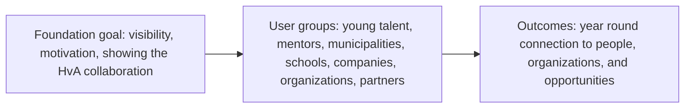

# Product vision and business case, Young Amstelland Connect

This document serves the HvA level 3 criterion Analysis & Advice (AA). It is grounded in
`docs/client/clientBrief.md` and `docs/team/collaborationAgreement.md`, and stays open for the
team to edit and restructure as understanding develops. Every open question below names the
issue or the client question that decides it. The questions for the client are in
`docs/client/clientQuestions.md`, and issue 10 The client's priorities for the epics (epic
Decisions) asks them. The GitLab number of every board number is in `docs/team/boardNumbers.md`.

## The central design question

The client's brief names one design question as central. It is quoted here exactly as
Rachid Kherrazi wrote it, so its punctuation stays:

> **“Hoe kunnen we een digitaal ecosysteem ontwikkelen waarin jong talent uit Amstelland niet
> alleen zichtbaar wordt, maar ook duurzaam wordt verbonden met mensen, organisaties, kansen
> en maatschappelijke uitdagingen?”**

Everything below is an attempt to answer around that question, not a replacement for it.

## What Young Amstelland Connect is, and is not

Young Amstelland Connect is a new, standalone platform: "een zelfstandig digitaal
community- en talentplatform dat voortbouwt op YAA, maar technisch en functioneel losstaat
van de bestaande YAA-website" (`docs/client/clientBrief.md`). It gets its own hosting and its
own database. The foundation rents a server and lends it to the team. The test site runs there
(issue 09 Every team member on the client's server), and the live version is planned there on
k3s with Terraform (issue 92 k3s and Terraform for production, compose for test), once the
client agrees in issue 91 The director agrees where production runs.

It is not a replacement for, or a change to, the existing Young Amstelland Awards website.
That site stays the official and business-critical platform for nominations, voting, the
jury process, and the gala. The client's brief is explicit that no change may reach YAA's
production environment, database, or voting functionality. The two platforms connect only
by link at first, with an API a possible later step, not a semester 1 requirement.

The separation is deliberate on the client's part: it lets new ideas be built and tested for
Connect without putting the existing award cycle at risk.

## Who it serves

The brief's own list of who Connect connects young talent with, unchanged:

- Young people, nominees, winners, and YAA alumni.
- Jury members, ambassadors, mentors, and experts.
- Municipalities and youth work.
- Schools and educational institutions.
- Companies and entrepreneurs.
- Social, cultural, and sports organizations.
- Partners, funds, and other organizations that offer opportunities to young people.

On Connect itself these groups meet as four kinds of users: a visitor who is not logged in, a
member (a young person), an organisation (a company, school or municipality) and an admin of
the foundation (issue 13 The role table per module).

## The business case: impact, not revenue

Connect is a foundation's platform. The WailSalutem Foundation is a nonprofit organization
(fact from Wesley Oerlemans, 24 September 2026), and the case for building it is impact, not
revenue. The collaboration agreement's classification answer states the client's own
reasoning: "The client wants the project visible, to motivate young people and to show the
foundation works with the HvA" (`docs/team/collaborationAgreement.md`, header table). Three
threads follow from that:

- **Visibility.** An open, visible platform is the client's explicit preference over a
  shielded one.
- **Motivating young people.** Connect exists to show young talent from Amstelland that they
  are seen and can be connected to people, organizations, and opportunities, not only judged
  once a year through the award cycle.
- **Showing the collaboration with the HvA.** The client wants the partnership with the
  university itself to be visible, which is part of why the classification stays open rather
  than closed.

No part of the brief or the agreement mentions revenue, pricing, or a funding model for
Connect itself. The only commercial element is the webshop, which sits at the edge of scope
(see below).

*Figure: the foundation's goal reaches the platform's user groups, which the platform turns
into a year-round connection outcome for young talent.*

## Possible functionality

The client's "Mogelijke functionaliteiten" list and the concept diagram largely agree with
each other. Each module is now a requirement in `docs/project/requirements.md` and an epic on
the board:

- User and organization profiles (FR1, epic Profiles).
- Community interaction and matching (FR2, epic Matching).
- An admin dashboard, "beheer & statistieken" in the diagram (FR3, epic Admin).
- Opportunities (FR4, epic Opportunities).
- Talent and project showcases (FR5, epic Showcases).
- Events (FR6, epic Events).
- News and inspiration (FR7, epic News).
- Challenges (FR8, epic Challenges).
- Badges and achievements (FR9, epic Badges).

The brief adds that students have room to bring their own innovative ideas on top of this
list, so it is a starting point rather than a fixed scope. The order in which the modules are
built is the proposal of the team in the MoSCoW table of `docs/project/requirements.md`. The
client confirms it in `docs/client/clientQuestions.md`, question 1.

A webshop for T-shirts, caps, and agendas appears only in the concept diagram, not in the
client's text, and would pull in a payment provider the text does not otherwise require. The
board holds it as FR10 Webshop (not confirmed by the client), epic Webshop, with every issue
could. Issues 81 See the merchandise, 82 Put an item in my basket and 83 Pay for my basket are
blocked until the client answers question 2. Choosing a payment provider is issue 171 The
payment provider chosen with the client.

## Risks

- **Minors' personal data.** The user base spans ages 15 to 30, so some users are minors,
  and Connect's profiles, community interaction, and matching modules hold personal data for
  them on an open, visible platform. This is a standing risk to design around from sprint 1,
  not something to resolve once and forget. The board handles it in epic Security analysis:
  issue 12 Inventory of the personal data per module, issue 13 The role table per module,
  issue 18 Data flow diagram of profile creation and issue 19 GDPR notes on minors' data. A
  young person under 16 needs permission of a parent (issues 130 and 131, epic Profiles).
- **Intellectual property ownership is not yet answered.** Who owns the code, the designs and
  the texts at the end of the project is open with the client. `docs/client/clientQuestions.md`,
  question 4, asked in issue 10, task 10.5.
- **Whether development uses real personal data is not yet answered.** The client has not
  said whether the test site may hold real data of young people or only invented data, which
  matters directly for the minors' data risk above. Question 3, issue 10, task 10.4. Until then
  the test site holds only invented data.
- **Portfolio and public use is not yet formally answered.** Whether the work may be shown in
  a portfolio, in Portflow, and in an R&D report is expected to be yes, given the openness
  answer, but it still needs an explicit yes from the client, since it matters for every team
  member individually. Question 4, together with ownership, issue 10, task 10.5.
- **Connect after January 2027 is not yet answered.** Nobody has said who runs and pays for
  Connect when the team leaves. Without an answer, young people may make a profile on a
  platform that is switched off a few months later. Question 6, issue 10, task 10.7.

## Success measures

Open. What counts as success for Connect, for the client and for the team, is not defined in
the brief, the agreement or the board, and is not guessed here. Two parts of it are on the
board as proposals the client chooses in question 5: a page shows its first content within two
seconds on a phone (NFR4 Fast pages), and Connect is available 99 percent of each month (NFR5
Available when it matters). The rest stays open for the whole team together with the client.
No issue holds it yet, and the natural moment is the meeting of issue 10 before the first
sprint review on 9 October 2026.

## AI use declaration

AI was used as a writing support tool while working on this document. We used AI to draft
the formulation of sentences, the structure of wording, readability, and clarity from
content that we had provided, and to generate the diagrams. The content itself, including
our experiences, reflections, learning goals, decisions, self-assessments, and
conclusions, is our own. We reviewed the drafts and decided as a team which text to
include.
