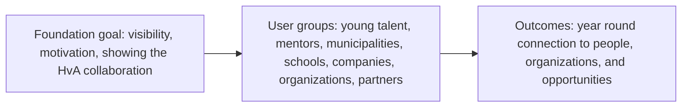

# Product vision and business case, Young Amstelland Connect

This document serves the HvA level 3 criterion Analysis & Advice (AA). It is grounded in
`clientBrief.md` and `collaborationAgreement.md`, and stays open for the team to edit and
restructure as understanding develops. Every open question below carries an owner and a date,
and the success measures section is left for the team to fill in at sprint 1 planning rather
than decided here.

## The central design question

The client's brief names one design question as central. It is quoted here exactly as
Rachid Kherrazi wrote it, so its punctuation stays:

> **“Hoe kunnen we een digitaal ecosysteem ontwikkelen waarin jong talent uit Amstelland niet
> alleen zichtbaar wordt, maar ook duurzaam wordt verbonden met mensen, organisaties, kansen
> en maatschappelijke uitdagingen?”**

Everything below is an attempt to answer around that question, not a replacement for it.

## What Young Amstelland Connect is, and is not

Young Amstelland Connect is a new, standalone platform: "een zelfstandig digitaal
community- en talentplatform dat voortbouwt op YAA, maar technisch en functioneel losstaat
van de bestaande YAA-website" (`clientBrief.md`). It gets its own hosting and its own
database.

It is not a replacement for, or a change to, the existing Young Amstelland Awards website.
That site stays the official and business-critical platform for nominations, voting, the
jury process, and the gala. The client's brief is explicit that no change may reach YAA's
production environment, database, or voting functionality. The two platforms connect only
by link at first, with an API a possible later step, not a semester 1 requirement.

The separation is deliberate on the client's part: it lets new ideas be built and tested for
Connect without putting the existing award cycle at risk.

## Who it serves

The brief's own list of who Connect connects young talent with, unchanged:

- Young people, nominees, winners, and YAA alumni.
- Jury members, ambassadors, mentors, and experts.
- Municipalities and youth work.
- Schools and educational institutions.
- Companies and entrepreneurs.
- Social, cultural, and sports organizations.
- Partners, funds, and other organizations that offer opportunities to young people.

## The business case: impact, not revenue

Connect is a foundation's platform, the WailSalutem Foundation is a nonprofit organization
(fact from Wesley Oerlemans, 2026-09-24), and the case for building it is impact, not revenue.
The
collaboration agreement's classification answer states the client's own reasoning: "The
client wants the project visible, to motivate young people and to show the foundation works
with the HvA" (`collaborationAgreement.md`, header table). Three threads follow from that:

- **Visibility.** An open, visible platform is the client's explicit preference over a
  shielded one.
- **Motivating young people.** Connect exists to show young talent from Amstelland that they
  are seen and can be connected to people, organizations, and opportunities, not only judged
  once a year through the award cycle.
- **Showing the collaboration with the HvA.** The client wants the partnership with the
  university itself to be visible, which is part of why the classification stays open rather
  than closed.

No part of the brief or the agreement mentions revenue, pricing, or a funding model for
Connect itself. Any commercial element sits at the edge of scope, flagged below.

*Figure: the foundation's goal reaches the platform's user groups, which the platform turns
into a year-round connection outcome for young talent.*

## Possible functionality

The client's "Mogelijke functionaliteiten" list and the concept diagram largely agree with
each other:

- User and organization profiles.
- Talent and project showcases.
- Challenges.
- Opportunities.
- Events.
- Badges and achievements.
- News and inspiration.
- Community interaction and matching.
- An admin dashboard ("beheer & statistieken" in the diagram).

The brief adds that students have room to bring their own innovative ideas on top of this
list, so it is a starting point rather than a fixed scope. A webshop for T-shirts, caps, and
agendas appears only in the concept diagram, not in the client's text, and would pull in a
payment provider the text does not otherwise require. Whether it is in scope for this semester
needs confirming with the client, owned by Nick Hoebe as sprint 1 Product Owner and due at the
latest the sprint 1 review, week of 5 October 2026.

## Risks

- **Minors' personal data.** The user base spans ages 15 to 30, so some users are minors,
  and Connect's profiles, community interaction, and matching modules hold personal data for
  them on an open, visible platform. This is a standing risk to design around from sprint 1,
  not something to resolve once and forget.
- **Intellectual property ownership is not yet answered.** Who owns the code and the
  intellectual property at the end of the project is open with the client.
  Owner: Nick Hoebe. Due: at the latest the sprint 1 review, week of 5 October 2026.
- **Whether development uses real personal data is not yet answered.** The client has not
  said whether real user data or test data only is available during development, which
  matters directly for the minors' data risk above. Owner: Nick Hoebe. Due: at the latest the
  sprint 1 review, week of 5 October 2026.
- **Portfolio and public use is not yet formally answered.** Whether the work may be shown in
  a portfolio, in Portflow, and in an R&D report is expected to be yes, given the openness
  answer, but the collaboration agreement records it as still needing an explicit yes from
  the client, since it matters for every team member individually. Owner: Nick Hoebe. Due: at
  the latest the sprint 1 review, week of 5 October 2026.

## Success measures

TBD. What counts as success for Connect, for the client and for the team, is not defined in
either the brief or the agreement, and is not guessed here. Owner: the whole team, together
with the client. Due: sprint 1 planning, week of 21 September 2026.

## AI use declaration

AI was used as a writing support tool while working on this document. We used AI to draft
the formulation of sentences, the structure of wording, readability, and clarity from
content that we had provided, and to generate the diagrams. The content itself, including
our experiences, reflections, learning goals, decisions, self-assessments, and
conclusions, is our own. We reviewed the drafts and decided as a team which text to
include.
