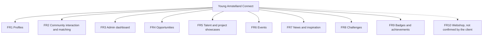
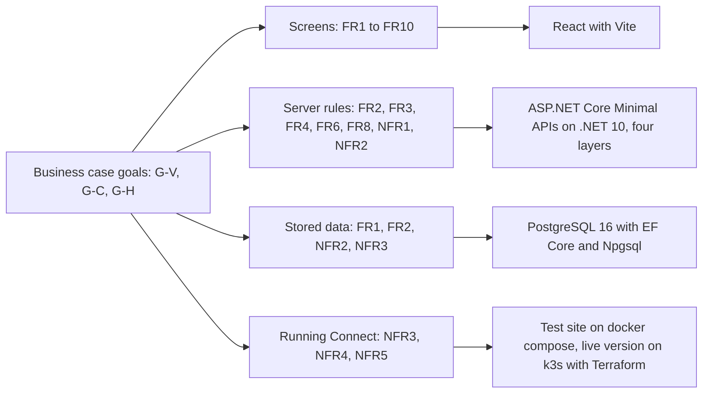

# Requirements analysis, Young Amstelland Connect

This document serves the HvA level 3 criteria Analysis & Advice (AA) and Design & Realisation
(OR). It is grounded in `docs/project/productVision.md`, `docs/project/problemAnalysis.md`,
`docs/client/clientBrief.md`, `docs/architecture/techStack.md` and
`docs/architecture/stackResearch.md`. It is the one place every issue on the board points to
under "Relates to" and "Quality rules this issue follows": FR1 to FR10 for features and NFR1
to NFR6 for quality rules. The names below are the names the issues use.

The MoSCoW groups below are the proposal of the team, taken from the priority label of every
issue on the board. They stay a proposal until the client confirms the order in issue 10 The
client's priorities for the epics (epic Decisions), `docs/client/clientQuestions.md`,
question 1. The GitLab number of every board number is in `docs/team/boardNumbers.md`.

## The business case goals this traces against

Three threads from the business case in `docs/project/productVision.md`, plus the gap
`docs/project/problemAnalysis.md` names: visibility for young talent, motivating young people
by giving them a year-round connection instead of a once-a-year judgment, and showing the
foundation's collaboration with the HvA. Each functional requirement below is tied back to one
or more of these.

| Code | Goal | Source |
| --- | --- | --- |
| G-V | Visibility for young talent on an open platform | `docs/project/productVision.md`, "The business case" |
| G-C | Year-round connection, closing the gap between one gala and the next | `docs/project/problemAnalysis.md`, "The gap", and `docs/project/productVision.md`, "motivating young people" |
| G-H | Showing the foundation's collaboration with the HvA | `docs/project/productVision.md`, "The business case" |

## Functional requirements

Derived module by module from the client's "Mogelijke functionaliteiten" list and the concept
diagram in `docs/client/clientBrief.md`. Each requirement now has its own epic on the board.
The board has 227 issues in 21 epics. Seventeen epics build or prepare Connect itself, and four
exist because the school asks for them (see "The school epics" below).

The diagram shows the ten feature modules of Connect with their requirement codes.

*Figure: the platform's modules drawn from the client's concept diagram, each with its
requirement code. The webshop has a dotted line because the client has not confirmed it.*

| ID | Name | Requirement | Goal served | Epic | Proposed MoSCoW |
| --- | --- | --- | --- | --- | --- |
| FR1 | Profiles | Young people and organisations can create and maintain a profile. | G-C, G-V | Profiles | Must |
| FR2 | Community interaction and matching | Members can find and connect with other members, organisations and opportunities, answering the client's central design question of a "duurzaam verbonden" ecosystem. | G-C | Matching | Must |
| FR3 | Admin dashboard | The foundation can manage members and content and see platform numbers ("beheer & statistieken"). | G-H | Admin | Must |
| FR4 | Opportunities | Organisations can publish opportunities that reach young people. | G-C | Opportunities | Should |
| FR5 | Talent and project showcases | Young people can show their projects and work beyond the awards cycle. | G-V, G-C | Showcases | Should |
| FR6 | Events | Organisations can publish events and young people can register for them. | G-C | Events | Should |
| FR7 | News and inspiration | The foundation publishes news that gives members a reason to return outside the awards cycle. | G-V, G-C | News | Could |
| FR8 | Challenges | Organisations can post challenges for young people to take part in. | G-C | Challenges | Could |
| FR9 | Badges and achievements | Young people earn recognition for what they do on Connect. | G-C | Badges | Could |
| FR10 | Webshop (not confirmed by the client) | Members can buy merchandise of the foundation. | G-V | Webshop | Could, and blocked on question 2 |

The proposed group of each requirement is the group of its own epic in the MoSCoW table
below. It is the same order the team proposed on 22 September 2026, before the board existed.
What changed is that the webshop now has issues with a priority (could) instead of no priority
at all. They stay blocked until the client answers question 2.

## The MoSCoW table

One row per epic that builds or prepares Connect. The numbers are the priority labels of its
issues on the board (prio::must, prio::should, prio::could). The proposed group of an epic is
the highest priority among its issues, because the must issues of an epic are its core and the
rest are extras on top of that core. No issue carries a "will not have this time" label yet.

| Epic | Issues | Must | Should | Could | Proposed group |
|---|---|---|---|---|---|
| Foundation | 2 | 2 | 0 | 0 | Must |
| Hosting and deploy | 7 | 6 | 1 | 0 | Must |
| Decisions | 5 | 4 | 0 | 1 | Must |
| Security analysis | 7 | 7 | 0 | 0 | Must |
| Site shell | 6 | 5 | 1 | 0 | Must |
| Account | 23 | 5 | 10 | 8 | Must |
| Account security | 21 | 7 | 7 | 7 | Must |
| Profiles | 21 | 18 | 1 | 2 | Must |
| Matching | 15 | 8 | 6 | 1 | Must |
| Admin | 25 | 7 | 6 | 12 | Must |
| Opportunities | 17 | 0 | 11 | 6 | Should |
| Showcases | 12 | 0 | 11 | 1 | Should |
| Events | 13 | 0 | 9 | 4 | Should |
| News | 8 | 0 | 0 | 8 | Could |
| Challenges | 12 | 0 | 0 | 12 | Could |
| Badges | 2 | 0 | 0 | 2 | Could |
| Webshop | 7 | 0 | 0 | 7 | Could |

### The order confirmed by the client

Not confirmed yet. Issue 10 The client's priorities for the epics (epic Decisions), task 10.2,
writes the client's order here with the date and his reason for every epic he moves, next to
the argument of the team. Until then the table above is the proposal. `docs/client/clientQuestions.md`,
question 1.

### The school epics

These epics exist because a school workshop asks for them. Every issue in them is must and
carries the label school::required, except issues 173 and 174 (epic Production), which are
should and have no school label.

| Epic | Issues | Must | Should | Could | Proposed group |
|---|---|---|---|---|---|
| Workshop evidence | 4 | 4 | 0 | 0 | Must |
| Production | 9 | 7 | 2 | 0 | Must |
| Observability | 4 | 4 | 0 | 0 | Must |
| Research and development | 7 | 7 | 0 | 0 | Must |

### Webshop

The webshop (T-shirts, caps and agendas) appears only in the client's concept diagram, not in
his text (`docs/client/clientBrief.md`). The board plans it as epic Webshop with issues 81 See
the merchandise, 82 Put an item in my basket, 82b, 82c, 82d, 83 Pay for my basket and 83b, all
could, plus issue 171 The payment provider chosen with the client (epic Decisions). Issues 81,
82 and 83 carry the label blocked until the client answers question 2 of
`docs/client/clientQuestions.md`: does Connect get a webshop this semester, and which of the
three alternatives (a link to an existing shop, a later semester, or a full shop now). Issue 10,
task 10.3, writes his answer and his reason here.

## Non-functional requirements

Made measurable where the board sets a number, and left open where only the client can set it.

### NFR1 Authentication and authorization

The user base spans ages 15 to 30, so some users are minors, and `docs/project/problemAnalysis.md`
names their personal data on an open, visible platform as a standing risk. The team has a
dedicated security specialist, Kelvin van Voorst, for this reason.

- Every member address on the server is behind the guard of issue 04 Log in with email and
  password (epic Account). The admin addresses are behind the rule AdminOnly of issue 45 See
  all members (epic Admin).
- A password needs at least fifteen characters (issue 03b A clear message when my password is
  too weak). Issue 116 refuses a password known from data leaks.
- Too many wrong passwords slow down and then lock logging in: issue 30 Wait a minute after
  five wrong passwords and issue 31 Account locked after fifteen wrong passwords (epic Account
  security).
- Connect has four kinds of users: a visitor, a member (a young person), an organisation and
  an admin of the foundation. What each may see and change per module is issue 13 The role
  table per module (epic Security analysis), including where a member under 18 is treated more
  carefully. Whether an organisation may see and contact a member under 18 is open,
  `docs/client/clientQuestions.md`, question 31.

This replaces the open point of 22 September 2026, "the authorization design for minors' data".
The design is now issue 13, and the choice only the foundation can make is question 31.

### NFR2 GDPR footing

Processing personal data of EU users, some of them minors, carries GDPR (AVG) obligations
whatever the client asks for. The foundation has no separate privacy officer: the team writes
the privacy rules and the client approves them.

- Issue 12 Inventory of the personal data per module lists what each part of Connect keeps and
  whether young people under 18 are involved.
- Issue 19 GDPR notes on minors' data holds the notes on the law and five data rules. The
  client approves the rules, `docs/client/clientQuestions.md`, question 30.
- A young person under 16 needs permission of a parent before the profile is visible: issues
  130 A young person under 16 asks a parent for permission and 131 A parent gives permission for
  a young person under 16 (epic Profiles).
- A member can delete the account and all its data: issue 113 Delete my account and all my data
  (epic Account).

Real or invented data on the test site: open. Until the client answers question 3 of
`docs/client/clientQuestions.md`, the test site holds only invented data. Issue 10, task 10.4,
writes his answer here, and issues 03 Create an account and 07 Create a profile say the same.
Whether the live version may hold real data from its first day is question 114 (issue 91 The
director agrees where production runs).

### NFR3 Hosting at no license cost

Connect gets its own standalone hosting and database (`docs/client/clientBrief.md`).

History. On 22 September 2026 the team planned Microsoft SQL Server, the coursework stack.
`docs/architecture/stackResearch.md` showed the cost boundary of that choice: Developer edition
is free only for building and testing, the free Express edition is capped at "the lesser of 1
socket or 4 cores", and every edition without that cap costs from $989 per server. The open
items list then weighed SQL Server against PostgreSQL, which eases Docker hosting on the chosen
budget. On 26 September 2026 the team changed the database to PostgreSQL 16 with EF Core and
Npgsql. Issue 11 The team agrees on the layered architecture (epic Decisions) records that
.NET 10 and PostgreSQL 16 cost no license.

- The foundation rents a server and lends it to the team. The test site runs there on docker
  compose: issue 09 Every team member on the client's server (epic Hosting and deploy), with
  one Dockerfile from issue 20 Dockerfiles for the server and the frontend.
- The live version runs on k3s with Terraform: issue 92 k3s and Terraform for production,
  compose for test (epic Production), built in issues 93 to 97.
- Every tool the pipeline adds is free: for example the image scan of issue 90 and the code
  quality tool that issue 88 The team picks the code quality tool chooses.

Still open: whether the foundation agrees to a live version on its server and whether it may
share the server with the test site (questions 111 and 112, issue 91), and who runs and pays
for Connect after January 2027, including the grant of Microsoft for Nonprofits (question 6).

### NFR4 Fast pages

Proposal of the team, not yet agreed: a page shows its first content within two seconds on a
phone on a normal mobile network, measured on the test site. Issue 10, task 10.6, lets the
client choose, `docs/client/clientQuestions.md`, question 5, and writes the agreed number and
its date here. Issue 100 An email before young people notice a problem (epic Observability)
warns when the live site is slower than that number.

Agreed number: open, question 5.

### NFR5 Available when it matters

Proposal of the team, not yet agreed: Connect is available 99 percent of each month outside
announced maintenance, which is about seven hours of downtime a month and realistic on one
server. Issue 10, task 10.6, lets the client choose, question 5, and writes the agreed number
and its date here. Issue 91 uses it to size the live server.

The board already keeps Connect up in these ways: issue 17 A health check and structured logs,
issue 97 Going back to the previous version is practised, issue 105 Connect keeps working under
too many requests, and issues 98 to 101 (epic Observability) that count errors, show them on
one dashboard and send an email when Connect is down.

Agreed number: open, question 5.

### NFR6 Definition of Done

Project completion is the week of 4 January 2027, the last week of sprint 5. The Definition of
Done in `docs/team/definitionOfDone.md` sets the bar a handover has to clear, and every issue
on the board names it. Code and documentation meet it continuously through the project, not
only at the end, so that handover in January does not depend on a catch-up pass.
`docs/architecture/stackResearch.md` names the cost of this for the chosen stack: ASP.NET Core
and C# sit behind the steepest learning curve for most of the team, at the same time the
Definition of Done applies from sprint 1.

## Traceability to the stack

What each requirement group asks of the stack. The reasoning behind each technology's fit is in
`docs/architecture/stackResearch.md` and `docs/architecture/techStack.md`.

The diagram shows each requirement group next to the part of the stack that serves it.

*Figure: how the business case goals trace through each requirement group to the part of the
stack that serves it.*

**Screens, React.** Every feature requirement has pages in `web/src/pages`. The screen and
the server share one origin through the dev proxy in `web/vite.config.ts`.

**Server, ASP.NET Core on .NET 10.** FR2 (matching), FR3 (admin), FR4 (opportunities), FR6
(events) and FR8 (challenges) hold the most server logic. The server uses Minimal APIs
throughout, no controllers and no SignalR. Wesley Oerlemans decided this on 24 September 2026,
and issue 11 builds the web project with Minimal APIs and no controllers. The server is split
into four projects,
Presentation, Application, Domain and Infrastructure, in issue 11 The team agrees on the
layered architecture. NFR1 and NFR2 draw on the built-in authentication, dependency injection
and configuration of ASP.NET Core.

**Stored data, PostgreSQL 16.** FR1 (profiles) and FR2 (matching) hold the personal data that
NFR1 and NFR2 protect. EF Core with Npgsql gives parameterized access and migrations, so the
team writes almost no SQL by hand.

**Running Connect.** NFR3, NFR4 and NFR5 draw on the test site of issue 09 and the live version
of issue 92.

## Traceability per requirement

Every requirement code the issues name under "Relates to" and "Quality rules this issue
follows", with every epic and issue that serves it. Board numbers are listed in build order.
The home epic of a requirement comes first.

### FR1 Profiles

Home: epic Profiles. Named by 95 issues: 48 must, 25 should, 22 could.

| Epic | Issues, in build order |
|---|---|
| Profiles | 07, 07b, 08, 14, 15, 15b, 130, 130b, 131, 33, 34, 132, 34b, 35, 36, 129, 36b, 36c, 36d, 134, 133 |
| Decisions | 10 |
| Account | 03, 04, 04b, 03b, 05, 113, 114, 116, 21, 21b, 22, 22b, 23, 23b, 24, 25, 25b, 26, 25c, 115, 118, 117, 119 |
| Site shell | 06, 06b, 51, 51b, 53 |
| Security analysis | 12, 19, 13, 18 |
| Account security | 27, 28, 28b, 28c, 29, 29b, 30, 30b, 31, 31b, 122, 123, 125, 124 |
| Matching | 37, 41, 41b, 41c, 42 |
| Admin | 45, 46, 139, 49, 142, 145 |
| Opportunities | 54, 54b, 54c, 56b, 58, 58b, 156 |
| Showcases | 60, 62, 62b |
| Events | 65 |
| Challenges | 74, 78 |
| Badges | 80b |
| Research and development | 110, 111 |

### FR2 Community interaction and matching

Home: epic Matching. Named by 45 issues: 24 must, 14 should, 7 could.

| Epic | Issues, in build order |
|---|---|
| Matching | 37, 37b, 38, 39, 40, 41, 41b, 41c, 42, 135, 43, 43b, 44, 44b, 136 |
| Site shell | 06, 52 |
| Security analysis | 12 |
| Profiles | 07, 14, 34, 34b, 35, 36, 129, 36c, 36d, 134 |
| Account security | 29, 121 |
| Admin | 46, 46b, 47, 143, 151, 152 |
| Opportunities | 55, 55c, 57, 59 |
| Events | 66c, 161 |
| Challenges | 75 |
| Showcases | 62b, 64 |

### FR3 Admin dashboard

Home: epic Admin. Named by 40 issues: 11 must, 11 should, 18 could.

| Epic | Issues, in build order |
|---|---|
| Admin | 45, 45b, 46, 46b, 137, 139, 138, 47, 50, 50b, 48, 49, 140, 143, 148, 149, 151, 141, 142, 147, 145, 146, 144, 150, 152 |
| Security analysis | 12, 13 |
| Account security | 32, 120, 121, 32b, 126, 127, 128 |
| Site shell | 51, 52 |
| Showcases | 60 |
| News | 71, 165, 164 |

### FR4 Opportunities

Home: epic Opportunities. Named by 20 issues: 1 must, 13 should, 6 could.

| Epic | Issues, in build order |
|---|---|
| Opportunities | 54, 54b, 55, 55b, 54c, 55c, 56, 56b, 57, 57b, 58, 58b, 59, 153, 154, 155, 156 |
| Profiles | 34, 132 |
| Admin | 140 |

### FR5 Talent and project showcases

Home: epic Showcases. Named by 24 issues: 5 must, 14 should, 5 could.

| Epic | Issues, in build order |
|---|---|
| Showcases | 60, 60b, 61, 62, 158, 62b, 63, 63b, 157, 61b, 64, 159 |
| Site shell | 06, 53 |
| Research and development | 106, 108, 109 |
| Admin | 48, 141, 147, 146 |
| Security analysis | 104 |
| Badges | 80 |
| Hosting and deploy | 172 |

### FR6 Events

Home: epic Events. Named by 19 issues: 3 must, 11 should, 5 could.

| Epic | Issues, in build order |
|---|---|
| Events | 65, 66, 66b, 66c, 67, 68, 68b, 69, 160, 70, 161, 162, 163 |
| Site shell | 06, 53 |
| Research and development | 106, 107 |
| Admin | 140, 144 |

### FR7 News and inspiration

Home: epic News. Named by 9 issues: 0 must, 0 should, 9 could.

| Epic | Issues, in build order |
|---|---|
| News | 71, 71b, 72, 73, 72b, 165, 166, 164 |
| Admin | 148 |

### FR8 Challenges

Home: epic Challenges. Named by 13 issues: 0 must, 1 should, 12 could.

| Epic | Issues, in build order |
|---|---|
| Challenges | 74, 75, 75b, 76, 76b, 77, 78, 79, 167, 168, 169, 170 |
| Admin | 140 |

### FR9 Badges and achievements

Home: epic Badges. Named by 4 issues: 0 must, 2 should, 2 could.

| Epic | Issues, in build order |
|---|---|
| Badges | 80, 80b |
| Showcases | 62, 158 |

### FR10 Webshop (not confirmed by the client)

Home: epic Webshop. Named by 11 issues: 2 must, 0 should, 9 could.

| Epic | Issues, in build order |
|---|---|
| Webshop | 81, 82, 82b, 82c, 82d, 83, 83b |
| Decisions | 10, 171 |
| Security analysis | 12 |
| Admin | 150 |

### NFR1 Authentication and authorization

Home: epic Account security. Named by 190 issues: 61 must, 62 should, 67 could.

| Epic | Issues, in build order |
|---|---|
| Account security | 27, 28, 28b, 28c, 29, 29b, 30, 30b, 31, 31b, 32, 120, 121, 32b, 122, 123, 125, 124, 126, 127, 128 |
| Foundation | 01 |
| Account | 03, 04, 04b, 03b, 05, 113, 114, 116, 21, 21b, 22, 22b, 23, 23b, 24, 25, 25b, 26, 25c, 115, 118, 117, 119 |
| Site shell | 06, 06b, 51, 53 |
| Security analysis | 12, 19, 13, 18, 104, 105 |
| Hosting and deploy | 17 |
| Profiles | 07, 08, 14, 15, 15b, 130, 130b, 131, 33, 34, 132, 34b, 35, 36, 129, 36b, 36c, 36d, 134, 133 |
| Research and development | 106, 110 |
| Matching | 37, 37b, 38, 39, 40, 41, 41b, 41c, 42, 135, 43, 43b, 44, 44b, 136 |
| Admin | 45, 45b, 46, 46b, 137, 139, 138, 47, 50, 50b, 48, 49, 140, 143, 148, 149, 151, 141, 142, 147, 145, 146, 144, 150, 152 |
| Opportunities | 54, 54b, 55, 55b, 54c, 55c, 56, 56b, 57, 57b, 58, 58b, 59, 153, 154, 155, 156 |
| Showcases | 60, 61, 62, 158, 62b, 63, 63b, 157, 61b, 64, 159 |
| Events | 65, 66, 66b, 66c, 67, 68, 68b, 69, 160, 70, 161, 162, 163 |
| News | 71, 71b, 72, 73, 165, 164 |
| Challenges | 74, 75, 75b, 76, 76b, 77, 78, 79, 167, 168, 169, 170 |
| Webshop | 81, 82, 82b, 82c, 82d, 83 |
| Production | 93, 95, 173 |
| Observability | 99 |
| Decisions | 102 |
| Badges | 80, 80b |

### NFR2 GDPR footing

Home: epic Security analysis. Named by 186 issues: 68 must, 61 should, 57 could.

| Epic | Issues, in build order |
|---|---|
| Security analysis | 12, 19, 13, 18, 104 |
| Hosting and deploy | 09, 16, 17, 90, 172 |
| Decisions | 10, 171 |
| Account | 03, 04, 04b, 03b, 05, 113, 114, 116, 21, 21b, 22, 22b, 23, 23b, 24, 25, 25b, 26, 115, 118, 117, 119 |
| Site shell | 06b, 51, 51b, 52, 53 |
| Profiles | 07, 07b, 08, 14, 15, 15b, 130, 130b, 131, 33, 34, 132, 34b, 35, 36, 129, 36b, 36c, 36d, 133 |
| Research and development | 106, 109, 110 |
| Account security | 27, 28, 28b, 29, 29b, 30, 31, 31b, 32, 120, 121, 32b, 122, 123, 125, 124, 126, 127, 128 |
| Matching | 37, 38, 39, 40, 41, 41b, 41c, 42, 135, 43, 43b, 44, 44b, 136 |
| Admin | 45, 45b, 46, 46b, 137, 139, 138, 47, 50, 50b, 48, 49, 140, 143, 149, 151, 141, 142, 147, 145, 146, 150, 152 |
| Opportunities | 54, 54b, 55, 55b, 54c, 56b, 57, 57b, 58, 58b, 59, 154 |
| Showcases | 60, 60b, 61, 62, 158, 62b, 63, 157, 61b, 64, 159 |
| Events | 65, 66, 66b, 66c, 67, 68, 68b, 69, 160, 70, 161 |
| News | 71, 71b, 72, 73, 72b, 165 |
| Challenges | 74, 75, 75b, 76, 76b, 77, 78, 79, 168, 169, 170 |
| Webshop | 81, 82, 82b, 83, 83b |
| Production | 91, 95, 173, 174, 97 |
| Observability | 98, 100, 101 |
| Workshop evidence | 86, 87 |
| Badges | 80, 80b |

### NFR3 Hosting at no license cost

Home: epic Hosting and deploy. Named by 32 issues: 22 must, 3 should, 7 could.

| Epic | Issues, in build order |
|---|---|
| Hosting and deploy | 09, 16, 88, 89, 90, 172 |
| Decisions | 10, 11, 171 |
| Workshop evidence | 84 |
| Account | 03 |
| Foundation | 20 |
| News | 71b |
| Webshop | 81, 83 |
| Production | 91, 92, 93, 94, 95, 174 |
| Observability | 98, 99, 100, 101 |
| Showcases | 61b |
| Security analysis | 105, 105b |
| Research and development | 111 |
| Account security | 123 |
| Admin | 150 |
| Profiles | 133 |

### NFR4 Fast pages

Home: epic Site shell. Named by 112 issues: 38 must, 41 should, 33 could.

| Epic | Issues, in build order |
|---|---|
| Site shell | 06, 53 |
| Decisions | 10, 102 |
| Account | 03, 04, 05, 21, 22, 23, 24, 25, 26 |
| Profiles | 07, 08, 14, 15, 33, 34, 132, 35, 36, 36c, 134 |
| Account security | 27, 28, 31, 32, 32b |
| Matching | 37, 37b, 38, 39, 40, 41, 41b, 41c, 42, 135, 43, 43b, 44, 44b, 136 |
| Admin | 45, 45b, 46, 47, 50, 50b, 48, 49, 143, 144, 152 |
| Opportunities | 54, 54b, 55, 55b, 55c, 57, 58, 59 |
| Showcases | 60, 60b, 61, 62, 62b, 63, 63b, 61b, 64 |
| Events | 65, 66, 66b, 66c, 67, 68, 68b, 69, 160, 70, 161, 162 |
| News | 72, 73, 72b, 166 |
| Challenges | 74, 75, 75b, 76, 76b, 77, 78, 79, 167 |
| Webshop | 81, 82, 82b, 82c, 82d, 83 |
| Observability | 98, 99, 100 |
| Badges | 80, 80b |
| Research and development | 107, 108, 109, 110 |

### NFR5 Available when it matters

Home: epic Hosting and deploy. Named by 36 issues: 25 must, 9 should, 2 could.

| Epic | Issues, in build order |
|---|---|
| Hosting and deploy | 09, 17, 172 |
| Decisions | 10, 102 |
| Account | 04, 21, 25c |
| Foundation | 20 |
| Account security | 27, 28c, 30b |
| Admin | 50, 48, 49 |
| Production | 91, 92, 93, 94, 95, 173, 174, 96, 97 |
| Observability | 98, 99, 100, 101 |
| Workshop evidence | 86, 87 |
| Showcases | 63, 63b |
| Security analysis | 105, 105b |
| Research and development | 107 |
| News | 166 |

### NFR6 Definition of Done

Home: every issue. Named by 219 issues: 86 must, 63 should, 70 could.

| Epic | Issues, in build order |
|---|---|
| Foundation | 01, 20 |
| Hosting and deploy | 09, 16, 17, 88, 89, 90, 172 |
| Decisions | 10, 11, 102, 103 |
| Workshop evidence | 84, 85, 86, 87 |
| Account | 03, 04, 04b, 03b, 05, 113, 114, 116, 21, 21b, 22, 22b, 23, 23b, 24, 25, 25b, 26, 25c, 115, 118, 117, 119 |
| Site shell | 06, 06b, 51, 51b, 52, 53 |
| Security analysis | 12, 19, 13, 18, 104, 105, 105b |
| Profiles | 07, 07b, 08, 14, 15, 15b, 130, 130b, 131, 33, 34, 132, 34b, 35, 36, 129, 36b, 36c, 36d, 134, 133 |
| Research and development | 106, 107, 108, 109, 110, 111, 112 |
| Account security | 27, 28, 28b, 28c, 29, 29b, 30, 30b, 31, 31b, 32, 120, 121, 32b, 122, 123, 125, 124, 126, 127, 128 |
| Matching | 37, 37b, 38, 39, 40, 41, 41b, 41c, 42, 135, 43, 43b, 44, 44b, 136 |
| Admin | 45, 45b, 46, 46b, 137, 139, 138, 47, 50, 50b, 48, 49, 140, 143, 148, 149, 151, 141, 142, 147, 145, 146, 144, 150, 152 |
| Opportunities | 54, 54b, 55, 55b, 54c, 55c, 56, 56b, 57, 57b, 58, 58b, 59, 153, 154, 155, 156 |
| Showcases | 60, 60b, 61, 62, 158, 62b, 63, 63b, 157, 61b, 64, 159 |
| Events | 65, 66, 66b, 66c, 67, 68, 68b, 69, 160, 70, 161, 162, 163 |
| News | 71, 71b, 72, 73, 72b, 165, 166, 164 |
| Challenges | 74, 75, 75b, 76, 76b, 77, 78, 79, 167, 168, 169, 170 |
| Webshop | 81, 82, 82b, 82c, 82d, 83, 83b |
| Production | 94, 96 |
| Observability | 98, 99, 100, 101 |
| Badges | 80, 80b |

## Open questions, gathered

Every open point in this document, in one place. All of them go to the client through issue 10
The client's priorities for the epics and are listed in `docs/client/clientQuestions.md`.

1. The order of the epics (the MoSCoW table). Question 1, issue 10 task 10.2.
2. Whether the webshop is in scope, and which alternative. Question 2, issue 10 task 10.3.
3. Real or invented data of young people on the test site (NFR2). Question 3, issue 10 task
   10.4.
4. The page speed and uptime numbers (NFR4, NFR5). Question 5, issue 10 task 10.6.
5. Who runs and pays for Connect after January 2027, and the hosting grant (NFR3). Question 6,
   issue 10 task 10.7.
6. Whether an organisation may see and contact a member under 18 (NFR1). Question 31, issue 13.
7. The five data rules for young people (NFR2). Question 30, issue 19.
8. A live version on the foundation's server, on the same server as the test site or a second
   one, and real data from its first day (NFR2, NFR3). Questions 111, 112 and 114, issue 91.

## AI use declaration

AI was used as a writing support tool while working on this document. We used AI to draft
the formulation of sentences, the structure of wording, readability, and clarity from
content that we had provided, and to generate the diagrams. The content itself, including
our experiences, reflections, learning goals, decisions, self-assessments, and
conclusions, is our own. We reviewed the drafts and decided as a team which text to
include.
