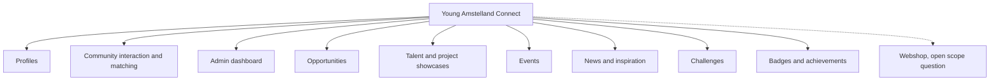
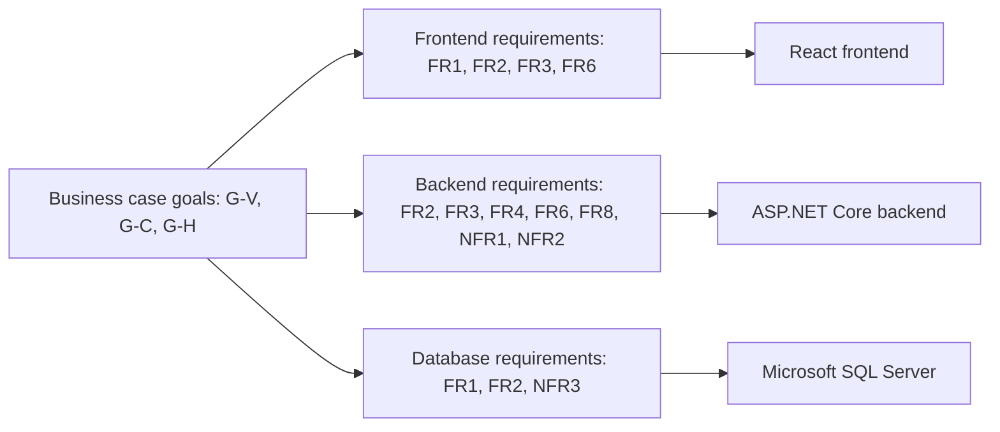

# Requirements analysis, Young Amstelland Connect

This document serves the HvA level 3 criteria Analysis & Advice (AA) and Design & Realisation
(OR). It is grounded in `productVision.md`, `problemAnalysis.md`, `clientBrief.md`,
`techStack.md`, and `stackResearch.md`, and stays open for the team to edit and restructure as
understanding develops. The MoSCoW prioritization below is a proposal, marked as one
throughout, and every open question carries an owner and a date.

## The business case goals this traces against

Three threads from `productVision.md`'s business case section, plus the gap `problemAnalysis.md`
names: visibility for young talent, motivating young people by giving them a year-round
connection instead of a once-a-year judgment, and showing the foundation's collaboration with
the HvA. Each functional requirement below is tied back to one or more of these:

| Code | Goal | Source |
| --- | --- | --- |
| G-V | Visibility for young talent on an open platform | `productVision.md`, "The business case" |
| G-C | Year-round connection, closing the gap between one gala and the next | `problemAnalysis.md`, "The gap" and `productVision.md`, "motivating young people" |
| G-H | Showing the foundation's collaboration with the HvA | `productVision.md`, "The business case" |

## Functional requirements

Derived module by module from the client's "Mogelijke functionaliteiten" list and the concept
diagram in `clientBrief.md`, both of which `techStack.md` already confirms agree with each
other. Each requirement carries the business case goal it serves and a **proposed** MoSCoW
priority. The proposal is a first reading of the client and vision documents, not a team
decision. Confirming it is a decision for the team with the client, owned by the whole team
with the client and due at sprint 1 planning, week of 21 September 2026.

*Figure: the platform's modules drawn from the client's concept diagram, with the webshop
marked by a dotted line as the one module still open pending client confirmation.*

| ID | Module | Requirement | Goal served | Proposed priority |
| --- | --- | --- | --- | --- |
| FR1 | Profiles | Users and organizations across the stakeholder groups in `problemAnalysis.md` can create and maintain a profile. | G-C, G-V | Must |
| FR2 | Community interaction and matching | Users can find and connect with other users, organizations, and opportunities, answering the client's central design question of a "duurzaam verbonden" ecosystem. | G-C | Must |
| FR3 | Admin dashboard | The foundation can manage users and content and see platform statistics ("beheer & statistieken"). | G-H | Must |
| FR4 | Opportunities | Partners, funds, companies, and organizations can publish opportunities that reach young people, per the stakeholder analysis's "publish and match opportunities" entry. | G-C | Should |
| FR5 | Talent and project showcases | Young people can showcase their projects and work beyond the awards cycle. | G-V, G-C | Should |
| FR6 | Events | Organizations, schools, and community groups can list and promote events. | G-C | Should |
| FR7 | News and inspiration | The platform carries news and inspiration content to give users a reason to return outside the awards cycle. | G-V, G-C | Could |
| FR8 | Challenges | Companies and organizations can post challenges for young people to take part in. | G-C | Could |
| FR9 | Badges and achievements | Users earn recognition for participation and achievement on the platform. | G-C | Could |

**FR10, webshop.** The webshop (T-shirts, caps, agendas) appears only in the concept diagram,
not in the client's text, per `clientBrief.md` and the open scope question already recorded in
`productVision.md`. It is kept out of the proposed musts above, and out of the proposal
entirely, until the client confirms it is in scope, owned by Nick Hoebe as sprint 1 Product
Owner and due at the latest the sprint 1 review, week of 5 October 2026.

Nine functional requirements are proposed and prioritized (FR1 to FR9). The webshop (FR10) is
named but not prioritized.

## Non-functional requirements

Made measurable where the recorded documents support a number, and left as a stated proposal
where they do not.

### Security and privacy

The user base spans ages 15 to 30, so some users are minors, and `problemAnalysis.md` names
their personal data on an open, visible platform as a standing risk, not a one-time fix.
`techStack.md` records a dedicated Security Specialist, Kelvin van Voorst, as a deliberate part
of the team's composition for this reason.

- **NFR1. Authentication and authorization.** The platform requires an authentication scheme
  covering all user roles named in the stakeholder analysis, with authorization rules that
  govern what each role can see and change, including on the profiles and community
  interaction modules that hold minors' data. `stackResearch.md`'s ASP.NET Core section notes
  built-in authentication features and a documented pairing with the BoKSA Authentication &
  Authorization Basics article as the basis for this. The specific authorization design,
  including whether minors' profiles are restricted differently from adult users' profiles,
  stays open, owned by Kelvin van Voorst and due at the latest the sprint 1 review, week of 5
  October 2026.

- **NFR2. GDPR footing.** Processing personal data for EU users, some of them minors, on an
  open platform carries GDPR (AVG) obligations regardless of what the client asks for. This is
  a legal requirement, not a client wish, so it is stated here without a source document
  confirming the client raised it. The specific measures, a lawful basis, data minimization,
  and any parental consent handling for minors, depend on an answer the client has not yet
  given. Whether development and later production use real personal data or test data only,
  which decides how far GDPR obligations reach in practice, stays open, owned by Nick Hoebe as
  sprint 1 Product Owner and due at the latest the sprint 1 review, week of 5 October 2026.

### Hosting within a student budget

Connect gets its own standalone hosting and database, per `clientBrief.md`. `stackResearch.md`
documents the cost boundary this sets on SQL Server: Developer edition is free and carries the
full Enterprise feature set for building and testing, while the only free edition suitable for
actually serving an application, Express, is capped at "the lesser of 1 socket or 4 cores"
(Microsoft, n.d.-b, as cited in `stackResearch.md`). Every edition without that ceiling costs
four figures at minimum, from $989 per server upward (Microsoft, n.d.-e, as cited in
`stackResearch.md`).

- **NFR3.** Development and testing run on SQL Server Developer edition at no license cost.
  Production hosting has to work within a student budget, which the Express edition's
  socket-and-core ceiling bounds if the team ends up choosing it, and which every paid edition
  above it does not fit. The production hosting and licensing approach stays open, since
  `techStack.md` records DevOps and hosting as unassessed for every team member, owned by the
  whole team and due at sprint 1 planning, week of 21 September 2026.

### Performance and availability

Stated as proposals. No recorded document gives Connect a specific response time or uptime
target, so none is invented here.

- **NFR4 (proposed).** The platform stays responsive for browsing profiles, showcases, and
  events under normal community use. No numeric target is set, because no source in
  `clientBrief.md`, `productVision.md`, or `techStack.md` justifies one.
- **NFR5 (proposed).** The platform is available during the periods it is meant to drive
  activity: around events, challenge deadlines, and the awards cycle it connects to. Again, no
  uptime percentage is set without a source. Numeric performance and availability targets stay
  open, the same question as the success measures TBD in `productVision.md` and
  `problemAnalysis.md`, owned by the whole team together with the client and due at sprint 1
  planning, week of 21 September 2026.

### Maintainability for handover

Project completion is the week of 4 January 2027, per `collaborationAgreement.md`'s header
table. The collaboration agreement's Definition of Done already sets the bar a handover has to
clear: a passing linter, no compile errors, passing unit tests, and documentation of both code
and architecture with significant choices recorded, all in the `docs` folder
(`collaborationAgreement.md`, sections 6 and 7).

- **NFR6.** Code and documentation meet the Definition of Done continuously through the
  project, not only at the end, so that handover in January does not depend on a
  catch-up pass. `stackResearch.md` names this cost directly for the chosen stack: ASP.NET
  Core and C# sit behind the steepest learning curve for most of the team, at the same time the
  Definition of Done applies from sprint 1.

## Traceability to the stack

What each requirement group demands of React, .NET, and Microsoft SQL Server. The reasoning
behind each technology's fit is in `stackResearch.md`. This section states which requirements
draw on which part of that research, so the stack choice is checked against requirements
rather than only against the team's learning goals.

*Figure: how the business case goals trace through each requirement group to the stack layer
that serves it.*

**Frontend, React.** FR1 (profiles), FR2 (community interaction and matching), FR3 (admin
dashboard), and FR6 (events) are the requirements `stackResearch.md`'s React section calls
out by name as "naturally component-shaped work." Because React does not include routing or
data fetching on its own, per the same section, these requirements also carry the tooling
decision (a framework such as Next.js or React Router) that has to be settled before feature
work on FR1 to FR3 starts.

**Backend, .NET with ASP.NET Core and C#.** FR2 (matching), FR3 (admin dashboard), FR4
(opportunities), FR6 (events), and FR8 (challenges) are the requirements with the most backend
logic, and `stackResearch.md`'s ASP.NET Core section names Minimal APIs as fitting "the
community interaction, matching, and events modules well." The backend stays to Minimal APIs
throughout, not controllers, and drops SignalR: `stackResearch.md` sets out the Minimal-API-
compatible alternative, polling or Server-Sent Events, for whichever of these modules turns
out to want a real-time-feeling update. Wesley Oerlemans decided on 2026-09-24 that the backend
uses Minimal APIs throughout, no controllers and no SignalR, for the team to confirm at sprint
1 planning, week of 21 September 2026.

NFR1 and NFR2, authentication,
authorization, and the GDPR footing they depend on, draw on the same section's built-in
dependency injection, configuration, and security features, and on the BoKSA Authentication &
Authorization Basics and Input Validation & Secure Coding articles it cites.

**Database, Microsoft SQL Server.** FR1 (profiles) and FR2 (matching) are the requirements
holding the personal data NFR1 and NFR2 protect, and `stackResearch.md`'s SQL Server section
ties the team's assessed relational-database skillset, transactions, constraints, user rights,
and parameterized ORM access, directly to that kind of data. NFR3, hosting within a student
budget, draws on the same section's licensing figures: Developer edition covers build and test
at no cost, and the Express edition's core-and-socket ceiling is the number that bounds what a
student budget can run in production without paying for a higher edition.

## Open questions, gathered

Every TBD in this document, in one place:

1. The actual MoSCoW prioritization. Owner: the whole team, with the client. Due: sprint 1
   planning, week of 21 September 2026.
2. Whether the webshop is in scope, and its prioritization if so. Owner: Nick Hoebe. Due: at
   the latest the sprint 1 review, week of 5 October 2026.
3. The authorization design for minors' data (NFR1). Owner: Kelvin van Voorst. Due: at the
   latest the sprint 1 review, week of 5 October 2026.
4. Real personal data or test data during development, which bounds NFR2's GDPR scope. Owner:
   Nick Hoebe. Due: at the latest the sprint 1 review, week of 5 October 2026.
5. The production hosting and licensing approach (NFR3). Owner: the whole team. Due: sprint 1
   planning, week of 21 September 2026.
6. Numeric performance and availability targets (NFR4, NFR5). Owner: the whole team, with the
   client. Due: sprint 1 planning, week of 21 September 2026.

## AI use declaration

AI was used as a writing support tool while working on this document. We used AI to draft
the formulation of sentences, the structure of wording, readability, and clarity from
content that we had provided, and to generate the diagrams. The content itself, including
our experiences, reflections, learning goals, decisions, self-assessments, and
conclusions, is our own. We reviewed the drafts and decided as a team which text to
include.
