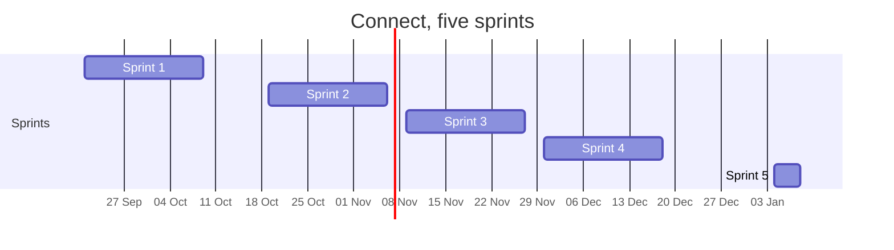

# Sprint goals and the MVP after each sprint

One goal per sprint, and what a real person can do with Connect once that sprint ends. MVP here means the smallest thing that works end to end, not a list of finished issues.

The plan of 1 October 2026 held 227 board items carrying 347 weight, under 21 epics, cut into 1214 tasks. After sprint 1 the team planned sprints 2 to 5 again on 9 October 2026, in [decision 004](../decisions/004-replanAfterSprint1.md): school goals first and spread over sprints 2 to 4, then every must, at about 60 weight per sprint of three weeks and 20 in sprint 5. The numbers below come from the board after that change: 250 board items, 147 of them in a sprint and 103 should and could items without a sprint. The milestone of each sprint in GitLab holds the same goal and the same MVP line. When one changes, the other changes with it.

| Sprint | Dates | Board items | Open weight | Goal in one line |
|---|---|---|---|---|
| 1 | 21 September to 9 October 2026 | 25 | 12 | A person can make an account, log in and have a profile, on a repository nobody can bypass |
| 2 | 19 October to 6 November 2026 | 30 | 63 | A person can make an account, log in and have a profile, and the team knows which personal data it protects |
| 3 | 9 to 27 November 2026 | 36 | 60 | Connect runs in production, organisations join and members connect |
| 4 | 30 November to 18 December 2026 | 36 | 63 | Young people find events, opportunities and projects, and Connect warns the team when it is down |
| 5 | 4 to 8 January 2027 | 20 | 23 | The last must haves of the foundation, so every must on the board is done |
| Without a sprint | | 103 | 135 | Should and could placeholders for a faster team or a next team |

## Sprint 1, 21 September to 9 October 2026

**Goal.** A person can make an account, log in and have a profile, and every change to Connect reaches `dev` only through a merge request a teammate approved.

**MVP after this sprint.** A visitor creates an account, logs in, fills in a profile, sees their own profile page, views another member's profile and logs out. A member who is not logged in is asked to log in and is brought back to the page they wanted.

What is in it: Profiles 5 items, Account 5, Security analysis 4, Hosting and deploy 3, Foundation 2, Site shell 2, Decisions 2, Workshop evidence 2, Research and development 1.

What it also settles: the layered architecture with four backend projects on .NET 10 and CQRS by functionality, the client's priorities for the epics, and the inventory of personal data. Every team member on the client's server waits for the DNS record of the test address from the client. The first login came on 2 October 2026.

**What happened.** The sprint built the foundation: the repository and the pipeline, the server of the foundation, the architecture, the data model, the clickable prototype of sprint 1 and 2, and the plans. None of the 12 slices was finished, and issue 03 Create an account was started. The 18 issues that had not started and issue 03 moved to sprint 2 in decision 004. What waits in an open merge request stays in sprint 1.

**Weight finished.** Sprint 1 finished 38 of its 48 weight. Of those 38, 30 is preparation that was logged afterwards as issues #1500 to #1515 and 2 is the sprint review (#1519). Every issue of the sprint got its weight on 9 October 2026, after the review, because the teacher asked the team to plan on the weight a sprint really finished. Sprint 2 holds 63. The team weighs that against these 38 at the sprint 2 planning (`docs/team/openItems.md`).

## Sprint 2, 19 October to 6 November 2026

**Goal.** A person can make an account, log in and have a profile, and the team knows which personal data it must protect.

**MVP after this sprint.** A visitor creates an account, logs in, fills in a profile, sees their own profile page, views another member's profile and logs out. A member who is not logged in is asked to log in and comes back to the page they wanted. A young person under 16 asks a parent for permission, a member resets a forgotten password and deletes the account with all its data, and Connect starts with one command and says whether it is healthy.

What is in it: Account 10 items, Profiles 5, Security analysis 4, Workshop evidence 3, Research and development 2, Hosting and deploy 2, Site shell 2, Foundation 1, Decisions 1. Six of them are school goals: the DevOps learning outcomes, the evidence table per student, the inventory of personal data, the Scrum Master proof of sprint 2, and the research on loading a profile and on Playwright and Cypress.

## Sprint 3, 9 to 27 November 2026

**Goal.** Connect runs in production, organisations join and members connect.

**MVP after this sprint.** Every merge into `main` reaches the production address after all checks, a broken version is replaced within ten minutes, and the team reads the numbers, the dashboard and the logs of the live version. A member confirms an email address and logs in with Google. An organisation creates a profile and has a page of its own. Members add tags, see suggested members with the reason, send, receive and accept a connection request and save a suggestion. The foundation lists, deactivates and reactivates members.

What is in it: Matching 8 items, Production 7, Account security 6, Profiles 4, Observability 3, Hosting and deploy 3, Admin 3, Account 2. Thirteen of them are school goals: the code quality and image checks, production on k3s, and the numbers, the dashboard and the logs of the live version.

## Sprint 4, 30 November to 18 December 2026

**Goal.** Young people find events, opportunities and projects, and Connect warns the team when it is down.

**MVP after this sprint.** An organisation publishes an event and an opportunity, and a young person registers for an event until it is full. A young person adds a project with a picture and finds projects on a page of their own, on a profile and in a list of all projects. The foundation edits site pages such as the privacy statement, and the privacy statement is on every page. The team gets an email within five minutes when Connect is down, slow or giving many errors.

What is in it: Showcases 7 items, Research and development 5, Events 5, Admin 3, Security analysis 2, Decisions 2, Workshop evidence 2, Production 2, News 2, Opportunities 2, Site shell 2, Observability 1, Account security 1. Twelve of them are school goals: the alerts, the recording and the live demo of DevOps, the architecture drawings and the design patterns, the threat model and the rate limit, and the research. The events, the opportunities, the news and the projects are here in the same sprint as the research and the threat model that measure them.

## Sprint 5, 4 to 8 January 2027

**Goal.** The last must haves of the foundation, so every must on the board is done.

**MVP after this sprint.** A member edits the profile and its tags, a parent sees what Connect keeps and gives permission with one button, a locked log in sends an email, members filter Discover and decline a request, and the foundation searches members and sees the usage numbers.

What is in it: Profiles 9 items, Matching 3, Account security 3, Site shell 2, Admin 2, Security analysis 1. All 20 are must, with 23 weight in one week, 3 above the pace of decision 004. The team checks at the sprint 4 review whether that still holds.

## Without a sprint

**What it is.** 34 should and 69 could items that no must or school goal waits for. They stay open on the board with their priority and are not planned this semester. The team takes them when it goes faster than 60 weight per sprint, or a next team finishes them after the semester.

What is in it: Admin 17 items, Opportunities 15, Challenges 12, Account security 11, Account 11, Events 8, Webshop 7, News 6, Showcases 5, Matching 4, Profiles 3, Badges 2, Decisions 1, Hosting and deploy 1.

## Keeping this in step

Every milestone in GitLab has a Sprint goal section and an MVP after this sprint section. They hold the two bold lines of that sprint from this page, word for word. The sprint goal is written before the sprint starts and is not changed during it. After the review of sprint 2 the team measures the weight it finished and plans sprints 3 to 5 again with the rules of decision 004. The MVP line is checked at the sprint review against what actually works on the test site.

## References

Hogeschool van Amsterdam. (2026). *Studio studyguide 26-27 semester 1* [Course document].

## AI use declaration

AI was used as a writing support tool while working on this document. We used AI to draft the formulation of sentences, the structure of wording, readability, and clarity from content that we had provided, and to generate the diagrams. The content itself, including our experiences, reflections, learning goals, decisions, self-assessments, and conclusions, is our own. We reviewed the drafts and decided as a team which text to include.