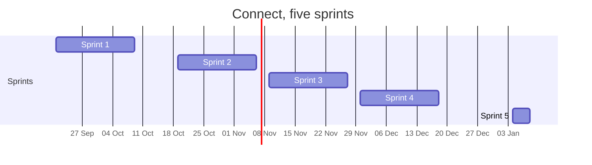

# Sprint goals and the MVP after each sprint

One goal per sprint, and what a real person can do with Connect once that sprint ends. MVP here means the smallest thing that works end to end, not a list of finished issues.

The numbers come from the board on 1 October 2026: 227 board items carrying 347 weight, under 21 epics, cut into 1214 tasks. The milestone of each sprint in GitLab holds the same goal and the same MVP line. When one changes, the other changes with it.

| Sprint | Dates | Board items | Weight | Goal in one line |
|---|---|---|---|---|
| 1 | 21 September to 9 October 2026 | 26 | 50 | A person can make an account, log in and have a profile, on a repository nobody can bypass |
| 2 | 19 October to 6 November 2026 | 54 | 81 | An account is safe to own, and two members can find each other |
| 3 | 9 to 27 November 2026 | 55 | 77 | The foundation can run Connect, and young people find opportunities and events |
| 4 | 30 November to 18 December 2026 | 49 | 76 | Connect is live, watched, and young people show their work on it |
| 5 | 4 to 8 January 2027 | 43 | 63 | The last admin and account work, and a Connect the foundation can take over |

## Sprint 1, 21 September to 9 October 2026

**Goal.** A person can make an account, log in and have a profile, and every change to Connect reaches `dev` only through a merge request a teammate approved.

**MVP after this sprint.** A visitor creates an account, logs in, fills in a profile, sees their own profile page, views another member's profile and logs out. A member who is not logged in is asked to log in and is brought back to the page they wanted.

What is in it: Profiles 5 items, Account 5, Security analysis 4, Hosting and deploy 3, Foundation 2, Site shell 2, Decisions 2, Workshop evidence 2, Research and development 1.

What it also settles: the layered architecture with four backend projects on .NET 10 and CQRS by functionality, the client's priorities for the epics, and the inventory of personal data. Every team member on the client's server waits for the first login and the DNS record of the test address from the client.

## Sprint 2, 19 October to 6 November 2026

**Goal.** An account is safe to own, and two members can find each other.

**MVP after this sprint.** A member confirms an email address, resets a forgotten password, signs in with a social login, keeps a fuller profile, and is matched with another member.

What is in it: Account 15 items, Profiles 14, Matching 13, Account security 10, Research and development 2.

This is the first sprint whose result a young person would notice, because Connect starts to connect people rather than only hold them.

## Sprint 3, 9 to 27 November 2026

**Goal.** The foundation can run Connect itself, and young people find what is on offer.

**MVP after this sprint.** The foundation manages members and content from an admin area and publishes news. An organisation posts an opportunity and an event, and a young person finds both and registers for an event without the event going over its safe limit.

What is in it: Admin 13 items, Opportunities 13, Events 10, News 5, Site shell 4, Account security 4, Challenges 2, Showcases 2, Research and development 1, Matching 1.

## Sprint 4, 30 November to 18 December 2026

**Goal.** Connect runs in production, the team can see that it is healthy, and young people show their work.

**MVP after this sprint.** Connect is reachable on its real address, deployed from `dev` to production on k3s. A young person publishes a showcase and joins a challenge, and the team reads logs, metrics and alerts from the live version.

What is in it: Showcases 9 items, Production 9, Challenges 6, Webshop 5, Hosting and deploy 4, Observability 4, Research and development 3, Security analysis 3, Badges 2, Decisions 2, Workshop evidence 2.

The webshop stays in scope only while the client says yes.

## Sprint 5, 4 to 8 January 2027

**Goal.** Finish the admin and account security work and hand a Connect over that the foundation can run without the team.

**MVP after this sprint.** The foundation does everything it needs from the admin area, every account security path is closed, and the handover documentation matches what is running.

What is in it: Admin 12 items, Account security 7, Challenges 4, Opportunities 4, News 3, Events 3, Account 3, Profiles 2, Webshop 2, Showcases 1, Matching 1, Decisions 1.

**Sprint 5 carries more than it can hold.** It is five working days against three weeks for every other sprint, and it holds 63 weight where sprints 2, 3 and 4 hold 81, 77 and 76. That is roughly three times the pace of any sprint before it. All 43 of its board items are priority could and none is a must, so the scope is droppable by design, but the plan should say which items are expected to move rather than leave the sprint claiming a pace that has never been reached. The team decides what stays in sprint 5 at the sprint 4 review. Owner: the whole team, 18 December 2026.

## Keeping this in step

Every milestone in GitLab has a Sprint goal section and an MVP after this sprint section. They hold the two bold lines of that sprint from this page, word for word. The sprint goal is written before the sprint starts and is not changed during it. The MVP line is checked at the sprint review against what actually works on the test site.

## References

Hogeschool van Amsterdam. (2026). *Studio studyguide 26-27 semester 1* [Course document].

## AI use declaration

AI was used as a writing support tool while working on this document. We used AI to draft the formulation of sentences, the structure of wording, readability, and clarity from content that we had provided, and to generate the diagrams. The content itself, including our experiences, reflections, learning goals, decisions, self-assessments, and conclusions, is our own. We reviewed the drafts and decided as a team which text to include.