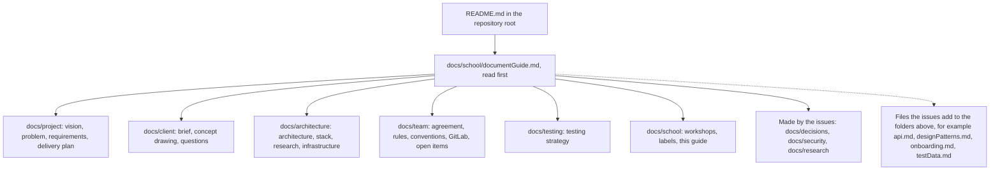

# Guide to the team documents, Young Amstelland Connect

Team 9, "Connect Nine": Bayon Eerhart, Nick Hoebe, Wesley Oerlemans, Gurpreet Singh and Kelvin van Voorst, working for the Social Impact Apps studio, semester 1, 2026-2027, on Young Amstelland Connect for the client Rachid Kherrazi of the WailSalutem Foundation. Read this guide first when you pick up the docs folder of the repository, as a teammate or as an assessor. It says what each document is, which HvA level 3 criterion it serves and what evidence it can become, and what it does for the team day to day.

The Mermaid diagrams in these documents render in GitLab.

## History of this guide

The first version, of 23 to 25 September 2026, described a delivered folder with seven numbered folders (1 agreement to 7 planning). On 27 September 2026 the documents moved into the docs folder of the repository on gitlab.fdmci.hva.nl, grouped by subject. The facts inside them were brought in line with the board: 227 issues in 21 epics, five sprints, PostgreSQL 16 in place of Microsoft SQL Server, .NET 10, production on k3s with Terraform and the test site on docker compose.

## How the docs folder is organized

The README.md in the root of the repository (issue 01 The repository, the pipeline and the team rules, task 1.1) points here.

*Figure: the folders of docs, in reading order.*

| Folder | Documents |
|---|---|
| docs/project | productVision.md, problemAnalysis.md, requirements.md, deliveryPlan.md, and later houseRules.md |
| docs/client | clientBrief.md, clientBriefConcept.jpeg, clientQuestions.md, and later clientContact.md |
| docs/architecture | architecture.md, techStack.md, stackResearch.md, infrastructure.md, and later api.md, designPatterns.md, socialLogin.md, concurrencyRegistration.md |
| docs/team | collaborationAgreement.md, codeConventions.md, definitionOfDone.md, gitlabSetup.md, issueRules.md, boardNumbers.md, openItems.md, actionOverview.md, and later onboarding.md |
| docs/testing | testingStrategy.md, and later testData.md |
| docs/school | workshopCoverage.md, issueMapping.md, documentGuide.md, and later devopsLearningOutcomes.md, workshopEvidenceMap.md, recordingScript.md, liveDemoPlan.md |
| Made by the issues | docs/decisions, docs/security, docs/research |

## The criteria in short

- **AA, Analysis & Advice**: analysing a problem, researching options and advising with sources.
- **OR, Design & Realisation**: designing and building the product, and verifying it.
- **MS, Management & Collaboration**: planning, working together and keeping work transparent and transferable. Its five success criteria are MS1 to MS5.

## docs/project

### productVision.md

The product vision and business case: what Connect is and is not, who it serves, the case for building it (impact, not revenue), the possible functions and the open risks.

For the studio, it serves **AA**. It frames the business case that problemAnalysis.md and requirements.md trace back to, so an assessor reads it to see why the project exists in the client's own terms.

For the team, it is the reference for scope. The questions it leaves for the client, such as who owns the work and what may be shown at school, are asked by issue 10 The client's priorities for the epics and answered in docs/client/clientQuestions.md.

### problemAnalysis.md

The problem statement, the current and the desired situation, a stakeholder analysis, the constraints of the client's brief and the risks of the project, grounded in clientBrief.md and productVision.md.

For the studio, it serves **AA**. It shows the gap between what the awards cycle does once a year and what Connect has to do all year, with a stakeholder analysis behind it. It is a candidate piece of AA evidence on its own.

For the team, it is the check for a proposed feature: does it close the gap the analysis names, or not.

### requirements.md

The requirements: the functional requirements FR1 to FR10 traced to the business case, the MoSCoW order, and the non-functional requirements NFR1 to NFR6 (authentication and authorization, a GDPR footing, hosting at no license cost, fast pages, available when it matters, and the Definition of Done). Every issue names the requirement it serves in its linked items, and the priority label of each issue follows the order the client confirms in issue 10.

For the studio, it serves **AA** and **OR**: it is analysis that decides what gets built. It is the document most directly usable as OR evidence, because every slice traces back to it.

For the team, it is the basis of the backlog. Rule A5 of the rulebook says a slice exists only because of a requirement here, with one exception: an issue with the label school::required.

### deliveryPlan.md

The dated calendar of the semester: the five sprints (Sprint 1 21 September to 9 October 2026, Sprint 2 19 October to 6 November, Sprint 3 9 to 27 November, Sprint 4 30 November to 18 December, Sprint 5 4 to 8 January 2027), the sprint reviews, the datapoint moments, the Scrum Master and Product Owner rotation, and a Mermaid gantt chart.

For the studio, it serves **MS**. It shows the team seeing deadlines coming and keeping work transparent (MS1) and connects each member's deliverables to one shared calendar (MS4). The milestones in GitLab carry the same dates ([gitlabSetup.md](../team/gitlabSetup.md)).

For the team, it is the one place to check what is due next and who owns it.

## docs/client

### clientBrief.md and clientBriefConcept.jpeg

The client's own description of Young Amstelland Connect, quoted word for word in Dutch with where it came from, and the concept drawing the client sent. The quoted text is never changed, only the notes around it.

For the studio, they are the primary source behind the AA analysis. An assessor can follow a claim in productVision.md or problemAnalysis.md back to the client's exact words or to the drawing. They carry no criterion of their own.

For the team, they are the shared reference for what the client actually asked, including the webshop that the drawing shows and the text does not. Whether the webshop comes this semester is question 2 in clientQuestions.md.

### clientQuestions.md

Every open question for the client, the director of the foundation, in one numbered table with the card that asks it, the answer and the date. Issue 10 The client's priorities for the epics asks them and writes each answer here with a link to the written confirmation. Questions 1 to 8 come from the tasks of issue 10, questions 9 and up from the other cards. A card that waits for an answer says "issue 10, question N".

For the studio, it serves **AA** and **MS**: the questions are analysis of what is still unknown, and keeping them in one place with dates is transparent work with the client.

For the team, it is the list to take to every meeting with the client, and the place to look before starting an issue that is blocked by the client.

## docs/architecture

### architecture.md

The architecture of Connect: four layers (Presentation, Application, Domain, Infrastructure) with the directions they may call, Minimal API endpoints, one shared PostgreSQL database, and the table diagrams that the issues add as they build. Issue 11 The team agrees on the layered architecture holds the decision. Issue 102 The architecture drawn in layers, parts and places adds the layer, component and deployment drawings, each with the quality it protects.

For the studio, it serves **AA** and **OR**: the style is weighed against other styles, and the layers shape how the server is built. It is the "at least one architecture diagram" the Architecture & Patterns workshop asks for, and evidence for the **Security & Architecture** datapoint.

For the team, it is the map of the code. The Definition of Done keeps it up to date on every issue that changes the structure.

### techStack.md

The stack of the platform and why: React with TypeScript and Vite, .NET 10 with ASP.NET Core and C#, and PostgreSQL 16 through EF Core and Npgsql. It keeps the history: on 22 September 2026 the team chose Microsoft SQL Server, and on 26 September 2026 Wesley Oerlemans changed that to PostgreSQL 16. .NET 10 for every project is issue 11 task 11.3. It also holds the skills and learning goals of each member and the profile and level each member is assessed at.

For the studio, it serves **AA** and **OR**. The reasoning behind the choice is analysis, and the choice governs the building that follows. It ties each member's level and learning goal to the division of work.

For the team, it is the reference for who is expected to know what.

### stackResearch.md

The research behind the stack: React, ASP.NET Core and C#, and the database, each read against BoKSA and the official documentation, with the strengths, weaknesses and cost for this platform, and an APA 7 reference list.

For the studio, it serves **AA**. It is the most cited single piece of research in the docs folder.

For the team, it is the answer when a coach, a teammate or the client questions the stack. It names the trade-off the team accepted: a stack that is new to most members, chosen mainly for what they learn from it.

### infrastructure.md

What runs where. Laptops and the test site run on docker compose (issue 20 Dockerfiles for the server and the frontend), the test site on the client's server behind Caddy with the padlock (issue 09 Every team member on the client's server), with Mailpit as the test mailbox. Production runs on k3s on the client's server, described in Terraform (issues 92 to 97), with Prometheus, Grafana, Alertmanager and Loki (issues 98 to 101). It also covers the pipeline stages, secrets, backups (issues 172 and 174) and rollback.

For the studio, it serves **AA** and **OR**, and it is the main evidence for the **DevOps & Testing** datapoint. The options for running production are weighed in issue 92, and the environments and the pipeline shape how Connect is built and delivered.

For the team, it is the reference before touching the pipeline or a server. Where production runs exactly, and on which address, is decided by the client in issue 91 The director agrees where production runs.

### api.md (made later)

The list of server addresses, what each one expects and answers, and who may use it. Issue 03 Create an account starts it (task 3.1), and every slice that adds an endpoint adds its lines.

For the studio, it is **OR** evidence: the design of the interface between the screen and the server.

For the team, it is where the frontend developer looks up an endpoint without reading the server code.

## docs/team

### collaborationAgreement.md

The team's working agreement: roles, communication, working hours and the semester calendar, the git conventions, the Definition of Done, the AI use rules (section 9) and the consequences when someone does not keep to it.

For the studio, it serves **MS** and maps to all five success criteria: MS1 through foreseeing risks and keeping work transparent, MS2 through the retrospective rhythm, MS3 through the consequences section, MS4 through the branch and review rules that connect each member's work, and MS5 through the rotating Scrum Master and Product Owner roles. The agreement is still a draft: the team is working on the final version and nobody has signed it yet. Once the five members sign it, the signatures are the evidence.

For the team, it is the agreement itself: who to contact and how, which hours count, what finished work looks like, and what happens when someone does not do their part. Every merge request carries the AI declaration of section 9.1 (Definition of Done).

### codeConventions.md

What "the code follows the team's code conventions" in the Definition of Done means, per layer: branches and merge requests, Conventional Commits, the frontend (TypeScript, React, Vite), the server (C#, ASP.NET Core) and the database (PostgreSQL through EF Core, snake_case names), plus the rules added after the audit of 27 September 2026. When the board changes, this file changes in the same merge request.

For the studio, it serves **OR** and **MS**: OR because it sets the craft standard the code is judged against, MS because the team keeps it together.

For the team, it is the list to check a merge request against.

### definitionOfDone.md

The Definition of Done, one list per issue type (slice, setup, research, decision, client). A slice carries it in short, one checkbox per category, and the other types carry their short list in full. The "How to check" under each line lives only here.

For the studio, it serves **MS** and **OR**: it is the shared quality agreement, and its tests, security and docs lines are what make every slice verified evidence. The line "The BoKSA proof that each task asks for is in the merge request, ready for Portflow" is what feeds the portfolio.

For the team, it is the list the reviewer walks before a merge.

### gitlabSetup.md

How the GitLab project Connect Nine is set up, written so someone outside the team can repeat it: dev and main protected, main only from dev, one approval from someone else, the labels, the epics as issues named "EPIC: <name>" (GitLab Free), one milestone and one board per sprint, and the limits of the Free tier.

For the studio, it serves **MS**: it shows a transparent, repeatable way of working (MS1, MS4).

For the team, it is the reference when a setting is unclear, and for a new project.

### issueRules.md

The rulebook for writing an issue and its tasks: what an issue is (a vertical slice, or a setup, research, decision or client issue), the story, the parts of an issue and of a task in order, the proof block for the portfolio, and the rules for the code. Rule A5 has the exception for school::required issues.

For the studio, it serves **MS** and **AA**: it is how the team turns the client's needs into work that anyone can pick up, and every task's proof block quotes the BoKSA success criteria.

For the team, it is what a new issue must follow. When anything else disagrees with the rulebook, the rulebook wins.

### boardNumbers.md

The board number of every issue next to its GitLab number. The cards name each other by board number, GitLab gives its own numbers.

For the studio, it supports **MS**: it keeps the planning on the Figma board traceable to GitLab.

For the team, it is the lookup when an issue says "issue 92" and you need #156.

### openItems.md

The register of what is still open across the documents: what needs deciding, what needs asking of the client or the coach, and what needs planning. Each item names the issue or the client question that decides it.

For the studio, it serves **MS**: all open decisions and questions in one place (MS1).

For the team, it is the place to check what is still open, rather than every document in turn.

### actionOverview.md

The biggest portfolio risks with, per risk, what is needed, what the team already has and what is still to do, in order.

For the studio, it serves **OR** and **MS**: it states the evidence gaps plainly and plans how the team closes them.

For the team, it is the reference before a sprint review.

### onboarding.md (made later)

The guide for a new team member and for the foundation after January 2027: how to start Connect, the quality gate, the security scan, the production server, changing production, going back to a previous version, metrics, logs and alerts. Issue 01 starts it (tasks 1.1 and 1.7), and the Hosting and deploy, Production and Observability issues each add a section.

For the studio, it serves **MS**: work that is transferable to someone who was not there.

For the team, it is the first thing to give someone who joins.

## docs/testing

### testingStrategy.md

The testing strategy: unit, integration and end to end tests, NUnit and FluentValidation on the server, Vitest in the frontend, Playwright in a real browser, and how the pipeline runs them on every merge request and against the test site after each deploy. It keeps the history of the decisions of 23 and 24 September 2026. The tests lines of the Definition of Done make every slice follow it.

For the studio, it serves **AA** and **OR**, and it is evidence for the **DevOps & Testing** datapoint and the sprint 4 **Review of Security & Testing**.

For the team, it is the answer to "which test goes where".

### testData.md (made later)

The invented test data of the test site: which test accounts, profiles and events exist and what each one is for. Issue 10 The client's priorities for the epics, task 10.4, decides whether the test site holds real or invented data of young people. The slices add their seed data.

For the studio, it supports **OR**: tests that can be repeated by anyone.

For the team, it is where a tester finds the account to use in a check.

## docs/school

### workshopCoverage.md

The map from each sprint 0 workshop requirement to the issues that cover it, with the sprint and the datapoint each one feeds. See [workshopCoverage.md](workshopCoverage.md).

For the studio, it serves **AA** and **OR**: reading each workshop against the board is analysis, and the issues it names are the design and realisation work.

For the team, it is the one place that checks all workshops against the project at once. The coach table of issue 85 The coach sees per student which issue proves which workshop builds on it per student.

### issueMapping.md

The portfolio labels (outcome, level, direction) on every task, how they are counted, how they map to BoKSA articles, and how to find the evidence at datapoint time. See [issueMapping.md](issueMapping.md).

For the studio, it serves **AA**, **OR** and **MS** together, since it connects each task to the outcome it proves.

For the team, it is the reference before making a task, and at every datapoint.

### documentGuide.md

This guide. It carries no criterion of its own. It helps the assessor find the evidence behind each criterion.

### Made by the issues in docs/school

Some school issues write their own file here: the DevOps learning outcomes in devopsLearningOutcomes.md (issue 84), the table student by workshop in workshopEvidenceMap.md (issue 85), the recording script in recordingScript.md (issue 86) and the live demo plan in liveDemoPlan.md (issue 87). Each is evidence for the workshop its issue names.

## Made later by the issues

- **docs/decisions**: one file per decision, numbered, with the options, the choice and why the others lost. Started by issue 01 task 1.6, for example the layered architecture (issue 11), the code quality tool (issue 88) and k3s and Terraform for production (issue 92). AA evidence: weighing options with reasons.
- **docs/security**: the security specialist's analysis, such as the personal data inventory (issue 12), the role table (issue 13), the threat models (issues 18 and 104), the data rules (issue 19) and the accepted scan risks (issue 16). AA evidence for the Security Specialist profile, and the base of the security lines of the Definition of Done.
- **docs/research**: the research proposals (issue 106), a one page summary per research for the team and the client (issues 107 to 111), and the peer review pairs (issue 112). AA evidence for R&D. The full scientific report of each student goes in Portflow.

## Individual work

The research of each student is individual, as the R&D workshop requires. Only the proposal, the one page summary and the peer review pairs are in the repository. On 23 September 2026 Wesley drafted a research proposal of his own, on eager and lazy loading in EF Core, and a plan for the Advanced Programming elective on the event capacity race. The elective plan now runs through issues 68b A full event refuses a place fairly and 107 Three ways to give out the last event place, measured. Whether the research proposal stays his own topic is decided in issue 106 Each student's research topic approved, task 106.1.

## Other files the issues make

Some issues make a document of their own inside the folders above. The issues name each one at its place: docs/architecture/designPatterns.md (issue 103), docs/architecture/socialLogin.md (issue 23), docs/architecture/concurrencyRegistration.md (issue 68b), docs/security/privacyStatement.md (issue 51), docs/project/houseRules.md (issue 52) and docs/client/clientContact.md (issue 01).

## AI use declaration

AI was used as a writing support tool while working on this document. We used AI to draft
the formulation of sentences, the structure of wording, readability, and clarity from
content that we had provided, and to generate the diagrams. The content itself, including
our experiences, reflections, learning goals, decisions, self-assessments, and
conclusions, is our own. We reviewed the drafts and decided as a team which text to
include.
