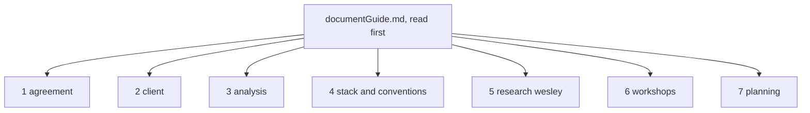

# Guide to the team documents, Young Amstelland Connect

Team 9, "Connect Nine": Bayon Eerhart, Nick Hoebe, Wesley Oerlemans, Gurpreet Singh, and Kelvin
van Voorst, working for the Social Impact Apps studio, semester 1, 2026-2027, on Young
Amstelland Connect for the client Rachid Kherrazi at the WailSalutem Foundation. This guide is
meant to be read first by a teammate or an assessor picking up this directory, before any of
the documents themselves. These documents are destined for the project's GitLab repository,
per Wesley Oerlemans on 23 September 2026, and the Mermaid diagrams below render natively
there.

## How the delivered folder is organized

The delivered folder is organized into seven numbered folders, in reading order. `1 agreement`
holds `collaborationAgreementV1.md`. `2 client` holds `clientBrief.md`, `clientBriefConcept.jpeg`,
and `clientQuestions.md`. `3 analysis` holds `problemAnalysis.md`, `productVision.md`, and
`requirements.md`. `4 stack and conventions` holds `techStack.md`, `stackResearch.md`,
`codeConventions.md`, `infrastructure.md`, `architecture.md`, and `testingStrategy.md`.
`5 research wesley` holds Wesley's individual research track, `proposal.md`, `topicCandidates.md`,
`inputsNeeded.md`, and `advancedProgramming.md`. `6 workshops` holds `workshopCoverage.md`, the
map from the six sprint 0 workshops to what Connect implements for each, and `issueMapping.md`,
the guide to labeling GitLab issues by learning outcome, level, and study direction. `7 planning` holds
`deliveryPlan.md`, the team's dated calendar of deliverables, `actionOverview.md`, the three
biggest portfolio risks with what is needed, what the team has, and what is still to do, and
`openItems.md`, the team's register of what needs deciding, what needs asking, and what needs
planning. `documentGuide.md` itself stays at the folder root as the map.

*Figure: the seven numbered folders in the delivered semester 7 layout, in reading order.*

Each entry below names what the document is, what it serves for the studio, meaning which HvA
level 3 criterion it maps to and what evidence or datapoint it can become, and what it does for
the group day to day.

## collaborationAgreementV1.md

The signed version of the team's collaboration agreement: roles, communication channels,
working hours, the sprint calendar, git conventions, the Definition of Done, AI use rules, and
the strike system for addressing team members who do not follow it. It is generated by
`buildSigningVersion.py` from the working copy, `collaborationAgreement.md`, and is never
edited by hand.

For the studio, it serves **MS, Management & Collaboration**. It maps to all five Advanced
success criteria: MS1 through anticipating risks and keeping work transparent, MS2 through the
retrospective and evaluation rhythm it sets, MS3 directly through its section 10 strike system,
MS4 through the branching and review rules that connect each member's work to the others', and
MS5 through the rotating Scrum Master and Product Owner roles. The five signatures are the
evidence that this criterion is met once the agreement is signed.

For the group, it is the working agreement itself: who to contact and how, what hours count,
what a finished piece of work looks like, and what happens when someone does not hold up their
end.

## collaborationAgreement.md

The working copy with the team's blockquote notes still in it, the version `collaborationAgreementV1.md`
is generated from. It carries no separate criterion mapping of its own, since the signed V1 file
is what the studio treats as evidence. For the group, it is where the editing
actually happens, since a blockquote is a note to the team and is deleted before signing.

## buildSigningVersion.py

The generator, standard library only, that strips the blockquote notes out of
`collaborationAgreement.md` and writes `collaborationAgreementV1.md`. It carries no criterion
mapping of its own. For the group, it is what keeps the two files from drifting: run it after
any edit to the working copy, never edit the signing version by hand.

## clientBrief.md and clientBriefConcept.jpeg

The client's own description of Young Amstelland Connect, quoted verbatim in Dutch with its
provenance recorded, plus the concept diagram the client sent by WhatsApp. Neither file carries
its own criterion mapping. They are the source material that the two AA-mapped analysis
documents below, `productVision.md` and `problemAnalysis.md`, are grounded in.

For the studio, this is the traceable primary evidence behind the AA analysis: an assessor can
follow a claim in the analysis back to the client's exact words or to the diagram.

For the group, it is the shared reference for what the client actually asked for, including the
one scope question the diagram raises that the text does not, a webshop module, which
`productVision.md` and `requirements.md` both flag as open.

## clientQuestions.md

The team's single list of every open question that needs an answer from the client, Rachid
Kherrazi: ownership and IP of the built platform, real versus test data given that the user
base includes minors, permission to show the work in portfolios, the webshop scope parked as
FR10, what happens to hosting and the platform after the project ends, and whether the
WailSalutem Foundation is a formally registered nonprofit in the Netherlands. Each question is
gathered from a client-facing TBD already recorded in `requirements.md`, `infrastructure.md`,
`productVision.md`, or `deliveryPlan.md`, rather than raised fresh here.

It carries no separate criterion mapping of its own, the same as `clientBrief.md`. It exists so
the team, and Nick Hoebe as client contact, have one place to check what is still owed by the
client rather than four.

For the group, it is the reference to hand to Nick Hoebe, and the checklist to work through at
the sprint 1 review, week of 5 October 2026, when every question on it is due.

## problemAnalysis.md

The problem statement, the current and desired situation, a stakeholder analysis, the two
constraints the client's brief sets, and the risks the project carries, all grounded in
`clientBrief.md` and `productVision.md`.

For the studio, it serves **AA, Analysis & Advice**. It is the document that shows the gap
between what the awards cycle already does, once a year, and what Connect is meant to close,
year-round, with a stakeholder analysis behind it. It is a candidate piece of AA evidence in its
own right.

For the group, it is the reference the team checks a proposed feature against: does this close
the gap the analysis names, or not.

## productVision.md

The product vision and business case: what Connect is and is not, who it serves, the case for
building it, the possible functionality list, and the open risks.

For the studio, it also serves **AA**. It frames the business case, impact rather than revenue,
that `problemAnalysis.md` and `requirements.md` both trace back to, so it is the document an
assessor reads to see why the project exists in the client's own terms.

For the group, it is the day-to-day reference for scope and for the open questions still owed
to the client, IP ownership, real or test data, and portfolio visibility, all owned by Nick
Hoebe and due at the latest the sprint 1 review, week of 5 October 2026.

## requirements.md

The requirements analysis: functional requirements traced to the business case goals in
`productVision.md`, a proposed MoSCoW prioritization, non-functional requirements covering
security, hosting cost, performance, and maintainability, and a traceability section linking
each requirement group to the stack in `techStack.md` and `stackResearch.md`.

For the studio, it serves both **AA** and **OR, Design & Realisation**, since it is analysis
that also shapes what gets built. It is the document most directly usable as OR evidence once
the team confirms the prioritization.

For the group, it is the working backlog basis: what to build, in what order, and why, with the
MoSCoW order still a proposal owned by the whole team with the client, due sprint 1 planning,
week of 21 September 2026.

## techStack.md

The platform's required stack, the constraints the collaboration agreement sets on it, the
non-functional weight toward security given the minors in the user base, the per-member skills
inventory, and the recorded decision: React, .NET with ASP.NET Core and C#, and Microsoft SQL
Server.

For the studio, it serves both **AA** and **OR**, the same pairing as `requirements.md`: the
reasoning behind the stack choice is analysis, and the choice itself governs the realization
work that follows. It is also the document that ties each team member's assessment level and
learning goal to the division of work.

For the group, it is the reference for who is expected to know what, and it is where the team's
own DevOps and hosting gap, still TBD for everyone, gets planned for at sprint 1 planning, week
of 21 September 2026.

## stackResearch.md

The research behind the stack decision recorded in `techStack.md`: React, ASP.NET Core and C#,
and Microsoft SQL Server, each read against BoKSA and the official documentation, with the
strengths, weaknesses, and cost or licensing consequences for this specific platform, and a full
APA 7 reference list.

For the studio, it serves **AA**. It is the strongest single piece of cited, source-backed
research in the directory, since every claim traces to BoKSA or to Microsoft or React's own
documentation, fetched and read on 2026-09-22.

For the group, it is the rationale document to point to whenever the stack choice is
questioned, by a coach, a teammate, or the client, and it names the concrete trade-off the team
accepted: an unfamiliar stack chosen mainly for learning value, not for the fastest route to a
working platform.

## codeConventions.md

The team's code conventions: what holds regardless of stack, SOLID, DRY where practical, clean
code, English identifiers, a passing linter, unit tests, and reviewer rules, plus a
stack-specific section for React, .NET, and Microsoft SQL Server that is still entirely TBD,
owned by the team at sprint 1 planning, week of 21 September 2026. It extends
`collaborationAgreementV1.md` section 6 rather than repeating it.

For the studio, it serves both **OR** and **MS**: OR because it sets the craft standard the
built code is judged against, and MS because it is a collaboration document the team maintains
together, in the same family as the agreement it extends.

For the group, it is the reference to check a merge request against once the stack-specific
section is filled in, and until then it is the list of what still needs deciding before sprint
1 planning closes.

## infrastructure.md

What the client's brief and concept diagram imply for infrastructure, item by item, the
environments story for local development, a shared test environment, and production, GitLab as
the platform with a proposed CI pipeline, two or three hosting options on a student budget
weighed against the SQL Server licensing tension in `stackResearch.md`, and operational needs,
backups, secrets handling, a domain name, HTTPS, and GDPR-relevant data location, all as
proposals. Every hosting and operational choice is TBD, owned by the whole team at sprint 1
planning, week of 21 September 2026, except the webshop's payment dependency, which follows the
same open scope question `productVision.md` and `requirements.md` already record, owned by Nick
Hoebe, due at the latest the sprint 1 review, week of 5 October 2026.

For the studio, it serves both **AA** and **OR**: AA because the hosting options are weighed
research, three options checked against live pricing pages and against the licensing tension
`stackResearch.md` already names, and OR because the environments and CI pipeline sections
shape how the platform is actually built and deployed.

For the group, it is the reference to check before sprint 1 planning closes, since it is where
the hosting decision, still open everywhere else in this directory, gets its options laid out
side by side.

## architecture.md

The proposed backend architecture: a layered structure with the dependency inversion principle
applied to the persistence layer, argued against MVC alone, microservices, event-driven, and
full hexagonal or Clean Architecture, with a component diagram and three design patterns,
Repository, Dependency Injection, and Strategy for the matching module (FR2), proposed against
real Connect modules. Grounded in the Architecture & Patterns workshop material and in
`techStack.md`, `requirements.md`, and `codeConventions.md`. The proposal is TBD, owned by the
whole team, due sprint 1 planning, week of 21 September 2026.

For the studio, it serves both **AA** and **OR**: AA because the styles are weighed against the
team's own skills inventory in `techStack.md` rather than assumed, and OR because the layers,
the component diagram, and the three patterns shape how the ASP.NET Core backend is actually
built.

For the group, it is the reference to confirm or redirect at sprint 1 planning, since it is
where the backend's shape, unwritten everywhere else in this directory, gets a concrete
proposal.

## testingStrategy.md

The testing strategy: unit, integration, and end to end layers mapped to NUnit and Vitest for
unit and integration, FluentValidation for request validation, React Testing Library for
frontend component tests, and Playwright for end to end, each tied to a concrete Connect
module, event capacity, matching, authorization, profiles, and to how the layers gate the
merge request flow through `infrastructure.md`'s CI pipeline. Grounded in the Testing
workshop's example repository and in `codeConventions.md` and `infrastructure.md`. The tools
are decided. React Testing Library and the module-by-module test plan stay TBD, owned by the
whole team, due sprint 1 planning, week of 21 September 2026.

For the studio, it serves both **AA** and **OR**: AA because the tool choices are argued from
the workshop's own example and from Microsoft's testing guidance rather than picked without
reasoning, and OR because the module-by-module test plan and the CI gate shape how the platform
is actually verified before it merges.

For the group, it is the reference to confirm or redirect at sprint 1 planning, and until then
it is what `codeConventions.md`'s own "Test framework" TBD is waiting on.

## workshopCoverage.md

The map from the six sprint 0 workshops, Research and Development, Architecture & Patterns,
DevOps, Security, Advanced Programming, and Testing, to what Connect has to implement or
answer for each, read against `requirements.md`, `techStack.md`, `infrastructure.md`, and
`codeConventions.md` for what already exists, and against `../research/proposal.md` for the
R&D track. Each workshop section names what the material concretely asks for, points at the
existing document that covers it, states which level 3 datapoint the evidence feeds, and names
the honest gap as an owned, dated TBD where one exists.

For the studio, it serves both **AA** and **OR**, the same pairing as `requirements.md` and
`infrastructure.md`: reading each workshop against what the team has already written is
analysis, and the gaps it surfaces are what design and realisation work still has to close.

For the group, it is the single place that checks all six sprint 0 workshops against the
project at once, rather than each workshop's coverage being implicit across several other
documents. Three gaps came out of it directly: the backend's architectural style and design
patterns are not chosen, no testing strategy is written for any layer, and no concurrency risk
in the .NET backend has been named for the Advanced Programming elective.

## issueMapping.md

The guide to labeling GitLab issues by BoKSA learning outcome, level, and study direction: why
the labels exist, a small scoped label scheme, a mapping table from the kinds of issues this
project actually generates to the outcome, level, and BoKSA article or CYBOK topic each serves,
the rule for choosing Level 2 versus Level 3, and the three-step habit for tagging an issue at
creation and harvesting it at datapoint time.

For the studio, it serves **AA**, **OR**, and **MS** together, depending on which label an
issue carries, since it is the document that connects a piece of project work to whichever
outcome it actually evidences.

For the group, it is the reference to check before opening a new GitLab issue, so the team
keeps building the same workshop-to-datapoint-to-article join `workshopCoverage.md` already
sets out, down to the level of individual issues and merge requests.

## deliveryPlan.md

The team's dated calendar of deliverables from 24 September 2026 to the portfolio submission: a
milestone table, the sprint 1 planning decisions queued in `architecture.md`, `testingStrategy.md`,
`infrastructure.md`, `requirements.md`, `productVision.md`, `codeConventions.md`, and
`techStack.md`, the four Sprint Review dates read from the DLO Assignments page, the
Scrum Master and Product Owner rotation from `collaborationAgreement.md` section 5, and a
Mermaid gantt chart of the semester.

For the studio, it serves **MS, Management & Collaboration**, the same criterion as
`collaborationAgreementV1.md`: it is the document that shows the team anticipating deadlines
and keeping work transparent and transferable (MS1) and that connects each member's own
deliverables to the shared calendar (MS4). The milestones it schedules are themselves AA and OR
evidence once delivered, so it also feeds those criteria indirectly.

For the group, it is the single place to check what is due next and who owns it, rather than
reconstructing the calendar from the study manual, `collaborationAgreement.md`, and
`workshopCoverage.md` separately. Every date not yet known is a named TBD with an owner and a
route, not a guess.

## actionOverview.md

The three biggest portfolio risks Wesley asked for on 23 September 2026: Design & Realisation
having no realized artifacts yet, the October 9 minimum credible set from `deliveryPlan.md`,
and the authenticity of hand-ins reaching an assessor. Each risk carries what is needed, what
the team already has, and an ordered still-to-do list where each item unblocks the next.
Grounded in `deliveryPlan.md`, `workshopCoverage.md`, and `documentGuide.md`, with a Mermaid
diagram showing how risk 1's repository chain feeds risk 2's repository item and how risk 3
runs on its own schedule.

For the studio, it serves both **OR** and **MS**: OR because risk 1 is that criterion's own
evidence gap, stated plainly rather than assumed away, and MS because risks 2 and 3 are about
the team's delivery calendar and about hand-ins standing up to review.

For the group, it is the reference to check before Sprint Review 1, since it lays out in one
place what blocks what, and who owns closing each block.

## openItems.md

The team's single register of everything still open across the delivered document set: what
needs deciding, at sprint 1 planning unless noted otherwise, what needs asking, of the client or
of coach Karthik Srinivasan, and what needs planning, the GitLab repository, Kelvin van
Voorst's security datapoint, Wesley's research draft, and the sprint 1 review minimum set. Each
item is gathered from an owned, dated TBD already recorded elsewhere rather than raised fresh
here. Grounded in every other document in this directory.

For the studio, it serves **MS, Management & Collaboration**, the same criterion as
`collaborationAgreementV1.md` and `deliveryPlan.md`: it is where the team keeps its own work
transparent and transferable (MS1) by holding every open decision, question, and planning item
in one place instead of four.

For the group, it is the single place to check what still needs deciding, asking, or planning,
rather than checking every document in this directory in turn.

## The research directory

`../research/proposal.md`, `../research/topicCandidates.md`, and `../research/inputsNeeded.md`
are not team documents. This folder, `5 research wesley` in the delivered layout, holds
Wesley's individual research track, kept here for his own assessment. Every team member
carries individual work of their own, each kept in that member's own portfolio rather than in
this shared layout. Wesley's sits inside the shared layout anyway, so the team, and an
assessor, can see how his individual work connects with the team's rather than reading it as
detached from Connect. They belong to Wesley's individual R&D report track, the level 3
differentiator that level 2 team members do not carry, and they map to **AA** in the same way
`problemAnalysis.md` and `productVision.md` do, but as Wesley's own evidence, not the team's.

`proposal.md` is the draft research proposal itself: the problem statement, main question,
three sub-questions, and the reproducible method comparing eager and lazy loading in Entity
Framework Core, built from `topicCandidates.md`'s candidate 2. It is the direct evidence
candidate for the **Research & Design** datapoint, sprint 1, and carries its own AI use
declaration. It is a draft awaiting Wesley's own review, per its own header, and it has not
gone to Portflow yet.

`topicCandidates.md` holds three rubric-judged research proposal candidates, each grounded in
Connect and its decided stack, with the pick between them, candidate 2, already made and
carried into `proposal.md`. `inputsNeeded.md` is the input list that track was built from, with
several questions, chiefly the Portflow proposal and report dates, still open and unowned by
any team member since they depend on the course, not on the team.

`../research/advancedProgramming.md` is different again: it is Wesley's plan for the Advanced
Programming elective, not the R&D track, feeding the Custom Datapoint for whichever sprint he
assigns it rather than the Research & Design datapoint, though it also maps to **AA** in the
same individual-evidence sense. It plans the elective's three-way fix for a shared-mutable-state
race, applied to Connect's own event capacity feature (FR6), and is a draft awaiting Wesley's
own review, per its own header.

## AI use declaration

AI was used as a writing support tool while working on this document. We used AI to draft
the formulation of sentences, the structure of wording, readability, and clarity from
content that we had provided, and to generate the diagrams. The content itself, including
our experiences, reflections, learning goals, decisions, self-assessments, and
conclusions, is our own. We reviewed the drafts and decided as a team which text to
include.
