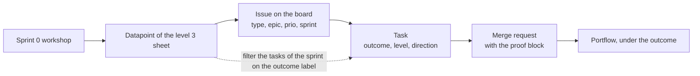

# Issue to learning outcome mapping, Young Amstelland Connect

This document serves the HvA level 3 criteria Analysis & Advice (AA), Design & Realisation (OR) and Management & Collaboration (MS), depending on which label a task carries. It explains the labels as they are set in the GitLab project Connect Nine on gitlab.fdmci.hva.nl since 27 September 2026, and how the team uses them to find its portfolio evidence. The setup itself is in [gitlabSetup.md](../team/gitlabSetup.md), the rules for writing an issue and a task are in [issueRules.md](../team/issueRules.md).

## History of this document

The first version, of 24 September 2026, was a proposal for the team to confirm. It put the outcome and level labels on the issue, chose the level by the person doing the work, and left the direction label off for full-stack work. The board of 27 September changed all three:

- The portfolio labels (outcome, level, direction) are on every **task**, never on the issue (rules C11 and D5 of the rulebook).
- A task gets one level label for **every level that can do it**, not the level of the person who picks it up.
- Every task carries a direction label, also direction::full-stack. There is no unmarked default.

The seven labels themselves stayed the same.

## Why tasks carry learning outcome labels

Portfolio evidence in Portflow is taken from real project work, not written from memory months later. [workshopCoverage.md](workshopCoverage.md) builds the first half of that chain: a sprint 0 workshop feeds a datapoint, and the issues that deliver it. This document adds the last step: from the datapoint down to the task and the merge request that produced the evidence. A task that is labelled when it is made can be found at datapoint time by filtering, instead of the team having to rebuild at the sprint review which merge request proved which outcome.

The chart below shows the whole chain, from a workshop to the evidence in Portflow, and where the labels of this document sit in it.

*Figure: from workshop to Portflow. workshopCoverage.md covers the first two steps, this document the rest.*

The labels sit on the task and not on the issue because one issue proves different things. Issue 03 Create an account has a database task, backend and frontend tasks, test tasks and two pipeline tasks. The pipeline tasks prove Management & Collaboration, the others prove Design & Realisation. Only the task knows which one.

## The labels in GitLab

Labels with two colons are grouped by kind. The table shows all labels of the project and where each one goes.

| Kind | Labels | On |
|---|---|---|
| Type | type::slice, type::setup, type::research, type::decision, type::client | issue |
| Epic | epic::<name>, one per epic (21), and EPIC on the issue named "EPIC: <name>" that stands for an epic | issue |
| Priority | prio::must, prio::should, prio::could, prio::nice-to-have | issue |
| Sprint | sprint::1, sprint::1-stretch, sprint::2 to sprint::5 | issue |
| Blocked | blocked, always with the reason in the issue | issue |
| School | school::required, on an issue that exists because a school workshop requires it | issue |
| Outcome | outcome::analysing-and-advising, outcome::designing-and-realising, outcome::managing-and-collaborating | task |
| Level | level::2, level::3 | task |
| Direction | direction::full-stack, direction::security-specialist | task |
| Board list | Doing, Verify | issue, moved on the sprint board |

Every task also carries the milestone of its sprint, the same as its issue.

## The three task labels

**Outcome.** One label for every learning outcome the proof block of the task covers. BoKSA's own outcome names are used. Personal Leadership is BoKSA's fourth outcome, but it is individual reflection on one's own development, not project work a task produces, so it has no label.

- outcome::analysing-and-advising
- outcome::designing-and-realising
- outcome::managing-and-collaborating

**Level.** One label for every level that can do the task. Every task has level::3. A task also has level::2 when a level 2 student can do it. Level 2 is left out when the core of the task is choosing and justifying: decide, choose, compare, weigh (rule E3). The proof block then only has the heading "LEVEL 3, FULL-STACK DEVELOPER".

- level::2
- level::3

**Direction.** Exactly one per task.

- direction::full-stack
- direction::security-specialist, for a task of the security specialist. Its proof block uses the heading "SECURITY SPECIALIST" and the wording of that profile.

A task can therefore carry two outcome labels and two level labels at once. Task 10.1 The question list and the meeting with the client, for example, carries outcome::analysing-and-advising, outcome::managing-and-collaborating, level::3, level::2 and direction::full-stack.

## The labels on the board, counted

The board of 27 September 2026 has 1214 tasks in 227 issues.

| Label | Tasks |
|---|---|
| outcome::designing-and-realising | 1068 |
| outcome::managing-and-collaborating | 84 |
| outcome::analysing-and-advising | 79 |
| level::3 | 1214 (all) |
| level::2 | 1163 |
| direction::full-stack | 1193 |
| direction::security-specialist | 21 |

17 tasks carry two outcome labels. 51 tasks carry level::3 only. The 21 tasks of the security specialist are in 12 Inventory of the personal data per module, 13 The role table per module, 18 Data flow diagram of profile creation, 19 GDPR notes on minors' data and 110 The cost of password hashing, measured.

## Mapping table

The kinds of work on the board, the labels their tasks carry, and the BoKSA article or CYBOK topic the proof block leans on. The layer is the word in the TASK line of every task (DATABASE, BACKEND, FRONTEND, TEST, DEPLOY, DOCS).

| Kind of work | Example tasks | Labels on the tasks | BoKSA article or topic |
|---|---|---|---|
| Client questions and the order of the epics | 10.1, 10.2, 10.5, 10.10 in 10 The client's priorities for the epics, questions in [clientQuestions.md](../client/clientQuestions.md) | outcome::analysing-and-advising, outcome::managing-and-collaborating, level::3, level::2, direction::full-stack | Technical Requirements Analysis |
| Decisions: compare the options and choose | 11.1 to 11.3 in 11 The team agrees on the layered architecture, 88.1 and 88.2 in 88 The team picks the code quality tool, 92.1 and 92.2 in 92 k3s and Terraform for production, compose for test | outcome::analysing-and-advising, level::3, direction::full-stack | Third-Party Options Analysis, Architecture and Design Patterns |
| Architecture drawings and design patterns | 102.1 and 102.2 in 102 The architecture drawn in layers, parts and places, 103.1 and 103.2 in 103 The design patterns Connect uses, where and why | outcome::analysing-and-advising, level::3 (and level::2 where a level 2 student can draw or find it), direction::full-stack | Architecture and Design Patterns |
| Database tables and their storeroom | 3.3 in 03 Create an account, 68b.1 in 68b A full event refuses a place fairly | outcome::designing-and-realising, level::3, level::2, direction::full-stack | Database Integration |
| Server endpoints | 3.4 in 03, 68.2 in 68 Register for an event | outcome::designing-and-realising, level::3, level::2, direction::full-stack | Component Architecture & Framework Basics, Authentication & Authorization Basics where the endpoint checks who may use it |
| Screens | 3.6 in 03, 68.4 in 68 | outcome::designing-and-realising, level::3, level::2, direction::full-stack | Component Architecture & Framework Basics |
| Tests: end to end and team checks | 3.7 in 03, 68.6 and 68.7 in 68 | outcome::designing-and-realising, level::3, level::2, direction::full-stack | Advanced Testing: Strategy & Professional Test Environment |
| Pipeline, servers, production and monitoring | 1.2 and 1.4 in 01 The repository, the pipeline and the team rules, 9.2 to 9.5 in 09 Every team member on the client's server, and the DEPLOY tasks of the epics Production and Observability, such as 93.1, 95.2 and 100.1 | outcome::managing-and-collaborating, level::3, level::2 (level::3 only for 99.1 and 101.2), direction::full-stack | CI/CD: Complete Pipeline Design & Implementation, Version Control & Git Workflow |
| Team documents and guides | 1.7 and 1.8 in 01, 20.5 in 20 Dockerfiles for the server and the frontend, 85.2 and 85.3 in 85 The coach sees per student which issue proves which workshop | outcome::managing-and-collaborating, level::3, level::2, direction::full-stack | Version Control & Git Workflow |
| Research plan and scientific report | 106.1, 106.2, 107.1, 107.4 in the epic Research and development | outcome::analysing-and-advising, level::3, direction::full-stack | Research (the R&D workshop) |
| Research experiment and measurements | 107.2, 107.3, 108.2, 108.3 | outcome::designing-and-realising, level::3, level::2, direction::full-stack | Advanced Testing: Strategy & Professional Test Environment, Database Integration |
| Security requirements, risk framing and threat modelling | 12.1 to 12.7 in 12, 18.1 to 18.3 in 18 | outcome::analysing-and-advising, level::3, direction::security-specialist | CYBOK 02, Risk Management & Governance |
| Authorization design | 13.1 to 13.3 in 13 | outcome::analysing-and-advising, level::3, direction::security-specialist | CYBOK 14, Authentication, Authorisation & Accountability (AAA) |
| Data protection of minors | 19.1 to 19.3 in 19 | outcome::analysing-and-advising, level::3, direction::security-specialist | CYBOK 05, Privacy & Online Rights |
| The full-stack side of the same security work | the 401 or 403 test on every endpoint (security line of the Definition of Done), 104.1 to 104.4 in 104 A threat model of adding an image to a project | outcome::designing-and-realising or outcome::analysing-and-advising, level::3, level::2 (level::3 only for 104.3), direction::full-stack | Authentication & Authorization Basics |

Authorization is still the clearest example of one subject proving two different things. The security specialist designs the role table in 13 with direction::security-specialist. The full-stack team builds and tests each rule of that table in the slices, with direction::full-stack. Each has its own tasks and its own labels.

## The level rule

BoKSA gives level 2 and level 3 the same four outcome names and the same article list. What changes is the wording under each level. Level 2 asks the student to apply a method well inside one clear frame, question found sources, and follow a plan that someone else largely set. Level 3 asks the student to choose and justify the approach, weigh more than one view or stakeholder, and own the result, including supporting others in their work. The proof block says it in one line: at level 2 you show your plan and that it works, at level 3 you also name the alternative you rejected and why, name the standard you followed, and say what you changed after testing (rule E2).

So the level labels say who **can** do a task, not who **does** it. A task with level::2 and level::3 can be picked up by anyone in the team, and each student fills in the part of the proof block for their own level. A task with only level::3 needs a level 3 student.

## The habit

1. **Labelled when made.** Every new task gets its outcome, level and direction labels when it is made, from its proof block. The issue gets type, epic, priority, sprint and, when it applies, blocked and school::required. The templates in .gitlab/issue_templates hold the parts.
2. **The proof goes in the merge request.** Every proof block ends with "Hand in: merge request description, Portflow under <outcome> <code>". The Definition of Done checks it: "The BoKSA proof that each task asks for is in the merge request, ready for Portflow."
3. **Harvest at datapoint time.** A board shows issues, not tasks. The milestone description of each sprint links to the list of all tasks of that sprint ([gitlabSetup.md](../team/gitlabSetup.md)). At each datapoint, filter that list on the outcome label of the datapoint, your level and your direction, and take the merge request links into Portflow.

## Still open

- [techStack.md](../architecture/techStack.md) records Kelvin van Voorst as Security Specialist level 2. The 21 security specialist tasks carry only level::3. Which level the proof blocks of these tasks should be written for is a question for the team and the coach, at the latest at the mid-term review of 85 task 85.4.

## References

HBO-ICT. (n.d.-a). *Advanced testing: Strategy & professional test environment*. BoKSA. Retrieved September 24, 2026, from https://boksa.hbo-ict-hva.nl/profiles/full-stack-developer/design-and-realise/advanced-testing-strategy-and-test-environment/

HBO-ICT. (n.d.-b). *Analysing & advising*. BoKSA. Retrieved September 24, 2026, from https://boksa.hbo-ict-hva.nl/profiles/full-stack-developer/analyse-and-advice/

HBO-ICT. (n.d.-c). *Analysing & advising*. BoKSA. Retrieved September 24, 2026, from https://boksa.hbo-ict-hva.nl/profiles/security-specialist/analyse-and-advice/

HBO-ICT. (n.d.-d). *Architecture and design patterns*. BoKSA. Retrieved September 24, 2026, from https://boksa.hbo-ict-hva.nl/profiles/full-stack-developer/design-and-realise/architecture-and-design-patterns/

HBO-ICT. (n.d.-e). *Authentication & authorization basics*. BoKSA. Retrieved September 22, 2026, from https://boksa.hbo-ict-hva.nl/profiles/full-stack-developer/design-and-realise/authentication-and-authorization-basics/

HBO-ICT. (n.d.-f). *CI/CD: Complete pipeline design & implementation*. BoKSA. Retrieved September 24, 2026, from https://boksa.hbo-ict-hva.nl/profiles/full-stack-developer/manage-and-collaborating/ci-cd-complete-pipeline-design/

HBO-ICT. (n.d.-g). *Component architecture & framework basics*. BoKSA. Retrieved September 22, 2026, from https://boksa.hbo-ict-hva.nl/profiles/full-stack-developer/design-and-realise/component-architecture-and-frameworks/

HBO-ICT. (n.d.-h). *CYBOK 02 risk management & governance*. BoKSA. Retrieved September 25, 2026, from https://boksa.hbo-ict-hva.nl/profiles/security-specialist/analyse-and-advice/mdfiles/CYBOK%2002%20Risk%20Management%20&%20Governance/

HBO-ICT. (n.d.-i). *CYBOK 05 privacy & online rights*. BoKSA. Retrieved September 24, 2026, from https://boksa.hbo-ict-hva.nl/profiles/security-specialist/analyse-and-advice/mdfiles/CYBOK%2005%20Privacy%20&%20Online%20Rights/

HBO-ICT. (n.d.-j). *CYBOK 14 authentication, authorisation & accountability (AAA)*. BoKSA. Retrieved September 24, 2026, from https://boksa.hbo-ict-hva.nl/profiles/security-specialist/analyse-and-advice/mdfiles/CYBOK%2014%20Authentication,%20Authorisation%20&%20Accountability/

HBO-ICT. (n.d.-k). *Database integration*. BoKSA. Retrieved September 22, 2026, from https://boksa.hbo-ict-hva.nl/profiles/full-stack-developer/design-and-realise/database-integration/

HBO-ICT. (n.d.-l). *Designing & realising*. BoKSA. Retrieved September 24, 2026, from https://boksa.hbo-ict-hva.nl/profiles/full-stack-developer/design-and-realise/

HBO-ICT. (n.d.-m). *Designing & realising*. BoKSA. Retrieved September 24, 2026, from https://boksa.hbo-ict-hva.nl/profiles/security-specialist/design-and-realise/

HBO-ICT. (n.d.-n). *Foundation*. BoKSA. Retrieved September 24, 2026, from https://boksa.hbo-ict-hva.nl/profiles/security-specialist/Foundation/

HBO-ICT. (n.d.-o). *Managing & collaborating*. BoKSA. Retrieved September 24, 2026, from https://boksa.hbo-ict-hva.nl/profiles/full-stack-developer/manage-and-collaborating/

HBO-ICT. (n.d.-p). *Managing & collaborating*. BoKSA. Retrieved September 24, 2026, from https://boksa.hbo-ict-hva.nl/profiles/security-specialist/manage-and-collaborating/

HBO-ICT. (n.d.-q). *Non-functional requirements & quality attribute analysis*. BoKSA. Retrieved September 24, 2026, from https://boksa.hbo-ict-hva.nl/profiles/full-stack-developer/analyse-and-advice/non-functional-requirements-and-quality-attributes/

HBO-ICT. (n.d.-r). *Technical requirements analysis*. BoKSA. Retrieved September 24, 2026, from https://boksa.hbo-ict-hva.nl/profiles/full-stack-developer/analyse-and-advice/technical-requirements-analysis/

HBO-ICT. (n.d.-s). *Third-party options analysis*. BoKSA. Retrieved September 24, 2026, from https://boksa.hbo-ict-hva.nl/profiles/full-stack-developer/analyse-and-advice/third-party-options-analysis/

HBO-ICT. (n.d.-t). *Version control & Git workflow*. BoKSA. Retrieved September 24, 2026, from https://boksa.hbo-ict-hva.nl/profiles/full-stack-developer/manage-and-collaborating/version-control-with-git/

## AI use declaration

AI was used as a writing support tool while working on this document. We used AI to draft
the formulation of sentences, the structure of wording, readability, and clarity from
content that we had provided, and to generate the diagrams. The content itself, including
our experiences, reflections, learning goals, decisions, self-assessments, and
conclusions, is our own. We reviewed the drafts and decided as a team which text to
include.
