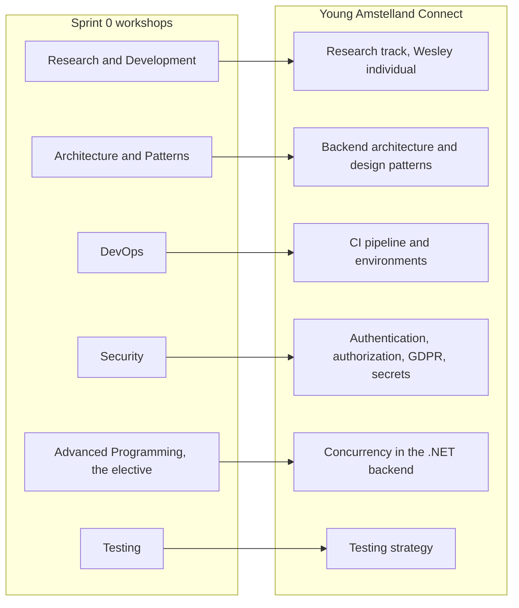

# Workshop coverage, Young Amstelland Connect

This document serves the HvA level 3 criteria Analysis & Advice (AA) and Design & Realisation
(OR). It is grounded in the six sprint 0 workshops' own material, the level 3 datapoint sheet
from the study manual, and the project team's own documents: `requirements.md`, `techStack.md`,
`infrastructure.md`, `codeConventions.md`, and `../research/proposal.md`. Every gap below
carries an owner and a date. The four gaps this document found real, sections 2, 3, 5, and 6
below, now carry a researched proposal each, `architecture.md`, the extended pipeline section
of `infrastructure.md`, `../research/advancedProgramming.md`, and `testingStrategy.md`, all
dated 2026-09-23. Every one stays a proposal, confirmed or redirected by the team or by
Wesley, not a decision taken here.

## Why this document exists

Each of the six sprint 0 workshops names something the project has to implement in some form,
not necessarily the same software the workshop demonstrates but the same kind of thing.
Wesley's own framing, 23 September 2026: a workshop that shows Kubernetes and Terraform does
not mean Connect needs Kubernetes and Terraform, it means Connect needs a pipeline, an
environment story, and a rollback plan of some shape. This document reads each workshop that
way, names what it concretely asks for, checks it against what the team has already written,
and states honestly where nothing has been written yet.

The six workshops ran across the three weeks of sprint 0, per the study manual's "Sprint 0,
week by week" section: Research and Development and Architecture & Patterns in week 1, DevOps
and Security in week 2, Advanced Programming (the chosen elective, T009) and Testing in week 3.
This document follows that order.

*Figure: the six sprint 0 workshops mapped to the project area each one asks Connect to have an
answer for.*

## 1. Research and Development (R&D)

**What the material asks for.** `rd_workshop.pdf`'s stated learning outcome: "Student can
analyse an IT-related problem, make a research plan for it, carry out the research and report
the results." To demonstrate it, a student writes a proposal with five elements (title, a
problem statement of at most half an A4, research questions, research methods, three
references), carries out the experiment, and writes a scientific report reviewed by a peer.
Research questions have to be answerable and reproducible, not "what is" questions: the
material's own example of a bad question is "What is a merge sort?" and a good one is "How does
the execution time of insertion sort and merge sort change when the size of a randomly ordered
integer array increases from 1,000 to 20,000 elements?" [example from the R&D workshop
material, not our case]. This is the level 3 differentiator, per the study manual: level 2
carries no R&D datapoint at all.

**How Connect implements it.** Wesley's individual research track, not a team deliverable.
`../research/proposal.md` proposes exactly the shape the material asks for: a problem statement
grounded in Connect's own profile and matching modules ("Entity Framework Core gives us more
than one way to load that related data"), a main question and three sub-questions on eager
versus lazy loading query counts and response time, a reproducible method (a seeded ASP.NET
Core API measured with EF Core query logging and k6 load tests across five data volumes), and a
literature list of two Microsoft Learn pages and one Fowler article. `../research/topicCandidates.md`
records the two alternative topics weighed against the rubric before this one was picked.

**Evidence and datapoint.** `../research/proposal.md` and `../research/topicCandidates.md` are
candidate AA evidence for the **Research & Design** datapoint, sprint 1, learning outcome
Analysing & Advising. The finished report and its peer review, once written, are the evidence
for **Review of R&D Report**, sprint 3, feedback from a fellow student and a teacher.

**Gap.** The proposal is a draft. `../research/proposal.md`'s own header says so: "awaiting
Wesley's own review... It has not gone to Portflow yet." The experiment itself, the seeded
API and the k6 measurement, has not been built. Submitting the reviewed proposal to Portflow,
and building and running the experiment, stays open, owned by Wesley. The Portflow proposal and
report deadlines are not in any material this repository holds (`../research/inputsNeeded.md`,
question 4), so the working date is sprint 1, before the draft to the learning group teacher
due 5 October 2026.

## 2. Architecture & Patterns

**What the material asks for.** `architecture_design_pattern_workshop_intro (1).pdf` states two
concrete deliverables for the course: "Propose and document a clear architecture (e.g. layered,
MVC, hexagonal/clean)" with "at least one architecture diagram (packages/components, layers)"
kept "roughly in sync with the code", and "Apply at least 3 meaningful patterns such as
Strategy, Observer, Decorator, Factory Method, Repository, Adapter", documenting for each one
where it is used and why it is appropriate, or alternatively demonstrating knowledge of
standard patterns through the provided exercises. `whoNeedsArchitect.pdf` (Fowler, 2003) is the
reading behind the slide's definition of architecture as "the highest level concept of the
expert developers" of a system, the shared understanding of how it divides into components. The
same slide deck also teaches SOLID (single responsibility, open-closed, Liskov substitution,
interface segregation, dependency inversion) as the reasoning behind why patterns exist at all.
`patterns_material_exercises.zip` carries four starter projects (Observer, Strategy, Factory,
State) as the fallback route if a pattern is not naturally used in the project.

**How Connect implements it.** `techStack.md`'s decision diagram already draws a three-layer
shape, React frontend, ASP.NET Core API, Microsoft SQL Server, and `codeConventions.md` names
"established best practices of the language and framework in use" plus SOLID as holding
regardless of stack. Neither document names a specific architectural style (layered, MVC,
hexagonal) for the ASP.NET Core backend, and no design pattern has been chosen yet for any
module.

**Evidence and datapoint.** `techStack.md`'s three-layer diagram is a starting point, not the
"at least one architecture diagram (packages/components, layers)" the material asks for. Once
written, an architecture document and the pattern choices are AA and OR evidence for
**Security & Architecture**, sprint 1, Designing & Realising.

**Gap.** Real, and this is the one the task briefing anticipated correctly. Neither an
architectural style (layered, MVC, hexagonal/clean, or something else) nor any design pattern
has been chosen for the .NET backend. `architecture.md` drafted a proposal on 2026-09-23: a
layered architecture with the dependency inversion principle applied to the persistence layer,
argued against MVC alone, microservices, event-driven, and full hexagonal or Clean
Architecture, with a component diagram and three design patterns proposed against real Connect
modules, Repository, Dependency Injection, and Strategy for the matching module (FR2).
Confirming or redirecting the proposal is still the team's decision, due at sprint 1 planning,
week of 21 September 2026, the same date `requirements.md` and `codeConventions.md` already
carry their own stack-specific TBDs against. Two pieces of that proposal are no longer open:
Wesley Oerlemans decided on 2026-09-24, recorded in `architecture.md` and `infrastructure.md`,
that the presentation layer is Minimal API endpoints, not controllers, and that the backend
reads and writes one shared database, not one per module. What stays open is the rest of the
layered shape and the three patterns.

## 3. DevOps

**What the material asks for.** `Level3_DevOps_Advanced_Workshop_DLO.pdf` is explicitly the
Level 3 "Advanced Track", covering "Release onward, production practices, not just automation"
on top of a foundation pipeline of "commit, lint, test, build, deploy". Concretely: a chosen
branching strategy (trunk-based or GitFlow), a "complete pipeline" with analysis and scan gates
before build and deploy, a documented rollback path, secrets management that separates
pipeline-time secrets from runtime secrets, container orchestration (the demo uses Kubernetes:
pods, deployments, services), infrastructure as code ("Write, Plan, Review, Apply"), and an
observability stack: metrics and dashboards (Prometheus, Grafana, Alertmanager) plus
centralized logging (Promtail shipping to Loki). Two deliverables are named: a screen recording
of the full pipeline running end to end, and a live demo including a real rollback.

**How Connect implements it.** `infrastructure.md` already covers the branching strategy
(`codeConventions.md`'s feature branch into `dev`, `dev` into protected `main`, which is
trunk-based in shape) and proposes a three-stage GitLab CI pipeline, build then test then
deploy, gated on merge request approval, plus an environments story of local development, one
shared test environment, and production. Secrets handling is proposed too: ASP.NET Core's
user-secrets tooling locally, the hosting platform's own environment variable store in test and
production, connection strings and the four external-service credentials named in the client's
diagram never committed to the repository.

**Evidence and datapoint.** `infrastructure.md`'s CI pipeline, environments diagram, and
secrets handling proposal are AA and OR evidence toward **DevOps & Testing**, sprint 2,
Designing & Realising, once the team confirms them at sprint 1 planning.

**Gap.** The material's Advanced-track items beyond the basic build-test-deploy pipeline are
not addressed. `infrastructure.md`'s proposed pipeline has no analysis or scan gate (the
workshop's SonarCloud- and Trivy-equivalent step) and no documented rollback path. None of the
three hosting options in `infrastructure.md` (a single VPS, Azure for Students, or a hybrid)
runs a Kubernetes cluster, which is consistent with a five-student team whose DevOps experience
is recorded as TBD for everyone in `techStack.md`, and it is also the reasoning behind the
proposed decision: container orchestration and infrastructure as code are proposed as out of
scope for this project's size, not merely unanswered. `infrastructure.md`'s extended pipeline
section drafted a proposal on 2026-09-23 for the rest: a scan gate using `dotnet package list
--vulnerable` and `npm audit` rather than GitLab's own Ultimate-tier dependency scanning, a
rollback path sized to a single hosting tier (redeploy the previous build, not blue-green or a
feature flag), and a lightweight observability proposal, ASP.NET Core health checks, structured
`ILogger` logging, and a free-tier external uptime check, in place of the workshop's own
Prometheus, Grafana, and Loki stack. Infrastructure as code is not proposed for any of the
three hosting options, since none of them is a cluster a Write-Plan-Review-Apply tool would
manage. Container orchestration is no longer a one-line dismissal: `infrastructure.md`'s
"Container orchestration, checked against this project's shape" subsection runs an
applicability check against Connect's own single-VPS shape, and, since the check finds no
cluster for an orchestrator to manage, sets out an optional study-points path, containerizing
the backend and frontend, Docker Compose on the VPS as the practical step, and single-node k3s
as the demonstration step if the team wants the Advanced Track's own evidence. Confirming the
pipeline proposal, and whether the team pursues that optional path, is still the team's
decision, due at sprint 1 planning, week of 21 September 2026, alongside the hosting decision
`infrastructure.md` already carries as TBD.

## 4. Security

**What the material asks for.** `Introduction_to_Security_for_Software_Engineers.pdf` frames
security as "a normal part of software engineering, not a final gate," structured around four
properties (confidentiality, integrity, availability, accountability) and a shared vocabulary
of asset, threat, vulnerability, and control. Six everyday risk categories are named directly:
access control ("Check permission server-side for each protected action"), unsafe input
("parameterised queries, validation, and safe APIs"), authentication ("established identity
libraries and protocols"), secrets ("Keep keys out of code, logs, and client applications"),
dependencies ("Update, review provenance, and patch based on risk"), and availability ("Set
limits, rate-limit, and monitor resource use"). The session's mini threat model exercise walks
a document-sharing scenario through assets, threats, impact, and controls, and its debrief
names five engineering principles: server-side authorization, least privilege, secure
defaults, defense in depth, and design for response.

**How Connect implements it.** `requirements.md` already carries NFR1 (Authentication and
authorization, "with authorization rules that govern what each role can see and change,
including on the profiles and community interaction modules that hold minors' data") and NFR2
(a GDPR footing, since the user base spans ages 15 to 30 and some users are minors). `techStack.md`'s
"Non-functional weight: security and privacy" section weighs the stack decision itself toward
"clear, well-documented patterns for authentication, authorization, and input handling" and
names Kelvin van Voorst, the team's Security Specialist, as owning the review. `infrastructure.md`'s
secrets handling proposal matches the workshop's "Keep keys out of code, logs, and client
applications" line directly: connection strings and external-service credentials held outside
the repository, in user-secrets locally and the hosting platform's own store elsewhere.

**Evidence and datapoint.** NFR1 and NFR2 in `requirements.md`, the security weighting in
`techStack.md`, and the secrets proposal in `infrastructure.md` are AA and OR evidence toward
**Security & Architecture**, sprint 1, Designing & Realising, and, re-checked against the
finished application, toward **Review of Security & Testing**, sprint 4. They also feed Kelvin
van Voorst's own **Security requirements and risk framing** datapoint, Analysing & Advising at
Level 2 in BoKSA's own Security Specialist wording, due now per the Security Specialist
datapoint sheet he shared 2026-09-24.

**Gap.** The authorization design itself, not the requirement naming it, is not written yet.
This is not a new gap: `requirements.md` already carries it as an owned TBD. "The specific
authorization design, including whether minors' profiles are restricted differently from adult
users' profiles. Owner: Kelvin van Voorst. Due: at the latest the sprint 1 review, week of 5
October 2026." No document in the repository yet runs the workshop's own mini-threat-model
exercise (assets, threats, impact, controls) against a Connect scenario, such as a profile page
or the matching feature.

The NFR1 authorization design stays open, owned by Kelvin van Voorst and due at the latest the
sprint 1 review, week of 5 October 2026, per `requirements.md`. It is fed by his own **Security
requirements and risk framing** datapoint, identifying the security requirements, key assets
and main risks for the team's project and building on Domain I (Human, Organisational &
Regulatory) and the Secure Software Lifecycle workshop, due in the current weeks, 21 and 28
September 2026, per the Security Specialist datapoint sheet Kelvin shared 2026-09-24. A threat
model for at least one Connect feature, run the way the workshop's own exercise runs one, stays
open too, also owned by Kelvin, but is separate: his **Threat Model** datapoint, DFD plus
STRIDE, lands weeks of 19 and 26 October 2026, sprint 2, not the sprint 1 review.

Once the design is realized in the codebase, the issue mapping document tracks it as two
separate labeled issues rather than one: Kelvin's own Security Specialist Level 2 design work,
and the full-stack team's Level 3 realization of that same design. The split follows BoKSA's
own level distinction on its Designing & Realising pages (HBO-ICT, n.d.-a, n.d.-b), applying a
given method competently within one frame at Level 2 against choosing and justifying the
approach across more than one stakeholder view at Level 3, so the two pieces of work are
tagged, and claimed, at the level each actually reaches.

## 5. Advanced Programming (the elective)

**What the material asks for.** `advanced_programming.pdf` compares imperative/object-oriented
and functional programming styles in Java, then turns to concurrency: "Race conditions: outcome
depends on timing", "Deadlocks: tasks waiting forever on each other", and why "pure functions
don't depend on shared mutable state" while "immutable data can be safely shared between
threads". The companion exercise, `exercise_race_condition.docx`, has the student run a Java
program with a genuine race condition (`counter++` from two threads, unsynchronized), observe
that the actual result "is often less than the expected value", then fix it three ways:
`synchronized`, `AtomicInteger`, and a redesign that avoids shared mutable state entirely by
giving each thread its own local count and combining the results afterward. The exercise closes
by asking which version the student would trust in a real system and how the shift from "shared
mutable state and locks" to "local state and combining results" connects to the paradigms.

**How Connect implements it.** This is the elective workshop, per T009 and the study manual's
mandatory/elective table, and per the level 3 sheet its evidence route is the three Custom
Datapoints in sprints 2, 3, and 4 ("review of elective work"), each one decided at the start of
the sprint it falls in rather than fixed now. Connect's backend runs C# and ASP.NET Core, not
Java, so the material's own concepts, not its language, are what have to carry over: shared
mutable state under concurrent access, and the same three-way choice the exercise walks (lock
around it, use an atomic or thread-safe primitive, or redesign to avoid sharing it) has direct
C# equivalents, `lock`, `Interlocked` or the .NET concurrent collections, and immutable or
per-request state.

**Evidence and datapoint.** Whatever the elective demonstration turns out to be, it feeds the
**Custom Datapoint** for that sprint, learning outcome variable, per the level 3 sheet.

**Gap.** No document in the repository names a concurrency or shared-state risk in Connect's
own backend. ASP.NET Core handles each HTTP request on its own thread by default, and Entity
Framework Core's `DbContext` is documented as not thread-safe, which is exactly the kind of
shared-mutable-state risk the workshop's exercise demonstrates, applied to the framework Connect
is actually built on rather than to the exercise's own counter. Neither `requirements.md` nor
`techStack.md` nor `infrastructure.md` mentions it, and the concurrency angle of Wesley's own
R&D proposal (`../research/proposal.md`) is about query count and response time under load, not
about a shared-state race the way this workshop teaches it. `../research/advancedProgramming.md`
drafted a plan on 2026-09-23: the chosen risk is a check-then-act race on event capacity (FR6),
two concurrent registrations both reading an open spot before either writes back, planned
against the exercise's own three-way fix, a `SemaphoreSlim` lock, an EF Core optimistic
concurrency token, and a redesign that derives capacity from a count of registration rows
instead of a mutable counter. Which sprint's Custom Datapoint this becomes is still Wesley's
call, per T009, owned by him since Advanced Programming is his elective, and due at the start
of sprint 2, following the same "decided at the start of the sprint it falls in" rule T009
already sets for the elective's demonstration.

## 6. Testing

**What the material asks for.** No slide deck exists for this workshop, only `testing-example.zip`,
a working Next.js todo application. Its own `README.md` states the point directly: "This project
is a small Todo app used to demonstrate three layers of testing: **Unit tests**
(`lib/todos.ts`) test pure logic functions in isolation, no DOM, no network. **Integration
tests** test pieces wired together: the API route exercising the pure logic plus in-memory
state, and the TodoList component exercising React state plus a mocked `fetch`. **End-to-end
tests** (`cypress/e2e/todo.cy.ts`) drive the real app in a real browser against the real dev
server." The `package.json` separates the three layers into their own commands
(`test:unit`, `test:integration`, `test:e2e`, `test:e2e:ci` for a headless CI run), and Cypress
is the e2e tool, Vitest with Testing Library the unit and integration tool.

**How Connect implements it.** `codeConventions.md` requires "Unit tests for new code" and "A
passing linter" as part of what holds regardless of stack, and lists "Test framework" among the
stack-specific conventions still to be filled in. `infrastructure.md`'s proposed CI pipeline
names a Test stage ("linter, npm test, dotnet test") that runs on every merge request. Neither
document names which testing layers Connect's own test suite will have, or which tools cover
each layer for React and ASP.NET Core the way the example repository's three commands do for
Next.js.

**Evidence and datapoint.** The CI Test stage in `infrastructure.md` and the unit-testing
requirement in `codeConventions.md` are the only testing content written so far, and are AA and
OR evidence toward **DevOps & Testing**, sprint 2, Designing & Realising, and, re-checked later,
**Review of Security & Testing**, sprint 4.

**Gap.** Real, and confirmed rather than assumed. No document in the repository sets out a
testing strategy: which layers Connect tests (unit, integration, end-to-end, the same three the
example repository demonstrates), which tool covers each layer on the React side and the
ASP.NET Core side, or how the CI Test stage in `infrastructure.md` enforces more than "npm test,
dotnet test" as a placeholder. `testingStrategy.md` drafted a proposal on 2026-09-23, decided in
part on 2026-09-24: NUnit for backend unit and integration tests, FluentValidation for request
validation with its validators tested in plain NUnit, no FluentAssertions, and Vitest and
Playwright confirmed as already proposed, each mapped to a concrete Connect module (event
capacity, matching, authorization, profiles). What stays open, owned by the whole team and due
at sprint 1 planning, week of 21 September 2026: React Testing Library or an alternative for
frontend integration tests, the module-by-module test plan, how the E2E suite fits the
pipeline's timing, a coverage ambition tied to the Definition of Done rather than a blanket
percentage, and `codeConventions.md`'s own "Test framework" line beyond naming the decided
tools.

## Datapoints, gathered

Crossing the six workshops against the level 3 profile sheet's "What each workshop feeds"
table. Once the team's GitLab issues exist, the issue mapping document is the route from each
Connect evidence entry below down to the labeled issue and merge request that produced it,
found by filtering the board on the datapoint's own outcome label rather than reconstructed
from memory at the sprint review:

| Workshop | Datapoint | Sprint | Learning outcome | Connect evidence so far |
| --- | --- | --- | --- | --- |
| Research (R&D) | Research & Design | 1 | Analysing & Advising | `../research/proposal.md`, `../research/topicCandidates.md` (draft) |
| Research (R&D) | Review of R&D Report | 3 | variable, peer and teacher | not yet written |
| Architecture & Patterns | Security & Architecture | 1 | Designing & Realising | `architecture.md` (proposal: layered plus DIP, component diagram, three patterns) |
| Security | Security & Architecture | 1 | Designing & Realising | `requirements.md` NFR1 and NFR2, `techStack.md` security section, `infrastructure.md` secrets proposal |
| Security | Review of Security & Testing | 4 | variable | none yet, re-check owned and dated, Open questions item 7 |
| DevOps | DevOps & Testing | 2 | Designing & Realising | `infrastructure.md` CI pipeline, environments, secrets, scan gate, rollback, observability (all proposals) |
| Testing | DevOps & Testing | 2 | Designing & Realising | `testingStrategy.md` (NUnit, FluentValidation, Vitest, and Playwright decided 2026-09-24, React Testing Library and the module test plan still proposal) |
| Testing | Review of Security & Testing | 4 | variable | none yet, re-check owned and dated, Open questions item 7 |
| Advanced Programming | Custom Datapoint | 2, 3, 4 | variable | `../research/advancedProgramming.md` plans sprint 2 only, sprints 3 and 4 owned and dated, Open questions item 8 |

## Open questions, gathered

Every TBD in this document, in one place:

1. Submitting the reviewed research proposal to Portflow and building the experiment. Owner:
   Wesley. Due: sprint 1, before the draft to the learning group teacher 5 October 2026.
2. Confirming or redirecting `architecture.md`'s proposed architectural style, component
   diagram, and three design patterns. Owner: the whole team. Due: sprint 1 planning, week of
   21 September 2026.
3. Confirming or redirecting `infrastructure.md`'s proposed scan gate, rollback path, and
   observability setup, confirming that infrastructure as code stays out of scope for a
   five-student team on a single VPS, and, for container orchestration, deciding whether the
   optional study-points path in `infrastructure.md`'s "Container orchestration, checked
   against this project's shape" subsection is worth pursuing. Owner: the whole team. Due:
   sprint 1 planning, week of 21 September 2026.
4. The NFR1 authorization design. Owner: Kelvin van Voorst. Due: at the latest the sprint 1
   review, week of 5 October 2026, fed now by Kelvin's own Security requirements and risk
   framing datapoint, due weeks of 21 and 28 September 2026 per the Security Specialist
   datapoint sheet he shared 2026-09-24. A threat model for at least one Connect feature, DFD
   plus STRIDE, is Kelvin's separate Threat Model datapoint and lands weeks of 19 and 26 October
   2026, sprint 2, corrected 2026-09-24 from an earlier assumption that it fell at the sprint 1
   review.
5. Confirming `../research/advancedProgramming.md`'s chosen risk, the event capacity race, and
   deciding which sprint's Custom Datapoint it becomes. Owner: Wesley. Due: start of sprint 2.
6. Confirming React Testing Library or an alternative for `testingStrategy.md`'s frontend
   integration tests, and the module-by-module test plan. NUnit, FluentValidation, Vitest, and
   Playwright are decided as of 2026-09-24. Owner: the whole team. Due: sprint 1 planning, week
   of 21 September 2026.
7. Re-checking the Security & Architecture and DevOps & Testing evidence against the finished
   application, once it exists, for the sprint 4 **Review of Security & Testing** datapoint.
   Owner: the whole team. Due: start of sprint 4 (week of 7 December 2026, per the study
   manual's anchored calendar).
8. Settling what sprints 3 and 4's Custom Datapoints review, since
   `../research/advancedProgramming.md` plans only one sprint's worth of elective evidence and
   the level 3 sheet names three. Owner: Wesley. Route: ask coach Karthik Srinivasan whether
   one elective legitimately covers all three Custom Datapoints or each needs its own piece of
   evidence. Ask by: Thursday 24 September 2026.

## Examples to replace

- The R&D workshop's own good/bad research-question example (merge sort versus insertion
  sort execution time), in section "1. Research and Development (R&D)" above. Once Wesley's
  own research question in `../research/proposal.md` is reviewed and submitted to Portflow,
  this can point to that question instead of the workshop's generic pair. Owner: Wesley.

## References

Fowler, M. (2003). Who needs an architect? *IEEE Software, 20*(4), 2–4.

HBO-ICT. (n.d.-a). *Designing & realising*. BoKSA. Retrieved September 24, 2026, from
https://boksa.hbo-ict-hva.nl/profiles/full-stack-developer/design-and-realise/

HBO-ICT. (n.d.-b). *Designing & realising*. BoKSA. Retrieved September 24, 2026, from
https://boksa.hbo-ict-hva.nl/profiles/security-specialist/design-and-realise/

Hogeschool van Amsterdam. (2026a). *Introduction to security for software engineers* [Course
document].

Hogeschool van Amsterdam. (2026b). *Level 3 DevOps advanced workshop* [Course document].

Hogeschool van Amsterdam. (n.d.-a). *Advanced programming: Comparative paradigms and
concurrency* [Course document].

Hogeschool van Amsterdam. (n.d.-b). *Architecture & design patterns workshop* [Course
document].

Hogeschool van Amsterdam. (n.d.-c). *Fixing a race condition in Java* [Course document].

Hogeschool van Amsterdam. (n.d.-d). *Testing-example* [Course document, example repository].

## AI use declaration

AI was used as a writing support tool while working on this document. We used AI to draft
the formulation of sentences, the structure of wording, readability, and clarity from
content that we had provided, and to generate the diagrams. The content itself, including
our experiences, reflections, learning goals, decisions, self-assessments, and
conclusions, is our own. We reviewed the drafts and decided as a team which text to
include.
