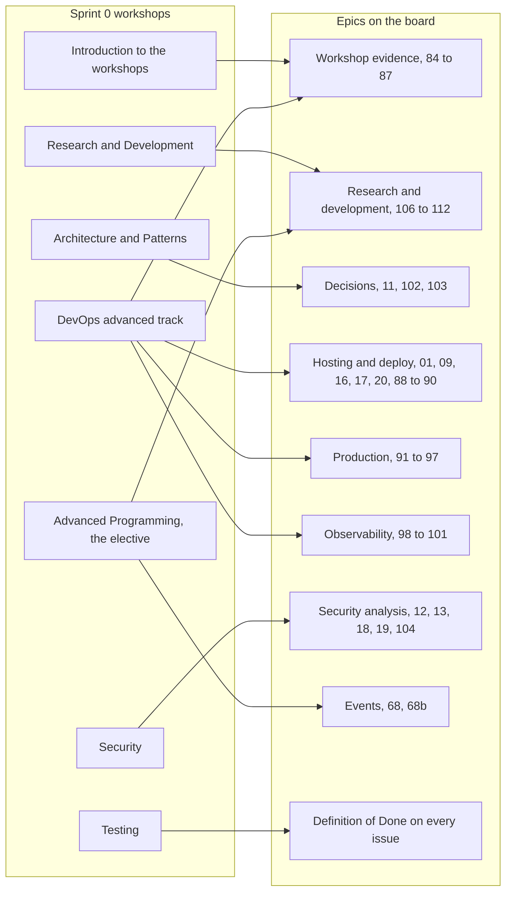
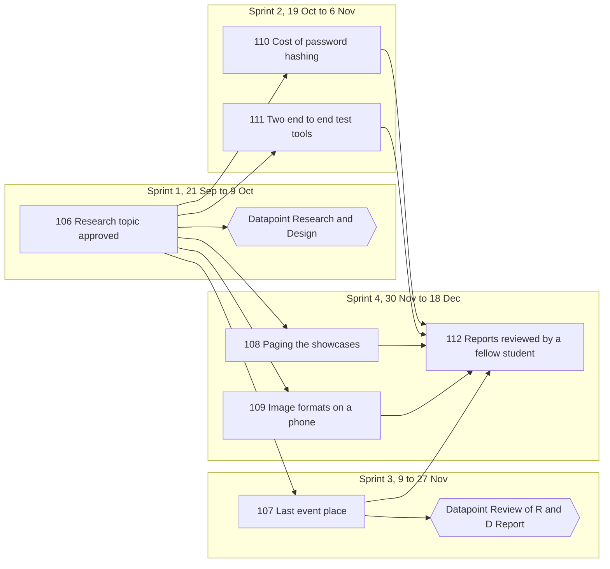

# Workshop coverage, Young Amstelland Connect

This document serves the HvA level 3 criteria Analysis & Advice (AA) and Design & Realisation (OR). It lists, per requirement of each sprint 0 workshop, the issues on the board that now cover it. It is grounded in the workshop material itself, the level 3 datapoint sheet from the study manual, and the board of 27 September 2026 with 227 issues in 21 epics.

## History of this document

The first version was written on 22 to 25 September 2026, before the board was finished. It checked each workshop against the team documents of that time and found four real gaps: no architectural style and no design patterns chosen, no testing strategy, no concurrency risk named for the elective, and most of the DevOps advanced track not addressed. At that time the team proposed to keep container orchestration and infrastructure as code out of scope, because the project had one small server.

On 27 September 2026 Wesley decided that the school requirements are met in full, even when that is more work. Production runs on k3s on the client's server, set up with Terraform. The test site stays on docker compose. The team then compared every workshop item with the board, item by item, and added 29 issues, 84 to 112, that exist only because of school. Each of them carries the label school::required and a part SCHOOL REQUIREMENT that names the workshop and says the foundation did not ask for it. Rule A5 of the rulebook got an exception for exactly these issues, see [issueRules.md](../team/issueRules.md).

This version replaces the old gap lists with the issues that now cover each requirement.

## Why this document exists

Each sprint 0 workshop names something the project has to show in some form. It does not have to be the same software the workshop demonstrates, but it has to be the same kind of thing. Wesley's own framing, 23 September 2026: a workshop that shows Kubernetes and Terraform does not by itself mean Connect needs Kubernetes and Terraform, it means Connect needs a pipeline, an environment story and a rollback plan of some shape. The decision of 27 September goes one step further for DevOps: the team now does use k3s and Terraform, because the advanced track grades orchestration and infrastructure as code.

This document reads each workshop that way, names what it asks for, and points to the issue and task that delivers it. An assessor or a teammate can follow each row to the issue in GitLab. The GitLab number of every board number is in [boardNumbers.md](../team/boardNumbers.md). In the tables below a GitLab number is written after the board number, for example 92 (#156).

The workshops ran across the three weeks of sprint 0, per the study manual: Research and Development and Architecture & Patterns in week 1, DevOps and Security in week 2, Advanced Programming (the chosen elective, T009) and Testing in week 3. The general introduction to the workshops comes first below, then the workshops in that order.

*Figure: the sprint 0 workshops and the epics on the board that answer them.*

## How to read the tables

- **Required** means the material says students must do it. **Example** means the material shows one way and says an equivalent is fine. **Elective** means it applies only to a student who chose that elective.
- **Covered by** names the issue and, where it matters, the task. The Definition of Done in [definitionOfDone.md](../team/definitionOfDone.md) counts as board coverage, because every issue carries the list of its type.
- **Sprint** is the sprint the issue is planned in (sprint 1 runs 21 September to 9 October 2026, sprint 2 19 October to 6 November, sprint 3 9 to 27 November, sprint 4 30 November to 18 December, sprint 5 4 to 8 January 2027). "1-stretch" means sprint 1 when time allows.
- **Outside** means an individual school duty that does not belong on a team board. No issue covers it.

## 0. Introduction to the workshops

**What the material asks for.** At level 3 a student does the workshops R&D, Testing, Security, DevOps and Architecture & Patterns, and chooses one elective: Programming, AI in IT or General SE. How a student shows each topic is free: in the project, a course, research or exercises. Proposals go in the personal development plan, all evidence goes in the portfolio, and the work happens as much as possible on GitLab with a sprint board, stand ups and retrospectives. Two knowledge tests on the BoKSA domain are scheduled by school.

| Requirement | Kind | Covered by | Sprint |
|---|---|---|---|
| Choose one elective and record it | Required | 85 (#37) The coach sees per student which issue proves which workshop, task 85.1 (the elective of each student as a decision file) | 1 |
| Show per student which work proves each workshop | Required | 85 (#37), tasks 85.2 (the table student by workshop, with thin cells marked) and 85.4 (the table reviewed with the coach at mid-term) | 1 |
| Write the proposals per workshop in the personal development plan | Required | Outside. Each student copies their row of the table of 85 into their own plan | |
| All evidence goes in the portfolio | Required | Every task has a proof block "Where it goes: the merge request, linked in Portflow" (rule E2), and the Definition of Done line "The BoKSA proof that each task asks for is in the merge request, ready for Portflow" | all |
| Work on GitLab, with commits | Required | 01 (#1) The repository, the pipeline and the team rules, tasks 1.2 and 1.8, and the commit line of the Definition of Done | 1 |
| Sprint board and stand ups | Required | 01 (#1) task 1.3, one board per sprint in [gitlabSetup.md](../team/gitlabSetup.md), and the review lines of the Definition of Done | 1 |
| A retrospective every sprint | Required | 85 (#37) task 85.3 (a short retrospective at the end of every sprint, written in the milestone) | 1 |
| Two knowledge tests on the BoKSA domain | Required | Outside. Scheduled by school, individual | |

## 1. Research and Development (R&D)

**What the material asks for.** The stated learning outcome of rd_workshop.pdf: "Student can analyse an IT-related problem, make a research plan for it, carry out the research and report the results." Every student writes an own proposal with a title, a problem statement of at most half an A4, a main question with one or two sub-questions, methods and three references. The topic is applied and answerable, never a "what is" topic. The material's own example of a bad question is "What is a merge sort?" [example from the R&D workshop material, not our case]. The student builds a repeatable experiment, writes a scientific report, and reviews the report of a fellow student with the school's peer review form. This is the level 3 differentiator, per the study manual: level 2 carries no R&D datapoint.

**How Connect covers it.** The epic Research and development. Issue 106 gets every proposal approved. Issues 107 to 111 are five candidate topics taken from parts of Connect that are already being built, one per student. A student may take an own topic instead: then the team makes a new research issue in this epic with the same tasks as 107 (issue 106, description). Issue 112 pairs the peer reviews.

| Requirement | Kind | Covered by | Sprint |
|---|---|---|---|
| Choose an applied topic, not a "what is" topic, judged against the topic rubric | Required | 106 (#38) Each student's research topic approved, tasks 106.1 and 106.2 | 1 |
| Proposal with title, problem statement, questions, methods and three references | Required | 106 (#38) task 106.2, written in docs/research/proposals/ | 1 |
| Proposal handed in on Portflow, reviewed by a teacher, revised when needed | Required | 106 (#38) task 106.3, and task 106.4 writes the approved topics in one decision file | 1 |
| A repeatable experiment with an artefact | Required | One per student: 107 (#187) Three ways to give out the last event place, measured. 108 (#188) Two ways of paging the showcases, measured. 109 (#189) Image formats for project pictures, measured on a phone. 110 (#190) The cost of password hashing, measured (a good fit for the security specialist). 111 (#191) Two end to end test tools compared on one flow | 110 and 111 in 2, 107 in 3, 108 and 109 in 4 |
| Scientific report: abstract, background with peer reviewed sources, method, results, conclusion with limitations, APA or IEEE | Required | Task 4 of each of 107 to 111 (the scientific report, handed in on Portflow) | 2 to 4 |
| Graded with the assessment form | Required | Outside. Filled in by the teacher | |
| Review another student's report with the peer review form, the form in both portfolios | Required | 112 (#192) Every research report reviewed by a fellow student, tasks 112.1 to 112.3 | 4 |

**History.** On 23 September Wesley drafted a proposal of his own on eager and lazy loading in Entity Framework Core. The board now routes every proposal through issue 106. Whether Wesley keeps that topic as an own topic or takes one of 107 to 111 is decided in 106 task 106.1.

**Schedule.** On 27 September 2026 the research moved earlier, to follow the level 3 datapoint sheet, which puts **Research & Design** in sprint 1 and **Review of R&D Report** in sprint 3. Issue 106 is now in sprint 1, so the proposals are ready for the Research & Design datapoint. The experiments that do not wait on a feature come early: 110 and 111 in sprint 2, 107 in sprint 3 right after 68b A full event refuses a place fairly. Issues 108 and 109 stay in sprint 4 because they measure features that are built in sprint 4: 108 measures 63 Browse all showcases, and 109 measures 61b Add an image to my project and 64 Open a project page. The peer review 112 waits for the reports, so it is in sprint 4 too.

The chart below shows in which sprint each research issue is planned, next to the two R&D datapoints.

*Figure: the research issues per sprint, with the two R&D datapoints of the level 3 sheet.*

**Still open.**
- The reports of 108 and 109 and the peer review 112 fall in sprint 4, after the Review of R&D Report datapoint in sprint 3. Which reports that datapoint reviews is checked with the R&D teacher in 106. The Portflow deadlines are not in any material the team holds.
- The board has five topics for five students. Per the study manual, level 2 carries no R&D datapoint, and [techStack.md](../architecture/techStack.md) records Bayon Eerhart at Full-Stack level 2 and Kelvin van Voorst at Security Specialist level 2. Which students actually take a research issue is decided in 106 task 106.1. A topic that nobody takes is marked as not taken this semester (issue 106, description).

## 2. Architecture & Patterns

**What the material asks for.** architecture_design_pattern_workshop_intro (1).pdf asks to "Propose and document a clear architecture (e.g. layered, MVC, hexagonal/clean)" with "at least one architecture diagram (packages/components, layers)" kept "roughly in sync with the code". It asks to "Apply at least 3 meaningful patterns such as Strategy, Observer, Decorator, Factory Method, Repository, Adapter", each documented with where it is used and why, and to show how the patterns fit the architecture. The alternative route is the four starter exercises (Observer, Strategy, Factory, State) in patterns_material_exercises.zip, shown to a teacher. The slides also teach SOLID as the reason patterns exist. whoNeedsArchitect.pdf (Fowler, 2003) is the reading behind the definition of architecture as the shared understanding of how a system divides into components.

| Requirement | Kind | Covered by | Sprint |
|---|---|---|---|
| Propose and document a clear architecture | Required, style is an example | 11 (#12) The team agrees on the layered architecture, tasks 11.1 and 11.2, written in [architecture.md](../architecture/architecture.md) | 1 |
| Separate the screen, the business logic and the storage | Required | Four projects Presentation, Application, Domain and Infrastructure, 03 (#14) Create an account task 3.1, with the compiler guard proven in 11 task 11.2 | 1 |
| Justify the key choices | Required | 11 (#12) tasks 11.2 and 11.3 (.NET 10 for every project), decision files in docs/decisions, and the docs line of the Definition of Done | 1 |
| At least one diagram of layers, components or places | Required | 102 (#170) The architecture drawn in layers, parts and places, tasks 102.1 (layer drawing and component drawing) and 102.2 (deployment drawing of the test site and production) | 4 |
| Tie the choices to quality attributes | Required | 102 (#170) task 102.1, each drawing with the quality it protects | 4 |
| Keep the architecture roughly in sync with the code | Required | 102 (#170) task 102.3 (a teammate checks the drawings against the code), and the docs line of the Definition of Done | 4, and every issue |
| At least three real patterns, each with where and why | Required | 103 (#171) The design patterns Connect uses, where and why, tasks 103.1 and 103.2. The candidates the board already names: Repository (03, 11), IMailSender with its mail sender (21 Ask for a password reset link by email), two login providers behind one flow (23 Register or log in with Google, 24 Register or log in with Facebook), OpportunityOpenRule with TimeProvider (54 Post an opportunity) | 4 |
| Show how the patterns fit the architecture | Required | 103 (#171) task 103.2, each pattern placed in the layers of 102 | 4 |
| SOLID behind each pattern | Knowledge | 103 (#171) task 103.2 names the principle each pattern supports | 4 |
| Alternative route: the four pattern exercises | Alternative | 103 (#171) task 103.3, only when fewer than three real patterns are found | 4 |
| Explain a pattern to a teacher | Required | 103 (#171) task 103.4, each student explains one pattern | 4 |
| Reading list and Fowler | Reading | Outside. Used as a source in the proof blocks of 11 and 102 | |

**History.** On 23 September the team proposed a layered architecture with dependency inversion on the storage layer, and three patterns: Repository, Dependency Injection and Strategy for the matching module. On 24 September Wesley Oerlemans decided on Minimal API endpoints instead of controllers, and on one shared database for all modules. Issue 11 now holds the decision on the layered shape. The pattern list is no longer fixed in advance: 103 names only patterns that really solve a problem in the code, because the workshop says "we don't want a pattern just for the sake of it". The Adapter in 83 Pay for my basket only counts when the webshop goes ahead, which the client decides in [clientQuestions.md](../client/clientQuestions.md), question 2.

**Still open.** The level 3 sheet puts **Security & Architecture** in sprint 1. Issue 11 is in sprint 1, but the drawings of 102 and the pattern page of 103 are in sprint 4. For the sprint 1 datapoint the evidence is 11 and the security issues of section 4. The drawings and patterns count at the sprint 4 review.

## 3. DevOps, advanced track

**What the material asks for.** Level3_DevOps_Advanced_Workshop_DLO.pdf is the level 3 "Advanced Track": "Release onward, production practices, not just automation". On top of a foundation pipeline of lint, test, build and deploy it asks for gates that block (static analysis and an image scan), secrets split between pipeline time and run time, container orchestration, infrastructure as code with "Write, Plan, Review, Apply", a production deployment, a rehearsed rollback, and observability: metrics, dashboards, alerts and central logs. Before building starts, each student agrees learning outcomes with the teacher. Two deliverables are graded: a screen recording of the full pipeline to monitored production, and a live demo with a real rollback. Slide 14 says "Example tools throughout, your assignment can use any equivalent", so every tool is an example and every practice is required.

| Requirement | Kind | Covered by | Sprint |
|---|---|---|---|
| Learning outcomes and success criteria agreed with the teacher before building | Required | 84 (#13) The DevOps learning outcomes agreed with the teacher, tasks 84.1 to 84.3 | 1-stretch |
| Foundation pipeline: lint, test, build, deploy | Required | 01 (#1) task 1.4, 03 (#14) tasks 3.8 and 3.9, 20 (#32) Dockerfiles for the server and the frontend, task 20.3 | 1 and 1-stretch |
| A chosen branching strategy, short lived branches, merge by merge request | Required, example strategy | 01 (#1) task 1.2: dev and main protected, main only from dev, one branch per issue, one approval. Written in [codeConventions.md](../team/codeConventions.md) and [gitlabSetup.md](../team/gitlabSetup.md) | 1 |
| Checks must pass before a merge | Required | 01 (#1) tasks 1.2 and 1.5 (a red pipeline blocks the merge, proven once) | 1 |
| Static analysis as a gate that blocks | Required, SonarCloud as example | 88 (#152) The team picks the code quality tool, and 89 (#153) A change that lowers code quality is stopped, task 89.2 (the stage analyze with the job quality-gate that blocks the merge) | 4 |
| Container image scan as a gate | Required, Trivy as example | 16 (#22) A security scan in the pipeline (packages), and 90 (#154) An image with a serious known hole is stopped, task 90.1 (Trivy in the stage scan) | 1-stretch and 4 |
| Secrets at pipeline time, masked and never logged | Required | 09 (#10) Every team member on the client's server, task 9.5, and the code and security lines of the Definition of Done | 1 |
| Runtime secrets referenced by name, never in git | Required | Test site: 09 (#10) task 9.5. Production: 95 (#159) Connect and its database described in Terraform, tasks 95.1 and 95.2, and 173 (#160) Connect sends email through the foundation's mail account on the live site, task 173.1 | 1 and 4 |
| Images pushed to a registry on merge | Required | 20 (#32) task 20.3 | 1-stretch |
| Container orchestration | Required, kind as example | 92 (#156) k3s and Terraform for production, compose for test, and 93 (#157) k3s on the production server | 4 |
| Infrastructure as code: write, plan, review, apply | Required, Terraform as example | 94 (#158) Every production change shown as a plan first, and 95 (#159) | 4 |
| A production deployment from commit to monitored production | Required | 91 (#155) The director agrees where production runs, and 96 (#162) A merge into main goes to production | 4 |
| A rollback, rehearsed before it is needed | Required | Test site: 17 (#23) A health check and structured logs, task 17.4. Production: 97 (#163) Going back to the previous version is practised | 1-stretch and 4 |
| Log levels, and what never goes in a log line | Required | 17 (#23) task 17.2, and the security line on logs in the Definition of Done | 1-stretch |
| Metrics | Required, Prometheus as example | 98 (#164) The server counts its requests and errors | 4 |
| Dashboards | Required, Grafana as example | 99 (#165) One dashboard with the health of Connect | 4 |
| Alerts before users notice | Required, Alertmanager as example | 100 (#166) An email before young people notice a problem | 4 |
| Central logging, searchable next to the metrics | Required, Loki and Promtail as example | 101 (#167) All log lines of Connect in one place | 4 |
| Backups of production data | Production practice | 174 (#161) A backup of the live database | 4 |
| Deliverable 1: screen recording from commit to monitored production | Required | 86 (#168) A recording of one change from commit to production | 4 |
| Deliverable 2: live demo with a rollback and questions on the design choices | Required | 87 (#169) The live demo to the teacher | 4 |

**History.** The first version proposed a three stage pipeline, a scan with dotnet package list --vulnerable and npm audit, a rollback by redeploying the previous build, health checks with structured logging and a free external uptime check. It kept orchestration and infrastructure as code out of scope, with an optional study path of docker compose and single node k3s. Wesley's decision of 27 September 2026 replaced that: the full advanced track is now on the board, with k3s and Terraform on production and docker compose on the test site and on laptops (issue 92). Hosting is no longer an option list. The test site and production both run on the client's server (09, 91).

**Still open.**
- Where production runs on the client's server, on which address, and who gets the alert emails: decided by the client in 91 (#155).
- The code quality tool: decided in 88 (#152), and it follows the tools the teacher agrees in 84 (#13) task 84.3.
- The log shipper: the workshop names Promtail. Issue 101 task 101.2 checks the current Grafana documentation and writes the choice in the issue.
- The level 3 sheet puts **DevOps & Testing** in sprint 2. The evidence that exists by then is the pipeline, the test site, the scan, the health check and the test site rollback (01, 03, 09, 16, 17, 20). The production and observability issues and both graded deliverables are in sprint 4.

## 4. Security

**What the material asks for.** Introduction_to_Security_for_Software_Engineers.pdf frames security as "a normal part of software engineering, not a final gate". It works with confidentiality, integrity, availability and accountability, and with asset, threat, vulnerability and control. Six everyday risks are named: access control ("Check permission server-side for each protected action"), unsafe input ("parameterised queries, validation, and safe APIs"), authentication ("established identity libraries and protocols"), secrets ("Keep keys out of code, logs, and client applications"), dependencies ("Update, review provenance, and patch based on risk") and availability ("Set limits, rate-limit, and monitor resource use"). The class activity is a mini threat model, and the debrief names five principles: server side authorization, least privilege, secure defaults, defence in depth and design for response.

| Requirement | Kind | Covered by | Sprint |
|---|---|---|---|
| Think in assets, threats, vulnerabilities and controls | Required | 12 (#21) Inventory of the personal data per module, tasks 12.1 and 12.2 | 1 |
| Confidentiality, integrity, availability, accountability | Required | 12 (#21) tasks 12.3 to 12.6 | 1 |
| A mini threat model: assets, three to five threats, controls, one open question | Required as practice | 18 (#29) Data flow diagram of profile creation (STRIDE, by the security specialist), and 104 (#172) A threat model of adding an image to a project (by a full-stack student, reviewed by the security specialist) | 1-stretch and 4 |
| Access control checked on the server for every protected action | Required | 13 (#28) The role table per module, and the security line of the Definition of Done "Every server address says who may use it" with a 401 or 403 test | 1, and every issue |
| Unsafe input: parameterised queries, validation, safe APIs | Required | EF Core only in Infrastructure (code line of the Definition of Done), validators in Presentation, and 61b (#180) Add an image to my project (size, type, new random name) | every issue, and 4 |
| Established identity libraries | Required | 03 (#14) task 3.4 (the password hasher of ASP.NET Core Identity), 23 (#46) Register or log in with Google | 1 and 2 |
| Secrets out of code, logs and client apps | Required | 09 (#10) task 9.5, and the code and security lines of the Definition of Done | 1 |
| Dependencies patched by risk | Required | 16 (#22) A security scan in the pipeline, with accepted risks in docs/security/securityExceptions.md | 1-stretch |
| Availability: limits, rate limits, monitoring | Required | Rate limits on single addresses: 28c (#57) Wait a minute before I ask for the confirmation email again, 30 (#60) Wait a minute after five wrong passwords, 30b (#61) Wait a minute after ten tries from one phone or laptop, 31 (#62) Account locked after fifteen wrong passwords. A limit on all addresses: 105 (#185) Connect keeps working under too many requests. A size limit: 105b (#186) A request that is far too large is refused. Monitoring: 98 to 100 | 2 and 4 |
| What must be logged and what never | Required | 17 (#23) task 17.2, the security line on logs in the Definition of Done, and 32 (#92) See who did what on the platform | 1-stretch and 3 |
| Least privilege, secure defaults, defence in depth, design for response | Required as principles | 01 (#1) task 1.3 (the client and the coach as readers), 13 (#28) (a minor is treated more carefully), 32 (#92) (audit trail), 30 and 31 (two layers against guessing) | 1 to 3 |
| Escalate early for sensitive data and minors | Required | 19 (#24) GDPR notes on minors' data, and 12 (#21) task 12.7 | 1 and 1-stretch |
| Personal commitment for the next feature | Example | Outside. Personal reflection for the personal development plan | |

**History.** The first version found the authorization design unwritten and no threat model run the way the workshop runs one. Both are now on the board: the role table in 13 and the threat models in 18 and 104. Issue 104 exists so that a full-stack student also has own threat model evidence, not only the security specialist.

**Still open.** Kelvin van Voorst's own Security Specialist datapoints (Security requirements and risk framing, weeks of 21 and 28 September 2026, and Threat Model with DFD and STRIDE, weeks of 19 and 26 October 2026) come from the datapoint sheet he shared on 24 September. The board covers them with 12 and 18. Whether 18, planned as sprint 1-stretch, is ready in time for his Threat Model datapoint is for the sprint 1 review.

## 5. Advanced Programming (the elective)

**What the material asks for.** advanced_programming.pdf compares imperative and object oriented style with functional style, then turns to concurrency: "Race conditions: outcome depends on timing" and "Deadlocks: tasks waiting forever on each other". The exercise exercise_race_condition.docx runs a Java program where two threads do counter++ without a lock, shows that the result "is often less than the expected value", and fixes it three ways: synchronized, AtomicInteger, and a redesign that gives each thread its own count and combines them afterwards. It closes by asking which version the student would trust in a real system. This is one of three electives and applies only to a student who chose Programming. Per T009 that is Wesley. The Connect server is C#, so the concepts carry over, not the language.

| Requirement | Kind | Covered by | Sprint |
|---|---|---|---|
| Show and explain a race condition on shared mutable state | Elective | 68b (#129) A full event refuses a place fairly: two people pressing Register for the last place at once, task 68b.8 | 3 |
| Fix it with a lock, and name the trade-off | Elective | 68b (#129) task 68b.1 (the locked step that counts the places before it saves), and task 68b.7 (the document that explains why registering is fair) | 3 |
| Fix it with an atomic operation | Elective | 22 (#44) Set a new password through the link, task 22.1 (finish a reset in one transaction with one conditional update), compared with the lock in 107 (#187) | 2 and 3 |
| Avoid shared state by design | Elective | 68b (#129) task 68b.1 counts the registration rows instead of keeping a counter, compared as a design choice in 107 (#187) | 3 |
| Reflect on imperative and functional style, and which fix to trust | Elective | 107 (#187) Three ways to give out the last event place, measured, task 107.5 (the reflection on shared mutable state for the Programming elective) | 3 |
| Record the chosen elective | Required | 85 (#37) task 85.1 | 1 |

**History.** On 23 September the event capacity race (FR6) was chosen as the risk, with three planned fixes: a SemaphoreSlim lock, an EF Core optimistic concurrency token, and counting registration rows instead of a counter. The board keeps the risk. 68b builds the fair registration, and 107 measures three ways against each other: a row lock, an optimistic check and one conditional update.

**Still open.** The level 3 sheet names three **Custom Datapoints**, in sprints 2, 3 and 4, and T009 says each is decided at the start of the sprint it falls in. Since 27 September 2026, 107 is in sprint 3 next to 68b, so the board offers 22 in sprint 2 and 68b and 107 in sprint 3. No Programming issue is planned in sprint 4 for the third Custom Datapoint. The split is Wesley's choice per sprint. Whether one elective may cover all three Custom Datapoints was a question for coach Karthik Srinivasan (to ask by 24 September 2026). No answer is recorded in the team documents. The mid-term review with the coach in 85 task 85.4 is the latest moment to settle it.

## 6. Testing

**What the material asks for.** There is no slide deck, only testing-example.zip, a small Next.js todo app. Its README names three layers: "**Unit tests** ... test pure logic functions in isolation, no DOM, no network. **Integration tests** test pieces wired together ... **End-to-end tests** ... drive the real app in a real browser against the real dev server." The package.json has a separate command per layer and one for a headless run in CI. The tools (Vitest, React Testing Library, Cypress) are an example. The three layers are what the workshop teaches.

| Requirement | Kind | Covered by | Sprint |
|---|---|---|---|
| Unit tests of pure logic, no DOM and no network | Required layer | The tests line of the Definition of Done "Every rule in the code has a unit test", NUnit on the server and Vitest in the frontend, set up in 03 (#14) tasks 3.1 and 3.6 | 1, and every slice |
| Integration tests of an API route with its logic and a real database | Required layer | The tests line of the Definition of Done: WebApplicationFactory with a correct request, wrong input and a person who is not allowed, against a real test database | every slice |
| Integration tests of a screen with a fake server answer | Required layer | The tests line of the Definition of Done: loading, empty, filled and error | every slice |
| End to end test in a real browser against the real app | Required layer | 03 (#14) task 3.7 (Playwright), and one end to end task on every slice | 1, and every slice |
| End to end tests headless in CI | Required | 03 (#14) task 3.9 and 20 (#32) task 20.4, the job e2e-test against the test site after the deploy | 1 and 1-stretch |
| Tests clean up after themselves | Example | docs/testing/testData.md with the seeded test data, and the Definition of Done line that no test is skipped | every slice |

**History.** The first version found no testing strategy at all. On 23 and 24 September the team decided on NUnit for the server, FluentValidation with its validators tested in plain NUnit, no FluentAssertions, Vitest and Playwright. That is written in [testingStrategy.md](../testing/testingStrategy.md). The board now holds the layers in the Definition of Done, so every issue proves them.

**Still open.** Nothing on the board. Testing is also a candidate research topic: 111 (#191) compares Playwright and Cypress on one Connect flow.

## Datapoints, gathered

The six workshops crossed with the "What each workshop feeds" table of the level 3 datapoint sheet. The issues are the route from each datapoint to the merge requests that prove it: filter the tasks of the sprint on their outcome label (see [issueMapping.md](issueMapping.md)).

| Workshop | Datapoint | Sprint of the datapoint | Learning outcome | Issues that feed it |
|---|---|---|---|---|
| Research (R&D) | Research & Design | 1 | Analysing & Advising | 106 (sprint 1) |
| Research (R&D) | Review of R&D Report | 3 | variable, peer and teacher | 110 and 111 (sprint 2), 107 (sprint 3), 108, 109 and 112 (sprint 4) |
| Architecture & Patterns | Security & Architecture | 1 | Designing & Realising | 11 (sprint 1), deepened by 102 and 103 (sprint 4) |
| Security | Security & Architecture | 1 | Designing & Realising | 12, 13 (sprint 1), 18, 19 (1-stretch) |
| Security | Review of Security & Testing | 4 | variable | 104, 105, 105b (sprint 4), and the security and tests lines of the Definition of Done on every finished issue |
| DevOps | DevOps & Testing | 2 | Designing & Realising | 01, 03, 09 (sprint 1), 16, 17, 20 (1-stretch) |
| DevOps | the two graded deliverables | 4 | per the teacher's check-in of 84 | 86, 87, built on 88 to 101 (sprint 4) |
| Testing | DevOps & Testing | 2 | Designing & Realising | the tests lines of the Definition of Done, 03 tasks 3.1, 3.6, 3.7 and 3.9 |
| Testing | Review of Security & Testing | 4 | variable | the same lines on every finished issue, re-checked at the sprint 4 review |
| Advanced Programming | Custom Datapoint | 2, 3, 4 | variable | 22 (sprint 2), 68b and 107 (sprint 3), see section 5 |

## Open points, gathered

1. The reports of 108 and 109 and the peer review 112 are in sprint 4, after the Review of R&D Report datapoint in sprint 3. They stay there because 108 and 109 measure features built in sprint 4. Which reports the datapoint reviews is checked with the R&D teacher in 106.
2. Which students take a research issue, given that level 2 carries no R&D datapoint. Decided in 106 task 106.1.
3. Where production runs, its address and who gets the alerts. Decided by the client in 91.
4. The code quality tool. Decided in 88, after the teacher's check-in in 84.
5. The log shipper that replaces Promtail. Decided in 101 task 101.2.
6. Whether 18 is ready for Kelvin van Voorst's Threat Model datapoint in the weeks of 19 and 26 October 2026. Checked at the sprint 1 review.
7. What each of the three Custom Datapoints reviews, and whether one elective may cover all three. Wesley per sprint, and the coach at the latest in 85 task 85.4.
8. Whether the Adapter pattern of 83 counts. Only when the webshop goes ahead, [clientQuestions.md](../client/clientQuestions.md), question 2.

## References

Fowler, M. (2003). Who needs an architect? *IEEE Software, 20*(4), 2-4.

HBO-ICT. (n.d.-a). *Designing & realising*. BoKSA. Retrieved September 24, 2026, from https://boksa.hbo-ict-hva.nl/profiles/full-stack-developer/design-and-realise/

HBO-ICT. (n.d.-b). *Designing & realising*. BoKSA. Retrieved September 24, 2026, from https://boksa.hbo-ict-hva.nl/profiles/security-specialist/design-and-realise/

Hogeschool van Amsterdam. (2026a). *Introduction to security for software engineers* [Course document].

Hogeschool van Amsterdam. (2026b). *Level 3 DevOps advanced workshop* [Course document].

Hogeschool van Amsterdam. (n.d.-a). *Advanced programming: Comparative paradigms and concurrency* [Course document].

Hogeschool van Amsterdam. (n.d.-b). *Architecture & design patterns workshop* [Course document].

Hogeschool van Amsterdam. (n.d.-c). *Fixing a race condition in Java* [Course document].

Hogeschool van Amsterdam. (n.d.-d). *Testing-example* [Course document, example repository].

Hogeschool van Amsterdam. (n.d.-e). *Research and development workshop* [Course document].

Hogeschool van Amsterdam. (n.d.-f). *Introduction to the workshops* [Course document].

## AI use declaration

AI was used as a writing support tool while working on this document. We used AI to draft
the formulation of sentences, the structure of wording, readability, and clarity from
content that we had provided, and to generate the diagrams. The content itself, including
our experiences, reflections, learning goals, decisions, self-assessments, and
conclusions, is our own. We reviewed the drafts and decided as a team which text to
include.
