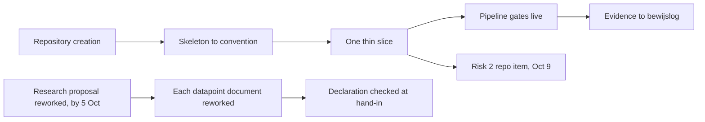

# Action overview: the three biggest portfolio risks

This document serves the HvA level 3 criteria Design & Realisation (OR) and Management &
Collaboration (MS). Risk one is OR's own evidence gap. Risks two and three are the team's
delivery calendar and the integrity of what reaches an assessor, grounded in `deliveryPlan.md`,
`workshopCoverage.md`, and `documentGuide.md`. Each open item below carries an owner and a date
already established in those documents, and where no date exists yet the item stays a TBD.

## Risk 1: Design & Realisation has no realized evidence yet

**Needed.** A GitLab repository with a working vertical slice and the pipeline running, before
Sprint Review 1 on 9 October 2026.

**Have.** The full document set. The stack decision (`techStack.md`), the architecture
proposal (`architecture.md`), the testing strategy proposal (`testingStrategy.md`), the
infrastructure proposal (`infrastructure.md`), and the CI pipeline design inside it. Every one
of these is a proposal. None of them is code, and no repository exists yet.

**Still to do, in order.**

1. Repository creation, at sprint 1 planning. Owner: whole team. Date: week of 21 September
   2026.
2. A skeleton built to the agreed conventions, once `codeConventions.md`'s stack-specific
   section is confirmed at the same planning session. Owner: whole team. Date: sprint 1,
   before 9 October 2026.
3. One thin end-to-end slice, for example a profile page carried from the database through to
   React. Owner: whole team. Date: sprint 1, before 9 October 2026.
4. The pipeline gates live: the build, test, and scan stages `infrastructure.md` proposes,
   running against a real commit. Owner: whole team. Date: sprint 1, before 9 October 2026.
5. Evidence recorded: screenshots of the pipeline run and a link to the repository, mapped to
   the HvA level 3 criteria. Owner: whole team, Wesley reviews the record. Date: sprint 1,
   before 9 October 2026.

Each step blocks the next one. There is no slice without a skeleton, no pipeline run without a
repository to run it in, and no evidence to log without a pipeline that actually ran.

## Risk 2: the October 9 minimum credible set

`deliveryPlan.md`'s own minimum credible set for Sprint Review 1, restated compactly here.
**Proposal, the team confirms this split at sprint 1 planning**, `deliveryPlan.md`'s own
wording for it.

1. The collaboration agreement, signed (`collaborationAgreementV1.md`). Owner: whole team.
2. The sprint 1 planning decisions, confirmed rather than proposed: architecture, testing,
   hosting, prioritization, performance targets, success measures, stack conventions, DevOps
   additions, and the skills inventory. Owner: whole team.
3. An existing GitLab repository, with the project skeleton and a small working slice of code
   in it. This is risk 1's chain above, items 1 through 3. Owner: whole team.
4. The sprint board, showing the backlog split into sprint 1 work. Owner: whole team.
5. Each member's own evidence collection toward their individual datapoints, gathered rather
   than finished. Owner: each member, for their own collection.

All five are due by Sprint Review 1, per `deliveryPlan.md`: Friday 9 October 2026, DLO
deadline, 11:59 PM.

## Risk 3: authenticity of hand-ins

**Needed.** Anything submitted to an assessor reads as its own author's work, and carries a
true AI use declaration, per study manual §7.

**Have.** An AI use declaration in every team document, and Wesley's own measured writing
register applied to the drafts.

**Still to do, in order.**

1. Wesley reworks the research proposal (`../research/proposal.md`) into his own words first,
   since it goes to the learning group teacher by 5 October 2026. Owner: Wesley. Date: before
   5 October 2026.
2. Each document that becomes a datapoint gets the same treatment before its own hand-in.
   Owner: Wesley for his individual evidence, the whole team for team documents. Date: before
   each hand-in, starting with Sprint Review 1, 9 October 2026.
3. The declaration section is checked against study manual §7 at each hand-in. Owner: whole
   team. Date: at each hand-in, starting 9 October 2026.

Reworking the proposal first closes the nearest deadline. The same treatment then carries into
every later document, and the check at each hand-in is what confirms it held.

## How the three risks connect

*Figure: risk 1's chain supplies risk 2's repository item directly, at the slice step rather
than the full pipeline. Risk 3 runs on its own schedule, gated by the 5 October research
deadline rather than by risk 1 or risk 2.*

## AI use declaration

AI was used as a writing support tool while working on this document. We used AI to draft
the formulation of sentences, the structure of wording, readability, and clarity from
content that we had provided, and to generate the diagrams. The content itself, including
our experiences, reflections, learning goals, decisions, self-assessments, and
conclusions, is our own. We reviewed the drafts and decided as a team which text to
include.
