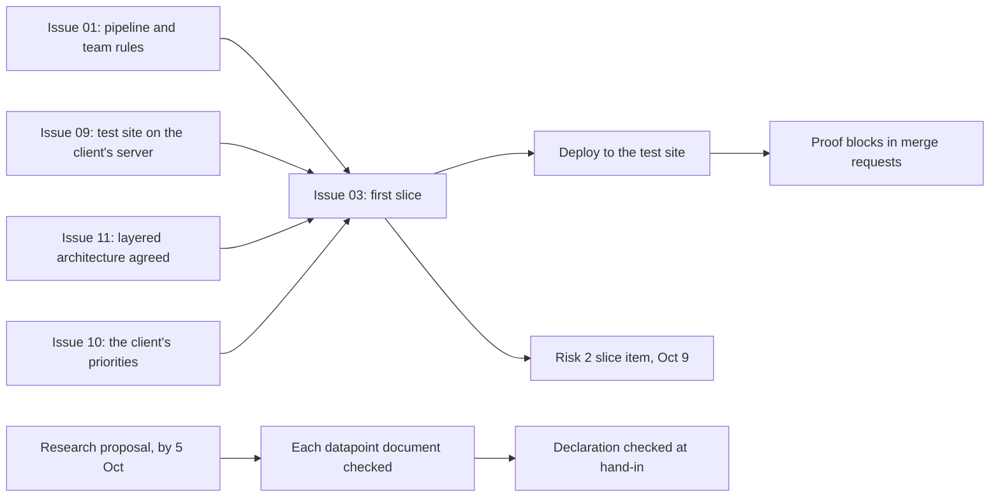

# Action overview: the three biggest portfolio risks

This document serves the HvA level 3 criteria Design & Realisation (OR) and Management &
Collaboration (MS). Risk one is OR's own evidence gap. Risks two and three are the team's
delivery calendar and the integrity of what reaches an assessor, grounded in
`docs/project/deliveryPlan.md`, `docs/school/workshopCoverage.md`, and
`docs/school/documentGuide.md`. Each open item below carries an owner and a date already
established in those documents or on the board, and where no date exists yet the item stays a
TBD. Issues are named by their board number and title. The GitLab number of each is in
`boardNumbers.md`.

## Risk 1: Design & Realisation has no realized evidence yet

**Needed.** A working vertical slice on the test site with the pipeline running, before Sprint
Review 1 on 9 October 2026.

**Have.** The GitLab project connect-nine on gitlab.fdmci.hva.nl, set up on 27 September 2026
with dev and main protected, one approval per merge request, labels, milestones, one board per
sprint and the templates (`gitlabSetup.md`). The board with 227 issues in 21 epics, each issue
with its tasks and its Definition of Done (`definitionOfDone.md`). The code conventions per
layer (`codeConventions.md`). The stack is decided: React with TypeScript, .NET 10 and
PostgreSQL 16 with EF Core and Npgsql. None of this is code yet. The first set of templates and
docs went onto main directly, before the protection existed. Every change after that goes
through a merge request.

**Still to do, in order.**

1. The rest of issue 01 The repository, the pipeline and the team rules: the pipeline file with
   its stages, `docs/team/onboarding.md` and the decision on the code conventions. Owner: whole
   team. Date: sprint 1, before 9 October 2026.
2. Issue 09 Every team member on the client's server: the test site with docker compose on the
   client's server. It is blocked until the client gives the first login and points the test
   address at the server. Owner: whole team, with the client. Date: sprint 1, before 9 October
   2026.
3. Issue 11 The team agrees on the layered architecture: the four backend projects and the way
   data is read and written, agreed before anyone writes them. Owner: whole team. Date: first
   week of sprint 1.
4. One thin end-to-end slice: issue 03 Create an account, from the database through to the
   screen, with its build and test jobs in the pipeline and its first deploy to the test site.
   Then issues 04, 05, 06, 07 and 08 of sprint 1. Owner: whole team. Date: sprint 1, before 9
   October 2026.
5. Evidence recorded: every task has a proof block that goes in its merge request, linked in
   Portflow, as the Definition of Done asks. Owner: each member, for their own tasks, Wesley
   reviews the record. Date: sprint 1, before 9 October 2026.

Each step blocks the next one. Issue 03 also waits for issue 10 The client's priorities for the epics.
There is no slice without the pipeline and the agreed structure,
no deploy without the test site, and no evidence to record without a merge request that really
went through.

## Risk 2: the October 9 minimum credible set

`docs/project/deliveryPlan.md`'s own minimum credible set for Sprint Review 1, restated compactly
here and updated to the board.

1. The final version of the collaboration agreement, agreed and signed
   (`collaborationAgreement.md`). Version 1.12 is a draft and not signed yet, the team is still
   working on the final version. Owner: whole team.
2. The sprint 1 decisions, made in their issues rather than proposed: issue 10 The client's
   priorities for the epics, issue 11 The team agrees on the layered architecture, issue 12
   Inventory of the personal data per module and issue 13 The role table per module. Owner:
   whole team. The open points that are not in an issue yet are in `openItems.md`.
3. The GitLab project with a small working slice of code in it, on the test site. This is risk
   1's chain above, steps 1 to 4. Owner: whole team.
4. The board Sprint 1 in GitLab, showing the sprint 1 issues and their tasks with the milestone
   Sprint 1. Owner: whole team.
5. Each member's own evidence collection toward their individual datapoints, gathered rather
   than finished. Owner: each member, for their own collection.

All five are due by Sprint Review 1, per `docs/project/deliveryPlan.md`: Friday 9 October 2026,
DLO deadline, 11:59 PM.

## Risk 3: authenticity of hand-ins

**Needed.** Anything submitted to an assessor reads as its own author's work, and carries a
true AI use declaration, per study manual §7.

**Have.** An AI use declaration in every team document. Every type of the Definition of Done
has the line "Where AI helped, it is declared as the collaboration agreement asks", so every
merge request carries the declaration of section 9 of `collaborationAgreement.md`.

**Still to do, in order.**

1. Wesley's research proposal, which goes to the learning group teacher by 5 October 2026,
   reads as his own work and carries a true declaration. Issue 106 Each student's research
   topic approved (sprint 1) covers the review in Portflow. Owner: Wesley. Date: before 5
   October 2026.
2. Each document that becomes a datapoint gets the same check before its own hand-in. Owner:
   Wesley for his individual evidence, the whole team for team documents. Date: before each
   hand-in, starting with Sprint Review 1, 9 October 2026.
3. The declaration section is checked against study manual §7 at each hand-in. Owner: whole
   team. Date: at each hand-in, starting 9 October 2026.

The research proposal first closes the nearest deadline. The same check then carries into every
later document, and the check at each hand-in is what confirms it held.

## How the three risks connect

The picture below shows which steps wait for which, and how the three risks meet.

*Figure: risk 1's chain supplies risk 2's slice item directly. Issue 03 waits for issues 01, 09,
10 and 11. Risk 3 runs on its own schedule, gated by the 5 October research deadline rather than by
risk 1 or risk 2.*

## AI use declaration

AI was used as a writing support tool while working on this document. We used AI to draft
the formulation of sentences, the structure of wording, readability, and clarity from
content that we had provided, and to generate the diagrams. The content itself, including
our experiences, reflections, learning goals, decisions, self-assessments, and
conclusions, is our own. We reviewed the drafts and decided as a team which text to
include.
