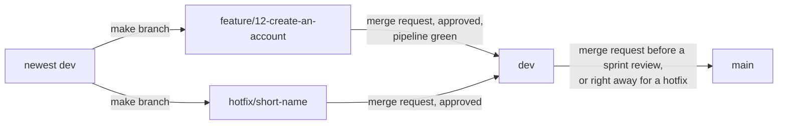

# Code conventions

What "the code follows the team's code conventions" in the Definition of Done means, per layer. The same for everyone and every issue. Every rule is a common industry standard, kept small for a team of five that is new to React and .NET. The source is section 3b of the page Issue creation on the Figma board, plus the rules the team added after the audit of 27 September 2026 (the last part of this file). When the board changes, this file changes in the same merge request.

## Branches and merge requests

The flow of every change:

The picture below shows the road of a normal change and of a hotfix, from the newest dev to main.

1. Make your branch from the newest dev: `<type>/<issue number>-<short name>`, for example `feature/12-create-an-account`. Types: feature, fix, refactor, docs, test, chore. The button Create branch on a GitLab issue makes this name for you.
2. Commit in the format `<type>(<scope>): <what changed> (#<issue number>)`, for example `feat(backend): add account endpoint (#3)`.
3. Open a merge request into dev. The title uses the commit format. The description starts with `Relates to #<issue number>` and holds the proof block of the task (the template Default does this for you).
4. One teammate who is not the author approves it, the pipeline is green and every thread is resolved. Then it is merged into dev and the branch is deleted.
5. Before a sprint review, dev goes into main through a merge request, approved by one teammate who is not the author.
6. An urgent repair of the live site is `hotfix/<short name>`, made from the newest dev. It also goes through dev: a merge request into dev, then right away a merge request from dev into main, because main only takes merge requests from dev.

Nobody pushes directly to dev or main: both are protected, and the pipeline job branch-flow refuses a merge request into main from any branch other than dev, see docs/team/gitlabSetup.md.

## General and Git

### For all code

1. Everything in English: names, comments, commit messages and documents.
2. One file .editorconfig in the root sets the layout for every editor: UTF-8, line ending LF, 2 spaces for TypeScript, JavaScript, JSON, YAML, Markdown and CSS, 4 spaces for C#. (tool: .editorconfig in the editor, dotnet format of #259 and Prettier of #263)
3. Secrets only in the file .env on your own machine, never in Git. Every setting has an example value in .env.example.
4. Documents live in docs, with file names in camelCase, for example docs/team/codeConventions.md. One decision per file in the folder docs/decisions, for example docs/decisions/003-minimalApis.md.

### Branches

5. Name: `<type>/<issue number>-<short name>`, for example `feature/12-create-an-account`. Types: feature, fix, refactor, docs, test, chore. The number lets GitLab link the branch to the issue by itself, the name tells a person what it is about. The button Create branch on a GitLab issue makes this name for you.
6. A branch starts from dev and goes back into dev through a merge request (a GitLab page where a teammate reviews the change). main only changes from dev. An urgent repair on the live site is `hotfix/<short name>`, and it also goes through dev, because main only takes merge requests from dev.

### Commits (Conventional Commits)

7. Format: `<type>(<scope>): <what changed> (#<issue number>)`, for example `feat(backend): add status endpoint (#12)`. Types: feat (new feature), fix (repair), refactor (cleaner code with the same behaviour, also for removing code), docs, test, chore (maintenance). Scope: frontend, backend, database, pipeline or docs.
8. Write what changed in the present tense and in lower case, at most 72 characters: "add", not "added".

### Merge requests

9. The title uses the same format as a commit. The description starts with `Relates to #12`, so GitLab links it to the issue without closing it. The issue is closed by the teammate who ticked the acceptance criteria on the test site.
10. Every merge request description has a part `## TODO` with one line per thing that is still needed, each as a checkbox with who does it: `- [ ] Reviewer: ...`, `- [ ] <name>: ...`. Anyone who opens the merge request reads there what is still open, and the line is ticked when it is done. When nothing is open the part says "Nothing open." The same part goes in the proof file of the task in `docs/<your name>/portfolioProof/`. (reviewer)
11. A merge request with a red or running pipeline cannot be merged (Pipelines must succeed), and a reviewer never approves it. A red job is fixed on the branch first, and the reviewer looks again after the green run. (reviewer)

## Frontend: TypeScript, React, Vite

React is the library the screens are built with. A component is one piece of screen in its own file. TypeScript is JavaScript with types, so mistakes show up before the code runs. Vite builds the frontend and serves it while you work.

### Tools

1. TypeScript in strict mode (`"strict": true` in tsconfig.json). The type any is not allowed.
2. ESLint checks the code, with typescript-eslint, eslint-plugin-react-hooks and eslint-plugin-jsx-a11y (catches accessibility mistakes). Prettier with its default settings fixes the layout. `npm run lint` and `npx prettier --check .` must report nothing.

### Names

3. Component: PascalCase, and the file has the same name. MemberCard.tsx holds MemberCard.
4. Hook (a function starting with use that holds state or calls the server): useMembers.ts.
5. Other files and functions: camelCase, formatDate.ts. Constants: UPPER_SNAKE_CASE, MAX_PAGE_SIZE. Types: PascalCase without a prefix, Member and not IMember.
6. A test file sits next to the file it tests: MemberCard.test.tsx. Tests in a real browser go in `web/e2e/<name>.spec.ts`.

### Folders in web/src

7. pages: one component per page of the site, for example Home.tsx. components: pieces of screen used on more than one page. api: every call to the server, nothing else talks to the server. hooks: hooks used in more than one place. styles: tokens.css with the Young Amstelland colours and fonts as CSS variables.

### Writing components

8. Only function components, one component per file, and the props (the input of a component) described with a type.
9. A component never calls fetch itself. It uses a function from src/api, so the server address and the error handling live in one place.
10. Styling with CSS Modules: MemberCard.module.css next to the component. It is built into Vite, so there is nothing to install. Colours and fonts only through the variables in tokens.css.
11. Use the right HTML element: a button for an action, a link to go somewhere, never a div you can click.

## Backend: C#, ASP.NET Core

C# is the language. .NET is the platform it runs on. ASP.NET Core is the part of .NET that turns C# into a web server. The four layers (Presentation, Application, Domain, Infrastructure) are four projects, explained in docs/team/onboarding.md.

### Version and tools

1. .NET 10, the long term support version, supported until November 2028. .NET 8 stops getting security fixes on 10 November 2026, in the middle of this project.
2. In every project file: `<Nullable>enable</Nullable>` (the compiler warns when a value can be empty) and `<TreatWarningsAsErrors>true</TreatWarningsAsErrors>` (a warning stops the build, so "zero warnings" checks itself).
3. The built in .NET analyzers and dotnet format, with the rules in .editorconfig. `dotnet build` and `dotnet format --verify-no-changes` must report nothing. Nothing extra to install.

### Names (the Microsoft C# conventions)

4. PascalCase for classes, methods, properties and everything public: StatusService, GetStatusAsync. camelCase for local variables and parameters: memberCount. Private fields: _camelCase, for example _context.
5. Interfaces (contracts) start with I: IAppDbContext. A method that waits on something (async) ends in Async.
6. One class per file, and the file has the name of the class. The namespace follows the folder: Connect.Application.Status, written once at the top of the file as a file scoped namespace.

### Structure

7. Four projects in backend: Presentation, Application, Domain and Infrastructure, plus the test project Connect.Tests. Application holds one folder per feature in Features, one feature per epic, and inside it one folder per use case with its command or query and its handler: Features/Account/CreateAccount/CreateAccountCommand.cs with CreateAccountHandler.cs. A write is a command, a read is a query, never both in one handler. There are no repository classes, no IXRepository interfaces and no Repositories folder.
8. Presentation uses Application and Infrastructure. Application and Infrastructure use Domain. Domain uses nothing. Because they are separate projects, the compiler refuses code that breaks this, so a beginner cannot break the layers by accident.

### Web addresses (endpoints)

9. Minimal APIs. One static class per feature, for example StatusEndpoints with one method MapStatusEndpoints. An endpoint stays thin: read the request, call the handler, return the answer.
10. Addresses start with /api, are lower case and use plural nouns: /api/members, /api/members/{id}. Words are joined with a -: /api/member-profiles.
11. What goes in and out are records named ...Request and ...Response: CreateAccountRequest, StatusResponse. A database class (entity) is never sent straight to the browser.
12. Errors use the built in ProblemDetails format (web standard RFC 9457): `Results.Problem(...)`, and for a wrong form `Results.ValidationProblem(...)` with one message per field. Status codes: 200 OK, 201 created, 204 done without content, 400 wrong input, 401 not logged in, 403 not allowed, 404 not found, 409 conflict, 503 not available.
13. Input is checked with FluentValidation before it reaches Application.

### Other

14. A class gets what it needs through its constructor (dependency injection). Each layer registers its classes in one method: AddApplication(), AddInfrastructure(). Every handler is also registered in Program.cs, one line per handler.
15. Logging with ILogger and a message template: `_logger.LogError(ex, "Status failed for {RequestId}", requestId)`. Never glue text together with `$"..."` in a log line, the template keeps the values searchable.
16. Tests with NUnit. Name: Method_Situation_ExpectedResult, for example GetStatusAsync_DatabaseDown_ReturnsNotReachable. Every test has three parts: Arrange (prepare), Act (do), Assert (check).

## Database: PostgreSQL through EF Core

PostgreSQL is the database. EF Core (Entity Framework Core) is the C# library that reads and writes it for us. A migration is a script EF Core writes that changes the tables one step at a time, and can undo that step.

### Names

1. Everything in lower case with _ between words (snake_case), which PostgreSQL handles best: member_profile, created_at.
2. Tables in the singular: account, member_profile, event. A table that links two others gets both names: event_member.
3. Primary key: id. A column that points to another table: `<other table>_id`, for example member_profile.account_id.
4. Time columns end in _at and are timestamptz in UTC: created_at, updated_at. Yes or no columns start with is_ or has_: is_active.
5. Indexes: `ix_<table>_<columns>`, and unique ones `ux_<table>_<columns>`: ux_account_email.

### How we work with it

6. C# stays PascalCase and the database stays snake_case. The package EFCore.NamingConventions with UseSnakeCaseNamingConvention() translates between the two, so nobody types a table name by hand.
7. Tables only change through EF Core migrations, named after the change: AddAccountTable, AddIsActiveToAccount. A migration that is already on dev is never edited, you add a new one.
8. Ids are uuid, so nobody can find the next member by counting up. Text is text, not varchar(n), unless the length is a real rule. Email addresses are citext, so upper and lower case count as the same address.
9. Queries only through EF Core. Raw SQL only with parameters, never by gluing text together. A query that only reads uses AsNoTracking(). A list is always fetched in pages.
10. No separate SQL linter. With EF Core migrations the team writes almost no SQL by hand.

## Added after the audit of 27 September 2026

These rules join the parts above. When an older text disagrees, these win.

### Answers of the server

1. A successful answer with content is always `{"data": ..., "meta": {...}}`. For a list, data is the array and meta holds page, pageSize and total. For one item, meta is `{}`.
2. One named exception: GET /api/health answers 200 with `{"status":"healthy"}` and 503 with ProblemDetails, because deploy jobs and monitors read that body.
3. An error is always ProblemDetails (RFC 9457). Never a bare text and never `{"error": ...}`.
4. Paging is always page numbers: `?page=1&pageSize=20`, page starts at 1, pageSize at most 50. The button under a list is always "Load more".
5. An id and a page number in the address are bound as text and parsed in the validator, so a wrong value gets a ProblemDetails with a message, not a bare 400 or 404. So never `{id:guid}` or `{page:int}` constraints in a route.
6. Enums are stored as their name in PascalCase (Pending, Accepted), in a text column.

### Tags

7. One tag model for the whole board: table tag (id, name citext unique, max 30 characters), with link tables member_profile_tag, organisation_profile_tag and opportunity_tag. At most 10 tags per profile or opportunity. One component TagInput.tsx.

### Settings on a laptop and on a server

8. dotnet run does not read .env. Secrets on a laptop go in dotnet user-secrets (`dotnet user-secrets init` once, then `dotnet user-secrets set`). Settings that are not secret go in appsettings.Development.json. On a server everything comes from environment variables.
9. Setting names use sections, written with two _ signs in environment variables: `Mail__Host`, `Mail__Password`, `App__BaseUrl`, `Seeding__TestData`, `GoogleLogin__ClientId`. The same name in appsettings is `Mail:Host`.

### Test mail

10. The test mailbox is Mailpit. On the test site it sits behind basic auth. The address may be in docs/testing/testData.md, the login is in the GitLab variables MAILPIT_USER and MAILPIT_PASSWORD.

### Files and folders

11. A record ...Request or ...Response may sit in the endpoint file of its feature (an agreed exception to "one class per file"). A component used on one page only may sit in components under a folder named after the page.
12. Test folders: api/Connect.Tests/Features/<Feature>, with a handler test named <UseCase>HandlerTests.cs, api/Connect.Tests/Domain, api/Connect.Tests/Infrastructure, with a database test named <Feature>DatabaseTests.cs, api/Connect.Tests/Presentation, api/Connect.Tests/Fixtures.

### Commands

13. The solution is made with `dotnet new sln --format sln`, so every command can use api/Connect.sln.
14. docker-compose.yml names the database service `database` and gives it no fixed `container_name`, so two checkouts never clash on the container name. Commands reach it by the service name: `docker compose exec database psql -U connect -d connect`.
15. A migration is always added with `dotnet ef migrations add <Name> --project api/Infrastructure --startup-project api/Presentation`.
16. Going back one migration: `dotnet ef migrations list`, then `dotnet ef database update <the migration just before yours>` with the same --project and --startup-project. Never a fixed old migration name.
17. The database port is published only on 127.0.0.1: `"127.0.0.1:5432:5432"`.

### Checks

18. A tester checks "not reachable" without technical knowledge: open the page, switch the phone to airplane mode, press the button, read the message. Stopping the database stays in the integration and screen tests.
19. "Wait a day" is never a check step: the seed data holds an item with a date in the past, listed in docs/testing/testData.md.
20. Playwright logs in with page.request.post or context.request.post, never the separate request fixture, so the page gets the cookie.
21. A test account that must be visible to others is confirmed through Mailpit in the test setup, as docs/testing/testData.md describes.

## Kept from the collaboration agreement

These rules come from section 6 of the collaboration agreement (Code Conventions). They hold for every layer, next to the rules above.

1. Follow the established best practices of the language and framework in use.
2. SOLID, the five design principles for classes.
3. DRY (do not repeat yourself), as far as is practical.
4. Clean code, as far as is practical.

## AI use declaration

AI was used as a writing support tool while working on this document. We used AI to draft
the formulation of sentences, the structure of wording, readability, and clarity from
content that we had provided, and to generate the diagrams. The content itself, including
our experiences, reflections, learning goals, decisions, self-assessments, and
conclusions, is our own. We reviewed the drafts and decided as a team which text to
include.
