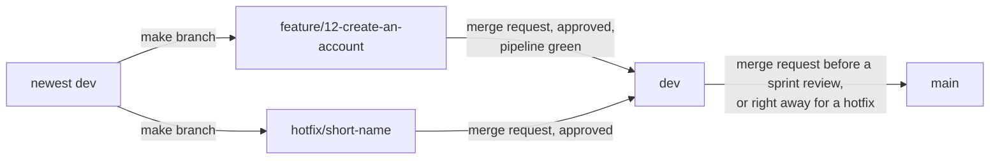

# Code conventions

What "the code follows the team's code conventions" in the Definition of Done means, per layer. The same for everyone and every issue. Every rule is a common industry standard, kept small for a team of five that is new to React and .NET. This file is the source, with the rules the team added after the audit of 27 September 2026 in its last part.

A rule that ends in (tool: name) is checked by that tool. Until the tool exists (#259 for the server, #263 for the screen, #266 for the pipeline), the reviewer checks it. A rule that ends in (reviewer) is only checked by a person.

## Branches and merge requests

Three examples: the branch `feature/14-create-an-account`, the commit `feat(backend): add account endpoint (#14)`, the merge request description that starts with `Relates to #14`.

The flow of every change:

The picture below shows the road of a normal change and of a hotfix, from the newest dev to main.



1. Make your branch from the newest dev: `<type>/<issue number>-<short name>`, for example `feature/12-create-an-account`. Types: feature, fix, refactor, docs, test, chore. The button Create branch on a GitLab issue makes this name for you. (reviewer)
2. Commit in the format `<type>(<scope>): <what changed> (#<issue number>)`, for example `feat(backend): add account endpoint (#3)`. (reviewer)
3. Open a merge request into dev. The title uses the commit format. The description starts with `Relates to #<issue number>` and holds the proof block of the task (the template Default does this for you). (reviewer)
4. One teammate who is not the author approves it, the pipeline is green and every thread is resolved. Then it is merged into dev and the branch is deleted. (tool: the approval rule and the pipeline, docs/team/gitlabSetup.md)
5. Before a sprint review, dev goes into main through a merge request, approved by one teammate who is not the author. (reviewer)
6. An urgent repair of the live site is `hotfix/<short name>`, made from the newest dev. It also goes through dev: a merge request into dev, then right away a merge request from dev into main, because main only takes merge requests from dev. (tool: branch-flow, #5)

A merge request with a red or running pipeline cannot be merged, and a reviewer never approves it. A red job is fixed on the branch first (rule 11). (reviewer)

Nobody pushes directly to dev or main: both are protected, and the pipeline job branch-flow refuses a merge request into main from any branch other than dev, see docs/team/gitlabSetup.md.

## General and Git

Three examples: the file `docs/team/onboarding.md`, the setting `Mail__Host` with an example value in `.env.example`, the decision file `docs/decisions/002-layeredArchitecture.md`.

### For all code

1. Everything in English: names, comments, commit messages and documents. (reviewer)
2. One file .editorconfig in the root sets the layout for every editor: UTF-8, line ending LF, 2 spaces for TypeScript, JavaScript, JSON, YAML, Markdown and CSS, 4 spaces for C#. (tool: .editorconfig in the editor, dotnet format of #259 and Prettier of #263)
3. Secrets only in the file .env on your own machine, never in Git. Every setting has an example value in .env.example. (tool: env-file-check, #5)
4. Documents live in docs, with file names in camelCase, for example docs/team/codeConventions.md. One decision per file in the folder docs/decisions, for example docs/decisions/003-minimalApis.md. (reviewer)

### Branches

5. Name: `<type>/<issue number>-<short name>`, for example `feature/12-create-an-account`. Types: feature, fix, refactor, docs, test, chore. The number lets GitLab link the branch to the issue by itself, the name tells a person what it is about. The button Create branch on a GitLab issue makes this name for you. (reviewer)
6. A branch starts from dev and goes back into dev through a merge request (a GitLab page where a teammate reviews the change). main only changes from dev. An urgent repair on the live site is `hotfix/<short name>`, and it also goes through dev, because main only takes merge requests from dev. (tool: protected branches and branch-flow, #5)

### Commits (Conventional Commits)

7. Format: `<type>(<scope>): <what changed> (#<issue number>)`, for example `feat(backend): add status endpoint (#12)`. Types: feat (new feature), fix (repair), refactor (cleaner code with the same behaviour, also for removing code), docs, test, chore (maintenance). Scope: frontend, backend, database, pipeline or docs. (reviewer)
8. Write what changed in the present tense and in lower case, at most 72 characters: "add", not "added". (reviewer)

### Merge requests

9. The title uses the same format as a commit. The description starts with `Relates to #12`, so GitLab links it to the issue without closing it. The issue is closed by the teammate who ticked the acceptance criteria on the test site. (reviewer)
10. Every merge request description has a part `## TODO` with one line per thing that is still needed, each as a checkbox with who does it: `- [ ] Reviewer: ...`, `- [ ] <name>: ...`. Anyone who opens the merge request reads there what is still open, and the line is ticked when it is done. When nothing is open the part says "Nothing open." The same part goes in the proof file of the task in `docs/<your name>/portfolioProof/`. (reviewer)
11. A merge request with a red or running pipeline cannot be merged (Pipelines must succeed), and a reviewer never approves it. A red job is fixed on the branch first, and the reviewer looks again after the green run. (reviewer)

### One product

12. Connect is one product, so the same thing is done the same way everywhere: the same structure of folders, names and layers, the same kind of test and the same way to answer an error, in every feature and every layer. Every rule in this file holds for all code, without exceptions wherever that is possible. An exception is made only where the shared way does not work, and then it is written in the rule it departs from, with the reason and exactly where it holds, as the answers of the server name GET /api/health and backend rule 17 names the navigation inside an EF Core query. A way that only one part of the code uses is changed to the shared way, or proposed to the team as the new shared way for all of it, and never kept as a second way beside it. Code that is older than a rule follows it once its file changes, as backend rules 17, 18 and 20 say, and new code never copies the older way. The reason: every exception is one more thing a new member, or a teammate who did not write that part, has to know before the code makes sense, and an exception that is written nowhere looks like a mistake or like a second rule. Microsoft: "Coding conventions are essential for maintaining code readability, consistency, and collaboration within a development team. Code that follows industry practices and established guidelines is easier to understand, maintain, and extend." (https://learn.microsoft.com/en-us/dotnet/csharp/fundamentals/coding-style/coding-conventions). Wesley Oerlemans proposed this on 21 October 2026. (reviewer)

## Frontend: TypeScript, React, Vite

Three examples: the file `web/src/components/MemberCard.tsx`, the hook `useMembers`, the call `GET /api/members` that only `web/src/api/members.ts` makes.

React is the library the screens are built with. A component is one piece of screen in its own file. TypeScript is JavaScript with types, so mistakes show up before the code runs. Vite builds the frontend and serves it while you work.

### Tools

1. TypeScript in strict mode (`"strict": true` in tsconfig.json). The type any is not allowed. (tool: TypeScript in npm run build, #263, frontend-build of #266)
2. ESLint checks the code, with typescript-eslint, eslint-plugin-react-hooks and eslint-plugin-jsx-a11y (catches accessibility mistakes). Prettier with its default settings fixes the layout. `npm run lint` and `npx prettier --check .` must report nothing. (tool: ESLint and Prettier, #263, frontend-lint of #266)

### Names

3. Component: PascalCase, and the file has the same name. MemberCard.tsx holds MemberCard. (reviewer)
4. Hook (a function starting with use that holds state or calls the server): useMembers.ts. (reviewer)
5. Other files and functions: camelCase, formatDate.ts. Constants: UPPER_SNAKE_CASE, MAX_PAGE_SIZE. Types: PascalCase without a prefix, Member and not IMember. (reviewer)
6. A test file sits next to the file it tests: MemberCard.test.tsx. Tests in a real browser go in `web/e2e/<name>.spec.ts`. (reviewer)

### Folders in web/src

7. pages: one component per page of the site, for example Home.tsx. components: pieces of screen used on more than one page. api: every call to the server, nothing else talks to the server. hooks: hooks used in more than one place. styles: tokens.css with the Young Amstelland colours and fonts as CSS variables. (reviewer)

### Writing components

8. Only function components, one component per file, and the props (the input of a component) described with a type. (reviewer)
9. A component never calls fetch itself. It uses a function from src/api, so the server address and the error handling live in one place. (reviewer)
10. Styling with CSS Modules: MemberCard.module.css next to the component. It is built into Vite, so there is nothing to install. Colours and fonts only through the variables in tokens.css. (reviewer)
11. Use the right HTML element: a button for an action, a link to go somewhere, never a div you can click. (tool: eslint-plugin-jsx-a11y, #263)

## Backend: C#, ASP.NET Core

Three examples: the file `Accounts/CreateAccount/CreateAccountCommandHandler.cs`, the method `CreateAccountAsync`, the address `POST /api/accounts`.

C# is the language. .NET is the platform it runs on. ASP.NET Core is the part of .NET that turns C# into a web server. The four layers (Presentation, Application, Domain, Infrastructure) are four projects, explained in docs/team/onboarding.md.

### Version and tools

1. .NET 10, the long term support version, supported until 14 November 2028. .NET 8 and .NET 9 stop getting security fixes on 10 November 2026, in the middle of this project. Why, with the source: docs/decisions/003-dotnet10.md. (tool: net10.0 in every project file, dotnet build of #259)
2. In every project file: `<Nullable>enable</Nullable>` (the compiler warns when a value can be empty) and `<TreatWarningsAsErrors>true</TreatWarningsAsErrors>` (a warning stops the build, so "zero warnings" checks itself). (tool: dotnet build, #259, backend-build of #266)
3. The built in .NET analyzers and dotnet format, with the rules in .editorconfig. `dotnet build` and `dotnet format --verify-no-changes` must report nothing. Nothing extra to install. (tool: dotnet format, #259, backend-build of #266)

### Names (the Microsoft C# conventions)

4. PascalCase for classes, methods, properties and everything public: StatusService, GetStatusAsync. camelCase for local variables and parameters: memberCount. Private fields: _camelCase, for example _context. (reviewer)
5. Interfaces (contracts) start with I: IAppDbContext. A method that waits on something (async) ends in Async. (reviewer)
6. One class per file, and the file has the name of the class. The namespace follows the folder: Connect.Application.Status, written once at the top of the file as a file scoped namespace. (reviewer)

### Structure

7. Four layer projects in api: Connect.Presentation, Connect.Application, Connect.Domain and Connect.Infrastructure, plus the start project Connect, which starts the server and connects the layers. Application holds one folder per area, named in the plural such as Accounts, and inside it one folder per use case with its command or query, its handler and its result: api/Connect.Application/Accounts/CreateAccount/CreateAccountCommand.cs with CreateAccountCommandHandler.cs and CreateAccountResult.cs. A write is a command with a `<UseCase>CommandHandler`, a read is a query with a `<UseCase>QueryHandler`, never both in one handler. A handler reaches the data only through the contract IAppDbContext in api/Connect.Application/Common/Abstractions, which gives each table as an `IQueryable<T>` with Add, Remove and SaveChangesAsync and which ConnectDbContext in Infrastructure implements. Application has no EF Core (decision 007), so a handler also runs its query through IAppDbContext, with methods named after the EF Core ones, such as `SingleOrDefaultAsync(query, cancellationToken)` and `AnyAsync(query, cancellationToken)`, each added when a handler first needs it, and saves with `SaveChangesOrConflictAsync`, which answers `Error.Conflict` when PostgreSQL refuses the save on a unique index, because decision 005 lets the database adapter translate a known constraint. Any other database error stays an exception. The account is the one exception, agreed on the way Nick Hoebe built it: CreateAccountCommandHandler hands the email address and password to the contract IAccountRegistrationService, which AccountRegistrationService in Infrastructure implements with UserManager<Account> of ASP.NET Identity. There are no repository classes, no IXRepository interfaces, no Repositories folder and no use case written as a Service class. (reviewer)
8. References point inward: Connect uses Presentation and Infrastructure, Presentation uses Application, Infrastructure uses Application (it implements contracts such as IAppDbContext), Application uses Domain, and Domain uses nothing. Each test project uses only the project it tests. Because they are separate projects, the compiler refuses code that breaks this, so a beginner cannot break the layers by accident. The decision, the options that lost and the compiler proof: docs/decisions/002-layeredArchitecture.md. (tool: the compiler, through the project references)

### Web addresses (endpoints)

9. Minimal APIs. One static class per feature, for example StatusEndpoints with one method MapStatusEndpoints. Presentation keeps the areas of Application: api/Connect.Presentation/Accounts/Endpoints/AccountEndpoints.cs, with DTO, Mappers and Validators beside Endpoints. An endpoint stays thin: read the request, call the handler, return the answer. (reviewer)
10. Addresses start with /api, are lower case and use plural nouns: /api/members, /api/members/{id}. Words are joined with a -: /api/member-profiles. (reviewer)
11. What goes in and out are records named ...Request and ...Response: CreateAccountRequest, StatusResponse. A database class (entity) is never sent straight to the browser. (reviewer)
12. Errors use the built in ProblemDetails format (web standard RFC 9457): `TypedResults.Problem(...)`, and for a wrong form `TypedResults.ValidationProblem(...)` with one message per field, its keys as rule 19 says. An endpoint returns `TypedResults`, never `Results`, as the account endpoints, the error mapper, the exception middleware and the screen on dev do. `HealthAnswerWriter` of #311 still uses `Results.Problem` and follows once its file changes for another reason (rule 12 of General and Git). Microsoft: "Returning TypedResults is preferred to returning Results." (https://learn.microsoft.com/en-us/aspnet/core/fundamentals/minimal-apis/responses). Status codes: 200 OK, 201 created, 204 done without content, 400 wrong input, 401 not logged in, 403 not allowed, 404 not found, 409 conflict, 503 not available. (reviewer)
13. Input is checked with FluentValidation before it reaches Application. A validator is tested with the test extensions of FluentValidation, as rule 8 of the part Tests and mocking says. (reviewer)

### Other

14. A class gets what it needs through its constructor (dependency injection). Each layer registers its own classes in one method: AddApplication() in api/Connect.Application/DependencyInjection.cs, AddInfrastructure(configuration) and AddPresentation() in theirs, and Program.cs of Connect only calls those three. Every handler is registered in AddApplication(), one line per handler. (reviewer)
15. Logging with ILogger and a message template: `_logger.LogError(ex, "Status failed for {RequestId}", requestId)`. Never glue text together with `$"..."` in a log line, the template keeps the values searchable. (reviewer)
16. Tests with NUnit. Name: Method_Situation_ExpectedResult, for example HandleAsync_EmailAlreadyUsed_ReturnsConflict. Every test has three parts: Arrange (prepare), Act (do), Assert (check). A handler that reads or writes data is unit tested with a test database of its own on in-memory SQLite behind IAppDbContext, because Connect.Application.Tests references only Connect.Application. A handler that hands its work to a contract, such as CreateAccountCommandHandler, is tested with a stand-in for that contract, as CreateAccountHandlerTests does. A rule that depends on PostgreSQL itself (a unique index, citext, a constraint, ExecuteDeleteAsync) is tested against a real PostgreSQL, because SQLite does not behave the same. (reviewer)

17. Avoid the null-forgiving operator `!` after a value, such as `account!.Email` or `public Account Account { get; set; } = null!`. It tells the compiler that a value is never empty without checking it, so it switches off the warning of rule 2 exactly where a value can be empty, and a mistake shows up as a NullReferenceException while a member uses Connect, instead of stopping the build. Microsoft: "The null-forgiving operator has no effect at run time." (https://learn.microsoft.com/en-us/dotnet/csharp/language-reference/operators/null-forgiving). Write what the code means instead: check with `is null` or `is not null`, stop with a clear message through `?? throw new InvalidOperationException("...")` or `ArgumentNullException.ThrowIfNull(value)`, use `?.` and `??` where empty is allowed, and make a property that must be set `required`, as `Profile.Account` in api/Connect.Domain/Users/Profile.cs is, so a forgotten value stops the build. The operator stays only where nothing else can say it: a test that passes `null` on purpose to check a guard, like `Result<string>.Success(null!)` in `ResultTests`, and a navigation inside an EF Core query, like `link.Tag!.Name` in a `Select`, which EF Core turns into SQL. Microsoft's EF Core guide: "it is necessary to use the null-forgiving operator (!) to inform the compiler that an actual null value isn't possible" (https://learn.microsoft.com/en-us/ef/core/miscellaneous/nullable-reference-types). In a test, `?? throw new AssertionException("...")` fails the test with that sentence, as `AccountDatabaseTests` does. A field of a test that `[SetUp]` fills gets no value at all, as in `AccountDatabaseTests`: NUnit.Analyzers sees that `[SetUp]` sets it and keeps the compiler quiet, so `= null!` is not needed there either. A `!` that is already in the code stays until its file changes for another reason. This rule is not about `!` as "not" (`!isValid`) or `!=`. (reviewer)

18. A class that gets what it needs through a primary constructor (rule 14) puts each value its methods use in a `private readonly` field, named as rule 4 says, and the methods use the field, never the parameter: `private readonly IAppDbContext _dbContext = dbContext;`, as `CreateAccountCommandHandler` and `AccountRegistrationService` do. Microsoft: "Primary constructor parameters can be assigned to." (https://learn.microsoft.com/en-us/dotnet/csharp/whats-new/tutorials/primary-constructors). So a method can give the parameter another value by mistake and the build accepts it, while a readonly field only gets its value when the object is made, and the same mistake stops the build (error CS0191). Once the field is there, using the parameter as well stops the build too (error CS9124, through rule 2). A parameter that only goes to the base class, such as `options` of `ConnectDbContext`, needs no field. A class that uses its parameters directly stays until its file changes for another reason. (reviewer)

19. The key of each field in the answer to a wrong form (rule 12) is the path of that field in camelCase, every part of it, with the index of a collection kept: `email`, `firstName`, `address.postalCode`, `addresses[0].postalCode`, `urlValue`. That is the name the field has in the JSON the screen sends, so the screen finds the message of a field under the name it already uses. Microsoft: the web defaults of System.Text.Json, which ASP.NET Core uses, include "PropertyNamingPolicy = CamelCase" (https://learn.microsoft.com/en-us/dotnet/standard/serialization/system-text-json/configure-options). FluentValidation: "By default, the name of the property extracted from the MemberExpression passed to RuleFor", and a collection gets its index "within square brackets (for example Foo.BarList[5].Baz)" (https://docs.fluentvalidation.net/en/latest/configuring.html). An endpoint answers with `TypedResults.ValidationProblem(validation.ToCamelCaseErrors())`, an extension on FluentValidation's `ValidationResult` that turns every part of the path into camelCase, and no global `ValidatorOptions.Global.PropertyNameResolver` is set. The reason, measured with FluentValidation 12.0.0: that resolver only gets the last member of a rule, so `RuleFor(x => x.Address.PostalCode)` answered `postalCode` without its parent, and lowering only the first letter turned `URLValue` into `uRLValue`. The extension gives the right key only once the resolver is gone, because the resolver has dropped the parent before the extension runs. Without the resolver, `validation.ToDictionary()` answers the C# names (`FirstName`), which the screen does not find, so an endpoint test checks each key, as `AccountEndpointTests` does with `email` and `password`. Nick proposed this way on 21 October 2026. The resolver in api/Connect.Presentation/DependencyInjection.cs and `ToDictionary()` in the endpoints stay until the extension is on dev, and every key the screen reads today stays the same. Until then a new endpoint answers the way `AccountEndpoints` does, `TypedResults.ValidationProblem(validation.ToDictionary())`, and its endpoint test checks each key. With the resolver that gives `firstName`, but a nested field loses its parent, so a form with a nested field needs the extension first. The merge request that brings `ToCamelCaseErrors()` changes every endpoint that uses `ToDictionary()` in the same pass and removes the resolver, so the code never holds both ways. (reviewer)

20. Setup that more than one test class needs lives in one helper of the test project, which the test or its `[SetUp]` calls, and what a test checks stays in the test. A database test gets its `ConnectDbContext` from one helper next to `TestConfiguration` in api/Connect.Infrastructure.Tests, which reads `TestsConnection` through `TestConfiguration`, instead of building the options with `UseNpgsql` and `UseSnakeCaseNamingConvention` in its own class. The check that PostgreSQL refused a write (`FindPostgresException`) and the rows a test needs before it starts, such as an account, a profile or a tag, sit in a helper as well. A value the check depends on is passed to the helper in the test, never hidden inside it. The reason: on 21 October 2026, `CreateDbContext` was written out in four database test classes and `FindPostgresException` in three, on dev and in open merge requests, so a change to the setup, such as the move to `TestsConnection`, has to be made in every copy, and a copy that is missed still builds and keeps the old setting. Microsoft's guide on testing against a real database puts that setup in one fixture with a `CreateContext()` method, because "your test suite has a single database that's shared between multiple tests across multiple test classes" (https://learn.microsoft.com/en-us/ef/core/testing/testing-with-the-database). Nick proposed this on 21 October 2026. A test class that builds its own setup stays until its file changes for another reason. (reviewer)

## Database: PostgreSQL through EF Core

Three examples: the table `member_profile`, the column `created_at`, the index `ux_account_email`.

PostgreSQL is the database. EF Core (Entity Framework Core) is the C# library that reads and writes it for us. A migration is a script EF Core writes that changes the tables one step at a time, and can undo that step.

### Names

1. Everything in lower case with _ between words (snake_case), which PostgreSQL handles best: member_profile, created_at. The tables of ASP.NET Identity are the one exception: they keep the names Identity gives them, such as AspNetUsers and AspNetRoles, and so does their index RoleNameIndex, so a query writes them in double quotes. Their columns are snake_case, and the unique indexes on the user name and the email address are ux_account_username and ux_account_email (rule 5). (tool: EFCore.NamingConventions)
2. Tables in the singular: member_profile, event. A table that links two others gets both names: event_member. The tables of ASP.NET Identity keep their own names (rule 1), so the accounts are in AspNetUsers. (reviewer)
3. Primary key: id. A column that points to another table: `<other table>_id`, for example member_profile.account_id. (reviewer)
4. Time columns end in _at and are timestamptz in UTC: created_at, updated_at. Yes or no columns start with is_ or has_: is_active. (reviewer)
5. Indexes: `ix_<table>_<columns>`, and unique ones `ux_<table>_<columns>`: ux_account_email. (reviewer)

### How we work with it

6. C# stays PascalCase and the database stays snake_case. The package EFCore.NamingConventions with UseSnakeCaseNamingConvention() translates between the two, so nobody types a table name by hand. The one exception is the table names of ASP.NET Identity of rule 1. (tool: EFCore.NamingConventions)
7. Tables only change through EF Core migrations, named after the change: AddAccountTable, AddIsActiveToAccount. A migration that is already on dev is never edited, you add a new one. (reviewer)
8. Ids are uuid, so nobody can find the next member by counting up. Text is text, not varchar(n), unless the length is a real rule. Email addresses are citext, so upper and lower case count as the same address. (reviewer)
9. Queries only through EF Core. Raw SQL only with parameters, never by gluing text together. A query that only reads uses AsNoTracking(). A list is always fetched in pages. (reviewer)
10. No separate SQL linter. With EF Core migrations the team writes almost no SQL by hand. (reviewer)

## Added after the audit of 27 September 2026

These rules join the parts above. When an older text disagrees, these win.

### Answers of the server

1. A successful answer with content is always `{"data": ..., "meta": {...}}`. For a list, data is the array and meta holds page, pageSize and total. For one item, meta is `{}`. (reviewer)
2. One named exception: GET /api/health answers 200 with `{"status":"healthy"}` and 503 with ProblemDetails, because deploy jobs and monitors read that body. (reviewer)
3. An error is always ProblemDetails (RFC 9457). Never a bare text and never `{"error": ...}`. (reviewer)
4. Paging is always page numbers: `?page=1&pageSize=20`, page starts at 1, pageSize at most 50. The button under a list is always "Load more". (reviewer)
5. An id and a page number in the address are bound as text and parsed in the validator, so a wrong value gets a ProblemDetails with a message, not a bare 400 or 404. So never `{id:guid}` or `{page:int}` constraints in a route. (reviewer)
6. Enums are stored as their name in PascalCase (Pending, Accepted), in a text column. (reviewer)

### Tags

7. One tag model for the whole board: table tag (id, name citext unique, max 30 characters), with link tables member_profile_tag, organisation_profile_tag and opportunity_tag. At most 10 tags per profile or opportunity. One component TagInput.tsx. (reviewer)

### Settings on a laptop and on a server

8. dotnet run does not read .env. Secrets on a laptop go in dotnet user-secrets (`dotnet user-secrets init` once, then `dotnet user-secrets set`). Settings that are not secret go in appsettings.Development.json. On a server everything comes from environment variables. (reviewer)
9. Setting names use sections, written with two _ signs in environment variables: `Mail__Host`, `Mail__Password`, `App__BaseUrl`, `Seeding__TestData`, `GoogleLogin__ClientId`. The same name in appsettings is `Mail:Host`. (reviewer)

### Test mail

10. The test mailbox is Mailpit. On the test site it sits behind basic auth. The address may be in docs/testing/testData.md, the login is in the GitLab variables MAILPIT_USER and MAILPIT_PASSWORD. (reviewer)

### Files and folders

11. A record ...Request or ...Response may sit in the endpoint file of its feature (an agreed exception to "one class per file"). A component used on one page only may sit in components under a folder named after the page. (reviewer)
12. Test projects per layer: api/Connect.Application.Tests/<Area>/<UseCase> with a handler test named <UseCase>HandlerTests.cs, api/Connect.Application.Tests/Domain with a rule tested without any database, api/Connect.Infrastructure.Tests/Persistence with a database test against a real PostgreSQL named <Feature>DatabaseTests.cs, api/Connect.Presentation.Tests/<Area> with the tests of one Presentation part such as a validator, and api/Connect.Tests for tests across projects, such as an endpoint test that starts the whole server in api/Connect.Tests/<Area>/Endpoints. There is no Connect.Domain.Tests (task 3.1, #259). Shared helpers go in a Fixtures folder of the test project. (reviewer)

### Commands

13. The solution file is api/Connect.slnx, as on dev and in task 3.1 (#259), so every command can use api/Connect.slnx. (reviewer)
14. docker-compose.yml names the database service `database` and gives it no fixed `container_name`, so two checkouts never clash on the container name. Commands reach it by the service name: `docker compose exec database psql -U connect -d connect`. (reviewer)
15. A migration is always added with `dotnet ef migrations add <Name> --project api/Connect.Infrastructure --startup-project api/Connect`. (reviewer)
16. Going back one migration: `dotnet ef migrations list`, then `dotnet ef database update <the migration just before yours>` with the same --project and --startup-project. Never a fixed old migration name. (reviewer)
17. The database port is published only on 127.0.0.1: `"127.0.0.1:5432:5432"`. (reviewer)

### Checks

18. A tester checks "not reachable" without technical knowledge: open the page, switch the phone to airplane mode, press the button, read the message. Stopping the database stays in the integration and screen tests. (reviewer)
19. "Wait a day" is never a check step: the seed data holds an item with a date in the past, listed in docs/testing/testData.md. (reviewer)
20. Playwright logs in with page.request.post or context.request.post, never the separate request fixture, so the page gets the cookie. (reviewer)
21. A test account that must be visible to others is confirmed through Mailpit in the test setup, as docs/testing/testData.md describes. (reviewer)

## Tests and mocking

These rules join backend rule 16 and rule 12 of the part above.

### The test database

1. A test that needs PostgreSQL reads the connection string `ConnectionStrings:TestsConnection` through `TestConfiguration` in api/Connect.Infrastructure.Tests, which reads the user secrets of api/Connect and the environment variables. A test never reads `ConnectionStrings:DefaultConnection`. On a laptop that is the database the server runs on, and a database test runs every migration of its branch on its database and leaves its rows behind. (tool: backend-test of #266, once it sets only `ConnectionStrings__TestsConnection`, #1541)
2. `TestsConnection` points at a database of its own, never at the database of `DefaultConnection`: on a laptop `connect_test` next to `connect`, in the pipeline the PostgreSQL service of backend-test. Set it once, in the folder api/Connect:

   ```
   dotnet user-secrets set "ConnectionStrings:TestsConnection" "Host=localhost;Port=5432;Database=connect_test;Username=connect;Password=<your local password>"
   ```

   The first test run makes the database and its tables, because a database test applies the migrations itself. The tests stop with a message when both names point at the same database. (tool: the check in TestConfiguration, #1541)
3. A database test makes its own rows with values no other test uses, such as an email address with a Guid in it: `$"account-{Guid.NewGuid():N}@example.com"`. The tests then pass in any order and on a database that still holds the rows of earlier runs. PostgreSQL keeps a time to the microsecond and .NET to 100 nanoseconds, so a time read back from the database is compared with `.Within(TimeSpan.FromMicroseconds(1))`, as `ConnectDbContextDatabaseTests` does. (reviewer)

### Substitutes with NSubstitute

A substitute is a stand-in object a test makes for an interface or a class. The test says what it answers, and checks afterwards how it was called. NSubstitute is the package that makes them, and every stand-in in a test is one.

4. A unit test replaces what its class gets through the constructor (backend rule 14) with a substitute of NSubstitute, never with a stub class written by hand. `Substitute.For<...>()` makes it, `.Returns(...)` says what it answers, `.ThrowsAsync(...)` throws, and `.Received(1)` and `.DidNotReceive()` check how it was called. An endpoint test puts the substitute in place of the handler through `ConfigureTestServices`, as `AccountEndpointTests` does. (reviewer)

   ```csharp
   [Test]
   public async Task HandleAsync_DelegatesRegistrationToService()
   {
       var expected = Result<CreateAccountResult>.Success(
           new CreateAccountResult(Guid.NewGuid(), "member@example.com"));
       var service = Substitute.For<IAccountRegistrationService>();
       var handler = new CreateAccountCommandHandler(service);
       var command = new CreateAccountCommand("member@example.com", "password");
       using var cancellationTokenSource = new CancellationTokenSource();
       service.RegisterAsync(command.Email, command.Password, cancellationTokenSource.Token)
           .Returns(expected);

       Result<CreateAccountResult> result = await handler.HandleAsync(
           command,
           cancellationTokenSource.Token);

       Assert.That(result, Is.EqualTo(expected));
       await service.Received(1).RegisterAsync(
           command.Email,
           command.Password,
           cancellationTokenSource.Token);
   }
   ```

5. Substitute an interface. Substitute a class only when the members the test needs are virtual, such as `UserManager<Account>` of ASP.NET Core Identity, created with its constructor arguments as in `AccountRegistrationServiceTests`. NSubstitute can only replace the members a class lets it override, so the rest of the class still runs inside the test. The package NSubstitute.Analyzers.CSharp sits next to NSubstitute in every test project, and turns a member NSubstitute cannot replace into a build error, because every project has TreatWarningsAsErrors (backend rule 2). (tool: NSubstitute.Analyzers.CSharp)
6. NSubstitute and NSubstitute.Analyzers.CSharp have the same versions in every test project. A new test project gets both from the start. (reviewer)
7. The database is never replaced: not by a substitute of `IAppDbContext`, `ConnectDbContext` or a `DbSet`, and not by the in-memory provider of EF Core (`UseInMemoryDatabase`). A query is written with LINQ, and EF Core turns it into SQL. Microsoft's guide on testing with EF Core says a substitute cannot do that for a query, and calls the in-memory provider as a stand-in database highly discouraged (https://learn.microsoft.com/en-us/ef/core/testing/choosing-a-testing-strategy). A test on any of these can pass where PostgreSQL fails. A test that needs the database uses the test database of rule 1, and a handler is tested as backend rule 16 says. (reviewer)

### Validators

8. A validator is tested with the test extensions of FluentValidation, `using FluentValidation.TestHelper;`: `validator.TestValidate(request)` runs it, `ShouldHaveValidationErrorFor(request => request.Email).WithErrorMessage("Fill in a valid email address")` checks the field and the message the member sees, and `ShouldNotHaveAnyValidationErrors()` checks a request that is right, as `CreateAccountRequestValidatorTests` does. Each case reads as one sentence, and a failing check names the field. FluentValidation's guide: "We recommend treating validators as ‘black boxes’ - provide input to them and then assert whether the validation results are correct or incorrect." (https://docs.fluentvalidation.net/en/latest/testing.html). The package FluentValidation already holds these extensions, so nothing extra is installed. (reviewer)

## Log in and sessions

These rules follow decision 009, a table session beside ASP.NET Core Identity, which Wesley Oerlemans and Nick Hoebe picked on 22 October 2026 (`docs/decisions/009-sessionTableBesideIdentity.md`). The tasks of issue 04 (#15) build them, and every later card that logs a member in or out follows them.

1. ASP.NET Core Identity keeps the account, the hash of the password and the check of the password, also at log in and when a password changes. Code never hashes or compares a password itself. It goes through Identity (`UserManager<Account>` and its password hasher) in Infrastructure, behind a small interface of Application, as decision 007 says for every operation of Identity. The reason: Identity already hashes and checks a password, and a second way would do it differently. (reviewer)
2. A member is logged in when the request carries the cookie `connect_session` of an active row in the table `session`. Every way of logging in, with a password (#15) or with Google (#46), ends in a new row in `session` and this cookie. No cookie of Identity (`AddIdentityCookies`, `SignInManager.SignInAsync`) and no JSON Web Token says who is logged in. `SessionAuthenticationHandler` of task 4.3 (#270) is the one way that does. The log in with Google of #46 needs a short cookie of its own for the handshake with Google: it holds Google's answer until Connect has made the row in `session`, is removed right after, and never says who is logged in. Microsoft: the sign-in scheme of such a log in "typically corresponds to a cookie middleware" (https://learn.microsoft.com/en-us/dotnet/api/microsoft.aspnetcore.authentication.remoteauthenticationoptions.signinscheme). The reason: with the cookie of Identity alone, a log out deletes the cookie in one browser while a copy of it keeps working, and one log in cannot be ended on the server without the others (decision 009). (reviewer)
3. The table keeps only the SHA-256 hash of the token, in `token_hash`, never the token. The token is made and hashed by `SessionToken` of task 4.2 (#269), and it is never in a log line or an error answer. The reason: whoever reads the database, a backup or the logs cannot log in with what they read. OWASP: "One-way storage protects against read-only disclosure of session records and backups that contain only verifier hashes", and "Do not log raw session IDs" (https://cheatsheetseries.owasp.org/cheatsheets/Session_Management_Cheat_Sheet.html). (reviewer)
4. A log in ends by filling `revoked_at`, and a session that already ended keeps its first time. Log out ends the session of the request (#18). A new password through the link in the email (#45) and a lock (#202, if the client says yes to question 14) end every active session of the account, in the same transaction as the new password or the lock. The row is never deleted on its own, only together with its account (on delete cascade, task 4.1, #268). Whether a row counts is one rule, `Session.IsActive(now)` in Domain: `revoked_at` is empty and the time is before `expires_at`, so a session ends at the exact moment of `expires_at`. A query for active sessions uses the same two conditions, with the time of the injected `TimeProvider`. The reason: one rule in one place gives the same answer in the guard, in the count of #197 and in the ends of #45 and #202, and a row that stays shows when a log in ended. OWASP: "the web application must invalidate the session at least on server side". (reviewer)
5. The account of the caller comes only from the session: `User.GetAccountId()` of `ClaimsPrincipalExtensions` (task 4.3, #270). An endpoint or a handler never takes the account id of the caller from the address, the body, a header or the cookie itself, and ignores one that is sent. An id in the address that says whom to show, such as the member of the page of another member (#30), is something else: it never says who asks. The reason: a member cannot act as another member by changing a number in a request. (reviewer)

## Kept from the collaboration agreement

These rules come from section 6 of the collaboration agreement (Code Conventions). They hold for every layer, next to the rules above.

1. Follow the established best practices of the language and framework in use. (reviewer)
2. SOLID, the five design principles for classes. (reviewer)
3. DRY (do not repeat yourself), as far as is practical. (reviewer)
4. Clean code, as far as is practical. (reviewer)

## AI use declaration

AI was used as a writing support tool while working on this document. We used AI to draft
the formulation of sentences, the structure of wording, readability, and clarity from
content that we had provided, and to generate the diagrams. The content itself, including
our experiences, reflections, learning goals, decisions, self-assessments, and
conclusions, is our own. We reviewed the drafts and decided as a team which text to
include.
