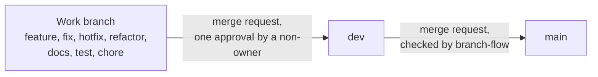

# Team 9, Connect Nine, Collaboration Agreement

**Status: draft, not signed yet. The team is still working on the final version.**

| | |
| --- | --- |
| Team number | 9 |
| Team name | Connect Nine |
| Product | Young Amstelland Connect |
| Program | HBO-ICT Full Time |
| Organization | Amsterdam University of Applied Sciences |
| Studio | Social Impact Apps, semester 1, 2026-2027 |
| Client | Rachid Kherrazi, WailSalutem Foundation |
| Team coach | Karthik Srinivasan |
| Version | 1.12 draft, 27 September 2026. It follows version 1.11 of 23 September 2026 and updates the facts the board changed since then: the sprint dates, the stack, commits, branches and the Definition of Done |
| Semester start | 31 August 2026 |
| Sprint 1 start | 21 September 2026 |
| Project completion | week of 4 January 2027 |
| Classification | Open. The client wants the project visible, to motivate young people and to show the foundation works with the HvA |

## 1. Introduction

This collaboration agreement defines the working arrangements for the Connect Nine project. It
sets expectations for communication, documentation, responsibilities, and team conduct so the
collaboration stays clear and productive.

The product is called Young Amstelland Connect. It is the project assignment for the Social
Impact Apps studio, and the client is the WailSalutem Foundation.

All team members are responsible for following the rules in this agreement and for addressing
team members who do not follow them.

## 2. Team members and contact details

Email addresses and phone numbers stay outside Git, in the contact list the team keeps on Teams.

_Students_

| Name | Profile | Level |
| --- | --- | --- |
| Bayon Eerhart | Full Stack Software Developer | 2 |
| Nick Hoebe | Full Stack Software Developer | 3 |
| Wesley Oerlemans | Full Stack Software Developer | 3 |
| Gurpreet Singh | Full Stack Software Developer | 3 |
| Kelvin van Voorst | Security Specialist | 2 |

_Coach_

- Karthik Srinivasan

_Client_

- Rachid Kherrazi, WailSalutem Foundation
- www.wailsalutem-foundation.com
- Zanderij 29, 1185 ZM Amstelveen

## 3. Communication

Microsoft Teams is the primary channel and carries everything that needs to be findable later:
decisions, documents, and anything the coach or the client may need to read.

The WhatsApp group **Team 9 | Connect Nine** is for short and urgent messages, and for anything
outside contact hours.

A message is answered within 24 hours. There is no fixed window inside that, and nobody is
expected to be reachable at a particular moment.

## 4. Working hours, attendance and the semester calendar

Each team member spends **24 hours a week** on the project, across **three project days**.

On campus, the project contact hours are **Thursday 9:00 to 12:00** and **Friday 12:00 to
14:30**. All other contact is remote. Attendance at all scheduled parts of the day is a
condition of passing the semester, and the studio asks for attendance close to 95 percent.

If a team member cannot attend, they inform the team in advance. If that is not possible, they
say so as soon as possible afterwards. An absent team member catches up on what was missed
themselves.

### Dates that affect the plan

| Date | What |
| --- | --- |
| 21 Sep to 9 Oct | sprint 1 |
| week of 28 Sep | no lecturer guidance |
| week of 5 Oct | progress evaluation 1 |
| 12 to 17 Oct | autumn break |
| 19 Oct to 6 Nov | sprint 2 |
| 26 Oct | knowledge test 1 |
| 9 to 27 Nov | sprint 3 |
| 8 to 13 Nov | Bayon Eerhart is at the Stuttgart BIP |
| week of 16 Nov | progress evaluation 2 |
| 30 Nov to 18 Dec | sprint 4 |
| week of 30 Nov | no lecturer guidance |
| week of 14 Dec, day to be confirmed | knowledge test 2 |
| 21 Dec to 2 Jan | Christmas break |
| 4 to 8 Jan | sprint 5, project completion and progress evaluation 3 |

Each sprint ends with a sprint review at the client and a retrospective. The sprint dates are the milestones Sprint 1 to Sprint 5 in GitLab, see `gitlabSetup.md`.

## 5. Project roles

Scrum Master and Product Owner rotate every sprint. Both are roles and neither is a full-time
job.

The Scrum Master organizes the daily standup, maintains the impediment log and removes
impediments. The Product Owner maintains communication with the client and other stakeholders,
and maintains quality within the project.

| Sprint | Scrum Master | Product Owner |
| --- | --- | --- |
| 0 | Nick Hoebe | Gurpreet Singh |
| 1 | Wesley Oerlemans | Nick Hoebe |
| 2 | Gurpreet Singh | Bayon Eerhart |
| 3 | Kelvin van Voorst | Wesley Oerlemans |
| 4 | Bayon Eerhart | Kelvin van Voorst |

Every team member holds each role exactly once across the five sprints.

**The Stuttgart BIP needs no cover.** Bayon Eerhart is abroad from 8 to 13 November, the first
week of sprint 3, and holds no role in that sprint: he is Product Owner in sprint 2 and Scrum
Master in sprint 4, both of which he attends in full. He catches up on the missed week himself,
per section 4.

### Standup

When the team is physically together, the standup is held in person.

When a team member works from home, the minimum is a written message covering three things:
what they did, what they are going to do, and any blockers.

If this proves not to work, the team tightens it into a fixed schedule with a plan per week for
when the standup happens and how long it takes.

### Retrospective

The retrospective is held on the last physical lesson day of the sprint.

## 6. Documentation

### Commit Messages

Every commit follows Conventional Commits with the issue number at the end:
`<type>(<scope>): <what changed> (#<issue number>)`, for example
`feat(backend): add account endpoint (#3)`.

The types:

1. `feat` Add a new feature.
2. `fix` Fix bugs or resolve defects.
3. `refactor` Change existing code without changing behavior, also when removing code.
4. `chore` Make small maintenance changes.
5. `docs` Add or update documentation.
6. `test` Add or update tests.

The scope is frontend, backend, database, pipeline or docs. Version 1.11 put the issue number
in front (`#issue number feat:`) and had a separate label `remove`. The board changed that:
the number moved to the end and removing code is a `refactor`. The full rules
are in `codeConventions.md`.

### Code Conventions

The stack is React with TypeScript for the frontend, .NET 10 with ASP.NET Core for the backend,
and PostgreSQL 16 for the database, used through EF Core and Npgsql. On 2026-09-22 the team chose
Microsoft SQL Server, a decision relayed by Wesley Oerlemans. On 2026-09-26 the team changed it
to PostgreSQL, because it is lighter to run in Docker on the client's server and has none of the
license questions of SQL Server. Both decisions are recorded with their rationale in
`docs/architecture/techStack.md`. The conventions are the established best practices of that
stack, together with SOLID, DRY as far as is practical, and clean code as far as is practical.

The stack-specific conventions are in `codeConventions.md`, one part per layer: frontend,
backend and database. Issue 01 The repository, the pipeline and the team rules writes them in
the repository, and `docs/decisions/001-codeConventions.md` records the choices.

### Branches and Merge Requests

1. `main` and `dev` are protected. No direct commits and no pushes. They change only through a
   merge request.
2. `dev` is the only branch that merges into `main`. The pipeline job branch-flow checks this on
   every merge request into `main`.
3. Every work branch merges into `dev`: feature, fix, hotfix, refactor, docs, test and chore
   alike.
4. Branch names follow the format `<type>/<issue number>-<short name>`, for example
   `feature/12-create-an-account`, with the types `feature/`, `fix/`, `refactor/`, `docs/`,
   `test/` and `chore/`.
5. Hotfix branches are `hotfix/<short name>` and are exempt from the issue number rules: no issue
   number in the branch name, the commit or the merge request name. An issue is created after the
   fact, so the paper trail catches up.
6. Merge request names use the commit format, so they include an issue number, hotfixes excepted
   per rule 5. The description starts with `Relates to #<issue number>`.
7. At least one reviewer must be a non-owner. GitLab enforces this: a merge request needs one
   approval, and neither its author nor anyone who added commits to it can approve it.

The picture below shows the only way a change reaches `main`.

There is deliberately no hotfix path straight into `main`. A bypass would weaken the protection
that rule 1 exists to provide. A hotfix goes into `dev` and then from `dev` into `main`.

Repository: the project connect-nine on gitlab.fdmci.hva.nl, the GitLab of the HvA, set up on
27 September 2026. How it is set up is in `gitlabSetup.md`.

## 7. Quality assurance

### Definition of Done

Work is done when every line of the Definition of Done of its issue type is true. There is one
list per type: slice, setup, research, decision and client. The lists are in
`definitionOfDone.md` and every issue carries its list with a checkbox on every line.

The lists replace the seven lines of version 1.11 and keep all seven:

1. The code follows the team's code conventions.
2. The linter passes.
3. There are no compile errors.
4. No warnings remain. The backend treats every warning as an error, so a warning stops the
   build and there is nothing left to explain.
5. Tests are written and pass: unit tests, and for every slice also integration tests, screen
   tests and one test in a real browser.
6. The documentation is updated, for both the code and the architecture.
7. Significant choices are documented, one file per choice in `docs/decisions`.

The lists also add a peer test, security, screen, review and deploy checks, and the AI
declaration of section 9.

### Documentation location

Project documentation lives in the `docs` folder in the repository.

## 8. Responsibilities

Each team member is expected to complete assigned work on time, communicate blockers early, and
contribute to shared project goals. If someone cannot meet a deadline, they should inform the
team as soon as possible so the work can be redistributed.

Team members often take on tasks that fit their profile, and also work outside it.

Minor problems are solved within the team first. Larger problems are discussed with the team,
and if they cannot be resolved quickly the person in question raises them with the team coach.

## 9. AI use

Using AI is allowed. Not mentioning it is not, and undisclosed AI-generated content counts as
fraud, which a lecturer is obliged to report to the Board of Examiners.

### 9.1 Declaration in written work

Each team member includes a declaration in the written work they hand in. The wording used in
this team is:

**AI was used as a writing support tool while working on this document. We used AI to improve
the formulation of sentences, the structure of wording, readability, and clarity of text that
we had written. The content itself, including our experiences, reflections, learning goals,
decisions, self-assessments, and conclusions, is our own. We reviewed the suggested changes
and decided as a team which improvements to include.**

### 9.2 Limitations set by the client

The client sets no limitations on AI use, confirmed in September 2026. The team's own rules
in this section and the school's rules in the study manual apply unchanged.

### 9.3 AI in project code

Code produced with AI follows the repository style and the same conventions as code written by
hand. The team member who commits it has read what the AI produced at least once.

The AI models used in the project are named here, in this section, so one place answers which
tools the team works with. The team as a whole uses the providers listed below, and the exact
model versions are pinned when a hand-in disclosure is written.

Models in use:

- Anthropic, Claude models
- OpenAI, GPT models

## 10. Consequences

A strike is issued by a majority vote of the team, when a team member does not follow this
collaboration agreement.

1. First strike: internal reminder and discussion within the student team.
2. Second strike: a formal internal warning and follow-up with the coach.
3. Third strike: escalation to the teacher, with the issue documented and discussed further.
   The team member leaves the team.

After each strike, the team will agree on a clear improvement point and a deadline for review.
If the behavior improves, no further action is needed.

Strikes do not reset and do not expire. They stand for the semester.

## 11. Signed by

The team signs here once the final version is agreed. Until then the table stays empty.

| Name | Signed | Date |
| --- | --- | --- |
| Bayon Eerhart | | |
| Nick Hoebe | | |
| Wesley Oerlemans | | |
| Gurpreet Singh | | |
| Kelvin van Voorst | | |
