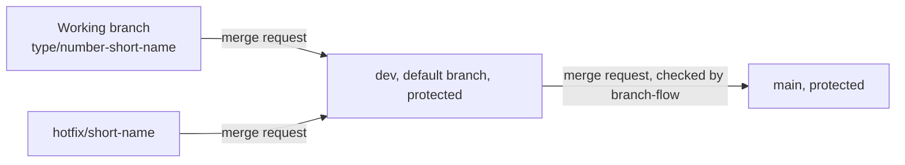
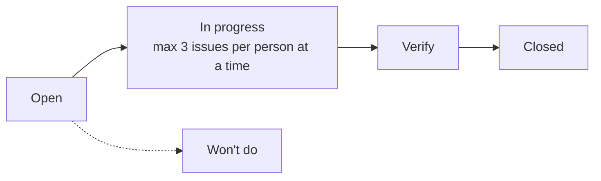
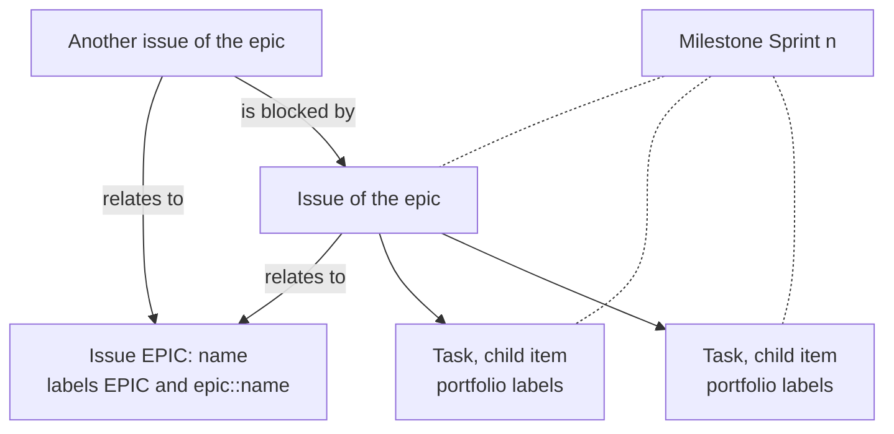

# How the GitLab project is set up

How the project Connect Nine on gitlab.fdmci.hva.nl is set up, written so someone outside the team can repeat it on a new project. It follows tasks 1.2, 1.3 and 1.8 of issue 01. Set on 27 September 2026.

The HvA GitLab runs GitLab 19.4 in the Free tier. Where a setting needs a paid tier, this file says what the team does instead.

## Members

The five students are Maintainers on the project, through the HvA group (access
level 40, checked through the GitLab API on 8 October 2026): Bayon Eerhart, Nick Hoebe,
Wesley Oerlemans, Gurpreet Singh and Kelvin van Voorst. Their individual
profiles and levels are listed in the collaboration agreement. Teachers and
coaches only watch the work; they do not take part in making changes.
Through the HvA group some teachers and coaches also have Maintainer or Owner
rights on the project (checked through the GitLab API on 9 October 2026), so
GitLab would let them change things. By agreement they only watch.

The client, Rachid Kherrazi of the WailSalutem Foundation, has no GitLab
account.
The HvA GitLab only has school accounts (login through the school, no sign up),
so the client cannot get an account and cannot be added to the project. He follows the work through the sprint review and the client contact
log in `docs/client/clientContact.md`. The log records what the team asks and
what the client answers, so every student can follow the same information.

## Branches and protection

- Code, Branches, New branch: dev, made from main.
- Settings, Repository, Branch defaults: dev is the default branch, so every clone and every new merge request starts from dev, and GitLab offers the templates of .gitlab from dev.
- Settings, Repository, Protected branches, for main and for dev: Allowed to push and merge set to No one, Allowed to merge set to Maintainers, Allowed to force push off. Nobody can push to dev or main, every change goes through a merge request.
- main only takes merge requests from dev. The pipeline job branch-flow in .gitlab-ci.yml checks it: a merge request into main from any other branch fails that job. The job runs on the HvA runners with the tag hva.
- Settings, Merge requests: Pipelines must succeed is on, switched on by Wesley Oerlemans on 8 October 2026. A merge request with a red or running pipeline cannot be merged. On top of that, a reviewer never approves a merge request with a red pipeline (rule 11 of the code conventions).
- A working branch is `<type>/<issue number>-<short name>`, made from dev. An urgent repair of the live site is `hotfix/<short name>`. It also goes through dev, because main only takes merge requests from dev. See docs/team/codeConventions.md.
- History: the first set of templates and docs went onto main directly on 27 September 2026, before the protection existed. Every change after that goes through a merge request.

The picture below shows which branch may merge into which.

## Merge requests

- Settings, Merge requests: All threads must be resolved on, and Delete source branch on by default.
- Settings, Merge requests, Merge request approvals: one approval required from any member, the author may not approve their own merge request, and people who added commits may not approve it either. Approvals are removed when new commits are pushed.
- The team rule holds on top of the setting: nobody merges without an approval of someone else, and the reviewer of the Definition of Done checks it on every issue.
- Every merge request has all five students as reviewer: Bayon Eerhart, Gurpreet Singh, Nick Hoebe, Kelvin van Voorst and Wesley Oerlemans (team rule since 9 October 2026), so everyone sees every change. One approval of someone who is not the author is still enough to merge. The template Default.md holds the quick action `/assign_reviewer` with the five names. A merge request made through the API or glab gets them with `reviewer_ids`.
- The template .gitlab/merge_request_templates/Default.md fills the description of every new merge request. Its parts: Relates to, the reviewers line, What changed, How to check it, The test that fails when its rule is removed, Proof for the portfolio, The version to go back to, TODO (rule 10 of the code conventions) and AI use (section 9.1 of the collaboration agreement).

## Pipeline

The file is .gitlab-ci.yml in the root. It runs on the HvA runners with the tag hva.

- When it runs: once on every merge request, and once more on dev and on main after a merge. A push to a branch that already has an open merge request does not start a second pipeline.
- Stage build, job backend-build: `dotnet build api/Connect.slnx`, then `dotnet format api/Connect.slnx --verify-no-changes` to catch a layout the editor did not fix.
- Stage build, job frontend-build: `npm ci` and `npm run build` in `web`, which type checks the screen and bundles it.
- Stage build, job image-build: only on a merge request. Builds the images server and migrations from the `Dockerfile` with kaniko and pushes nothing, so a broken Dockerfile turns only this job red.
- Stage build, job image-push: only on dev and main, after a merge. Builds both images and pushes them to the registry, part Images and the registry below.
- Stage test, job env-file-check: fails when a .env file is in Git, and names the file in its log. Only .env.example may be committed.
- Stage test, job branch-flow: only on a merge request. Fails when the target is main and the source branch is not dev.
- Stage test, job backend-test: `dotnet test api/Connect.slnx` against a real PostgreSQL 16, started for the job under the alias `database`. The user, password and name of that throwaway database are the CI/CD variables TEST_POSTGRES_USER, TEST_POSTGRES_PASSWORD and TEST_POSTGRES_DB (Settings, CI/CD, Variables), never written in `.gitlab-ci.yml`.
- Stage test, job frontend-lint: `npm run lint` (ESLint) and `npx prettier --check .` in `web`.
- Stage test, job frontend-test: `npm test` (Vitest) in `web`.
- Stage test, job terraform-check: `terraform init -backend=false`, `terraform fmt -check -recursive` and `terraform validate` in `infra/terraform`, without reaching production.
- Stage deploy, job kube-check: on dev, and by hand on a merge request. Shows that the node of production is Ready, with the read only login.
- Stage deploy, job terraform-plan: on a merge request that changes `infra/` or `.gitlab-ci.yml`. Puts the plan of production on the merge request, `docs/team/onboarding.md` part 14 Changing production.
- Stage deploy, job deploy-production: on main, after a merge. Puts that version on the live address by itself, part 14 From dev to main to production.
- Stage deploy, job smoke-production: on main, right after deploy-production. Two read only browser tests of the live address, `web/e2e/productionSmoke.spec.ts`.
- Stage deploy, job rollback-production: on main, by hand, with the variable ROLLBACK_IMAGE_TAG. Puts an earlier version back, part 14 Going back in production.
- A red pipeline locks the Merge button through Pipelines must succeed (part Branches and protection). On top of that, a reviewer never approves a merge request with a red pipeline. No job of stage build or stage test has allow_failure, so a red build or test job always blocks the merge.
- The jobs of stage test start only when every job of stage build is green, image-build included, so no test passes a version whose build went wrong. That makes a merge request wait for the images, about five and a half minutes in all, and it stays that way on purpose (decided on 22 October 2026).

When it is red:

1. Open the merge request, tab Pipelines, and click the red run.
2. Click the red job. The last lines of the log say what failed: env-file-check lists the .env file, branch-flow says which branch must go into dev first.
3. Fix it on your branch and push. The pipeline starts again by itself. A .env you committed by accident: `git rm --cached <file>`, then commit and push. The password in it counts as leaked, so change it.

## Images and the registry

The images of Connect are built in the pipeline and kept in the container registry of the project (Deploy, Container registry). The test site (#355) and production (#159) start these images, so they run exactly the version that was reviewed.

- **What the HvA runners allow.** Every job runs in a Docker container without privileged mode, with Docker's default seccomp profile and AppArmor profile, so a job cannot make a user namespace or mount anything. Docker in Docker, Buildah, Podman and BuildKit rootless are refused there, and kaniko builds, because it needs neither (measured on 22 October 2026, pipelines 586250, 586252, 586254 and 586259). The comparison and the choice are in `docs/decisions/008-kanikoForImages.md`.
- **The builder.** The maintained fork of kaniko, pinned as `ghcr.io/osscontainertools/kaniko:v1.28.6-debug` in the jobs image-build and image-push. An update of the tag is a merge request of its own.
- **The images.** `server`, the server with the screen in `wwwroot`, and `migrations`, which brings the tables up to date and stops. Each is stored as `$CI_REGISTRY_IMAGE/server:<short commit id>` and `$CI_REGISTRY_IMAGE/migrations:<short commit id>` of the merge on dev or on main, never only as latest.
- **The login.** image-push logs in with `CI_REGISTRY_USER` and `CI_REGISTRY_PASSWORD`, the variables GitLab gives every job. kaniko has no login command, so the job writes them into its own config file. No password is in `.gitlab-ci.yml`.
- **The cleanup.** The registry is on. Its cleanup policy (Settings, Packages and registries) keeps the ten newest versions of each image and removes older ones once they are a week old, so the registry never fills up.
- **Finding the image of the last merge.** Deploy, Container registry, the image `server`, and the tag with the short commit id of the merge.

## Labels

Settings, Labels. Scoped labels use two colons. The colours, as set in GitLab on 9 October 2026: prio::must FFD6D1, prio::should FFE9A8, prio::could D6F2DC, prio::nice-to-have EDEDED, type::slice CFE8FF and the other types E6DDFB, sprint::1 111111, sprint::1-stretch FFFFFF, sprint::2 to sprint::5 6B6B6B, blocked 111111, epic::&lt;name> 6699CC, EPIC FFDDC2, school::required FFE9A8, school-only E9D5FF, project DCE8F5, outcome and level F3F3F1, direction::full-stack CFE8FF, direction::security-specialist FFE9A8, Doing and Verify E6E6E6. The page Epics and features on the Figma board uses the four prio colours.

- prio::must, prio::should, prio::could, prio::nice-to-have, starred in that order (label priority) so lists sort by them.
- type::slice, type::setup, type::research, type::decision, type::client.
- sprint::1, sprint::1-stretch, sprint::2 to sprint::5, and blocked (always with the reason in the issue).
- epic::<name>, one per epic, and EPIC on the issue that stands for an epic.
- school::required on issues that exist because of a school requirement.
- school-only, next to school::required, on a school issue that adds nothing to Connect itself: knowledge tests, research outside Connect, proposals and peer reviews, evidence for the portfolio, the DevOps recording and demo, and the workshop issues. A school issue that builds something in Connect (production, monitoring, the rate limit, a document for the client) does not get it. Since 10 October 2026. It has no two colons on purpose: scoped labels work on this GitLab, so `school::only` would remove school::required.
- project on every issue that is not school-only and not an EPIC issue, since 10 October 2026. The sprint boards show only this label. The templates slice, client, decision and setup add it with `/label ~project`.
- On every task, never on the issue: outcome::analysing-and-advising, outcome::designing-and-realising, outcome::managing-and-collaborating, level::2, level::3, direction::full-stack, direction::security-specialist.
- Doing and Verify are old labels from before the boards used the status of an issue. The boards do not use them (see Boards, one per sprint).

## Epics

Real epics need a paid tier. Every epic is an issue with the title `EPIC: <name>` and the labels EPIC and `epic::<name>`. Its description says in one sentence what the epic is for and links every issue of that epic in build order. Every issue has a link "relates to" to its EPIC issue. Filter on the label EPIC to see all epics.

## Milestones, one per sprint

A sprint ends in the week of its sprint review and retrospective in the HvA schedule.

| Milestone | Start | Due |
|---|---|---|
| Sprint 1 | 21 September 2026 | 9 October 2026 |
| Sprint 2 | 19 October 2026 | 6 November 2026 |
| Sprint 3 | 9 November 2026 | 27 November 2026 |
| Sprint 4 | 30 November 2026 | 18 December 2026 |
| Sprint 5 | 4 January 2027 | 8 January 2027 |

Every milestone description has the three headings the assessor looks for: Sprint goal, MVP after this sprint and Client feedback. The team fills them at the start of the sprint. Every issue and every task carries the milestone of its sprint.

## Boards, one per sprint

Plan, Issue boards: Sprint 1 to Sprint 5 for the project, and School · Sprint 1 to School · Sprint 5 for school work, each with the lists Open, In progress, Verify, Won't do and Closed. Every board has its sprint and one label in its settings, and GitLab fills the filter with them when the board opens: the sprint boards show the label project, the School boards the label school-only. A board setting cannot say "without a label", which is why project issues have a label of their own. The filter above the board can still be changed by hand, and the milestone of every sprint links both boards. The three lists in the middle follow the status of an issue, not a label. A card stands in the list of its status, and dragging it to another list changes its status. In progress has a limit of 3 issues per person. The board does not enforce it, so the team checks it at the daily.

- Open: the issues of the sprint that nobody started yet.
- In progress: someone works on it.
- Verify: the work is ready, and a teammate reviews it and checks the Definition of done.
- Won't do: the team decided not to build it. The reason goes in a comment on the issue.
- Closed: done. Closing an issue gives it the status Done.

The picture below shows how an issue moves through the lists of a sprint board.

Two limits of the Free tier:

1. A board cannot be tied to a milestone. Every milestone description therefore holds a link to its board with the milestone filter, which shows only the issues of that sprint. Keep that link as a bookmark.
2. A board shows issues, not tasks. The same milestone description links to the list of all tasks of that sprint.

## Issues and tasks

The picture below shows how an epic, its issues, their tasks and the sprint milestone hang together.

- Every card of the board is one issue: the story as the title, and the parts from DESCRIPTION to DEFINITION OF DONE as the description. The first line names the board number and the rank. docs/team/boardNumbers.md lists the board number next to the GitLab number.
- Work the team did before it had an issue gets an issue afterwards, in the milestone of the sprint where it was done, and is closed at once (rule A8 of docs/team/issueRules.md). Issues #1500 to #1515, logged on 9 October 2026, are the first ones.
- A title may hold 255 characters. A longer story is shortened in the title, and the full story stands at the top of the description.
- Every task is a child item of its issue, in the order of the board, with its portfolio labels and the milestone of its issue.
- Every "is blocked by" of the board is a linked item, so each issue also shows "blocks" on the other side.
- New issues start from the templates in .gitlab/issue_templates, one per type.

## Templates

- Issue templates live in .gitlab/issue_templates on dev: slice, setup, research, decision and client for an issue, and task for a task. New issue, Description, Choose a template offers all six. The Definition of Done in each template copies only the bold sentences of docs/team/definitionOfDone.md, and the two change in the same merge request.
- The merge request template is .gitlab/merge_request_templates/Default.md. Because it is named Default, GitLab fills it in by itself on every new merge request made in the browser. A merge request made through the API or glab starts empty, so paste the template there by hand.
- The line `/assign_reviewer @eerharb @singhg11 @hoebenj @voorstk2 @oerlemw` in the template adds the five reviewers when the merge request is saved. Still to confirm on the first merge request made in the browser after this merge: the five names show under Reviewers and the line is gone from the description. If the line stays, add the reviewers by hand.
- Settings, General, Default description template for issues: GitLab offers this setting only in Premium and Ultimate (GitLab Docs, Description templates). The project API shows the field issues_template, empty on 8 October 2026, but a field in the API does not prove the HvA licence has the setting. The team does not need it: an issue has five types and no single default fits all of them, and the merge request default comes from the name Default.md.

## AI use declaration

AI was used as a writing support tool while working on this document. We used AI to draft
the formulation of sentences, the structure of wording, readability, and clarity from
content that we had provided, and to generate the diagrams. The content itself, including
our experiences, reflections, learning goals, decisions, self-assessments, and
conclusions, is our own. We reviewed the drafts and decided as a team which text to
include.
