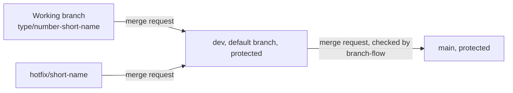
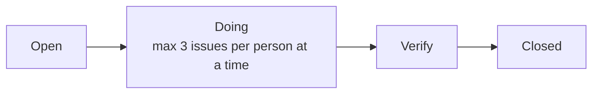
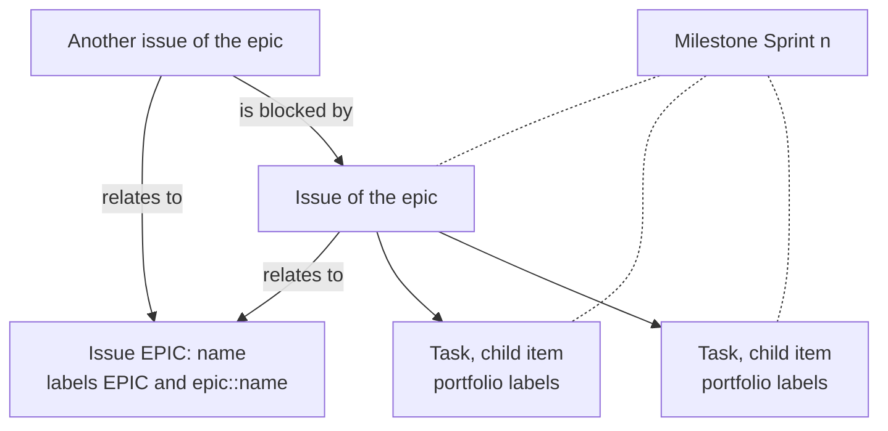

# How the GitLab project is set up

How the project Connect Nine on gitlab.fdmci.hva.nl is set up, written so someone outside the team can repeat it on a new project. It follows section 8 of the page Issue creation on the Figma board and tasks 1.2, 1.3 and 1.8 of issue 01. Set on 27 September 2026.

The HvA GitLab runs GitLab 19.4 in the Free tier. Where a setting of section 8 needs a paid tier, this file says what the team does instead.

## Members

The five students are Developers on the project: Bayon Eerhart, Nick Hoebe,
Wesley Oerlemans, Gurpreet Singh and Kelvin van Voorst. Their individual
profiles and levels are listed in the collaboration agreement. Teachers and
coaches only watch the work; they do not take part in making changes.

The client, Rachid Kherrazi of the WailSalutem Foundation, has no GitLab
account.
The school accounts cannot add members, so the client cannot be added to the
project. He follows the work through the sprint review and the client contact
log in `docs/client/clientContact.md`. The log records what the team asks and
what the client answers, so every student can follow the same information.

## Branches and protection

- Code, Branches, New branch: dev, made from main.
- Settings, Repository, Branch defaults: dev is the default branch, so every clone and every new merge request starts from dev, and GitLab offers the templates of .gitlab from dev.
- Settings, Repository, Protected branches, for main and for dev: Allowed to push and merge set to No one, Allowed to merge set to Maintainers, Allowed to force push off. Nobody can push to dev or main, every change goes through a merge request.
- main only takes merge requests from dev. The pipeline job branch-flow in .gitlab-ci.yml checks it: a merge request into main from any other branch fails that job. The job runs on the HvA runners with the tag hva.
- Settings, Merge requests: Pipelines must succeed. Checked on 8 October 2026: it is off, and only a Maintainer can switch it on, while the five students are Developer (part Members). Until a teacher switches it on, the Merge button still works on a red pipeline, and only the reviewer rule stops a red change: a reviewer never approves a merge request with a red pipeline (rule 11 of the code conventions).
- A working branch is `<type>/<issue number>-<short name>`, made from dev. An urgent repair of the live site is `hotfix/<short name>`. It also goes through dev, because main only takes merge requests from dev. See docs/team/codeConventions.md.
- History: the first set of templates and docs went onto main directly on 27 September 2026, before the protection existed. Every change after that goes through a merge request.

The picture below shows which branch may merge into which.

## Merge requests

- Settings, Merge requests: All threads must be resolved on, and Delete source branch on by default.
- Settings, Merge requests, Merge request approvals: one approval required from any member, the author may not approve their own merge request, and people who added commits may not approve it either. Approvals are removed when new commits are pushed.
- The team rule holds on top of the setting: nobody merges without an approval of someone else, and the reviewer of the Definition of Done checks it on every issue.
- The template .gitlab/merge_request_templates/Default.md fills the description of every new merge request. Its parts: Relates to, What changed, How to check it, The test that fails when its rule is removed, Proof for the portfolio, The version to go back to, TODO (rule 10 of the code conventions) and AI use (section 9.1 of the collaboration agreement).

## Pipeline

The file is .gitlab-ci.yml in the root. It runs on the HvA runners with the tag hva.

- When it runs: once on every merge request, and once more on dev and on main after a merge. A push to a branch that already has an open merge request does not start a second pipeline.
- Stage build: compiles the server and the screen. Still empty, task 3.8 (#266) adds backend-build and frontend-build.
- Stage test, job env-file-check: fails when a .env file is in Git, and names the file in its log. Only .env.example may be committed.
- Stage test, job branch-flow: only on a merge request. Fails when the target is main and the source branch is not dev.
- The reviewer rule: a reviewer never approves a merge request with a red pipeline. While Pipelines must succeed is off (part Branches and protection), this rule is the only thing that stops a red change.

When it is red:

1. Open the merge request, tab Pipelines, and click the red run.
2. Click the red job. The last lines of the log say what failed: env-file-check lists the .env file, branch-flow says which branch must go into dev first.
3. Fix it on your branch and push. The pipeline starts again by itself. A .env you committed by accident: `git rm --cached <file>`, then commit and push. The password in it counts as leaked, so change it.

## Labels

Settings, Labels. Scoped labels use two colons. The colours follow section 8 step 1.

- prio::must, prio::should, prio::could, prio::nice-to-have, starred in that order (label priority) so lists sort by them.
- type::slice, type::setup, type::research, type::decision, type::client.
- sprint::1, sprint::1-stretch, sprint::2 to sprint::5, and blocked (always with the reason in the issue).
- epic::<name>, one per epic, and EPIC on the issue that stands for an epic.
- school::required on issues that exist because of a school requirement.
- On every task, never on the issue: outcome::analysing-and-advising, outcome::designing-and-realising, outcome::managing-and-collaborating, level::2, level::3, direction::full-stack, direction::security-specialist.
- Doing and Verify, the two lists of the boards between Open and Closed.

## Epics

Real epics need a paid tier. Every epic is an issue with the title `EPIC: <name>` and the labels EPIC and `epic::<name>`. Its description says in one sentence what the epic is for and links every issue of that epic in build order. Every issue has a link "relates to" to its EPIC issue. Filter on the label EPIC to see all epics.

## Milestones, one per sprint

A sprint ends in the week of its sprint review and retrospective in the HvA schedule.

| Milestone | Start | Due |
|---|---|---|
| Sprint 1 | 21 September 2026 | 9 October 2026 |
| Sprint 2 | 19 October 2026 | 6 November 2026 |
| Sprint 3 | 9 November 2026 | 27 November 2026 |
| Sprint 4 | 30 November 2026 | 18 December 2026 |
| Sprint 5 | 4 January 2027 | 8 January 2027 |

Every milestone description has the three headings the assessor looks for: Sprint goal, MVP after this sprint and Client feedback. The team fills them at the start of the sprint. Every issue and every task carries the milestone of its sprint.

## Boards, one per sprint

Plan, Issue boards: Sprint 1 to Sprint 5, each with the lists Open, Doing, Verify and Closed. Doing has a limit of 3 per person. The Free tier cannot enforce list limits, so the team checks it at the daily.

The picture below shows the four lists an issue moves through on a sprint board.

Two limits of the Free tier:

1. A board cannot be tied to a milestone. Every milestone description therefore holds a link to its board with the milestone filter, which shows only the issues of that sprint. Keep that link as a bookmark.
2. A board shows issues, not tasks. The same milestone description links to the list of all tasks of that sprint.

## Issues and tasks

The picture below shows how an epic, its issues, their tasks and the sprint milestone hang together.

- Every card of the board is one issue: the story as the title, and the parts from DESCRIPTION to DEFINITION OF DONE as the description. The first line names the board number and the rank. docs/team/boardNumbers.md lists the board number next to the GitLab number.
- A title may hold 255 characters. A longer story is shortened in the title, and the full story stands at the top of the description.
- Every task is a child item of its issue, in the order of the board, with its portfolio labels and the milestone of its issue.
- Every "is blocked by" of the board is a linked item, so each issue also shows "blocks" on the other side.
- New issues start from the templates in .gitlab/issue_templates, one per type.

## AI use declaration

AI was used as a writing support tool while working on this document. We used AI to draft
the formulation of sentences, the structure of wording, readability, and clarity from
content that we had provided, and to generate the diagrams. The content itself, including
our experiences, reflections, learning goals, decisions, self-assessments, and
conclusions, is our own. We reviewed the drafts and decided as a team which text to
include.
