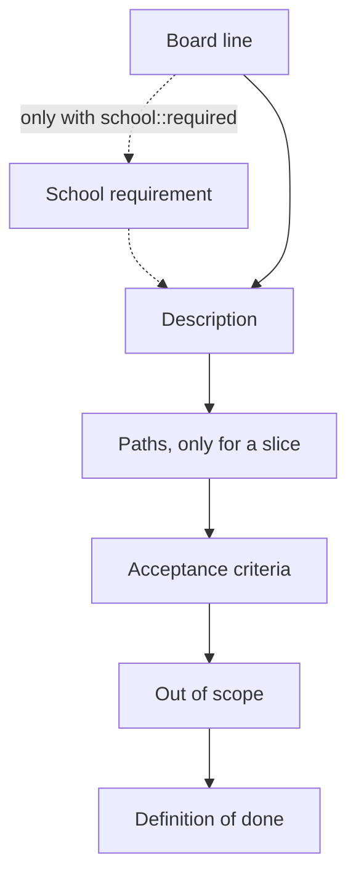

# Rulebook: how to write an issue and its tasks

This file is the source. The compact form was set by Wesley on 8 October 2026, after feedback from the team that issues and tasks were too long. Since 9 October 2026 the Figma board holds no rules and no issue texts, only the pages Issue pyramid and Epics and features (group H).

A person or an AI that follows these rules and the templates in .gitlab/issue_templates writes issues and tasks the same way. Issue #25 and its task #320 are the worked example. Group H says how the issues stand on the Figma board. When anything else disagrees with this rulebook, the rulebook wins.

## What an issue is

### A1

Every issue is short and written for someone outside the team: the client and a teacher must understand the description and the acceptance criteria. A card says what and why, not how. Explanations for newcomers (words, setup, the four layers) live once in docs, not on every card.

### A2

An issue is a vertical slice: one path from the screen through the server to the database that does one thing or shows one thing to a person using Connect. Two paths are two issues, however small the second one is. A form that creates something and the page that shows the result are two issues. An action and the list where you see it afterwards are two issues. Log in and log out are two issues.

### A3

Every slice has all three layers as tasks: at least one database task (a table, a column, an index, a query or seed data), one backend task and one frontend task, plus the tests. A separate frontend, backend or database issue does not exist. Those layers are tasks in the first slice that needs them.

### A4

Make every slice as small as possible while a person using Connect still notices it. When a slice holds several business rules, split by rule: first the basic version, then one issue per rule that improves or extends it. This is the agile way: first build the basic version, then improve or extend it. Example: 03 Create an account saves an account and refuses an email address that is taken. The password rules (at least fifteen characters, typing it twice the same) are a slice of their own, 03b A clear message when my password is too weak, because each rule with its message can be built and tested on its own.

### A5

Build only what the client needs. A slice exists because of a requirement in docs/project/requirements.md, or because another required slice cannot start without it. Never invent a feature only to prove the technology works. The first technical setup (the server project, the database, the pipeline, the first deploy) goes into the first real slice. Example: the old card 02 (the home page shows how many members Connect has) was removed on 26 September 2026 because no requirement asks for a member count. It only existed to connect the screen, the server and the database for the first time, so that setup moved into 03 Create an account. Exception, decided by Wesley on 27 September 2026: an issue that an HvA workshop requires may exist without a client requirement. It carries the label school::required and the part SCHOOL REQUIREMENT (rule C1), which says it is there because of school and not because the client asked for it, names the workshop and says why school asks it. It is still as small as possible, the client does not pay for it and it never delays a slice the client needs.

### A6

Work that is not a slice is still an issue, so the team records what it did and will do. It gets one type label: type::setup (tools, access, environments), type::research (a question answered with sources), type::decision (a choice between options), type::client (a question to the client). Keep these as few as possible. A normal slice has type::slice.

### A7

Weight is size and uncertainty compared with a known example, never a number of hours: 1, 2, 3 or 5, as in the weight scale in section 2. A 5 is a signal to split again. The only accepted 5 is a slice that cannot be split without making horizontal cards, and its description says why.

### A8

Work the team did before it had an issue still gets one afterwards, so the board shows everything the team did. The teacher asked for this on 9 October 2026. Such an issue stands in the milestone of the sprint where the work was done and is closed at once, so it lands in Closed with the status Done. It is assigned to the person who did the work. Work the whole team did together (the architecture, the design, the team agreements and everything that needed a brainstorm) is assigned to all five students. Its form is short: the story as the title (rules B1 and B2), the line "Logged afterwards on &lt;date>: this work was done in sprint &lt;n> before it had an issue of its own.", Description, Where to find it (the files or the merge request), and Acceptance criteria that are already ticked. It has no Definition of done, because its lines (a teammate checked it and wrote the date, and so on) were not done that way, and ticking them would not be true. It carries the type, epic, priority and sprint labels like any other issue. Issues #1500 to #1515 are the first ones.

## The story

### B1

The title of an issue is a user story: "As a &lt;role>, I want &lt;what>, so that &lt;what it gives me>." It is specific, and a person can check afterwards whether it is true.

### B2

The role is always a real person who uses Connect: a visitor, a person new to Connect, a young person, a member, an organisation, or a foundation employee named by function (admin of the foundation, platform owner, director, data protection contact). The role of an issue is NEVER a developer or the team, because we never build for ourselves. Only on an issue with school::required, when it serves school alone: a teacher of the HvA or the coach of the team. Rachid Kherrazi is the client: the director of the foundation and the contact for how the project must be. There is no separate data protection contact, the team writes the privacy rules and the client approves them.

### B3

The title of a task uses the same form with the developer as the role, and its "so that" names what the task makes possible for the role of the issue. Example: "As a developer, I want an address on the server that saves a new account, so that a person new to Connect can create an account."

## The parts of an issue, in this order

### C1

An issue has exactly these parts, in this order, each with its heading: the board line, Description, Paths (for developers), Acceptance criteria, Out of scope, Definition of done. An issue with the label school::required has one more part, School requirement, directly under the board line. Only a slice has Paths. The templates in .gitlab/issue_templates hold the parts, one template per type. Short wins: every line carries information, and nothing is repeated that is already in GitLab or in docs.

### C2

The board line: "Board number &lt;number> · rank &lt;number> · &lt;epic> · weight &lt;n>", and for a type that is not a slice also "· &lt;type>, not a slice". The rank is the build order on the board.

### C3

Description: 2 to 4 plain sentences without technical words, for someone outside the team: who it is for, what they can do when it is done, and why. Refer to another issue by its GitLab number, for example #24.

### C4

Paths (for developers), only on a slice. It opens with the line "Each unhappy path has the number of the happy path step where it goes another way." Happy path: numbered steps in the order the data travels, from what the person does on the screen, through the server address, what the server checks and the table it reads or writes, back to what the person sees. Unhappy paths: one line per thing that can go wrong, numbered with the step where it branches off and a letter (1a, 3a, 3b), each saying what happens and what the person sees. Together they cover wrong input, a person who is not allowed, a value that is taken, a double submit and a server or database that is not reachable, where they apply. Technical words are allowed here, because the reader is a developer.

### C5

Acceptance criteria: two parts, Functional and Non functional. Every criterion is "[ ] As a &lt;role>, I ..." with the role of the story, or a second real role when the issue touches two. It says what that person notices, in plain words, so a teammate without technical knowledge can tick it on the test site. Never a file, a server address, a table, a status code, a command or an issue number. No separate How to check: a good criterion can be checked as it is written. A rule that holds for every slice is not repeated here, it is in the Definition of done. No criterion needs a developer to change the database by hand.

### C6

Out of scope: one short list of what a reader might expect here, each with the GitLab number of the issue where it is done.

### C7

Definition of done: the line "Details per line: docs/team/definitionOfDone.md", then the list for the type of the issue. For a slice: one checkbox per category (Code, Tests, Peer test, Security, Screen, Review, Deploy, Docs) with the lines of that category in short. For setup, research, decision and client: the short list of that type in full. Never on a task.

### C8

Not in the text, because GitLab already holds it: the tasks (child items), is blocked by and blocks (linked items, set both ways), and the labels. Labels on an issue: type, epic, priority, sprint, and blocked with its reason when it applies. The portfolio labels (outcome, level, direction) are never on the issue. An issue that exists because of a school workshop also gets school::required.

## The parts of a task, in this order

### D1

A task is one thing on one layer: a table, an endpoint, a screen, seed data, a test in a real browser, a pipeline step, a deploy or a document. Never "the form and the page".

### D2

The unit tests and integration tests belong to the task that writes the code they test. Only the end to end test in a real browser and the manual team check are tasks of their own.

### D3

A task has exactly these parts, in this order, each with its heading: What, Checklist, BoKSA proof. The title is the story (rule B3). The template is .gitlab/issue_templates/task.md.

### D4

What: 1 or 2 sentences on what has to exist when the task is done, not how to build it.

### D5

Checklist: one checkbox per thing that must be in the result: the parts, the rules it must keep, the place in the code, the test that proves it, and the docs it updates. This is also what the reviewer checks. Technical words are allowed.

### D6

A task has no acceptance criteria and no Definition of done. Those belong to the issue.

### D7

LABELS: one outcome label for every learning outcome the proof block covers (outcome::analysing-and-advising, outcome::designing-and-realising, outcome::managing-and-collaborating), one level label for every level that can do the task (level::2, level::3), and one direction (direction::full-stack, or direction::security-specialist for a task of the security specialist).

## The proof block of a task (boksa)

### E1

The proof block is short and clear. It opens with: "This task can count as proof for the codes below. Write the proof in your merge request description and link that MR in Portflow under the code."

### E2

Then one block per code and level: a bold heading "&lt;code> &lt;name>" with the level and direction in brackets, for example "(Level 3, full-stack)", and three lines. "School wants to see:" the success criterion of that level in one plain sentence. "Show from this task:" the artefact and what it shows. "For level 3 also:" the alternative you did not choose, the standard you followed or what you changed after testing. A level 2 block has no "For level 3 also".

### E3

Level 3 is always there. Level 2 only when a level 2 student can do the task, and never when the core of the task is choosing and justifying (decide, choose, compare, weigh). A task of the security specialist uses that profile and its wording.

### E4

Which codes fit which task: a table or seed data OR1 and OR4. An endpoint OR1, OR2, OR4 and OR5. A screen OR1, OR3, OR4 and OR5. A test task OR4. Research AA1, AA2 and AA4. A decision AA4 and AA5. Process and pipeline work MS1 and MS4. PL never comes from a task, it comes from reflection at the sprint review.

### E5

The standards named under OR2 are real and specific, for example RFC 9110 for status codes, RFC 9457 for ProblemDetails, the OWASP Password Storage Cheat Sheet, WCAG 2.2 for accessibility, and the BoKSA article that fits.

### E6

OR5 at level 3 always asks for the student’s own judgment on a real trade-off in this task, named concretely.

## Writing style

### F1

Everything on the board and in GitLab is in English.

### F2

No em dashes and no semicolons in written text.

### F3

Plain words first. Technical words only in Paths (for developers) and in the checklist of a task.

### F4

Every part has a heading, and a blank line separates parts and paragraphs, so a reader who scrolls finds every part at once.

### F5

A reference to another card uses its GitLab number, for example #24. GitLab shows the title when you hover over it.

### F6

One set of names for the whole project, the same on every card: the folders frontend and backend, the backend projects Presentation, Application, Domain, Infrastructure and Connect.Tests, docs/project/requirements.md, docs/architecture/architecture.md, docs/architecture/api.md, docs/team/onboarding.md, docs/team/codeConventions.md, docs/team/definitionOfDone.md, docs/testing/testData.md, the folder docs/decisions, the docker compose service database, and server addresses under /api. Names in code follow docs/team/codeConventions.md.

### F7

A card holds what is special to this piece of work. What is the same for every card (the full Definition of done, the BoKSA school text, explanations of words and setup) lives once in docs and is not copied onto the card.

## How the issues stand on the Figma board (the pyramid and the epics)

### H1

GitLab is the source of every issue. The Figma board shows the issues only as a picture, on two pages: Issue pyramid and Epics and features. The text of an issue never goes onto the board, so the board cannot fall behind GitLab.

### H2

The page Issue pyramid has one column per epic, in build order from left to right, and one band per sprint, from top to bottom. A column shows what the team builds for that epic, a band shows when.

### H3

Inside a column an issue stands below every issue of the same epic that it waits for. Inside a band the issues stand in rows: an issue that waits for nothing in its epic is in the top row of its sprint, every other issue one row below the lowest issue of its epic that it waits for.

### H4

A card holds the GitLab number as a link to the issue and the short title, which is the part of the story after "I want". Under it the card names what else the issue waits for: "after #39" for an issue higher up in the same column, "after #12 Account" for an issue of another epic. That text is red when the issue it waits for is planned in a later sprint, so the planning has to change.

### H5

A line with an arrow runs from an issue to an issue in the row right below it that waits for it, inside one column. A wait over more rows, or on another epic, is the text on the card and not a line, so lines never cross a column or run through a card.

### H6

A card names only the waits that matter. When C waits for B and B waits for A, the card of C does not name A.

### H7

The page Epics and features has one column per epic in the same build order, with every issue of that epic under it, Must first, then Should, Could and Nice to have. Every card has the colour of its priority label in GitLab (part Labels of docs/team/gitlabSetup.md).

### H8

Both pages say at the top on which date they were made from GitLab. When issues, links, sprints or priorities change, the pages are made again from GitLab and never edited by hand.

### H9

Issues that are not slices (setup, research, decision, client) stand on both pages too, in their epic.

### H10

One truth for every link. Is blocked by and Blocks are set in GitLab as Linked items on both issues. The pages only show them.

### H11

The rank number is the build order over the whole project: an issue never has a lower rank than an issue that blocks it.

## Before a card is finished, check

### G1

- [ ] The role in the story is a real person, not a developer.
- [ ] The issue is one path, and a person using Connect notices it.
- [ ] It exists because of a requirement, or because a required slice needs it first.
- [ ] Every part is there, in the order of C1 for an issue and D3 for a task, with its heading.
- [ ] The description is 2 to 4 sentences without technical words.
- [ ] A slice has Paths, and every unhappy path carries the number of its happy path step.
- [ ] Every acceptance criterion starts with "As a &lt;role>" and can be checked without technical knowledge.
- [ ] Out of scope uses GitLab numbers.
- [ ] Every link under Linked items is also set on the other issue.
- [ ] Every slice has a database, a backend and a frontend task, and the unit and integration tests are inside the task that writes the code.
- [ ] Every task has What, Checklist and a BoKSA proof block, and no acceptance criteria or Definition of done.
- [ ] The Definition of done of the right type is on the issue, and on no task.
- [ ] Its epic, priority and sprint are set in GitLab, so the pages Issue pyramid and Epics and features show it in the right place when they are made again.
- [ ] No em dashes and no semicolons.

## AI use declaration

AI was used as a writing support tool while working on this document. We used AI to draft
the formulation of sentences, the structure of wording, readability, and clarity from
content that we had provided, and to generate the diagrams. The content itself, including
our experiences, reflections, learning goals, decisions, self-assessments, and
conclusions, is our own. We reviewed the drafts and decided as a team which text to
include.
