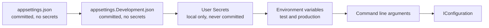

# Onboarding, everything a new member needs

This page takes a new team member from an empty machine to an approved merge request. Read it once from start to finish. After that, use the section you need.

Read three documents first, in this order: [collaborationAgreement.md](collaborationAgreement.md), [codeConventions.md](codeConventions.md) and [definitionOfDone.md](definitionOfDone.md). This page assumes all three.

## 1. What you install

| Tool      | Version                                                                           | Why                                                                                      |
| --------- | --------------------------------------------------------------------------------- | ---------------------------------------------------------------------------------------- |
| .NET SDK  | 10                                                                                | The backend of Connect                                                                   |
| Node.js   | 22, at least 22.13                                                                | The frontend of Connect. Vite needs 22.12 or newer, ESLint and the test tools need 22.13 |
| Docker    | current                                                                           | The database and the test site run in containers                                         |
| Git       | current                                                                           | Every change reaches dev through a merge request                                         |
| An editor | Visual Studio, Rider or Visual Studio Code                                        | Any of the three is fine                                                                 |
| dotnet-ef | matches the Entity Framework Core packages, pinned in `.config/dotnet-tools.json` | Creates and applies database migrations, part 4                                          |

Check that each one answers before you go on:

```
dotnet --version
node --version
docker --version
git --version
```

You should see four version numbers. `dotnet --version` starts with 10. `node --version` starts with v22. The other two print a line that starts with `Docker version` and `git version`. A line such as `command not found` means the tool is not installed or not on your path.

`dotnet-ef` is not installed by itself: it is a local tool, pinned to one version per repository in `.config/dotnet-tools.json`, and part 4 restores it before the first use.

## 2. Get the code

Clone the project and stay on `dev`, which is the default branch.

```
git clone https://gitlab.fdmci.hva.nl/studio/social-impact-apps/onderwijs/projects/2026-2027-semester-1/projects/project-9-wail-salutem-foundation-project-2/connect-nine.git
cd connect-nine
git switch dev
```

You should see `Cloning into 'connect-nine'...`, and after the last command `Already on 'dev'`.

Nobody pushes to `dev` or `main`. Both are protected. Every change starts on its own branch and reaches `dev` through a merge request that a teammate approves.

Two clones on the same laptop in folders named `connect-nine`? Docker Compose names the containers and the volume after the folder, so a second clone in a folder with the same name shares the containers and the volume of the first instead of getting its own. Clone the second copy into a folder with another name, or start it with `docker compose -p <name> up -d`.

## 3. Start the database

Connect uses PostgreSQL 16 in a container. `docker-compose.yml` in the root starts it together with pgAdmin, a web page to look inside it, with the same settings on every laptop. The database starts empty: the tables come from the migrations of the server, not from the compose file.

### Once per laptop

1. Install [Docker Desktop](https://docs.docker.com/desktop/) on your device and start it.
2. In the root of the repository, copy `.env.example` and name the copy `.env`. Already have a `.env`? Keep it, so you keep your passwords.
3. Open `.env` and replace `change-me` with a password of your own. `.env` is ignored by Git, so it stays on your laptop. Only Docker Compose reads it. Pick a password that is not an ordinary word, so `git grep "<your password>"` in section 8 finds nothing.

The database and pgAdmin only read the values in `.env` at their very first start. Changed one afterwards? Run `docker compose down -v` and `docker compose up -d`. That empties your local database, see the warning below.

### Start, check and stop

```
docker compose up -d              # start the database and pgAdmin
docker compose ps                 # wait until the database says (healthy)
docker compose stop               # stop both; your data stays
```

Look inside in one of two ways:

- **pgAdmin:** open http://localhost:5050. No login. Wait about half a minute after `docker compose ps` says the database is healthy before the page answers: pgAdmin itself still needs to start. The server Connect (local) is already on the left. The first time it asks for a password: that is `POSTGRES_PASSWORD` from your `.env`. Tick Save password.
- **psql:** `docker compose exec database psql -U connect -d connect`, and `\q` to leave. Use your own `POSTGRES_USER` and `POSTGRES_DB` if you changed them in `.env`.

The data lives in the volume `connect-data`, so a table you made is still there after `docker compose down` and `docker compose up -d`.

> **Careful with `docker compose down -v`.** The `-v` also removes the volume `connect-data`, and with it every row in your local database. Use it only when you want to start from an empty database on purpose. Afterwards the migrations build the tables again.

### Port 5432 or 5050 is busy

When `docker compose up` says `port is already allocated` or `address already in use`, another program already listens on that port of your laptop: another PostgreSQL on 5432, or another pgAdmin on 5050, for example the one of the database design in `docs/Gurpreet/dataModel/postgres`. Find it:

```
docker ps --filter publish=5432   # another container, for example of another project
docker ps --filter publish=5050
```

On Windows, `netstat -ano | findstr :5432` shows the process id, and Task Manager shows which program it is. On macOS and Linux, use `lsof -i :5432`.

On Windows, the message can instead be `bind: An attempt was made to access a socket in a way forbidden by its access permissions`. That is not another program on the port: Windows itself reserves a range of ports for Hyper-V and WinNAT. Check the reserved ranges with `netsh interface ipv4 show excludedportrange protocol=tcp`. Windows can reserve a range such as 5358 to 5457, so 5432 or a nearby port can fall inside it.

There are two fixes:

1. **Stop the other one.** Stop that container with `docker stop <name>`, or stop the locally installed PostgreSQL service, and run `docker compose up -d` again. A container that has a restart policy starts again with Docker Desktop, so stop it again after a restart, or switch its restart policy off with `docker update --restart no <name>`.
2. **Use another port.** Need the other PostgreSQL to keep running, or did Windows reserve 5432 for itself? In `docker-compose.yml`, change `"127.0.0.1:5432:5432"` into `"127.0.0.1:15432:5432"` and run `docker compose up -d` again. The database is then on `localhost:15432`, so use `Port=15432` in your own connection string. Keep this change on your laptop and do not commit it: the rest of the team uses 5432.

The seed accounts and the seed data of the test site are described in the testing folder.

## 4. Configuration and secrets

This is the section to get right. Connect keeps every secret out of Git, and there is one way to do that per environment.
The complete reference is [architecture/configuration.md](../architecture/configuration.md);
the tables and commands below are the onboarding version of the same rules.

### How the server reads settings

The backend uses the normal .NET configuration system. Five sources feed one `IConfiguration`, and each source overrides the one before it.



A value in `appsettings.json` is therefore a default, and an environment variable with the same name wins over it. The application never opens a configuration file itself. It asks `IConfiguration`.

### What lives where

| File or store                  | In Git    | Holds                                                    | Used in           |
| ------------------------------ | --------- | -------------------------------------------------------- | ----------------- |
| `appsettings.json`             | yes       | shared defaults, no secrets                              | every environment |
| `appsettings.Development.json` | yes       | local settings that are safe to share                    | local machines    |
| User Secrets                   | no, never | your local passwords, keys and connection strings        | local machines    |
| `appsettings.Production.json`  | yes       | production settings that are not secret                  | production        |
| Kubernetes Secrets             | no, never | production passwords, keys and connection strings        | production on k3s |
| `web/.env`                     | no, never | local frontend settings                                  | local machines    |
| `web/.env.example`             | yes       | the names of the frontend variables, with no real values | documentation     |

A real password, key, token or connection string that carries credentials never goes in a file whose row says yes.

### Set up your local secrets

`api/Connect/Connect.csproj` already holds a `<UserSecretsId>`, so you do not run `dotnet user-secrets init`. Every clone on your laptop shares the same secrets file. In the folder `api/Connect`, set the value the server reads, `ConnectionStrings:DefaultConnection`, with the password from your `.env`:

```
dotnet user-secrets set "ConnectionStrings:DefaultConnection" "Host=localhost;Port=5432;Database=connect;Username=connect;Password=<your local password>"
dotnet user-secrets set "ConnectionStrings:TestsConnection" "Host=localhost;Port=5432;Database=connect_test;Username=connect;Password=<your local password>"
dotnet user-secrets list
```

You should see `Successfully saved ConnectionStrings:DefaultConnection to the secret store.` and the same for `ConnectionStrings:TestsConnection`, and the list shows both values. Older examples that use `ConnectionStrings:Default` are obsolete.

`ConnectionStrings:TestsConnection` is what the database tests read, through `TestConfiguration`. It names a database of its own, `connect_test`, never the `connect` database the server runs on, because a database test runs every migration of your branch on its database and leaves its rows behind. The first test run creates `connect_test`. The rules are in `docs/team/codeConventions.md`, part Tests and mocking.

The database tests in `api/Connect.Infrastructure.Tests` read a second value, `ConnectionStrings:TestsConnection`, through `TestConfiguration`. They save accounts and never remove them, so point it at a separate database, `connect_test`, and your working database `connect` stays clean. Make it once, in the root of the repository (use your own `POSTGRES_USER` if you changed it in `.env`), then set it in the folder `api/Connect`. The tests create the tables themselves with the migrations:

```
docker compose exec database createdb -U connect connect_test
dotnet user-secrets set "ConnectionStrings:TestsConnection" "Host=localhost;Port=5432;Database=connect_test;Username=connect;Password=<your local password>"
```

The pipeline sets both values as variables of the job `backend-test` in `.gitlab-ci.yml`.

Two things to know about User Secrets:

- The file lives outside the repository, at `~/.microsoft/usersecrets/<UserSecretsId>/secrets.json` on Linux and macOS, and at `%APPDATA%\Microsoft\UserSecrets\<UserSecretsId>\secrets.json` on Windows.
- It is plain text. User Secrets keeps a secret out of Git. It does not protect the value on your disk, and it is only read when the environment is Development.

### Create and apply migrations

Once per clone, before the first `dotnet ef` command, restore the pinned tool:

```
dotnet tool restore
```

You should see `Tool 'dotnet-ef' (version '10.0.12') was restored.` and then `Restore was successful.`

The database context is in `api/Connect.Infrastructure`, while `api/Connect` is the startup
project that loads the connection string. Create a migration with both projects specified:

```
dotnet ef migrations add <MigrationName> \
  --project api/Connect.Infrastructure/Connect.Infrastructure.csproj \
  --startup-project api/Connect/Connect.csproj \
  --output-dir Persistence/Migrations
```

You should see `Build succeeded.` and then `Done. To undo this action, use 'ef migrations remove'`. EF Core adds two new files for your migration under `Persistence/Migrations` and updates the model snapshot.

Apply all pending migrations to the local PostgreSQL database:

```
dotnet ef database update \
  --project api/Connect.Infrastructure/Connect.Infrastructure.csproj \
  --startup-project api/Connect/Connect.csproj
```

You should see `Applying migration '<name>'.` for each migration not yet applied, one line per migration, ending with `Done.`

List migrations before changing database state:

```
dotnet ef migrations list \
  --project api/Connect.Infrastructure/Connect.Infrastructure.csproj \
  --startup-project api/Connect/Connect.csproj
```

You should see every migration printed on its own line, oldest first, for example `20261009065814_AddAccountTable`.

To go back one migration, use the migration immediately before the current one from that list.
Never put a fixed old migration name in a shared command:

```
dotnet ef database update <MigrationBeforeYours> \
  --project api/Connect.Infrastructure/Connect.Infrastructure.csproj \
  --startup-project api/Connect/Connect.csproj
```

You should see `Reverting migration '<name>'.` for each migration undone back to the one you chose, ending with `Done.`

Do not edit a migration already on `dev`; add a new migration instead. The local test factory
runs `Database.Migrate()` once when its host starts. Infrastructure table tests use PostgreSQL,
because InMemory cannot enforce PostgreSQL indexes, check constraints or PostgreSQL error codes.

### Production secrets

Production runs on k3s on the foundation's server (part 14 Changing production). Its secrets live in two places only: as masked and protected variables in GitLab (Settings, CI/CD, Variables) and as Kubernetes Secrets in the namespace `connect-production`. `infra/k3s/applySecrets.sh` makes the Secrets from the variables, and Terraform only names them, so no password is ever in a `.tf` file, in Git or in the Terraform state.

| GitLab variable | Kubernetes Secret | What it is |
| --- | --- | --- |
| `DATABASE_PASSWORD_PRODUCTION` | `connect-database-secret` and `connect-server-secret` | The password of the production database, 32 random hexadecimal characters |
| `REGISTRY_PULL_USER`, `REGISTRY_PULL_TOKEN` | `connect-registry-pull` | The deploy token `connect-production-pull`, which may only read the container registry, so k3s can pull the images |

`connect-server-secret` holds `ConnectionStrings__DefaultConnection`. A nested setting uses a double underscore in the name of an environment variable, because a colon is not allowed in a variable name outside Windows, so it is the same setting as `ConnectionStrings:DefaultConnection`.

- Never write a secret on a command line, for example with `kubectl create secret --from-literal`: every user of the computer can read a command line with `ps`. The script writes each value to a file with rights 600 first.
- A Kubernetes Secret is base64 encoded, and base64 is not encryption. Only the login `gitlab-deployer` and the administrators of the server may read the Secrets of `connect-production`.
- k3s keeps the Secrets in its own database on the server and encrypts them there since 25 October 2026, so a copy of that database alone holds no password. What that protects and what not: section Production server, part Secrets at rest (task 93.4, #1557).
- The settings of the server that are not secret are in the ConfigMap `connect-server-config` in `infra/terraform/connectServerConfig.tf`.

### The frontend

`.env` holds the local frontend settings and is ignored by Git. `.env.example` lists every variable the frontend needs, with no real value in it, and is committed. When you add a variable, add it to `.env.example` in the same merge request.

One rule catches people out, so it is worth stating plainly. **A frontend variable is not a secret.** The bundler writes it into the JavaScript that every visitor downloads, so anyone can read it in the browser. Only settings that may be public belong in the frontend `.env`, for example the address of the API or a feature flag. A key that must stay private stays on the server, and the frontend asks the server for what it needs. Which prefix the bundler exposes depends on the bundler, `VITE_` for Vite and `NEXT_PUBLIC_` for Next.js. The team confirms the bundler and its prefix in sprint 1 planning. Owner: the whole team, 1 October 2026.

The ignore rules cover the variants, so `.env.local` and `.env.production` cannot slip in either:

```
.env
.env.*
!.env.example
```

## 5. Run Connect

### Start the server

The backend has four layers: Presentation handles HTTP, Application holds use
cases and business rules, Domain holds core contracts and entities, and
Infrastructure handles external systems such as the database. The start project
`api/Connect` connects them, see `docs/decisions/002-layeredArchitecture.md`.

```
dotnet run --project api/Connect/Connect.csproj
```

You should see a JSON line with `"Message":"Now listening on: http://localhost:5000"` (every line is JSON since #312, see part 12). Open http://localhost:5000/api/health in a browser: you should see `{"status":"healthy"}`. Stop the server with Ctrl+C.

### Start the frontend

The frontend is a React app in the folder `web`, built and served by Vite. It needs Node.js 22, at least 22.13. `web/.nvmrc` says 22, so with nvm you run `nvm use` in that folder.

```
cd web
npm install
npm run dev
```

You should see a line with `Local:` and an address such as http://localhost:5173. Open it. Run `npm install` again after a pull that changed `package.json`.

The frontend never names the address of the server. Every call to `/api` goes to Vite, and Vite passes it on to `http://localhost:5000` (the proxy in `web/vite.config.ts`). The browser only sees one address, so the server needs no CORS settings. Start the server as well when a page needs data. Check the proxy with:

```
curl http://localhost:5173/api/health
```

It answers `{"status":"healthy"}` when the server runs.

The scripts in `web/package.json`:

| Script             | What it does                                                                               |
| ------------------ | ------------------------------------------------------------------------------------------ |
| `npm run dev`      | Starts Vite on http://localhost:5173 and reloads the page on every change                  |
| `npm run build`    | Checks the types and builds the site into `web/dist`                                       |
| `npm run lint`     | ESLint with the rules for TypeScript, React hooks and accessibility                        |
| `npm run format`   | Prettier puts every file in the team layout                                                |
| `npm test`         | Runs every Vitest test once                                                                |
| `npm run test:e2e` | Runs the Playwright tests of `web/e2e` in a real browser (Run the end to end test, part 6) |

## 6. Run the checks before you push

In the root of the repository:

```
dotnet build api/Connect.slnx
dotnet format api/Connect.slnx --verify-no-changes
dotnet test api/Connect.slnx
```

The database tests read `ConnectionStrings:TestsConnection` from your User Secrets (section 4), or they fail with `ConnectionStrings:TestsConnection is not configured`. The two tests in `HealthDatabaseTests` still read `ConnectionStrings__DefaultConnection` from the environment, until Gurpreet Singh moves them to `TestsConnection` (named on #1541, 20 October 2026). Until then, give them the test database in the terminal where you run `dotnet test`:

```
$env:ConnectionStrings__DefaultConnection="Host=localhost;Port=5432;Database=connect_test;Username=connect;Password=<your local password>"   # PowerShell
export ConnectionStrings__DefaultConnection="Host=localhost;Port=5432;Database=connect_test;Username=connect;Password=<your local password>"   # macOS, Linux
```

You should see `Build succeeded` with `0 Warning(s)` and `0 Error(s)`, no output from the format check, and `Passed!` with `Failed: 0` for the tests.

In the folder `web`:

```
npm run lint
npx prettier --check .
npm test
npm run build
```

You should see no lint errors, `All matched files use Prettier code style!` and every test passed.

The pipeline runs the same checks. A merge request cannot be accepted while any of them is red.

### Reading a red pipeline

Five jobs run these checks in the pipeline, split so a red run points at one thing. Each job also runs on `dev` after a merge, so the merged result is checked too.

| Job            | What it checks                                                              | The same check on your laptop                                                                                                                                                                             |
| -------------- | --------------------------------------------------------------------------- | --------------------------------------------------------------------------------------------------------------------------------------------------------------------------------------------------------- |
| backend-build  | The server compiles, and `dotnet format` finds no layout difference         | `dotnet build api/Connect.slnx` then `dotnet format api/Connect.slnx --verify-no-changes`                                                                                                                 |
| frontend-build | TypeScript has no type error, and Vite builds the screen                    | `cd web` then `npm run build`                                                                                                                                                                             |
| backend-test   | Every `dotnet test` in `api/Connect.slnx` passes, against a real PostgreSQL | `dotnet test api/Connect.slnx`, with `ConnectionStrings:TestsConnection` and `ConnectionStrings__DefaultConnection` set as in this section, and your database running (`docker compose up -d`, section 3) |
| frontend-lint  | ESLint finds no rule break, and Prettier finds no layout difference         | `cd web` then `npm run lint` and `npx prettier --check .`                                                                                                                                                 |
| frontend-test  | Every Vitest test passes                                                    | `cd web` then `npm test`                                                                                                                                                                                  |

A job that needs a database (backend-test) gets its own throwaway PostgreSQL inside the pipeline, under the alias `database`. The user, password and name of that database are CI/CD variables of the project (Settings, CI/CD, Variables), never written in `.gitlab-ci.yml`, and a value on your laptop never has to match them.

On a red run: open the merge request, tab Pipelines, click the red run, then the red job. The last lines of the log name what failed, the same text the command above prints on your laptop. Fix it on your branch, run the command again until it passes, then push.

### Run the end to end test

The tests in `web/e2e` drive a real Chromium through Connect, the way a person does (#265). `npm test` skips them, they have their own script.

Once per laptop, in `web`:

```
npx playwright install chromium
```

Then start the database, the server and the frontend as in parts 3 and 5, and in a second terminal in `web`:

```
npm run test:e2e
```

You should see `2 passed`: `home.spec.ts` opens the home page and follows Make an account, `createAccount.spec.ts` makes an account with the form of #264. `npm run test:e2e -- e2e/home.spec.ts` runs only the first. The account test makes a new account every run, with a made up address `e2e-<time>@example.org` and a password made up during the run (`docs/testing/testData.md`).

- **Against the test site.** `PLAYWRIGHT_BASE_URL=https://31-70-66-186.sslip.io npm run test:e2e`. Task 3.9 (#267) adds the job e2e-test, which does the same in the pipeline right after every deploy to the test site.
- **A red test.** The terminal names the step that failed. `test-results/` holds a trace of the run: `npx playwright show-trace test-results/<folder>/trace.zip` shows every step with a screenshot, and also the values the test typed, so the made up password as well. Never share a trace of a test that typed a real password.
- **The version.** `@playwright/test` in `web/package.json` has a fixed version, 1.64.1. The job e2e-test of #267 runs in the Playwright image of exactly that version, so from then on both change in the same merge request.

## 7. Your first change

1. Take an issue from the board of the sprint and drag it to the list In progress.
2. Branch from `dev`, named `<type>/<issue number>-<short name>`:

   ```
   git switch dev
   git pull
   git switch -c feature/14-create-an-account
   ```

   You should see `Switched to a new branch 'feature/14-create-an-account'`.

3. Commit as `<type>(<scope>): <what changed> (#<issue number>)`:

   ```
   git add <the files you changed>
   git commit -m "feat(backend): add account endpoint (#14)"
   ```

   You should see a line such as `[feature/14-create-an-account 3f2a1b9] feat(backend): add account endpoint (#14)` and how many files changed.

4. Push the branch with `git push -u origin <your branch>`. You should see a line with a link to make a merge request.
5. Open the link, choose `dev` as the target and ask a teammate who did not write it to approve. The template fills the description: start it with `Relates to #<issue number>`. You should see the merge request page with your title and the template in the description.
6. Wait for the pipeline of the merge request. Green means you can ask for the review. Red: click the red run, then the red job, and read the last lines of its log. They say what failed. The part Pipeline of [gitlabSetup.md](gitlabSetup.md) explains each job. You should see a green check next to the pipeline of the merge request when every job passed.
7. Walk the Definition of Done of the type of the issue, line by line. You should see every line of the list in the issue ticked before you ask for the merge.

## 8. Check that no secret leaked

Run this before every merge request:

```
git grep -i -E "password|secret|token|connectionstring"
```

You should see only lines where the word is a name, a placeholder or an explanation, such as `POSTGRES_PASSWORD=` in `.env.example`. Everything it finds has to be a placeholder or the name of a variable. If a real value ever reaches a commit, say so in the team channel at once. Removing it in a later commit is not enough, because the value stays in the history and has to be treated as leaked and replaced.

## 9. The words Connect uses

| Word           | What it means in Connect                                                  |
| -------------- | ------------------------------------------------------------------------- |
| Member         | Anyone with an account, whatever their role                               |
| Young person   | A member from Amstelland who uses Connect to find people and chances      |
| Organisation   | A company or institution around the young people of Amstelland            |
| The foundation | The WailSalutem Foundation, the client and the owner of Connect           |
| Profile        | What a member tells Connect about themselves                              |
| Opportunity    | Something an organisation offers that a young person can take             |
| Match          | A connection between two members that Connect proposes or confirms        |
| Showcase       | A project a young person publishes on Connect                             |
| Challenge      | A task an organisation posts for young people to join                     |
| Event          | A gathering with a date, a place and a safe limit on the number of people |
| News item      | Something the foundation publishes for everyone                           |
| Badge          | Recognition for taking part                                               |
| Board item     | One numbered card of work, with a weight and its own Definition of Done   |
| Task           | A step of a board item, never with its own Definition of Done             |
| Slice          | A board item that adds something a person can see and use                 |
| Epic           | A group of board items that belong to one part of Connect                 |

## 10. The client's server

Issue 09 Every team member on the client's server (task 9.2) prepares the foundation's server for the team. How the foundation gets in without the team, and what changes at the handover, is in [serverHandover.md](../client/serverHandover.md).

### The machine

| Fact                 | Value                                                             |
| -------------------- | ----------------------------------------------------------------- |
| Owner                | The WailSalutem Foundation, the client (director Rachid Kherrazi) |
| Provider and country | Strato, Germany                                                   |
| CPU                  | 4 vCPU, AMD EPYC Milan, 2.0 GHz                                   |
| Memory               | 7.7 GiB                                                           |
| Disk                 | 240 GB, 232 GB usable, 2.9 GB used                                |
| Operating system     | Ubuntu 24.04.5 LTS, kernel 6.8.0-146-generic                      |
| IPv4                 | 31.70.66.186                                                      |
| Hostname             | connect                                                           |
| Time zone            | Europe/Amsterdam                                                  |

The facts above come from these commands, run on the server on 9 October 2026:

```
$ nproc
4
$ free -h
               total        used        free      shared  buff/cache   available
Mem:           7.7Gi       833Mi       5.9Gi       1.0Mi       1.2Gi       6.9Gi
Swap:             0B          0B          0B
$ df -h /
Filesystem      Size  Used Avail Use% Mounted on
/dev/vda1       232G  3.1G  229G   2% /
$ head -4 /etc/os-release
PRETTY_NAME="Ubuntu 24.04.5 LTS"
NAME="Ubuntu"
VERSION_ID="24.04"
VERSION="24.04.5 LTS (Noble Numbat)"
```

The server is IPv4 only today. The client's sheet names an IPv6 address, 2a01:239:4b8:db00::1, but it is not configured on the interface yet.

### Logging in

Every team member has a user of their own, named after their first name in lower case, reachable only with their own ssh key. On 9 October 2026 the keys were copied once from each member's GitLab profile (User settings, SSH keys). A key you add to GitLab after that date does not reach the server by itself: send it to an admin, see A new laptop or a new key below.

Your first login, step by step:

1. Check that you have a key. `ls ~/.ssh` lists a file that ends in `.pub`, such as `id_ed25519.pub`. The same command works in PowerShell on Windows. No such file? Make one with `ssh-keygen -t ed25519` and press Enter to keep the default file name. Give it a passphrase: whoever copies a key without one can log in as you.
2. Log in with your own first name in lower case:

   ```
   ssh <your first name>@31.70.66.186
   ```

3. The first time, ssh shows a fingerprint and asks `Are you sure you want to continue connecting (yes/no/[fingerprint])?`. Compare the fingerprint with these three. It must match one of them exactly, then type `yes`. This proves you reached the client's server and not a machine in between.

   ```
   ED25519 SHA256:jZUye4ZjNvmKksJkDOtlQ94+O/jKnpsfWvzAhqj2Nbk
   ECDSA SHA256:jFBiJlKA3mGbIo0c5qv3sqeLa3xRRGyXRuGp9mSYLCI
   RSA SHA256:CmuGqwCHzubotlbA2rp/Ocg/P4yHMlochwTAXRxr35U
   ```

4. You should see a prompt such as `nick@connect:~$`. Type `exit` to leave.
5. Write your date in First login per team member below, through a small merge request.

Your key has another file name? Point ssh at it: `ssh -i ~/.ssh/<file> <your first name>@31.70.66.186`.

When the login fails:

- `Permission denied (publickey)`: the server does not know the key on this laptop. Most often it is a new laptop, or a key made after 9 October 2026. Send the content of your public key (`cat ~/.ssh/id_ed25519.pub`) to an admin, a member of the group sudo named below. A public key is not a secret, so the team chat is fine. Never send the file without `.pub`: that is your private key. The admin adds it with the steps of A new laptop or a new key.
- `WARNING: REMOTE HOST IDENTIFICATION HAS CHANGED!`: the server answered with another fingerprint than the one your laptop saved. Do not log in. Tell the team, because either the server was reinstalled or something sits in between. Only after the team knows why, remove the old fingerprint with `ssh-keygen -R 31.70.66.186` and start again at step 2.

How access works on this server:

- Password login is off for everyone: `/etc/ssh/sshd_config.d/10-connect.conf` sets `PasswordAuthentication no` and `KbdInteractiveAuthentication no`. A try with a password answers `Permission denied (publickey)` (tried on 9 October 2026).
- Why no password login: the team decided this for security (#237). A password can be guessed or leaked, a key cannot be guessed. The client does not log in to the server during the project: he has the Strato customer login, where he can reset the whole server, and the server holds no real data. In the last sprint, when the project is done, the team switches password login back on, step 6 of At the handover in [serverHandover.md](../client/serverHandover.md).
- Root never logs in over ssh: the same file sets `PermitRootLogin no` since 9 October 2026, checked with `sshd -t` before `systemctl reload ssh`. A try answers `root@31.70.66.186: Permission denied (publickey).`
- Every team member is an admin: the group sudo holds wesley, gurpreet, bayon, nick and kelvin. They become root with `sudo -i` after logging in with their own key, without a password (`/etc/sudoers.d/20-connect-admins`). Wesley decided this for wesley and gurpreet on 9 October 2026 and for the whole team on 10 October 2026. Every user has a locked password, so the ssh key is the only way in, and whoever holds a member's key is root. Guard that key.
- Add an admin with `sudo usermod -aG sudo <name>` and a line `<name> ALL=(ALL) NOPASSWD:ALL` in that file through `sudo visudo -f /etc/sudoers.d/20-connect-admins`.

### New team member

On the server, as a member of the group sudo, with the new member's first name and their public key from their GitLab profile:

```
sudo adduser --disabled-password --gecos "" <name>
sudo install -d -m 700 -o <name> -g <name> /home/<name>/.ssh
sudo nano /home/<name>/.ssh/authorized_keys   # paste only their public key
sudo chown <name>:<name> /home/<name>/.ssh/authorized_keys
sudo chmod 600 /home/<name>/.ssh/authorized_keys
```

You should see no output from the last two commands. The new member then logs in with `ssh <name>@31.70.66.186`.

### A new laptop or a new key

A member who already has a user sends their public key, the line that starts with `ssh-ed25519`. On the server, as a member of the group sudo:

```
sudo nano /home/<name>/.ssh/authorized_keys   # paste the key on a new line, keep the old lines
```

You should see nano open with the file already on screen, keeping every line that is there. Press Ctrl+O then Enter to write the file, and Ctrl+X to close nano.

Save, and the member logs in with the new key. Delete the line of a laptop the member no longer has, so a lost laptop is no way in.

### Someone leaves

```
sudo deluser --remove-home <name>
```

You should see `Removing user '<name>'`. Their key and home folder are gone, and a login with their name answers `Permission denied (publickey)`.

Then remove their line from `/etc/sudoers.d/20-connect-admins` with `sudo visudo -f /etc/sudoers.d/20-connect-admins`. Otherwise a new user who later gets the same name is root from the first login.

### Who logged in

`sudo journalctl -u ssh --since "7 days ago" | grep Accepted` lists every login with the user name, the key type and the time. `last` only lists logins with a terminal. Since 9 October 2026 the list shows personal first names instead of root.

### First login per team member

Each member writes their own line after their first login with their own user.

| Name              | First login with own user |
| ----------------- | ------------------------- |
| Wesley Oerlemans  | 9 October 2026            |
| Bayon Eerhart     | 22 October 2026           |
| Nick Hoebe        | 21 October 2026           |
| Gurpreet Singh    | 19 October 2026           |
| Kelvin van Voorst | 22 October 2026           |

### Open ports

```
sudo ufw status verbose
```

You should see `Default: deny (incoming), allow (outgoing)` and only these, for IPv4 and IPv6:

| Port    | Why                                       |
| ------- | ----------------------------------------- |
| 22/tcp  | The secure login (ssh)                    |
| 80/tcp  | Web visits, which Caddy sends on to https |
| 443/tcp | Web visits with the padlock               |

The output on 9 October 2026:

```
Status: active
Logging: on (low)
Default: deny (incoming), allow (outgoing), deny (routed)
New profiles: skip

To                         Action      From
--                         ------      ----
22/tcp                     ALLOW IN    Anywhere
80/tcp                     ALLOW IN    Anywhere
443/tcp                    ALLOW IN    Anywhere
22/tcp (v6)                ALLOW IN    Anywhere (v6)
80/tcp (v6)                ALLOW IN    Anywhere (v6)
443/tcp (v6)               ALLOW IN    Anywhere (v6)
```

- A scan from outside on 9 October 2026 found only 22 answering. 80 and 443 answer since Caddy runs.
- Docker 29.8.2 with Compose 5.5.1 comes from Docker's own package source (download.docker.com). Checked on 9 October 2026: `docker --version` answers `Docker version 29.8.2, build 7fc2dff`, `docker compose version` answers `Docker Compose version v5.5.1`, and `docker run --rm hello-world` prints `Hello from Docker!`.
- The programs on the server and their licence, so hosting costs no licence money (NFR3): Docker Engine (Apache 2.0, github.com/moby/moby), the Docker Compose plugin (Apache 2.0, github.com/docker/compose), Caddy (Apache 2.0, github.com/caddyserver/caddy) and ufw (GPL 3.0, launchpad.net/ufw).
- Docker opens ports past ufw. So every container publishes its port only on 127.0.0.1, for example `"127.0.0.1:8080:8080"`. That holds for the database and the test mailbox of #39 as well, which are reached only through Caddy with a login.
- The group docker equals full administrator rights on the server. Only the user deploy is in it, a team member only when needed.
- `/srv/connect-test` holds the test site, owned by deploy.

### The images of Connect

The `Dockerfile` in the root packs Connect into two images. `server` holds the published server with the built screen in `wwwroot` and answers on port 8080. `migrations` holds only the migration bundle, which carries its own .NET, brings the tables up to date once and stops. Both run as the user `app`, not as root, and neither holds a password: the connection string comes in as `ConnectionStrings__DefaultConnection` when the container starts. The pipeline builds them with kaniko and keeps them in the registry of the project, see part Images and the registry of `docs/team/gitlabSetup.md`. On a laptop with Docker, `docker build --target server .` and `docker build --target migrations .` build the same images.

### The test address

The test site is at https://31-70-66-186.sslip.io until the foundation sets the DNS record of the real test address (task 9.1, #236). sslip.io is a free name service that points a name with the IP address in it at that address. When the real address comes, only the first line of `deploy/Caddyfile` changes.

- Caddy 2.11.7 runs as a system service, installed from its own package source on 9 October 2026. Its settings file is `deploy/Caddyfile` in Git and `/etc/caddy/Caddyfile` on the server.
- The certificate comes from Let's Encrypt and Caddy renews it by itself. http answers with a redirect to https.
- Change the file in Git first. After the merge: `scp deploy/Caddyfile <your name>@31.70.66.186:/tmp/Caddyfile`, then `sudo cp /tmp/Caddyfile /etc/caddy/Caddyfile`, `caddy validate --config /etc/caddy/Caddyfile` (you should see `Valid configuration`) and `sudo systemctl reload caddy`.
- The log: `sudo journalctl -u caddy`. The end date of the certificate: `echo | openssl s_client -connect 31-70-66-186.sslip.io:443 -servername 31-70-66-186.sslip.io 2>/dev/null | openssl x509 -noout -enddate`.
- Caddy writes no log of every visit, because the Caddyfile has no log directive.
- Behind Caddy the Connect server listens on 127.0.0.1:8080, put there by the job deploy-test (The test site, below). When it does not run, the address answers 502 with the padlock. See the Caddy documentation on automatic https: https://caddyserver.com/docs/automatic-https

### The pipeline on the server

- The user deploy has no password, is in the group docker, owns `/srv/connect-test` and accepts only the deploy key of the pipeline. Nobody logs in as deploy by hand.
- Three protected GitLab variables, under Settings, CI/CD, Variables: SSH_PRIVATE_KEY (the private deploy key, base64 on one line, masked), SSH_KNOWN_HOSTS (the host keys above) and TEST_SERVER_HOST. Protected means only dev and main get them, so a run on another branch gets no key.
- The job deploy-test in `.gitlab-ci.yml` logs in as deploy with these three on every pipeline of dev (The test site, below). It replaced the job ssh-check of #240, which only proved the login.
- The secret settings of the test site are in `/srv/connect-test/.env` on the server, rights 600, owner deploy. The database password was made on the server with `openssl rand -hex 24` and is not written anywhere else. `deploy/.env.example` lists every name.
- **A new deploy key after a leak.** Make a new pair with `ssh-keygen -t ed25519`, put the public part in `/home/deploy/.ssh/authorized_keys` instead of the old one, the private part base64 encoded in SSH_PRIVATE_KEY, delete the private part from your laptop, and start a pipeline on dev (Build, Pipelines, New pipeline). deploy-test should end green.
- **Change the database password.** Change POSTGRES_PASSWORD and the password inside ConnectionStrings\_\_DefaultConnection in `/srv/connect-test/.env` together. The database keeps its first password on its volume, so also change it in PostgreSQL itself, or start the test database over.

### The test site

Every merge into dev puts Connect on https://31-70-66-186.sslip.io (task 3.9, #267). Nobody deploys by hand.

What the job deploy-test does, after every job of build, test and scan is green:

1. It publishes the server with `dotnet publish`, copies the screen that frontend-build made (`web/dist`) into its `wwwroot`, and makes the migrations into one file with `dotnet ef migrations bundle`.
2. It logs in as deploy and unpacks that into `/srv/connect-test/incoming`, next to `deploy/docker-compose.test.yml`.
3. On the server `deploy/deployTest.sh` stops the server, applies the migrations with `docker compose run --rm migrations`, and starts the new version in a new container. The settings come from `/srv/connect-test/.env`, which never leaves the server.
4. It asks `https://31-70-66-186.sslip.io/api/health` every ten seconds, and is green only when Connect answers healthy within two minutes.
5. Then e2e-test runs the browser tests of `web/e2e` against the site (#265). Usually that is the version deploy-test just put there. When two merges come close together, the deploy of the newer one can come in between, and the e2e-test of the older pipeline then tests the newer version. So a red e2e-test points at the newest deploy of dev, not always at its own merge (Operate, Environments, test shows which one that is).

The server serves the screen itself: every address outside `/api` gets the screen, and an unknown `/api` address gets 404 (`docs/architecture/api.md`). On the server, `database` has no published port and `server` listens only on 127.0.0.1:8080, behind Caddy. The site runs with environment `Staging`: not Development, so no developer pages.

- **Reading its log.** Build, Pipelines, the newest pipeline of dev, job deploy-test. The last lines say whether the server started and what /api/health answered. The log holds no key, password or server number.
- **A red deploy means the site is down.** deploy-test stops the old server before the migrations, so after a red run the test site may answer 502 or 503. Say so in the team channel at once, with the link of the red job, and follow Going back to the previous version below.
- **Only one at a time, never an older one.** Two merges in a row wait for each other (resource group test-site), so two deploys never write `/srv/connect-test` together. e2e-test holds the same lock, so a newer deploy never stops the site while the browser tests of an older one still run. When the pipeline of an older merge reaches deploy-test after a newer one already deployed, GitLab stops it with "The deployment job is older than the latest deployment" (Operate, Environments, test). That red job is fine: the newer version already holds its change.

### Going back to the previous version

When a merge broke the test site:

1. Open the merge request that broke it and press Revert. GitLab makes a new merge request into dev that takes the change out.
2. A teammate approves it as any other merge request. After the merge, deploy-test puts the version before it back.
3. A revert does not undo a migration. The tables and columns that migration made stay in the database. When the broken change had a migration, ask its author first: the fix is then a new migration that takes it back, not a revert alone.

Every merge request names the version to go back to (Definition of Done, Deploy). How to find that version in GitLab comes with task 17.3 (#313).

### Production server

The live version runs on k3s, installed on this server on 25 October 2026 by the script `infra/k3s/installK3s.sh` (task 93.1, #1044). Why k3s: `docs/decisions/010-productionOnK3s.md`. A new run of the script on this server is announced in the team channel before it starts.

- **The version.** k3s v1.36.5+k3s1, released on 30 September 2026 and chosen on 24 October 2026. It is pinned in `K3S_VERSION` at the top of the script. An update is a merge request that changes the version, the link of the install script and its sha256, after reading the release notes.
- **What the script does.** It stops without root or without an active ufw. It downloads the install script of exactly that release and checks its sha256 before it changes anything. It copies `infra/k3s/config.yaml` to `/etc/rancher/k3s/config.yaml`: ServiceLB off, NodePorts only on 127.0.0.1 and the Secrets encrypted (part Secrets at rest). It copies `infra/k3s/traefikPorts.yaml` to `/var/lib/rancher/k3s/server/manifests/traefik-config.yaml`: Traefik on the host network, only on 127.0.0.1. It adds two ufw rules, for the pod network 10.42.0.0/16 and the service network 10.43.0.0/16, and no rule for 6443 or 8081. Then it installs k3s and waits until the node is Ready and Traefik runs.
- **Run it.** On the server, from a copy of the repository: `sudo infra/k3s/installK3s.sh`. It takes about a minute. A second run changes nothing: it says `is up to date` for both files, `Skipping adding existing rule` twice and `k3s v1.36.5+k3s1 is already installed`.
- **When it stops halfway.** It prints `installK3s: stopped at line <n>` under the step that failed. Fix the cause and run it again. A wrong sha256 stops it before anything changed. The test site does not use k3s and keeps running.
- **See the node.** `sudo k3s kubectl get nodes`. On 25 October 2026:

  ```
  NAME      STATUS   ROLES           AGE   VERSION
  connect   Ready    control-plane   43s   v1.36.5+k3s1
  ```

- **See the front door inside k3s.** `sudo ss -ltnp | grep traefik` shows Traefik only on 127.0.0.1: 8081 for visits, which Caddy passes on, and 9000, 8443 and 9101 for its own health check, an https entry that is not used and its metrics. `curl -s -o /dev/null -w '%{http_code}\n' http://127.0.0.1:8081/` answers 404 until an address is set up in k3s.
- **An update of Traefik.** On the host network a new Traefik pod cannot start while the old one holds the ports, so k3s stops the old one first. The live version is away for a few seconds when Traefik itself is updated.

#### Secrets at rest

k3s keeps every object of the cluster in one database file on the server, `/var/lib/rancher/k3s/server/db/state.db`. Since 25 October 2026 it encrypts every Secret with AES-CBC before it writes it there (task 93.4, #1557), so a copy of that file alone holds no password, token or key of production. The key is `/var/lib/rancher/k3s/server/cred/encryption-config.json`, readable only by root.

- **What it protects.** A copy of the database file without the key, such as a backup of only that file.
- **What it does not protect.** Root on the server, who can read the key or ask k3s for a Secret. The login `gitlab-deployer`, which gets the Secrets back decrypted, as it should. The running server, which gets the values as environment variables. A copy of the whole disk, because the key is on the same disk. So a backup of `/var/lib/rancher/k3s/server` holds the key too and is kept as safely as the passwords themselves.
- **See it.** `sudo k3s secrets-encrypt status` shows `Encryption Status: Enabled`, `Current Rotation Stage: reencrypt_finished` and `Server Encryption Hashes: All hashes match`.
- **A new install** starts encrypted, because `config.yaml` has `secrets-encryption: true`.
- **An existing cluster without encryption**, the steps of the k3s documentation, one after the other:
  1. `sudo k3s secrets-encrypt enable`
  2. `sudo infra/k3s/installK3s.sh`, which writes the new `config.yaml` and restarts k3s
  3. `sudo k3s secrets-encrypt status` until it shows `Current Rotation Stage: start`. Right after the restart it can answer `secret-encrypt error ID` for a few seconds, until the node has its annotation: ask again.
  4. `sudo k3s secrets-encrypt rotate-keys`, which takes about a minute
  5. `sudo systemctl restart k3s`, then the status of step 3 shows `Enabled` and `reencrypt_finished`
  6. `sudo k3s secrets-encrypt rotate-keys` and `sudo systemctl restart k3s` once more. The database keeps the version before each change next to the new one, so after step 5 the newest copy of every Secret still carries its old unencrypted version. A second rotation writes every Secret again, now with an encrypted version before it.
- **Old copies.** k3s keeps the last 1,000 changes of its database and removes older ones every five minutes. So the old unencrypted copies stay in the file until about 1,000 newer changes have passed, on this server about 40 minutes.
- **Turn it off again.** `sudo k3s secrets-encrypt disable`, `sudo systemctl restart k3s`, then `sudo k3s secrets-encrypt reencrypt --force --skip`. Take `secrets-encryption: true` out of `config.yaml` too, or the next run of the script turns it on again.
- **Never change the key by hand.** The k3s documentation warns that a wrong rotation can leave the cluster unusable. A new key is `sudo k3s secrets-encrypt rotate-keys` followed by `sudo systemctl restart k3s`, and nothing else.

On a copy of the server and then on this server, the test site and the live version answered every check of their health address during all of the steps. The restarts of k3s stop no running container.

#### Closed doors

From a laptop, never from the server itself: `nmap -Pn -p 22,80,443,6443,8081,10250 31.70.66.186`. 22, 80 and 443 answer, every other port is `filtered`. The Kubernetes API (6443) and the kubelet (10250) listen on every address of the server, and ufw keeps them closed.

- Never give a Service of Connect the type NodePort or LoadBalancer. A NodePort passes around ufw like a port Docker publishes: on a copy of the server one answered from outside until `config.yaml` limited NodePorts to 127.0.0.1. On this server a test NodePort was filtered from outside on 25 October 2026. Visits reach Connect only through Caddy and Traefik.

The scan from outside on 25 October 2026, after the install:

```
PORT      STATE    SERVICE
22/tcp    open     ssh
80/tcp    open     http
443/tcp   open     https
6443/tcp  filtered sun-sr-https
8081/tcp  filtered blackice-icecap
10250/tcp filtered unknown
```

The same scan also found 2019 (the admin port of Caddy), 5432, 8080, 8443, 9000 and 9101 filtered.

#### Pipeline access

The pipeline reaches k3s only through an ssh tunnel, never through an open port (task 93.2, #1045). `infra/k3s/openTunnel.sh` logs in as the Linux user `tunnel`, which has no shell and may only forward to `127.0.0.1:6443`: its line in `/home/tunnel/.ssh/authorized_keys` starts with `restrict,port-forwarding,permitopen="127.0.0.1:6443"`. `infra/k3s/kubeconfigFromToken.sh` then makes a login file in a temporary folder and never prints the token. The hidden job `.production-access` in `.gitlab-ci.yml` does both, and every production job extends it. The job `kube-check` shows on every pipeline of dev that the node is Ready.

Two logins, made by `infra/k3s/clusterAccess.yaml`, which also makes the namespace `connect-production`:

| Login | May do | Where |
| --- | --- | --- |
| `gitlab-planner` | Read the parts of Connect in `connect-production`, never a Secret | The plan on every merge request |
| `gitlab-deployer` | Change those parts and the Secrets, nothing outside `connect-production` | Only the pipelines of dev and main |

Both may read whether the node is Ready (`connect-node-reader`), and no login is cluster-admin. Checked on 25 October 2026 with `kubectl auth can-i`: the planner may list pods but may not create a deployment or read a Secret, and the deployer may create a deployment in `connect-production` but not in `kube-system`.

The variables, under Settings, CI/CD, Variables:

| Variable | Masked | Protected | What it is |
| --- | --- | --- | --- |
| `TUNNEL_SSH_PRIVATE_KEY` | yes | no | The private key of the user `tunnel`, base64 on one line |
| `PRODUCTION_SSH_KNOWN_HOSTS` | no | no | The host keys of the server, checked against the server's own keys |
| `PRODUCTION_SERVER_HOST` | no | no | The address of the server |
| `KUBE_CA_CERT` | no | no | The CA of k3s, a variable of the type File |
| `KUBE_PLANNER_TOKEN` | yes | no | The token of `gitlab-planner` |
| `KUBE_DEPLOYER_TOKEN` | yes | yes | The token of `gitlab-deployer` |

None of them is in a file of the repository. `PRODUCTION_SERVER_HOST` is not protected since 25 October 2026, so the plan on a merge request can reach the server: the address is no secret, and a branch only gets the tunnel key and the read only token (part 14 Changing production, Plan, review, apply).

**A token or the tunnel key leaked.** Make the login new, not only its Secret: a token stays the same as long as its ServiceAccount stays, which was measured on 25 October 2026. On the server: `sudo k3s kubectl -n connect-production delete serviceaccount gitlab-deployer` (or `gitlab-planner`), then `sudo k3s kubectl apply -f infra/k3s/clusterAccess.yaml`. Put the new token, from `sudo k3s kubectl -n connect-production get secret gitlab-deployer-token -o jsonpath='{.data.token}' | base64 -d`, in its variable without showing it. For the tunnel key: make a new pair with `ssh-keygen -t ed25519`, replace the line in `/home/tunnel/.ssh/authorized_keys` and the variable, and delete the private key from your computer.

#### Install again

To start over: `sudo /usr/local/bin/k3s-uninstall.sh`, then `sudo infra/k3s/installK3s.sh`. The uninstall script is the one k3s leaves behind. It removes k3s with everything inside it, also the database of the live version and its volume, so on this server it only runs after a backup and with the team's yes. It leaves the ufw rules, Docker and the test site alone: on the copy of the server the test site answered all 287 checks, one every 0.2 seconds, during an uninstall and the install after it. During the install on this server the test site answered all 374 checks of its health address, one every half second.

## 11. The security scan

Every merge request, every run on dev and main, and once a week on dev, the pipeline checks the packages of the server and the screen against the public lists of known holes (issue #22).

- **Threshold.** High and critical stop the pipeline. Low and moderate do not, so the team is not stopped by every small advisory, while a serious hole never gets in.
- **Cost and time.** Both scans use tools that come free with .NET and npm, so the check costs nothing and needs no paid plan or paid scanning service. It made the checks of a change 17 seconds slower, from 4 to 21 seconds (pipelines 583862 and 583876 of 8 October 2026), where the limit is two minutes.
- **backend-scan.** `dotnet restore` with NuGet audit from `api/Directory.Build.props`, then `dotnet list package --vulnerable --include-transitive`. Red on NU1903 (high) or NU1904 (critical), or on High or Critical in the list. An advisory the client accepted (a NuGetAuditSuppress line, see `docs/security/securityExceptions.md`) is skipped, and the log names it under "Skipped, accepted by the client".
- **frontend-scan.** `npm ci`, then `npm audit --audit-level=high`. It only runs once `web/package.json` exists.
- **The same on your laptop.**

  ```
  cd api
  dotnet restore
  dotnet list package --vulnerable --include-transitive
  ```

  You should see "has no vulnerable packages" for every project. An advisory the client accepted still shows as High in this list; only the pipeline skips it. For the screen: `cd web`, `npm ci`, `npm audit --audit-level=high`, and you should see "found 0 vulnerabilities".

- **When it is red.** Open the red job and read the package and the advisory link. Update the package to the version the advisory names as fixed, and push. Is there no fixed version, then tell the stand up the same day. Only the client may accept the risk, see `docs/security/securityExceptions.md`.
- **The weekly run.** Build, Pipeline schedules, the schedule Weekly security scan of dev (#22), every Monday at 07:00 on dev. Only the two scan jobs run, nothing is deployed. One member per sprint reads the result on Monday and tells the stand up when it is red. Proposal: sprint 2 Wesley Oerlemans, sprint 3 Kelvin van Voorst, sprint 4 Nick Hoebe, sprint 5 Gurpreet Singh, decided at each sprint planning.
- **Proof that it stops a change.** On 8 October 2026 the closed merge request !31 added `Newtonsoft.Json` 12.0.3 to the server on purpose. backend-scan turned red with NU1903 and the advisory GHSA-5crp-9r3c-p9vr (pipeline 583877), and turned green again after the package was removed. On 21 October 2026 the closed merge request !85 did the same for the screen with `lodash` 4.17.20: frontend-scan turned red with the advisory GHSA-35jh-r3h4-6jhm (pipeline 586192), and turned green again after the package was removed (pipeline 586193).

## 12. Logs

Since #312 the server writes every log line as one JSON object, with the request id of the visit in it. A program can search the lines, and the team can pick out every line of one visit.

### What a line holds

This is the request line of one visit, from a local run on 20 October 2026 with the database stopped:

```json
{
  "Timestamp": "2026-10-20T12:35:51.200Z",
  "EventId": 9,
  "LogLevel": "Information",
  "Category": "Microsoft.AspNetCore.HttpLogging.HttpLoggingMiddleware",
  "Message": "Request and Response:\nMethod: GET\nPathBase: \nPath: /api/health\nStatusCode: 503\nDuration: 30.7247",
  "State": {
    "Method": "GET",
    "PathBase": "",
    "Path": "/api/health",
    "StatusCode": 503,
    "Duration": 30.7247
  },
  "Scopes": [
    {
      "Message": "SpanId:bde9ffba6cf23a10, TraceId:5e23629a8f68c058946e48e752c131e3, ParentId:0000000000000000",
      "SpanId": "bde9ffba6cf23a10",
      "TraceId": "5e23629a8f68c058946e48e752c131e3",
      "ParentId": "0000000000000000"
    },
    {
      "Message": "ConnectionId:0HNPEKQLR24NN",
      "ConnectionId": "0HNPEKQLR24NN"
    },
    {
      "Message": "RequestPath:/api/health RequestId:0HNPEKQLR24NN:00000001",
      "RequestId": "0HNPEKQLR24NN:00000001",
      "RequestPath": "/api/health"
    }
  ]
}
```

| Field                  | What it says                                                                                                                                                  |
| ---------------------- | ------------------------------------------------------------------------------------------------------------------------------------------------------------- |
| `Timestamp`            | When, always in UTC, so the server and your laptop write the same time                                                                                        |
| `LogLevel`, `Category` | How serious it is, and which part of the server wrote it                                                                                                      |
| `Message`, `State`     | The text, and the values of its message template as separate fields                                                                                           |
| `Scopes`               | The visit the line belongs to: `RequestId`, `RequestPath` (never the query string), `TraceId` and `SpanId`. Every line written during that visit carries them |
| `Exception`            | Only on an error line: the error with its stack trace                                                                                                         |

Lines written outside a visit, such as the start and the stop of the server, have no `RequestId`.

### What never goes in a line, and why

The log stays on the server longer than a visit lasts, and the platform is for young people of 15 to 30. A line that holds their data or a secret is a leak waiting to happen. The [OWASP Logging Cheat Sheet](https://cheatsheetseries.owasp.org/cheatsheets/Logging_Cheat_Sheet.html), part Data to exclude, names among others access tokens, authentication passwords, database connection strings and sensitive personal data.

- **The query string, headers and bodies.** That is where passwords, emails and tokens travel. The request line only holds `Method`, `Path`, `StatusCode` and `Duration` (`AddHttpLogging` in `api/Connect.Presentation/DependencyInjection.cs`). The framework line "Request starting" would print the whole address with its query string, so `Microsoft.AspNetCore.Hosting.Diagnostics` stays on `Warning` in `api/Connect/appsettings.json`.
- **A password, a full email address or a connection string.** Log an account by its uuid, never by its email address. `EnableSensitiveDataLogging` of EF Core is never switched on; the test `DbContext_ServerStarted_NeverLogsSensitiveData` fails when someone does.
- **Glued text.** A log line always uses a message template (rule 15 of [codeConventions.md](codeConventions.md)): `_logger.LogWarning("Account {AccountId} locked", accountId)`, never `$"..."`. The build stops on `$"..."` in a log call with CA2254, set in `.editorconfig`.

The tests in `api/Connect.Tests/Logging/LoggingTests.cs` check these rules on the lines the whole server writes.

### The levels

Set in `api/Connect/appsettings.json`:

| Category                                                 | Level       | Why                                                                     |
| -------------------------------------------------------- | ----------- | ----------------------------------------------------------------------- |
| `Default`                                                | Information | Our own lines and the start and stop of the server                      |
| `Microsoft.AspNetCore`                                   | Warning     | The framework writes several lines per visit, too many to find anything |
| `Microsoft.AspNetCore.Hosting.Diagnostics`               | Warning     | Its "Request starting" line holds the query string                      |
| `Microsoft.AspNetCore.HttpLogging.HttpLoggingMiddleware` | Information | The one request line per visit                                          |
| `Microsoft.EntityFrameworkCore.Database.Command`         | Warning     | Every SQL command at Information is noise                               |

### Find one visit

Start the server as in part 5, but keep its lines in a file:

```
dotnet run --project api/Connect/Connect.csproj | tee connect.log
```

- **By `RequestId`.** `grep '"RequestId":"0HNPEKQLR24NN:00000001"' connect.log` prints every line of that visit.
- **From an error answer.** Every error answer has a `traceId` like `00-5e23629a8f68c058946e48e752c131e3-bde9ffba6cf23a10-00`. The middle part is the `TraceId` in the log: `grep 5e23629a8f68c058946e48e752c131e3 connect.log`. The lines you find also show the `RequestId`.

### Check it yourself

A reviewer of #312 does this once, with the server started as above:

1. `curl -i "http://localhost:5000/api/health?token=abc123secret"`. You should see `200` and `{"status":"healthy"}`.
2. `grep abc123secret connect.log`. You should see nothing: the token never reaches the log.
3. `docker compose stop database`, then `curl -i http://localhost:5000/api/health`. You should see `503` with a `traceId`.
4. `grep <the middle part of that traceId> connect.log`. You should see two lines with the same `RequestId`: the `Error` line of the health check with the database error, and the request line with `"StatusCode":503`.
5. The error line names the address of the database, but no line holds your database password. `docker compose start database` to go on working.

### On the test server

The server of Connect runs on the test server in the container `server` of `/srv/connect-test/docker-compose.test.yml`, on `127.0.0.1:8080` behind Caddy (The test site, part 10). Read its newest lines with `sudo docker compose -f /srv/connect-test/docker-compose.test.yml logs --tail 50 server`. The plan for its log: it stays on the server, and only team members who log in with their own ssh key (part 10) and the user deploy of the pipeline, through the deploy key in GitLab (The pipeline on the server), can read it. Caddy writes no log of every visit (`deploy/Caddyfile` has no log directive), and the server has no web address that shows the log. Still to check on the server itself, at the team check of task 3.9 (#267) after the first deploy: that the command above shows the lines and that no web address shows them. How long lines stay comes with #315.

### Twenty real lines

From a local run on 20 October 2026 (environment Production, a local test database): the start, eleven visits (one with `?token=abc123secret`, a `POST` and a `PUT` that get `405`, two unknown addresses that get `404`), two visits with the database stopped, and the stop. No line holds the token, the database password or personal data.

<details>
<summary>The twenty lines</summary>

```
{"Timestamp":"2026-10-20T12:35:48.518Z","EventId":14,"LogLevel":"Information","Category":"Microsoft.Hosting.Lifetime","Message":"Now listening on: http://127.0.0.1:5310","State":{"address":"http://127.0.0.1:5310","{OriginalFormat}":"Now listening on: {address}"},"Scopes":[]}
{"Timestamp":"2026-10-20T12:35:48.521Z","EventId":0,"LogLevel":"Information","Category":"Microsoft.Hosting.Lifetime","Message":"Application started. Press Ctrl\u002BC to shut down.","State":{"{OriginalFormat}":"Application started. Press Ctrl\u002BC to shut down."},"Scopes":[]}
{"Timestamp":"2026-10-20T12:35:48.521Z","EventId":0,"LogLevel":"Information","Category":"Microsoft.Hosting.Lifetime","Message":"Hosting environment: Production","State":{"EnvName":"Production","{OriginalFormat}":"Hosting environment: {EnvName}"},"Scopes":[]}
{"Timestamp":"2026-10-20T12:35:48.521Z","EventId":0,"LogLevel":"Information","Category":"Microsoft.Hosting.Lifetime","Message":"Content root path: /mnt/c/projects/connect-nine/api/Connect","State":{"ContentRoot":"/mnt/c/projects/connect-nine/api/Connect","{OriginalFormat}":"Content root path: {ContentRoot}"},"Scopes":[]}
{"Timestamp":"2026-10-20T12:35:49.598Z","EventId":9,"LogLevel":"Information","Category":"Microsoft.AspNetCore.HttpLogging.HttpLoggingMiddleware","Message":"Request and Response:\nMethod: GET\nPathBase: \nPath: /api/health\nStatusCode: 200\nDuration: 590.9726","State":{"Method":"GET","PathBase":"","Path":"/api/health","StatusCode":200,"Duration":590.9726},"Scopes":[{"Message":"SpanId:6a8fdfe3ddcee0b2, TraceId:193964abb799904e77df9f09a55cff88, ParentId:0000000000000000","SpanId":"6a8fdfe3ddcee0b2","TraceId":"193964abb799904e77df9f09a55cff88","ParentId":"0000000000000000"},{"Message":"ConnectionId:0HNPEKQLR24NC","ConnectionId":"0HNPEKQLR24NC"},{"Message":"RequestPath:/api/health RequestId:0HNPEKQLR24NC:00000001","RequestId":"0HNPEKQLR24NC:00000001","RequestPath":"/api/health"}]}
{"Timestamp":"2026-10-20T12:35:49.630Z","EventId":9,"LogLevel":"Information","Category":"Microsoft.AspNetCore.HttpLogging.HttpLoggingMiddleware","Message":"Request and Response:\nMethod: GET\nPathBase: \nPath: /api/health\nStatusCode: 200\nDuration: 22.2447","State":{"Method":"GET","PathBase":"","Path":"/api/health","StatusCode":200,"Duration":22.2447},"Scopes":[{"Message":"SpanId:a66606c81c22a77e, TraceId:c5561206021598505b9a0191eca40e43, ParentId:0000000000000000","SpanId":"a66606c81c22a77e","TraceId":"c5561206021598505b9a0191eca40e43","ParentId":"0000000000000000"},{"Message":"ConnectionId:0HNPEKQLR24ND","ConnectionId":"0HNPEKQLR24ND"},{"Message":"RequestPath:/api/health RequestId:0HNPEKQLR24ND:00000001","RequestId":"0HNPEKQLR24ND:00000001","RequestPath":"/api/health"}]}
{"Timestamp":"2026-10-20T12:35:49.696Z","EventId":9,"LogLevel":"Information","Category":"Microsoft.AspNetCore.HttpLogging.HttpLoggingMiddleware","Message":"Request and Response:\nMethod: GET\nPathBase: \nPath: /api/health\nStatusCode: 200\nDuration: 57.0299","State":{"Method":"GET","PathBase":"","Path":"/api/health","StatusCode":200,"Duration":57.0299},"Scopes":[{"Message":"SpanId:e39cb062d9117304, TraceId:f7b50931c7c61be411f17002a790fb7d, ParentId:0000000000000000","SpanId":"e39cb062d9117304","TraceId":"f7b50931c7c61be411f17002a790fb7d","ParentId":"0000000000000000"},{"Message":"ConnectionId:0HNPEKQLR24NE","ConnectionId":"0HNPEKQLR24NE"},{"Message":"RequestPath:/api/health RequestId:0HNPEKQLR24NE:00000001","RequestId":"0HNPEKQLR24NE:00000001","RequestPath":"/api/health"}]}
{"Timestamp":"2026-10-20T12:35:49.704Z","EventId":9,"LogLevel":"Information","Category":"Microsoft.AspNetCore.HttpLogging.HttpLoggingMiddleware","Message":"Request and Response:\nMethod: POST\nPathBase: \nPath: /api/health\nStatusCode: 405\nDuration: 0.3035","State":{"Method":"POST","PathBase":"","Path":"/api/health","StatusCode":405,"Duration":0.3035},"Scopes":[{"Message":"SpanId:7d3badfcec1c209e, TraceId:c0de947fe3734c571dcc2eb5b54089ae, ParentId:0000000000000000","SpanId":"7d3badfcec1c209e","TraceId":"c0de947fe3734c571dcc2eb5b54089ae","ParentId":"0000000000000000"},{"Message":"ConnectionId:0HNPEKQLR24NF","ConnectionId":"0HNPEKQLR24NF"},{"Message":"RequestPath:/api/health RequestId:0HNPEKQLR24NF:00000001","RequestId":"0HNPEKQLR24NF:00000001","RequestPath":"/api/health"}]}
{"Timestamp":"2026-10-20T12:35:49.712Z","EventId":9,"LogLevel":"Information","Category":"Microsoft.AspNetCore.HttpLogging.HttpLoggingMiddleware","Message":"Request and Response:\nMethod: PUT\nPathBase: \nPath: /api/health\nStatusCode: 405\nDuration: 0.1","State":{"Method":"PUT","PathBase":"","Path":"/api/health","StatusCode":405,"Duration":0.1},"Scopes":[{"Message":"SpanId:0ae9405ce6530a9e, TraceId:ca6793c5e83398b1e539e8db73126a77, ParentId:0000000000000000","SpanId":"0ae9405ce6530a9e","TraceId":"ca6793c5e83398b1e539e8db73126a77","ParentId":"0000000000000000"},{"Message":"ConnectionId:0HNPEKQLR24NG","ConnectionId":"0HNPEKQLR24NG"},{"Message":"RequestPath:/api/health RequestId:0HNPEKQLR24NG:00000001","RequestId":"0HNPEKQLR24NG:00000001","RequestPath":"/api/health"}]}
{"Timestamp":"2026-10-20T12:35:49.720Z","EventId":9,"LogLevel":"Information","Category":"Microsoft.AspNetCore.HttpLogging.HttpLoggingMiddleware","Message":"Request and Response:\nMethod: GET\nPathBase: \nPath: /api/members\nStatusCode: 404\nDuration: 0.1842","State":{"Method":"GET","PathBase":"","Path":"/api/members","StatusCode":404,"Duration":0.1842},"Scopes":[{"Message":"SpanId:94d1e5213d903785, TraceId:d4835c901d993f4ec2347ac6480a1018, ParentId:0000000000000000","SpanId":"94d1e5213d903785","TraceId":"d4835c901d993f4ec2347ac6480a1018","ParentId":"0000000000000000"},{"Message":"ConnectionId:0HNPEKQLR24NH","ConnectionId":"0HNPEKQLR24NH"},{"Message":"RequestPath:/api/members RequestId:0HNPEKQLR24NH:00000001","RequestId":"0HNPEKQLR24NH:00000001","RequestPath":"/api/members"}]}
{"Timestamp":"2026-10-20T12:35:49.730Z","EventId":9,"LogLevel":"Information","Category":"Microsoft.AspNetCore.HttpLogging.HttpLoggingMiddleware","Message":"Request and Response:\nMethod: GET\nPathBase: \nPath: /api/members/42\nStatusCode: 404\nDuration: 0.0958","State":{"Method":"GET","PathBase":"","Path":"/api/members/42","StatusCode":404,"Duration":0.0958},"Scopes":[{"Message":"SpanId:f735aeb0af156ac0, TraceId:7cf77440e4c73c4b9f032077790ac603, ParentId:0000000000000000","SpanId":"f735aeb0af156ac0","TraceId":"7cf77440e4c73c4b9f032077790ac603","ParentId":"0000000000000000"},{"Message":"ConnectionId:0HNPEKQLR24NI","ConnectionId":"0HNPEKQLR24NI"},{"Message":"RequestPath:/api/members/42 RequestId:0HNPEKQLR24NI:00000001","RequestId":"0HNPEKQLR24NI:00000001","RequestPath":"/api/members/42"}]}
{"Timestamp":"2026-10-20T12:35:49.745Z","EventId":9,"LogLevel":"Information","Category":"Microsoft.AspNetCore.HttpLogging.HttpLoggingMiddleware","Message":"Request and Response:\nMethod: GET\nPathBase: \nPath: /api/health\nStatusCode: 200\nDuration: 6.4747","State":{"Method":"GET","PathBase":"","Path":"/api/health","StatusCode":200,"Duration":6.4747},"Scopes":[{"Message":"SpanId:8b4534a96aa9e3d6, TraceId:6ce82d9652f267ca11f26af19f511a47, ParentId:0000000000000000","SpanId":"8b4534a96aa9e3d6","TraceId":"6ce82d9652f267ca11f26af19f511a47","ParentId":"0000000000000000"},{"Message":"ConnectionId:0HNPEKQLR24NJ","ConnectionId":"0HNPEKQLR24NJ"},{"Message":"RequestPath:/api/health RequestId:0HNPEKQLR24NJ:00000001","RequestId":"0HNPEKQLR24NJ:00000001","RequestPath":"/api/health"}]}
{"Timestamp":"2026-10-20T12:35:49.760Z","EventId":9,"LogLevel":"Information","Category":"Microsoft.AspNetCore.HttpLogging.HttpLoggingMiddleware","Message":"Request and Response:\nMethod: GET\nPathBase: \nPath: /api/health\nStatusCode: 200\nDuration: 6.0035","State":{"Method":"GET","PathBase":"","Path":"/api/health","StatusCode":200,"Duration":6.0035},"Scopes":[{"Message":"SpanId:ad7f3e0b5e72a641, TraceId:c62e5e54ba0a7445193a6479a22aa71b, ParentId:0000000000000000","SpanId":"ad7f3e0b5e72a641","TraceId":"c62e5e54ba0a7445193a6479a22aa71b","ParentId":"0000000000000000"},{"Message":"ConnectionId:0HNPEKQLR24NK","ConnectionId":"0HNPEKQLR24NK"},{"Message":"RequestPath:/api/health RequestId:0HNPEKQLR24NK:00000001","RequestId":"0HNPEKQLR24NK:00000001","RequestPath":"/api/health"}]}
{"Timestamp":"2026-10-20T12:35:49.772Z","EventId":9,"LogLevel":"Information","Category":"Microsoft.AspNetCore.HttpLogging.HttpLoggingMiddleware","Message":"Request and Response:\nMethod: GET\nPathBase: \nPath: /api/health\nStatusCode: 200\nDuration: 5.2372","State":{"Method":"GET","PathBase":"","Path":"/api/health","StatusCode":200,"Duration":5.2372},"Scopes":[{"Message":"SpanId:249454d42ef84c06, TraceId:2fbb3835947d4137270895592f9a3357, ParentId:0000000000000000","SpanId":"249454d42ef84c06","TraceId":"2fbb3835947d4137270895592f9a3357","ParentId":"0000000000000000"},{"Message":"ConnectionId:0HNPEKQLR24NL","ConnectionId":"0HNPEKQLR24NL"},{"Message":"RequestPath:/api/health RequestId:0HNPEKQLR24NL:00000001","RequestId":"0HNPEKQLR24NL:00000001","RequestPath":"/api/health"}]}
{"Timestamp":"2026-10-20T12:35:49.788Z","EventId":9,"LogLevel":"Information","Category":"Microsoft.AspNetCore.HttpLogging.HttpLoggingMiddleware","Message":"Request and Response:\nMethod: GET\nPathBase: \nPath: /api/health\nStatusCode: 200\nDuration: 8.128","State":{"Method":"GET","PathBase":"","Path":"/api/health","StatusCode":200,"Duration":8.128},"Scopes":[{"Message":"SpanId:fe125d1e0758e66b, TraceId:b055768346a04ac0bf4b57327c67c398, ParentId:0000000000000000","SpanId":"fe125d1e0758e66b","TraceId":"b055768346a04ac0bf4b57327c67c398","ParentId":"0000000000000000"},{"Message":"ConnectionId:0HNPEKQLR24NM","ConnectionId":"0HNPEKQLR24NM"},{"Message":"RequestPath:/api/health RequestId:0HNPEKQLR24NM:00000001","RequestId":"0HNPEKQLR24NM:00000001","RequestPath":"/api/health"}]}
{"Timestamp":"2026-10-20T12:35:51.175Z","EventId":103,"LogLevel":"Error","Category":"Microsoft.Extensions.Diagnostics.HealthChecks.DefaultHealthCheckService","Message":"Health check database with status Unhealthy completed after 3.4642ms with message \u0027The database cannot be reached.\u0027","Exception":"Npgsql.NpgsqlException (0x80004005): Failed to connect to 127.0.0.1:5498\n ---\u003E System.Net.Sockets.SocketException (111): Connection refused\n   at System.Net.Sockets.Socket.AwaitableSocketAsyncEventArgs.ThrowException(SocketError error, CancellationToken cancellationToken)\n   at System.Net.Sockets.Socket.AwaitableSocketAsyncEventArgs.System.Threading.Tasks.Sources.IValueTaskSource.GetResult(Int16 token)\n   at Npgsql.Internal.NpgsqlConnector.ConnectAsync(NpgsqlTimeout timeout, CancellationToken cancellationToken)\n   at Npgsql.Internal.NpgsqlConnector.ConnectAsync(NpgsqlTimeout timeout, CancellationToken cancellationToken)\n   at Npgsql.Internal.NpgsqlConnector.RawOpen(NpgsqlTimeout timeout, Boolean async, CancellationToken cancellationToken)\n   at Npgsql.Internal.NpgsqlConnector.\u003COpen\u003Eg__OpenCore|209_0(NpgsqlConnector conn, String username, SslMode sslMode, GssEncryptionMode gssEncMode, NpgsqlTimeout timeout, Boolean async, CancellationToken cancellationToken)\n   at Npgsql.Internal.NpgsqlConnector.Open(NpgsqlTimeout timeout, Boolean async, CancellationToken cancellationToken)\n   at Npgsql.UnpooledDataSource.Get(NpgsqlConnection conn, NpgsqlTimeout timeout, Boolean async, CancellationToken cancellationToken)\n   at Npgsql.NpgsqlConnection.\u003COpen\u003Eg__OpenAsync|42_0(Boolean async, CancellationToken cancellationToken)\n   at Connect.Infrastructure.Health.DatabaseHealthCheck.CheckHealthAsync(HealthCheckContext context, CancellationToken cancellationToken) in /mnt/c/projects/connect-nine/api/Connect.Infrastructure/Health/DatabaseHealthCheck.cs:line 31\n   at Connect.Infrastructure.Health.DatabaseHealthCheck.CheckHealthAsync(HealthCheckContext context, CancellationToken cancellationToken) in /mnt/c/projects/connect-nine/api/Connect.Infrastructure/Health/DatabaseHealthCheck.cs:line 32","State":{"HealthCheckName":"database","HealthStatus":"Unhealthy","ElapsedMilliseconds":3.4642,"HealthCheckDescription":"The database cannot be reached.","{OriginalFormat}":"Health check {HealthCheckName} with status {HealthStatus} completed after {ElapsedMilliseconds}ms with message \u0027{HealthCheckDescription}\u0027"},"Scopes":[{"Message":"SpanId:bde9ffba6cf23a10, TraceId:5e23629a8f68c058946e48e752c131e3, ParentId:0000000000000000","SpanId":"bde9ffba6cf23a10","TraceId":"5e23629a8f68c058946e48e752c131e3","ParentId":"0000000000000000"},{"Message":"ConnectionId:0HNPEKQLR24NN","ConnectionId":"0HNPEKQLR24NN"},{"Message":"RequestPath:/api/health RequestId:0HNPEKQLR24NN:00000001","RequestId":"0HNPEKQLR24NN:00000001","RequestPath":"/api/health"},{"Message":"Microsoft.Extensions.Diagnostics.HealthChecks.HealthCheckLogScope","HealthCheckName":"database"}]}
{"Timestamp":"2026-10-20T12:35:51.200Z","EventId":9,"LogLevel":"Information","Category":"Microsoft.AspNetCore.HttpLogging.HttpLoggingMiddleware","Message":"Request and Response:\nMethod: GET\nPathBase: \nPath: /api/health\nStatusCode: 503\nDuration: 30.7247","State":{"Method":"GET","PathBase":"","Path":"/api/health","StatusCode":503,"Duration":30.7247},"Scopes":[{"Message":"SpanId:bde9ffba6cf23a10, TraceId:5e23629a8f68c058946e48e752c131e3, ParentId:0000000000000000","SpanId":"bde9ffba6cf23a10","TraceId":"5e23629a8f68c058946e48e752c131e3","ParentId":"0000000000000000"},{"Message":"ConnectionId:0HNPEKQLR24NN","ConnectionId":"0HNPEKQLR24NN"},{"Message":"RequestPath:/api/health RequestId:0HNPEKQLR24NN:00000001","RequestId":"0HNPEKQLR24NN:00000001","RequestPath":"/api/health"}]}
{"Timestamp":"2026-10-20T12:35:51.207Z","EventId":103,"LogLevel":"Error","Category":"Microsoft.Extensions.Diagnostics.HealthChecks.DefaultHealthCheckService","Message":"Health check database with status Unhealthy completed after 0.7366ms with message \u0027The database cannot be reached.\u0027","Exception":"Npgsql.NpgsqlException (0x80004005): Failed to connect to 127.0.0.1:5498\n ---\u003E System.Net.Sockets.SocketException (111): Connection refused\n   at System.Net.Sockets.Socket.AwaitableSocketAsyncEventArgs.ThrowException(SocketError error, CancellationToken cancellationToken)\n   at System.Net.Sockets.Socket.AwaitableSocketAsyncEventArgs.System.Threading.Tasks.Sources.IValueTaskSource.GetResult(Int16 token)\n   at Npgsql.Internal.NpgsqlConnector.ConnectAsync(NpgsqlTimeout timeout, CancellationToken cancellationToken)\n   at Npgsql.Internal.NpgsqlConnector.ConnectAsync(NpgsqlTimeout timeout, CancellationToken cancellationToken)\n   at Npgsql.Internal.NpgsqlConnector.RawOpen(NpgsqlTimeout timeout, Boolean async, CancellationToken cancellationToken)\n   at Npgsql.Internal.NpgsqlConnector.\u003COpen\u003Eg__OpenCore|209_0(NpgsqlConnector conn, String username, SslMode sslMode, GssEncryptionMode gssEncMode, NpgsqlTimeout timeout, Boolean async, CancellationToken cancellationToken)\n   at Npgsql.Internal.NpgsqlConnector.Open(NpgsqlTimeout timeout, Boolean async, CancellationToken cancellationToken)\n   at Npgsql.UnpooledDataSource.Get(NpgsqlConnection conn, NpgsqlTimeout timeout, Boolean async, CancellationToken cancellationToken)\n   at Npgsql.NpgsqlConnection.\u003COpen\u003Eg__OpenAsync|42_0(Boolean async, CancellationToken cancellationToken)\n   at Connect.Infrastructure.Health.DatabaseHealthCheck.CheckHealthAsync(HealthCheckContext context, CancellationToken cancellationToken) in /mnt/c/projects/connect-nine/api/Connect.Infrastructure/Health/DatabaseHealthCheck.cs:line 31\n   at Connect.Infrastructure.Health.DatabaseHealthCheck.CheckHealthAsync(HealthCheckContext context, CancellationToken cancellationToken) in /mnt/c/projects/connect-nine/api/Connect.Infrastructure/Health/DatabaseHealthCheck.cs:line 32","State":{"HealthCheckName":"database","HealthStatus":"Unhealthy","ElapsedMilliseconds":0.7366,"HealthCheckDescription":"The database cannot be reached.","{OriginalFormat}":"Health check {HealthCheckName} with status {HealthStatus} completed after {ElapsedMilliseconds}ms with message \u0027{HealthCheckDescription}\u0027"},"Scopes":[{"Message":"SpanId:1d73bf52722a0d5e, TraceId:940d3d9d13ff2ed0146005ae691681a7, ParentId:0000000000000000","SpanId":"1d73bf52722a0d5e","TraceId":"940d3d9d13ff2ed0146005ae691681a7","ParentId":"0000000000000000"},{"Message":"ConnectionId:0HNPEKQLR24NO","ConnectionId":"0HNPEKQLR24NO"},{"Message":"RequestPath:/api/health RequestId:0HNPEKQLR24NO:00000001","RequestId":"0HNPEKQLR24NO:00000001","RequestPath":"/api/health"},{"Message":"Microsoft.Extensions.Diagnostics.HealthChecks.HealthCheckLogScope","HealthCheckName":"database"}]}
{"Timestamp":"2026-10-20T12:35:51.208Z","EventId":9,"LogLevel":"Information","Category":"Microsoft.AspNetCore.HttpLogging.HttpLoggingMiddleware","Message":"Request and Response:\nMethod: GET\nPathBase: \nPath: /api/health\nStatusCode: 503\nDuration: 2.3608","State":{"Method":"GET","PathBase":"","Path":"/api/health","StatusCode":503,"Duration":2.3608},"Scopes":[{"Message":"SpanId:1d73bf52722a0d5e, TraceId:940d3d9d13ff2ed0146005ae691681a7, ParentId:0000000000000000","SpanId":"1d73bf52722a0d5e","TraceId":"940d3d9d13ff2ed0146005ae691681a7","ParentId":"0000000000000000"},{"Message":"ConnectionId:0HNPEKQLR24NO","ConnectionId":"0HNPEKQLR24NO"},{"Message":"RequestPath:/api/health RequestId:0HNPEKQLR24NO:00000001","RequestId":"0HNPEKQLR24NO:00000001","RequestPath":"/api/health"}]}
{"Timestamp":"2026-10-20T12:35:52.219Z","EventId":0,"LogLevel":"Information","Category":"Microsoft.Hosting.Lifetime","Message":"Application is shutting down...","State":{"{OriginalFormat}":"Application is shutting down..."},"Scopes":[]}
```

</details>

## 13. Run all of Connect with one command

For anyone who wants Connect running on their own computer without building it: the database, the server and the screen, on http://localhost:8080. It works the same on Windows, macOS and Linux. Where PowerShell needs another command, it is given below the first one.

**Install.** Git and Docker. On Windows and macOS that is [Docker Desktop](https://docs.docker.com/desktop/), which is free for an organisation with fewer than 250 employees and less than 10 million dollars in yearly revenue, such as the foundation ([Docker Desktop license agreement](https://docs.docker.com/subscription/desktop-license/)). On Linux it is [Docker Engine](https://docs.docker.com/engine/install/) with the compose plugin. Start Docker, then check:

```
git --version
docker compose version
```

You should see `git version` and `Docker Compose version`, each with a number.

**Get the code.** Use the address of the repository you were given.

```
git clone <address of the repository> connect
cd connect
```

You should see a folder `connect` with `docker-compose.yml` and `Dockerfile` in it.

**Settings, once.** Copy the example settings. An existing `.env` is never overwritten.

```
cp -n .env.example .env
```

PowerShell: `if (-not (Test-Path .env)) { Copy-Item .env.example .env }`

Open `.env` and replace `change-me` after `POSTGRES_PASSWORD` with a password of your own. Every value in `.env.example` is a placeholder. The other lines can stay: `POSTGRES_USER` and `POSTGRES_DB` name the database, `PGADMIN_EMAIL` is needed by pgAdmin, and `SERVER_PORT` is the port Connect opens on.

**Start.** The first start builds Connect and takes a few minutes.

```
docker compose --profile app up -d --build
```

You should see `Container connect-server-1  Started` as the last line. Open http://localhost:8080 and you see the home page of Connect. Make a first account on http://localhost:8080/create-account with a password of fifteen characters or more, with a digit, a capital, a small letter and a sign. You should see `Your account is made`.

**Check.** `docker compose --profile app ps -a` shows the database `(healthy)`, the migrations `Exited (0)` and the server `running`. `docker compose --profile app exec server whoami` answers `app`: Connect does not run as the administrator of the container.

**Stop and start again.** Your accounts and data stay.

```
docker compose --profile app stop
docker compose --profile app up -d
```

**Start over** with an empty Connect:

```
docker compose --profile app down -v
```

**Careful: `down -v` throws away the database with every account in it. It cannot be undone.**

### When it does not start

| What you see | What to do |
|---|---|
| `address already in use` or `port is already allocated` | Another program uses port 8080. Put `SERVER_PORT=8081` in `.env`, start again, and open http://localhost:8081. |
| `Cannot connect to the Docker daemon`, or on Windows a message that starts with `error during connect` | Docker is not running. Start Docker Desktop, wait until it says it is running, and start again. |
| `service "migrations" didn't complete successfully: exit 1`, and `docker compose --profile app logs migrations` shows `password authentication failed` | The password in `.env` changed after the first start, and the database keeps the first one. Put the old password back, or start over with `down -v`. |

### History

Every person who followed this part on a computer of their own writes one line.

| Name | Date | System | Minutes | Remarks |
|---|---|---|---|---|

## 14. Changing production

Production is described in the files of `infra/terraform`, and nobody changes it by hand (issue 94, #158). Why Terraform: `docs/decisions/010-productionOnK3s.md`.

### Files and versions

| File | What it is for |
| --- | --- |
| `infra/terraform/terraform.tf` | The exact version of Terraform and of the provider kubernetes, and where the state lives |
| `infra/terraform/.terraform.lock.hcl` | The provider version and its checksums, written by `terraform init`. Never edit it by hand |
| `infra/terraform/variables.tf` | `kubeconfig_path`, the login to the cluster that the pipeline builds. It has no default, so Terraform never reaches a cluster by accident |
| `infra/terraform/providers.tf` | The provider kubernetes, with that login and nothing else |
| `infra/terraform/connectServerConfig.tf` | The ConfigMap `connect-server-config` in the namespace `connect-production`, with the settings of the server that are not secret |

- **The versions.** Terraform 1.17.0, released on 21 October 2026, and the provider hashicorp/kubernetes 3.4.0, released on 19 October 2026, both chosen on 24 October 2026 and pinned with `=`. An update is a merge request that changes the version in `terraform.tf` and the lock file that `terraform init -upgrade` writes, and the image of the job `terraform-check` and of `.terraform-production` in `.gitlab-ci.yml`.
- **Where the state lives.** Terraform keeps what it made in a state. Connect's state is named `production` and lives in GitLab, under Operate, Terraform states, never in Git: `.gitignore` keeps `.terraform/`, `*.tfstate`, `*.tfstate.backup` and `*.tfplan` out. The pipeline gives the address of the state and the login, so `terraform.tf` holds no address, project number or token.
- **Check your change on your laptop.** In `infra/terraform`: `terraform init -backend=false`, `terraform fmt -check -recursive` and `terraform validate`, the same three the job `terraform-check` runs on every merge request. You should see `Success! The configuration is valid.` Never run `terraform plan` or `terraform apply` against production from a laptop: that is the pipeline's job.

### Plan, review, apply

Every change to production goes four steps (task 94.2, #1048):

1. **Write.** Change a file of `infra/terraform` on your branch and open a merge request into dev.
2. **Plan.** The job `terraform-plan` makes the plan with the login `gitlab-planner`, which may only read. It runs on a merge request that changes `infra/` or `.gitlab-ci.yml`, and on no other, because a plan needs the production server and a server that is away for a moment must not turn every merge request red. The plan keeps the image version that runs now, so it shows only what your files change. Its log says which version that is.
3. **Review.** The reviewer reads the plan before approving, and names in the approval the line they checked.
4. **Apply.** After the merge into dev, and of dev into main, the job `deploy-production` in the pipeline of main applies it by itself (part From dev to main to production, below). It runs `infra/k3s/applySecrets.sh` and `terraform apply` with the login `gitlab-deployer` and the images of that commit, and only one apply runs at a time (`resource_group: production`).

**Where the plan is.** On the merge request, the Terraform widget says how many parts are added, changed and removed. The link Terraform plan, under the pipeline of the merge request, opens the whole plan. Only members with at least the role Developer see either.

**What to look for in the plan.**

- `+` create and `~` update in place: fine when it is what the merge request says.
- `-` destroy or `-/+` replace on `kubernetes_stateful_set_v1.connect_database` or `kubernetes_service_v1.connect_database`: stop. That removes the database of production. Terraform refuses it for the StatefulSet (`prevent_destroy`), and a reviewer never approves it.
- `-/+` on `kubernetes_job_v1.connect_migrations`: normal when the image version changes, because there is one Job per version.
- `~` on the `volume_claim_template` of `kubernetes_stateful_set_v1.connect_database`, such as a new `database_storage`: stop. The plan calls it an update in place, but Kubernetes refuses to change the volume of a StatefulSet, so the apply would fail halfway (measured with a plan of 11Gi on 25 October 2026). A bigger volume needs its own steps, written first.
- A change the merge request does not explain, such as an annotation `kubectl.kubernetes.io/restartedAt`: someone changed production by hand. Ask in the team channel before the apply puts it back.

**Who releases.** Whoever merges dev into main, which takes the role Maintainer. All five of us have it (Manage, Members). The apply reaches the state with the job token of whoever started the pipeline, and locking and writing the state needs that role. Reading it, for the plan, needs Developer. Until 25 October 2026 the apply started only when a team member pressed play on the job `terraform-apply` (task 94.2, #1048). `deploy-production` replaced it (task 96.1, #1058).

**The two checks of the first merge request** (#158):

- Can `terraform-plan` on a branch reach the server? Only when `PRODUCTION_SERVER_HOST` is not protected, because a protected variable only reaches the pipelines of dev and main. It is not protected since 25 October 2026. The address of the server is no secret, it is in this guide and in the address of the test site. A branch gets the tunnel key and the token of `gitlab-planner`, which together can only read the parts of production that hold no secret. `KUBE_DEPLOYER_TOKEN` stays protected.
- May the person who starts the apply write the state? Yes, with the role Maintainer, which all five of us have.

**A stopped apply.** When an apply is cancelled or its runner stops, the state stays locked and the next apply waits. Check that no apply runs (Build, Jobs), then Operate, Terraform states, the menu of `production`, Unlock.

**By hand, until the first merge into main.** Until a merge into main runs `deploy-production`, Wesley Oerlemans applies by hand, with the same commands as the job, the same state and the login `gitlab-deployer` through the ssh tunnel, after the merge request of the change was approved. The last time was on 25 October 2026, for the wait before the server stops (#1051).

### The live version

The live version is at https://live.31-70-66-186.sslip.io until the foundation's domain www.youngamstellandconnect.nl points at the server (question 113). It runs the same screens as the test site. No real data of young people goes in before the director has said yes (questions 111 and 114).

**The address.** Caddy holds the padlock for the address and passes every visit to Traefik inside k3s on `127.0.0.1:8081`, which only listens on the server itself. The block is the second one in `deploy/Caddyfile`, next to the test site, and the Ingress `connect-server` in `infra/terraform/connectIngress.tf` sends that address on to the server. A new address changes those two places and the GitLab variable `PRODUCTION_HOST`. Reload Caddy and read its log as for the test site (part 10, The test address).

**The database.** `connect-database` in `infra/terraform/connectDatabase.tf`: PostgreSQL 16.15 with its own user, database and password, never shared with the test site. Its files are on the server under `/var/lib/rancher/k3s/storage`, in a volume of 10 GB. Terraform refuses a plan that would remove it (`prevent_destroy`). On 25 October 2026 the pod was removed on purpose, k3s started a new one within five seconds and the three migrations were still there. A new password: change `DATABASE_PASSWORD_PRODUCTION` in GitLab, run `applySecrets.sh`, and change it in PostgreSQL itself with `ALTER USER connect PASSWORD`, because the database keeps its first password on its volume.

**The server.** First the Secrets exist, then the Job `connect-migrations-<version>` brings the tables up to date and ends, and only then the Deployment `connect-server` starts the server of the same version. One Job per version, so a version runs its migrations once.

- The readiness probe asks `GET /api/health` every 10 seconds. Only a ready pod gets visits, so a visitor never reaches a server whose database is away.
- The liveness probe only checks that port 8080 answers, after 30 seconds. It never asks `/api/health`, or a database that is away for a moment would restart a server that is fine.
- A new version starts a new pod first, and the old one keeps answering until the new one is ready.

| Part | Memory asked and limit | Processor asked and limit | Used on 25 October 2026 |
| --- | --- | --- | --- |
| `connect-server` | 256Mi to 512Mi | 100m to 500m | 64Mi, 6m |
| `connect-database` | 256Mi to 1Gi | 100m to 500m | 19Mi, 5m |

The numbers are start values. After a week of real use they are measured again with `kubectl top pod` and set to what was seen.

**Which version runs.** The image of the newest merge into dev, 292759f1, until the first merge into main puts its own version there (part From dev to main to production, below).

### From dev to main to production

The road of a change (issue 96, #162):

1. **Branch.** From the newest dev, with a merge request into dev, reviewed and approved by a teammate (part 7 Your first change).
2. **Dev and the test site.** The merge into dev puts that version on the test site by itself (`deploy-test`), where `e2e-test` runs the browser tests against it. image-push makes the images of that commit.
3. **Main.** A merge request from dev into main, the only way into main (`branch-flow`). It is the release: everything on dev goes live.
4. **Production.** The pipeline of main builds the images of that commit, runs every gate, and then `deploy-production` puts that exact version on the live address by itself. Nobody presses play and nobody logs in on the server.

**The gates.** `deploy-production` runs in stage deploy, so only when every job before it is green, and none of those jobs may fail without stopping it (no `allow_failure`):

| Stage | Jobs in the pipeline of main |
| --- | --- |
| build | backend-build, frontend-build, image-push |
| test | env-file-check, backend-test, frontend-lint, frontend-test, terraform-check |
| scan | backend-scan, frontend-scan, the scan of the packages of the server and the screen (#22) |
| deploy | deploy-production |

Two gates the HvA DevOps workshop asks for do not exist yet: the code quality check in a stage analyze between test and scan comes with #153, and the scan of the images themselves with #154. Each adds its job before deploy, so `deploy-production` waits for it as well.

**What deploy-production does.** It fills the Secrets (`infra/k3s/applySecrets.sh`), runs `terraform apply` with the short commit id as the image version, waits until the new server is rolled out (`kubectl rollout status`, at most five minutes), and asks `https://<the live address>/api/health` every 10 seconds, at most 12 times, until it answers healthy (`infra/k3s/waitForHealthy.sh`). It runs only on a push pipeline of main, never in the weekly scheduled pipeline and never in a pipeline started by hand.

**Which version runs.** Operate, Environments, `production`: the commit, when it went live and who merged it. The same short commit id is the version of the image: `kubectl -n connect-production get deployment connect-server -o jsonpath='{.spec.template.spec.containers[0].image}'`.

**When deploy-production is red.**

1. Say so in the team channel at once, with the link of the red job.
2. Read the last lines of its log: which step stopped, and what the health address answered.
3. The old version keeps serving when the new one never gets ready, because the rolling update keeps the old pod until the new one is ready. Visitors see no difference, so there is time to find the cause.
4. Never press Retry before you know why it failed. A retry of a broken version fails the same way, and a retry after a migration ran can make it worse.
5. Fix it on a branch through dev, or go back to the version before it (issue 97, #163). Until #163 is built, going back is a revert merge request into dev and then dev into main.

## References

Microsoft. (2026). _CA2254: Template should be a static expression_. Microsoft Learn. https://learn.microsoft.com/en-us/dotnet/fundamentals/code-analysis/quality-rules/ca2254

Microsoft. (2026). _Console log formatting_. Microsoft Learn. https://learn.microsoft.com/en-us/dotnet/core/extensions/console-log-formatter

Microsoft. (2026). _HTTP logging in ASP.NET Core_. Microsoft Learn. https://learn.microsoft.com/en-us/aspnet/core/fundamentals/http-logging/

OWASP Foundation. (2026). _Logging Cheat Sheet_. OWASP Cheat Sheet Series. https://cheatsheetseries.owasp.org/cheatsheets/Logging_Cheat_Sheet.html

Microsoft. (2026). _Configuration in ASP.NET Core_. Microsoft Learn. https://learn.microsoft.com/en-us/aspnet/core/fundamentals/configuration/

Microsoft. (2026). _Safe storage of app secrets in development in ASP.NET Core_. Microsoft Learn. https://learn.microsoft.com/en-us/aspnet/core/security/app-secrets/

The Kubernetes Authors. (2026). _Secrets_. Kubernetes Documentation. https://kubernetes.io/docs/concepts/configuration/secret/

## AI use declaration

AI was used as a writing support tool while working on this document. We used AI to draft the formulation of sentences, the structure of wording, readability, and clarity from content that we had provided, and to generate the diagrams. The content itself, including our experiences, reflections, learning goals, decisions, self-assessments, and conclusions, is our own. We reviewed the drafts and decided as a team which text to include.
